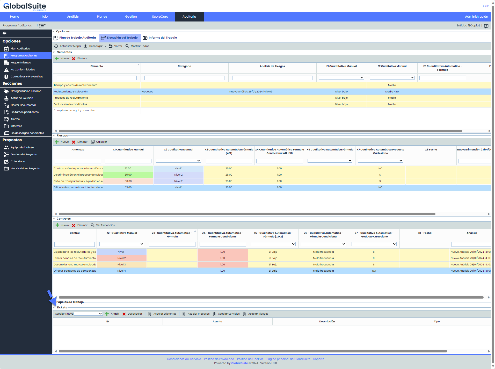
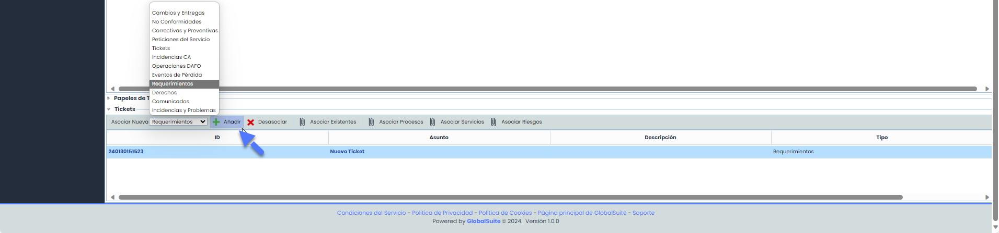
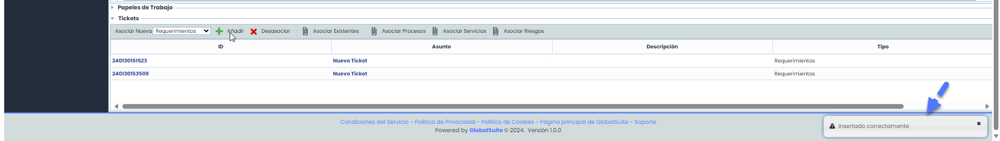
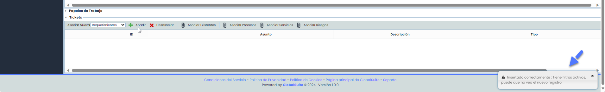
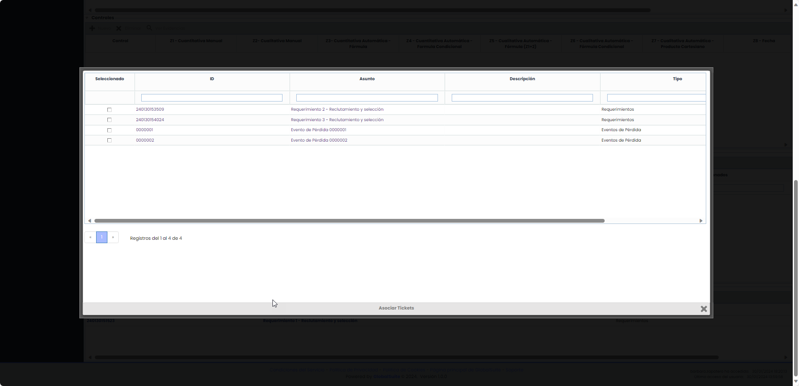
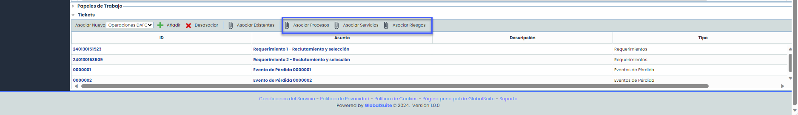
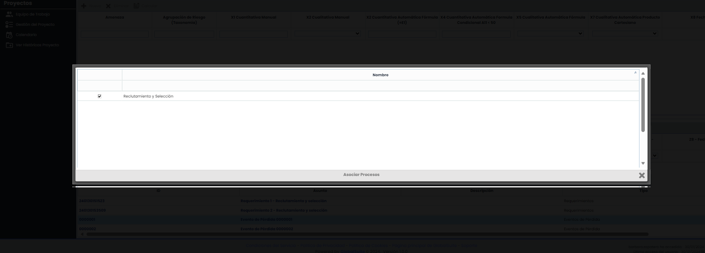
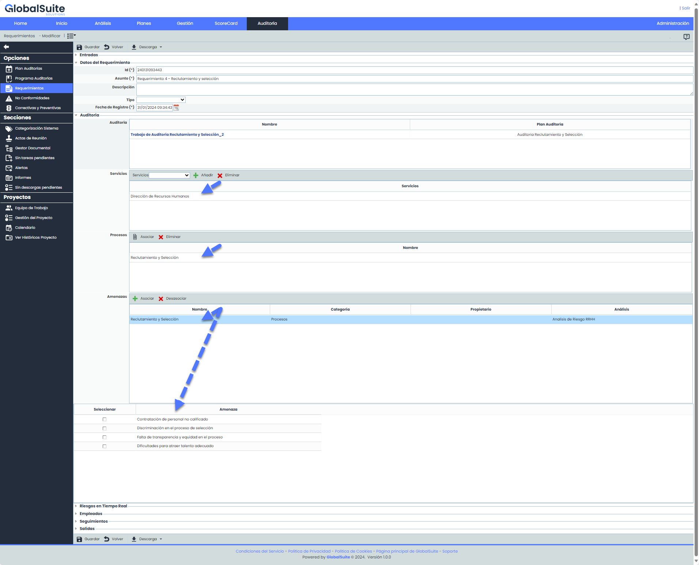
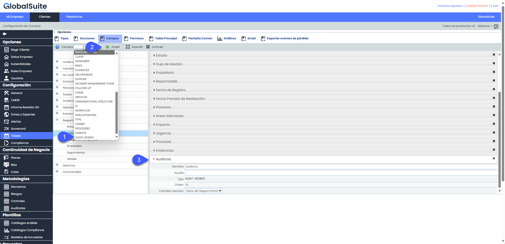
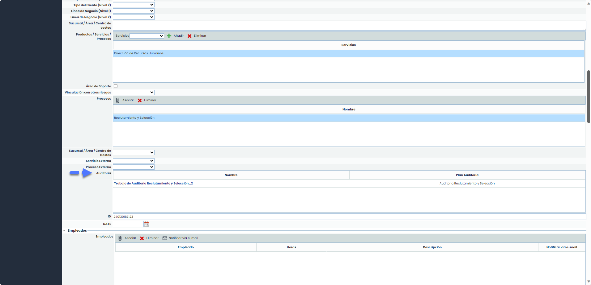

# ¿Cómo vincular Auditorias con Tickets?


En esta guía, se explicarán las diversas formas de configuraciones y asociaciones entre un trabajo de auditoría y un ticket, como por ejemplo, una No Conformidad o un Requerimiento, derivados de ese trabajo.


Debe dirigirse al Módulo de auditorías y abrir un Programa de auditoría en estado "En Ejecución"

Se podrá seleccionar un ticket existente o crear uno nuevo.

* En caso de crear uno nuevo, dentro del selector "Asociar Nuevo" se debe seleccionar el tipo de ticket que se desea crear y presionar Añadir

Al presionar Añadir, se mostrará el siguiente mensaje:


Nota: Puede suceder que, si hay Elementos/Riesgos/Controles seleccionado, el mensaje luego de crear un ticket sea:


Este mensaje sale porque hay controles, riesgos o elementos seleccionados, para que se vea el ticket creado, debe ir a la barra superior del trabajo y seleccionar “Mostrar Todos”.

* Si se desea asociar tickets existentes a un trabajo de auditorías, se debe hacer clic en "Asociar existentes”

Se abrirá una ventana emergente donde se listan los tickets que no hayan sido añadidos a la Auditoria.

## Asociar Servicios, Procesos o controles a un ticket dentro de una Auditoria

Otra funcionalidad que hay a la hora de vincular un ticket con una auditoria es que se le puede asociar un Servicio, Proceso o riesgo.

Se debe asegurar que los campos estén configurados correctamente:

* Para asociar un Servicio al ticket debe tener el campo SERVICES
* Para asociar un Proceso al ticket debe tener el campo PROCESSES
* Para asociar un Riesgo al ticket debe tener el campo THREATS

Una vez que se hayan configurado estas opciones, la asociación se lleva a cabo, seleccionando el ticket y eligiendo la opción deseada:

Al seleccionar cualquiera de las tres opciones, se mostrarán dentro de una ventana emergente los servicios/procesos/riesgos que formen parte del trabajo de auditoría

Al ingresar al ticket se verán en los campos correspondientes, los Servicios, procesos y/o Riesgos asociados desde la auditoria.

## Consultar los trabajos de Auditorias asociados a un Ticket


El vínculo de Ticket – Auditoria, siempre se realiza desde la Auditoria. Allí se puede ver todos los tickets asociados a ella. Pero existe la posibilidad de ver qué auditorias tiene asociado un ticket, para ello se deben seguir los siguientes pasos.


1. Se debe configurar el tipo de campo llamado AUDIT-WORK en el ticket

Como cualquier campo de un ticket, se puede configurar el nombre, la sección y el orden donde se ubicará.

Este tipo de campo solo podrá incluirse una única vez por ticket y como cualquier otro campo se podrá configurar para que sea visible tanto en la tabla principal del ticket como en la Pantalla Común.

Si quieres más información sobre configuración de ambas opciones lo puedes encontrar en el manual: [Configuración de tabla principal](https://help.globalsuitesolutions.com/es/globalsuite/v1/tabla-principal) y [Configuración de Pantalla común](https://help.globalsuitesolutions.com/es/globalsuite/v1/pantalla-comun)

2.  Una vez realizada esta configuración, ya podrás ver desde un ticket las auditorias que lo tienen asociado.

    

Como se ve en la imagen anterior, configurar el campo AUDIT-WORK implica que en el ticket se incluya una tabla en donde se muestra:

* Nombre del Trabajo/programa de Auditoria. Los datos en esta columna aparecerán con un enlace para facilitar el acceso al trabajo.
* Plan de auditoría.
