# ¿Cómo configurar el sistema de continuidad en GlobalSuite®?


Este tutorial explica, paso a paso, cómo realizar la \*\*configuración inicial del Sistema de Continuidad\*\* en GlobalSuite®, alineada con los requisitos de la norma \*\*ISO 22301\*\*. En esta guía se detallan las fases para definir el \*\*alcance del sistema\*\*, establecer la \*\*estructura organizativa\*\*, e identificar los \*\*roles y responsabilidades\*\* dentro del sistema de gestión. Además, se describe cómo seleccionar los \*\*servicios y procesos de negocio\*\* que formarán parte del Sistema de Continuidad, asociar empleados y competencias a cada rol, y preparar la estructura necesaria para desarrollar los \*\*planes de continuidad, recuperación y gestión de crisis\*\* dentro de la plataforma


## Fases para la configuración inicial del Sistema de Continuidad

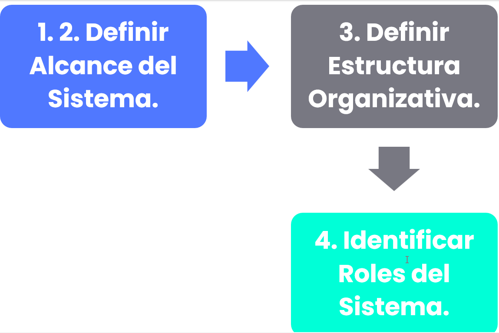

## Introducción

La licencia de GlobalSuite® Bussines Continuity permite tener en cuenta aspectos de la norma ISO 22301 de sistemas de gestión de continuidad de negocio. Con esto podremos realizar una comparativa que permite determinar el estado frente a la norma y definir planes de acción que permitan cerrar la brecha .

A lo largo del módulo se podrán definir opciones como: la de compliance, que permite definir el estado en el que se encuentra una empresa respecto a una o varias normativas, los escenarios de desastre y los escenarios de crisis, plan de continuidad , BIAS Y PRE BIAS, planes de gestión de crisis , plan de recuperación y el programa de pruebas .

## Servicios y Procesos de Negocio

Ver guía: **¿Cómo definir y gestionar servicios y procesos en GlobalSuite®?**

## Alcance del Sistema de Continuidad

La definición del alcance del Sistema de Continuidad se realiza en la opción I**nicio > Opciones >** [**Alcance**](https://help.globalsuitesolutions.com/es/globalsuite/v1/alcance)

Esta opción permite establecer de manera formal el alcance de nuestro Sistema de Continuidad, seleccionando los servicios que vamos a incluir dentro del mismo.

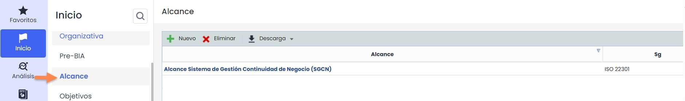

Al acceder en la opción Alcance se muestran todos los alcances definidos en la entidad.

La generación de un nuevo alcance se realiza pulsando sobre el botón “**Nuevo**”. Para registrar la información correspondiente al alcance hay que pulsar sobre el enlace existente en el propio nombre del alcance. En este momento, se muestra un formulario que permite definir toda la información correspondiente.

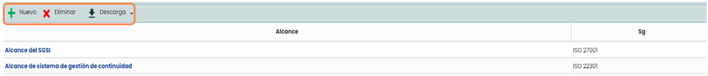

De la misma forma, es posible eliminar alcances definidos previamente o descargar el listado de los mismos en esta pantalla principal.\
El formulario del alcance permite definir toda la información relacionada con el alcance de Continuidad de Negocio.

En la sección denominada “**SG**” es necesario seleccionar, como mínimo, la opción “**ISO22301**” como Sistema de Gestión. Esto es importante para configurar la plataforma convenientemente, ya que el formulario del alcance se actualiza para permitir una definición concreta del Sistema de continuidad (ver siguiente paso).

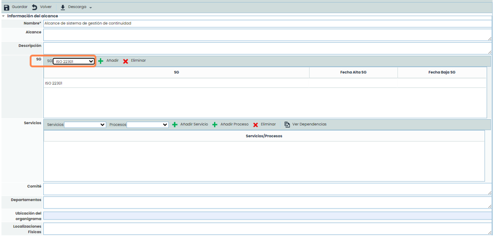

En la parte inferior del formulario del alcance aparece el árbol de servicios y procesos configurado en la entidad. GlobalSuite® permite seleccionar qué servicios son los que se incluyen dentro del Sistema de Continuidad, respecto al listado total de servicios. Esto es importante porque GlobalSuite® sólo tomará los servicios y procesos asociados que se encuentren seleccionados en el alcance.

Para seleccionar los servicios dentro del alcance, se tendrá que elegir en Opción de Tratamiento : Continuidad de Negocio.

De esta forma, automáticamente todos los procesos que se encuentren asociados al servicio podrán ser utilizados para, por ejemplo, el Análisis de Impacto en el Negocio (BIA) o los Planes de Recuperación.

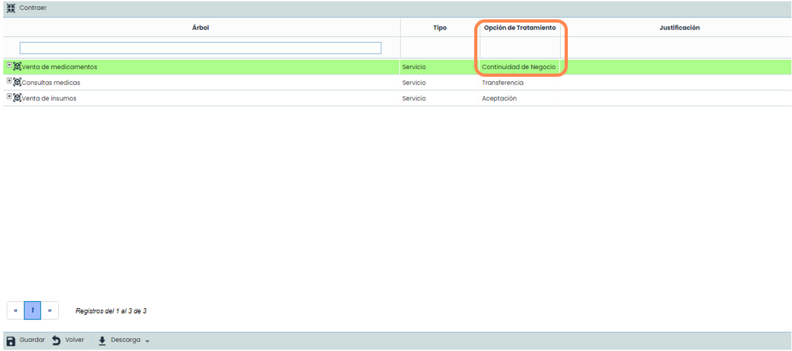

## Estructura Organizativa

Para acceder en la opción Estructura Organizativa se tiene que dirigir a **Inicio > Opciones >** [**Estructura Organizativa**](https://help.globalsuitesolutions.com/es/globalsuite/v1/estructura-organizativa)\
Aquí, GlobalSuite® permite definir la estructura organizativa de una empresa.

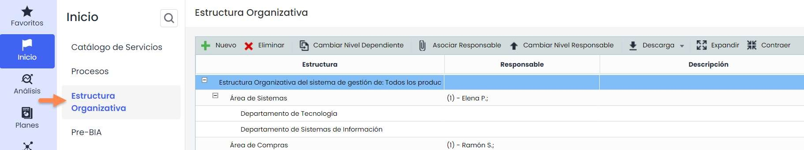

Para poder configurar correctamente esta jerarquía, es necesario previamente definir los niveles de la estructura organizativa de la empresa. Para ello, hay que dirigirse a la opción de **Ajustes > Configuración >** [**General**](https://help.globalsuitesolutions.com/es/globalsuite/v1/configuracion-general)y configurar los niveles deseados.

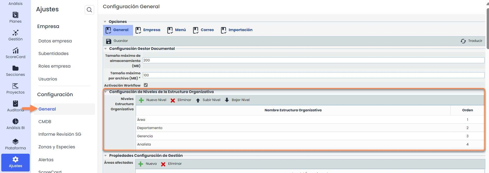

Una vez definidos los niveles, la opción de Estructura Organizativa permite realizar las siguientes acciones:

* **Nuevo**: Añadir nueva unidad de negocio. Se debe seleccionar la unidad de negocio dependiente de la nueva opción y pulsar el botón “**Nuevo**”.
* **Eliminar**: Se debe seleccionar en la tabla la unidad de negocio que se desea eliminar. Las unidades de negocio dependientes de esta también serán eliminadas.
* **Cambiar dependiente**: Permite cambiar una unidad de negocio (y sus unidades dependientes) a otra unidad de negocio distinta.
* **Asociar Responsable**: Permite definir un empleado del Sistema de Gestión. Se debe seleccionar la unidad de negocio y pulsar el botón. Saldrán todos los empleados definidos en GlobalSuite®.
* **Cambiar Nivel Responsable**: Permite subir o bajar a un empleado como principal responsable de la unidad de negocio.
* **Descargar**: Permite la descarga en Excel y PDF de la estructura organizativa.
* **Expandir** : Permite ampliar todos los niveles de la estructura para observar todas sus dependencias.
* **Contraer**: Permite minimizar todos los niveles de la estructura para solo observar el primer nivel de su jerarquía.

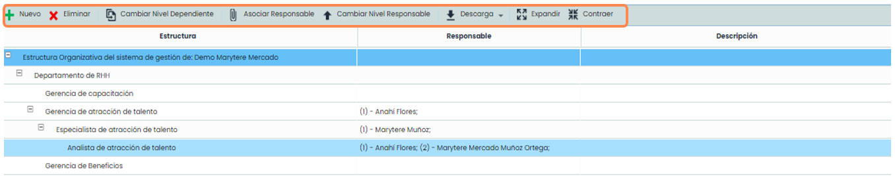

## Roles y Responsabilidades

Para acceder a la opción se tendrá que dirigir a **Inicio >** [**Gestión de roles**](https://help.globalsuitesolutions.com/es/globalsuite/v1/gestion-de-roles). Una vez dentro GlobalSuite® permite asociar los diferentes empleados que forman parte de la entidad a los diferentes roles del Sistema de continuidad.

De manera adicional, permite asociar las competencias requeridas para cada uno de los roles definidos de la entidad, pudiendo llevar a cabo la asociación de dichas competencias a diferentes roles de forma simultánea.

Por último, también permite definir las funciones y obligaciones a desarrollar por cada uno de los roles, también pudiendo ser asociados a varios perfiles de forma simultánea.

Mediante esta metodología establecida por parte de GlobalSuite®, la plataforma permite describir los diferentes perfiles de puesto de trabajo, asociando a estos los empleados que lo desempeñan, las competencias necesarias para cada rol y todas las funciones y obligaciones relacionadas.

Los roles que aparecen en la pestaña Roles y Empleados son configurables a través del botón Configurar Roles.

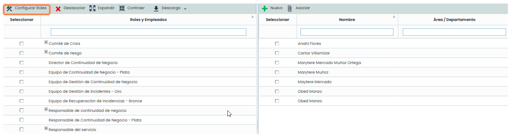

Al pulsar sobre el botón se abre una pestaña nueva del navegador correspondiente a la zona de **Ajustes > Configuración >** [**General**](https://help.globalsuitesolutions.com/es/globalsuite/v1/configuracion-general)**.** Concretamente, en el apartado de **Configuración de Roles y Responsabilidades** se encuentra el listado de roles pudiéndose crear, eliminar y modificar los roles existentes a través de las opciones marcadas.

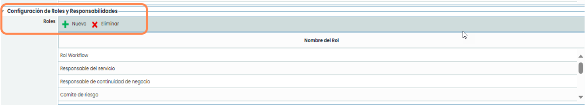

El listado de empleados que aparece en la tabla de la derecha corresponde a los empleados registrados en **Gestión >** [**Empleados**](https://help.globalsuitesolutions.com/es/globalsuite/v1/empleados)

Para establecer las relaciones entre los roles y los empleados, bastaría con pulsar dentro de la casilla seleccionar en la tabla de empleados, es decir, desde la tabla de la derecha, y posteriormente el de la casilla seleccionar ubicado en la tabla de la izquierda al rol al que pertenecerá. Una vez realizado el check dentro de ambas casillas se deberá pulsar el botón asociar, de esta forma la pantalla se refrescará automáticamente y el nombre del empleado aparecerá en un nivel inferior al del rol establecido en la entidad.

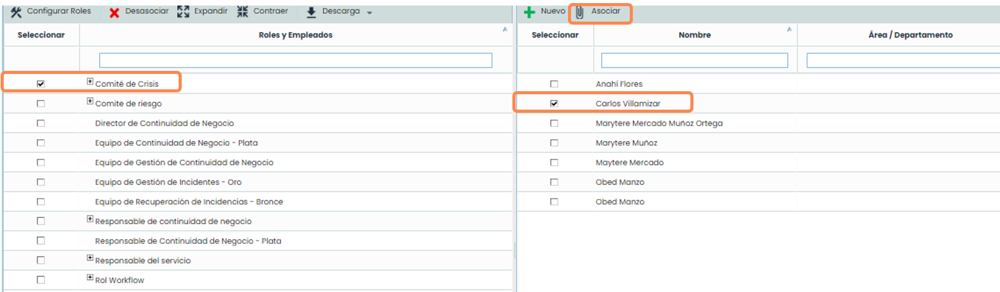

Una vez relacionados los empleados a los roles de la entidad, el siguiente paso consiste en la definición y vinculación de las competencias que están asociadas a cada rol. Esto se realiza en **Inicio > Competencias y funciones >** [**Roles y Competencias**](https://help.globalsuitesolutions.com/es/globalsuite/v1/competencias-y-funciones)**.**

Para realizar la definición de competencias es necesario pulsar el botón “**Nuevo**”, generando una nueva línea en el listado de competencias, la cual se puede editar. GlobalSuite® permite definir tantas competencias como se considere necesario.

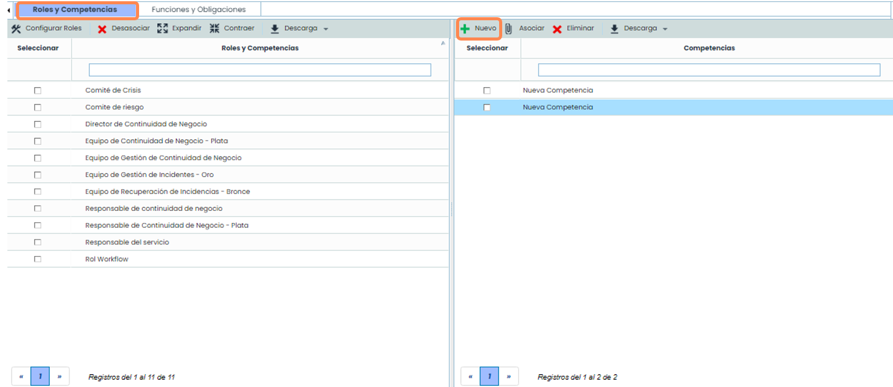

Una vez definido el listado de competencias necesarias para los roles de la entidad, la vinculación de competencias y roles se lleva a cabo a través del mismo mecanismo utilizado para realizar las relaciones entre empleados y roles anteriormente visto.

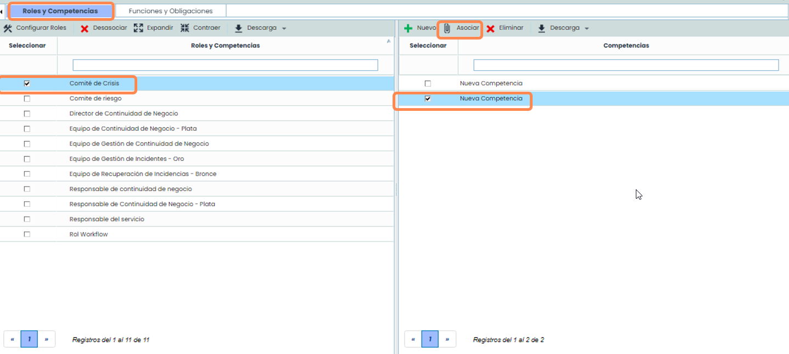

Una vez definido el listado de funciones y obligaciones necesario para los roles de la entidad, esto se lleva a cabo en **Inicio > Competencias y funciones >** [**Funciones y Obligaciones**](https://help.globalsuitesolutions.com/es/globalsuite/v1/competencias-y-funciones#CompetenciasyFunciones-FuncionesyObligaciones).

La vinculación de funciones y roles se lleva a cabo a través del mismo mecanismo explicado anteriormente. Por tanto, es necesario marcar un chek en la función a seleccionar de la tabla derecha, así como seleccionar con un check al rol que corresponda de la tabla izquierda para posteriormente presionar el botón asociar y de esta forma serán vinculados.

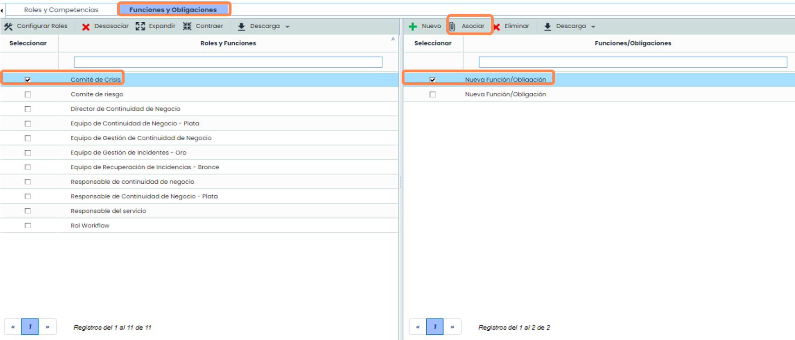
