# ¿Cómo configurar planes de recuperación en GlobalSuite®?


Este tutorial explica, paso a paso, cómo crear y configurar los \*\*planes de recuperación\*\* en GlobalSuite®, dentro del módulo de \*\*Continuidad de Negocio\*\*. En esta guía se detalla el proceso para definir \*\*secuencias de recuperación públicas y privadas\*\*, crear y configurar las \*\*tareas y subtareas\*\* asociadas, establecer \*\*dependencias y responsables\*\*, y asociar las secuencias a los \*\*planes de continuidad\*\*. Además, se explica cómo definir los \*\*criterios de activación\*\*, configurar los \*\*informes de planes de recuperación\*\*, personalizar las \*\*secciones del documento\*\*, y generar \*\*vistas previas o plantillas reutilizables\*\* para otros planes de la organización. Las imágenes y ejemplos del documento muestran cómo organizar jerárquicamente las tareas y generar informes dinámicos con formato personalizado


## Fases para la configuración inicial del Sistema de Continuidad

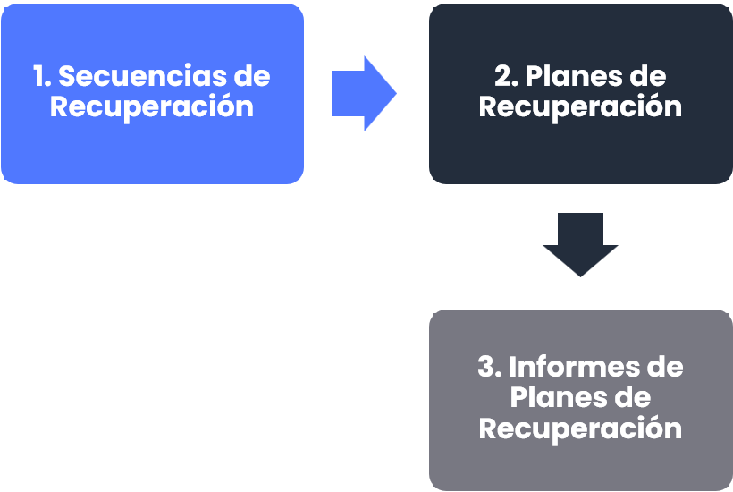

### 1. Introducción

La definición de los planes de recuperación se realiza en **Planes >** [**Planes de Recuperación**](https://help.globalsuitesolutions.com/es/globalsuite/v1/planes-de-recuperacion). Esta opción permitirá definir formalmente los distintos planes de recuperación que podrán estar asociados a los planes de continuidad del sistema de gestión.

Los planes de recuperación estarán formados por Secuencias de Recuperación. Una Secuencia de Recuperación es un conjunto de tareas que determinan la realización de una acción. Existen dos tipos de Secuencias:

* **Públicas**: Secuencias que se pueden compartir y reutilizar en más de un plan de recuperación. Se definen una vez y se pueden usar en todos los planes.
* **Privadas**: Secuencias que solo se utilizaran en un plan y no son visibles para su reutilización en varios planes.

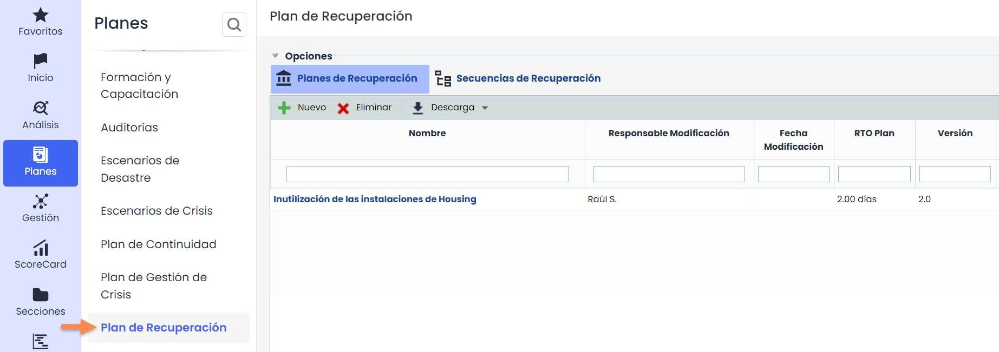

## 2. Secuencias de Recuperación – Públicas

En esta opción se definirán las secuencias de recuperación públicas. Posteriormente veremos las secuencias de recuperación privadas.

Estas secuencias públicas se definirán una vez y podrán utilizarse en todos los planes de recuperación. Sirven como un conjunto de tareas que se pueden repetir en los distintos planes de la organización.

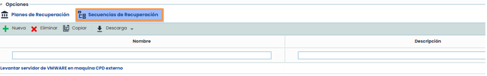

### Paso 1: Creación de tareas

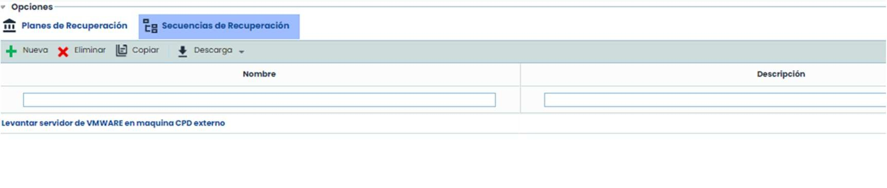

Dentro de una secuencia se especificará la descripción de la secuencia, las tareas a realizar, los responsables de las tareas y los plazos de estas tareas. Estas tareas se podrán configurar como un árbol con profundidad ilimitada, es decir, cada tarea podrá tener subtareas. Las tareas tendrán un nombre, un tipo, responsables, plazo, momento inicio y momento fin.

Para crear una nueva tarea principal, se deberá pulsar el botón “**Nuevo**”, con esto la tarea se creará con todos los atributos por defecto. Las tareas se ordenarán según su **Momento de inicio**.

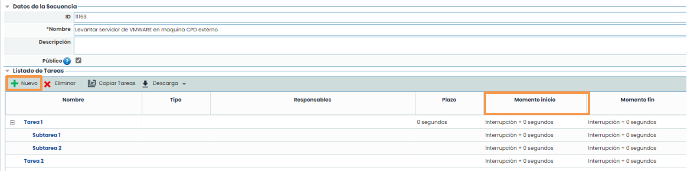

### Paso 2: Configuración Tarea.

Seleccionando en el link del nombre de la tarea, podremos definir los atributos de la misma (nombre, descripción, plazo y tipo).

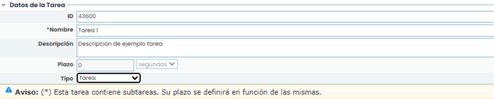

Además de los datos de la tarea existen otros atributos que se definirán en este formulario (responsables, tareas anteriores y posteriores, documentación, subtareas, etc.)

Para definir los responsables, se podrán elegir tres niveles de responsables. El responsable que este en el nivel 1 será el principal y los demás serán alternativos. Además, se puede elegir un rol o un empleado, si se elige un rol, los responsables serán todos los empleados de ese rol.

Para insertar un responsable, se deberá seleccionar un nivel en la tabla, posteriormente se cargará un listado con los roles existentes en el desplegable llamado **Roles** ahí se deberá seleccionar un rol y pulsar **Añadir**. Después, se deberá seleccionar el rol añadido en el nivel deseado y el desplegable llamado **Empleados** ahora se cargará con los empleados relacionados con a ese rol.

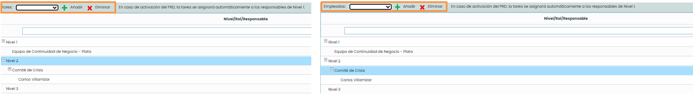

Además de definir los responsables, dentro de la tarea se podrá subir documentación que evidencie esta tarea, a su vez se podrán definir tareas anteriores o posteriores, así como sus subtareas. Las tareas anteriores y posteriores marcarán la precedencia de las tareas a realizar, por lo que el plazo de cada tarea se calculará en función de esta precedencia.

Para subir documentación, se deberá pulsar en el botón “**adjuntar**”, en el cual se abrirá una ventana para elegir el archivo

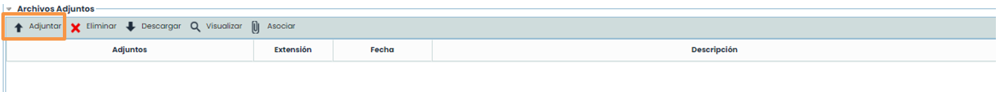

### Paso 3: Asociaciones de Tareas.

Este paso es muy importante para que el plan quede perfectamente configurado ya que definirá la estructura del plan con las dependencias entre tareas y calculará el momento de inicio y de fin de cada tarea, y así, se irá formando un camino de acciones a realizar marcando el flujo de las tareas del plan de recuperación.

Para realizarlo se debe pulsar sobre el botón “**Asociar**" en cualquiera de las tablas, se abrirá una ventana emergente con las tareas disponibles para asociar.

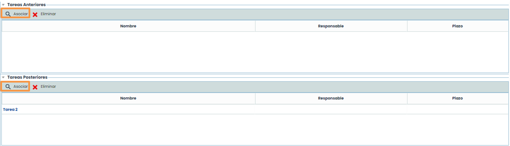


Nota: El sistema controla aquellas tareas que puedan provocar ciclos y no permite asociarlas.


### Paso 4: Creación de Subtareas.

Para crear las subtareas, se debe pulsar el botón “**Nuevo**”, las tareas se crearán con los atributos por defecto.

Para cambiar estos atributos se deberá pulsar en el link y se accederá al formulario de la subtarea creada. Este formulario será igual que el de la tarea padre/madre, por lo que se podrá asociar los mismos atributos que se han explicado anteriormente. A su vez también podrá crear subtareas de esta tarea.

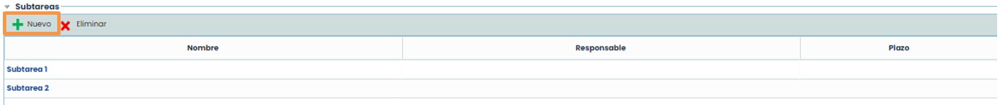

Una vez que se han creado subtareas, no se podrá cambiar el plazo de la tarea padre/madre. Dicho plazo se calculará en función del plazo de las subtareas.

### Paso 5: Resultado

Una vez definidas las tareas anteriores y posteriores, las subtareas y los plazos de todas ellas, el sistema irá calculando las dependencias de tiempo y queda como resultado un árbol de tareas ordenadas según su tiempo de ejecución.

De esta forma se podrá observar claramente cuáles son los pasos a seguir en el plan.

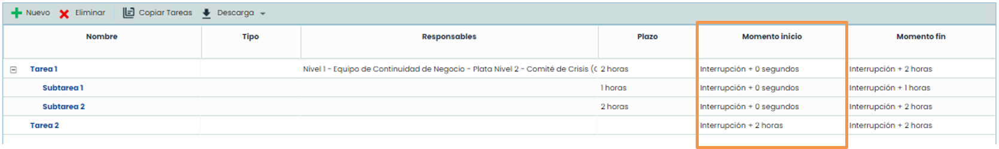

## 3. Planes de Recuperación

Una vez definidas las secuencias públicas (se pueden compartir entre los distintos planes).

En la opción de [Planes de Recuperación](https://help.globalsuitesolutions.com/es/globalsuite/v1/planes-de-recuperacion) saldrá el listado de los distintos planes de nuestro sistema de gestión. Pulsando en el nombre, la aplicación cargará el formulario especifico del plan.

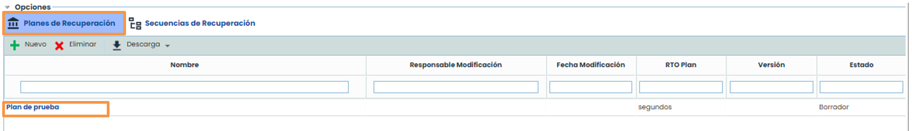

### Paso 1: Configuración general

Dentro del formulario habrá tres submenús: **Vista Previa** (se puede observar la creación del informe), **Información general** (formulario para la definición del plan) y **Secciones** (opción donde se genera el informe).

En la opción de **Información General** se definirán los datos generales del plan, para guardarlos, se debe completar los datos y pulsar el botón “**Guardar**”.

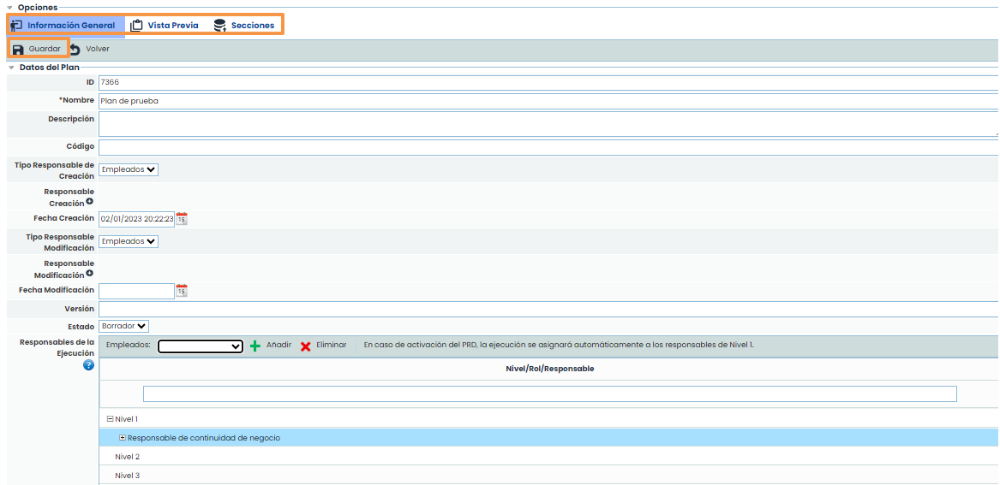

### Paso 2 : Asociación

Una vez configurados los datos generales del plan, se podrán asociar los planes de continuidad a los que hace referencia este plan de recuperación. Además, se puede definir los escenarios de desastre y los procesos de la organización que el plan intentará recuperar.

* **Planes de Continuidad:** En el listado saldrán los planes definidos en la opción de Planes de Continuidad. Elija uno y pulse Añadir para incluirlo.
* **Escenarios**: Se podrá elegir los escenarios asociados a los planes de continuidad. Seleccionar del listado y pulsar Añadir.
* **Procesos de Negocio**: Seleccione del desplegable el servicio para filtrar los procesos dependientes del servicio. Elija el proceso y pulse Añadir. Los procesos que se pueden elegir son los asociados a los escenarios.

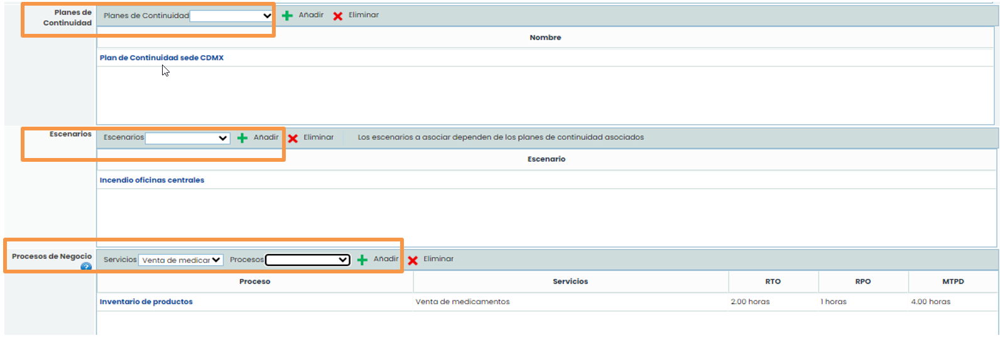

### Paso 3 : Configuración Responsables

Se insertarán empleados y roles para identificar una secuencia de inicio en caso de activación del plan de recuperación. Para añadir un nuevo nivel de llamadas se debe pulsar “**Añadir**”, se podrá elegir el rol y posteriormente al pulsar sobre el nivel creado se podrá pulsar en **Empleado** y así sucesivamente hasta llegar al nivel deseado.

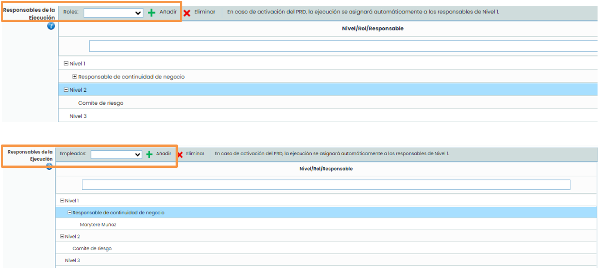

### Paso 4 : Criterios de activación

También se podrán elegir los criterios de activación del plan, a través del apartado llamado **Criterios de activación** se podrán adjuntar los criterios necesarios con el botón “**Adjuntar**” y asociarlos a través del botón “**Asociar**”. De igual manera se podrán adjuntar documentos que se consideren necesarios en el apartado llamado **Adjuntos** con el botón “**Adjuntar**” y asociarlos a través del botón “**Asociar**”.

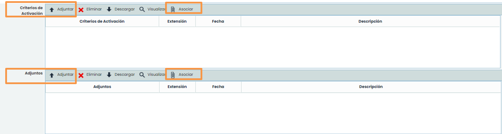

### Paso 5 : Selección de secuencias

En la opción de Secuencias, podrá elegir las secuencias públicas que forman el plan o las secuencias privadas que se crearán específicamente para este plan. Si se pulsa el botón “**Nuevo**”, se creará una secuencia privada para poder añadir las tareas del plan, si elige la secuencia del desplegable, automáticamente se asociará la secuencia al plan.

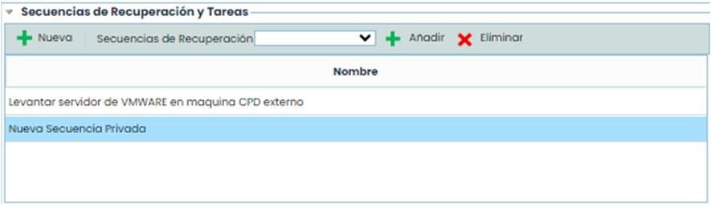

Después de elegir las secuencias, se podrá asociar las dependencias entre ellas, en la tabla de abajo se podrá seleccionar que secuencias son las anteriores a la elegida. Pulsando en la secuencia, se deberá marcar la tarea que va a permitir empezar con la siguiente secuencia.

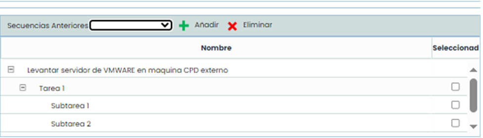

### Paso 6: Definición del formato del Informe

Por último, dentro del plan se podrá configurar el formato general del informe. El tipo de fuente y el tamaño, además también se podrá configurar los elementos estáticos de información general del plan de recuperación. Con el botón “**Incluir Campos**” se podrá añadir y eliminar los elementos generales del plan.

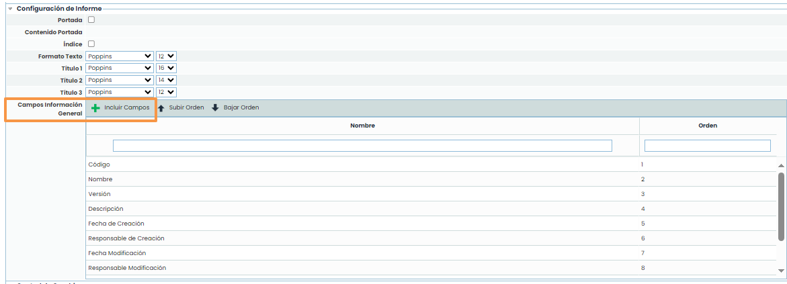

## Secuencias de recuperación – privadas

Para generar secuencias privadas, defínalas en el plan mediante el botón “**Nueva**”, en lugar de seleccionar una del desplegable **Secuencias de recuperación**. Al igual que con las secuencias públicas, podrá crear secuencias privadas desmarcando el check “**Pública**”, siempre que la secuencia esté asignada previamente a un plan de recuperación específico.

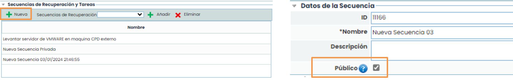

## Informe del plan de recuperación

Una vez definidos los datos se procederá a crear el informe relacionado.

En la opción **Secciones**, se definirán las secciones que tendrá el documento. En cada sección se podrán añadir todos los elementos que se necesiten.

En la opción **Vista previa**, se podrá observar el informe que se haya creado.

En la opción **Información**, se encontrará un formulario para la definición del plan.

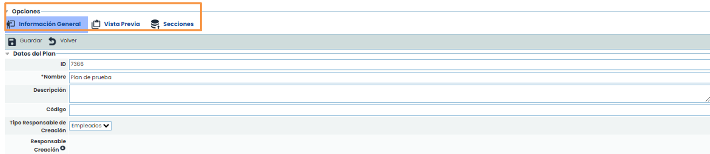

### Paso 1 : Configuración de secciones

Para crear secciones se debe pulsar “**Nuevo**” y para modificar la sección seleccionar la sección de la tabla y pulsar sobre el botón “**Editar Sección**”, si se hace doble click en el nombre se podrá modificar el nombre de la sección. También se podrá ordenar las secciones para que se vean ordenadas en el informe con los botones “**Subir**” y “**Bajar**”. Por último, también se podrá asociar permisos para que elegir los usuarios que la puedan editar.

Pulsando el botón “**Editar Sección**”, se pueden elegir los elementos que contendrá la sección. En el desplegable de elementos se podrán ir añadiendo todos los necesarios para dar formato y añadir contenido al informe, de tal forma que, el resultado del informe será la suma de las distintas secciones y dentro de la sección la suma de los elementos.

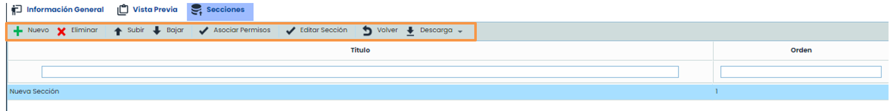

Los elementos que se puede añadir son:

* **Texto**: Podrá añadir cuadros de texto para escribir datos adicionales a la información del plan
* **Orientación de página**: Podrá cambiar la orientación de página de los documentos (horizontal o vertical)
* **Salto de página:** Añadirá un salto de página, el siguiente elemento empezará en una nueva página de esta forma se le irá aplicando un formato al documento.
* **Gráfica**: Podrá añadir cualquier gráfica de las existentes en toda la aplicación.
* **Tabla**: Podrá elegir cualquier tipo de información de la aplicación y en concreto del plan de recuperación. En el seleccionable **Seleccione una tabla**, tendrá que elegir la tabla deseada, posteriormente, en el seleccionable de la derecha, tendrá que elegir las columnas deseadas y el orden que se necesite. Seleccionando el nombre de la columna se irán incluyendo. Con la tabla, las columnas y el orden el informe queda 100% configurable.

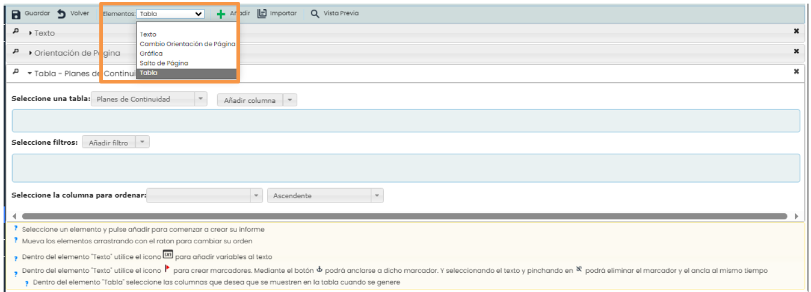

### Paso 2 : Vista previa

Por último, en el menú **Vista Previa** se podrá ver el resultado global del informe y un botón para descargar dicho informe.

Además, se podrá copiar la estructura de este informe a todos los planes de recuperación que lo necesiten, de esta forma solo es necesario crear la plantilla una vez y copiar dicha plantilla a los planes de la organización.

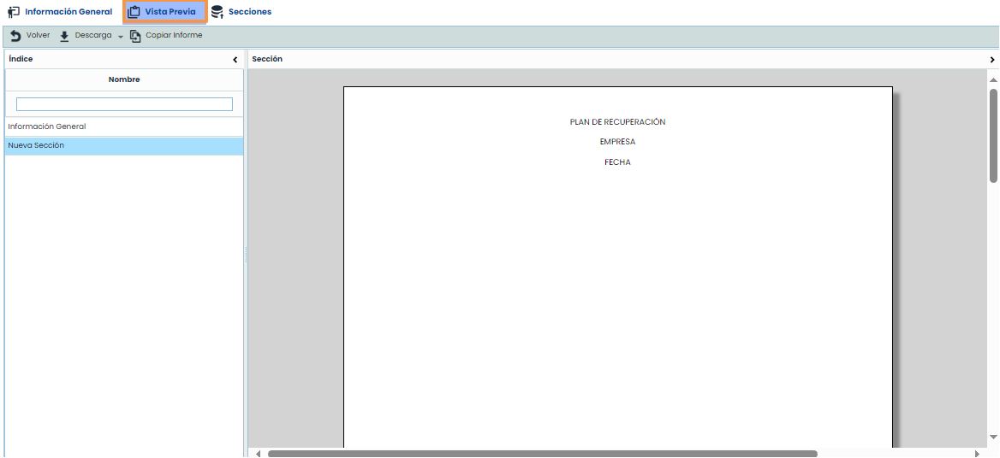
