# ¿Cómo configurar y ejecutar el Programa de Pruebas en GlobalSuite®?


Este tutorial explica, paso a paso, cómo crear, planificar y ejecutar un \*\*Programa de Pruebas\*\* en GlobalSuite®, dentro del módulo de \*\*Continuidad de Negocio\*\*. Una vez definidos los BIAS y los Planes de recuperación (DRP), se encuentra la opción de “Programa de Pruebas”, la cual permite realizar una simulación de los planes de recuperación, pero no tiene que ser necesariamente del plan entero, sino que puede ser también de secuencias sueltas, para, de esta manera, cerciorarse que esas secuencias están bien definidas. Es decir, no se trata de un simulacro de un plan de recuperación, sino de poder realizar pruebas a las diferentes secuencias para verificar su correcto funcionamiento. Se puede planificar una prueba a lo largo del tiempo, es decir, a lo largo del año, del trimestre, del semestre, y así sucesivamente. Para acceder a esta opción hay que acceder a \*\*Planes >\*\* [\*\*Programa de Pruebas.\*\*](https://help.globalsuitesolutions.com/es/globalsuite/v1/programa-de-pruebas)


## Fases para la configuración del programa de pruebas

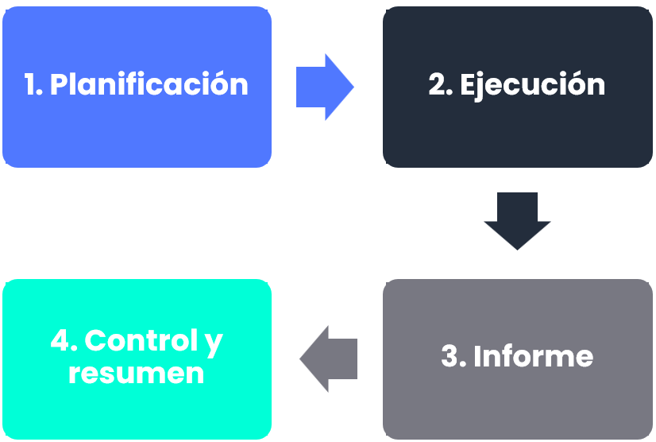

## Planificación

Al entrar en esta opción de “[**Programa de Pruebas**](https://help.globalsuitesolutions.com/es/globalsuite/v1/programa-de-pruebas)”, aparece tanto la gráfica, que es una línea anual donde se va a poder ir definiendo las diferentes planificaciones, como el listado de las pruebas realizadas.

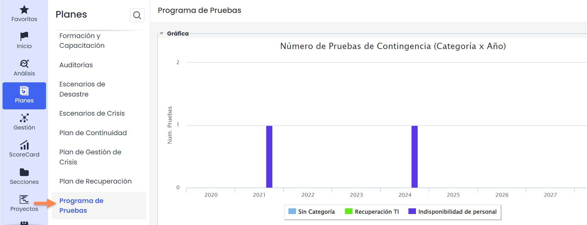

En la parte inferior de la gráfica se puede ver que, en este ejemplo ya hay algunas categorías definidas. Estas categorías se definen en **Ajustes > Continuidad >** [**Planes**](https://help.globalsuitesolutions.com/es/globalsuite/v1/configuracion-planes) **> Categorías de prueba de continuidad**

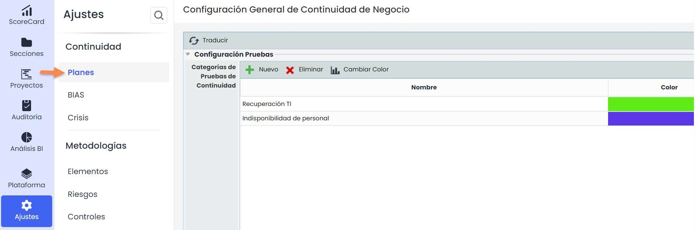

En esta opción se podrán crear diferentes categorías y asociarles un color. Este color será el que aparezca en la gráfica de la pantalla principal del “Programa de Pruebas”.

Una vez se tienen las categorías definidas, se vuelve a **Planes >** [**Programa de Pruebas**](https://help.globalsuitesolutions.com/es/globalsuite/v1/programa-de-pruebas)**.**

Para crear un programa de pruebas nuevo, se pulsa el botón “**Nuevo**”, y se crea un link azul, el cual abre un formulario a rellenar.

Al acceder a la prueba, hay tres submenús:

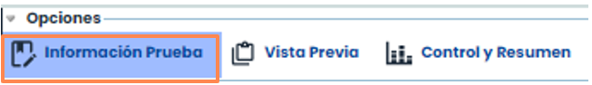

Para planificar y ejecutar el programa de pruebas se hará desde la primera pestaña “Información Prueba” (la opción por defecto).

Al entrar al formulario la primera sección que se observa es la siguiente:

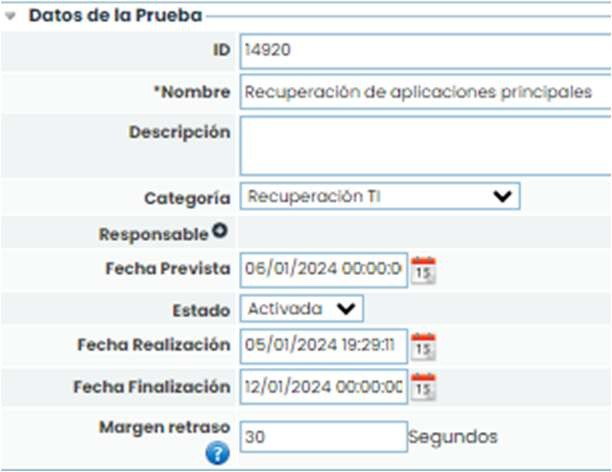

En dicho formulario se define el nombre de esta prueba y se puede poner la descripción de la misma. Además de ello se define la categoría a la que corresponde, y un responsable de esta prueba. También se define una fecha prevista de ejecución de la prueba, y el estado en el que se encuentra.

Este estado cambiará automáticamente cuando se produzca la activación de la prueba.

Adicionalmente, se define el margen de retraso, es decir, el tiempo que se deja de margen o demora entre cada una de las tareas para iniciarse.

Adicionalmente, se tiene el campo Proceso de Negocio, el cual permite asociar procesos dentro del ciclo de pruebas.

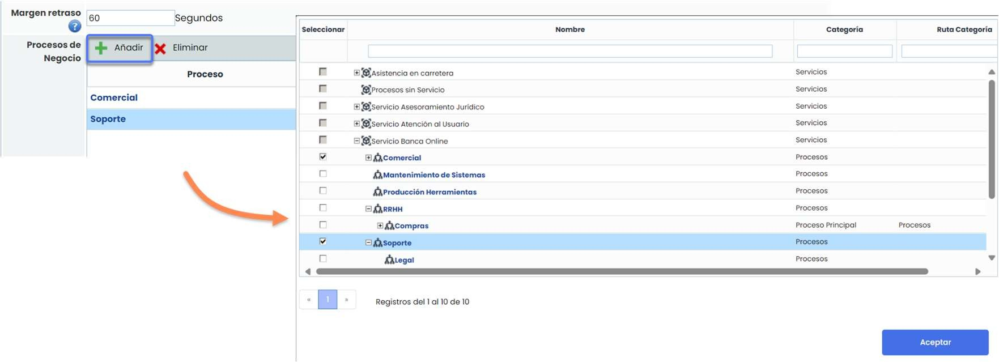

Una vez definida la primera parte del formulario, se pasa a seleccionar el plan de recuperación sobre el que se va a realizar las pruebas. Se puede seleccionar más de un plan a la vez. Para seleccionarlos hay que pinchar en el desplegable de **“Planes de Recuperación**”, seleccionar el/los planes que se quieran, y pulsar “**Añadir**”.

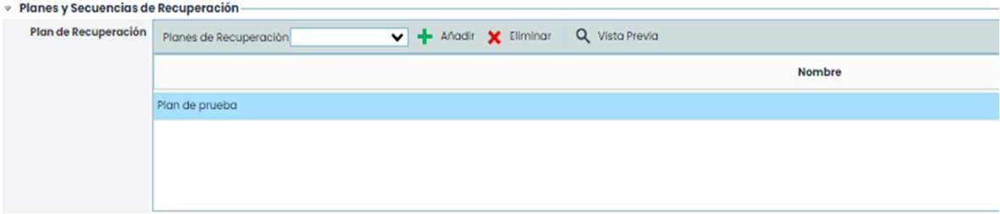

Al seleccionar el/los planes de recuperación aparecerán las secuencias de este con sus diferentes tareas, tal y como se ha configurado anteriormente en la opción de “**Planes de Recuperación**”. Para ver estas secuencias hay que pulsar sobre el Plan sobre el que se quieren ver las secuencias.

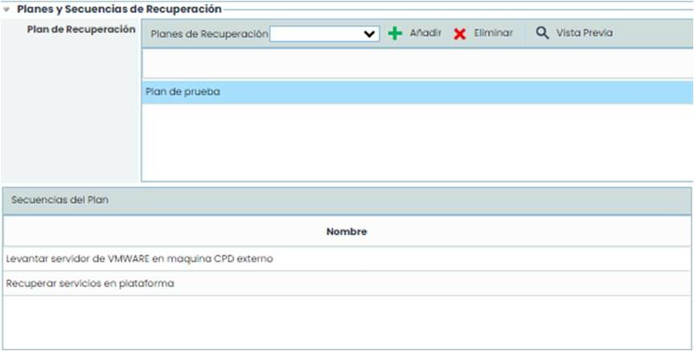

Al pulsar sobre cada secuencia del plan, en el cuadro de la derecha, en el desplegable de “**Secuencias Anteriores**” se podrá seleccionar las secuencias que son anteriores a esta secuencia seleccionada.

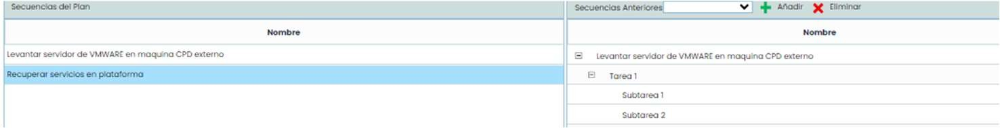

Dentro del cuadro “**Secuencias Anteriores**” también se podrá seleccionar la tarea o secuencia entera tras la que se tiene que realizar la secuencia seleccionada en la opción de la izquierda.

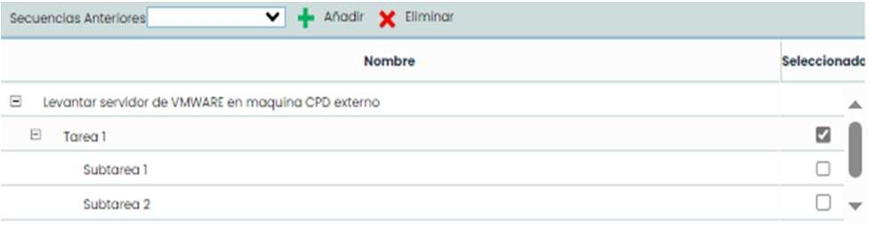

Cuando ya se ha seleccionado el plan de recuperación, se tienen que seleccionar las secuencias sobre las que se quiere realizar la prueba. Esta prueba se puede realizar sobre todo el plan (todas las secuencias y tareas), o solamente sobre algunas de ellas, es decir, no tiene que probarse el plan entero.

Esto se selecciona en el formulario, en la siguiente opción que es el “**Árbol de tareas**”.

En el desplegable que aparece de “**Secuencias de Recuperación**” se elegirán las secuencias a probar. En caso de que se haya añadido alguna secuencia que no se quiere probar, esta se podrá eliminar. Incluso, se podrán crear secuencias nuevas a través del botón “**Nueva**”.

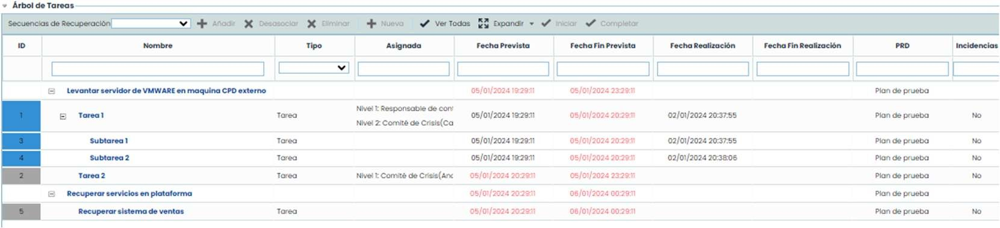

Adicionalmente, se podrá adjuntar cualquier documentación relacionada con la ejecución de la prueba. Esta documentación se podrá adjuntar desde los archivos que se tengan guardados en el local del PC.

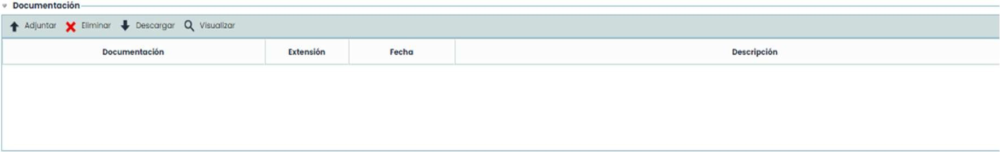

Después de rellenar todo el formulario, se debe seleccionar en “**Guardar**”.

Si se vuelve a la pantalla anterior, es decir, a la pantalla principal, se puede ver que en la gráfica aparecerá esta nueva prueba planificada.

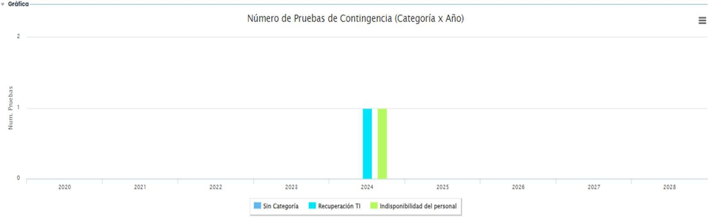

Además de ello, si se pulsa sobre el botón “**Ver Calendario**” se abrirá un calendario, en el cual se marca en amarillo el día actual y los días en los que las diferentes pruebas han sido planificadas y realizadas.

En la opción “**Mostrar**” se puede filtrar cuáles se quieren ver: todas, planificadas, realizadas.

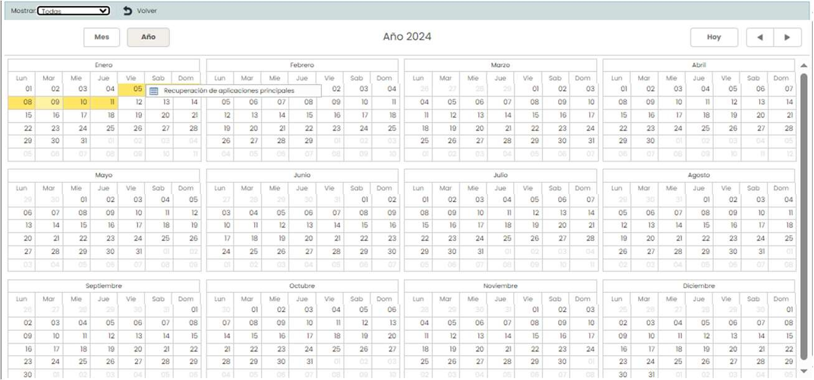

## Ejecución

Después de crear la prueba y planificarla, el siguiente paso es ejecutarla. Para ello hay que entrar en la prueba que se quiera realizar y pulsar el botón “**Activar**”.

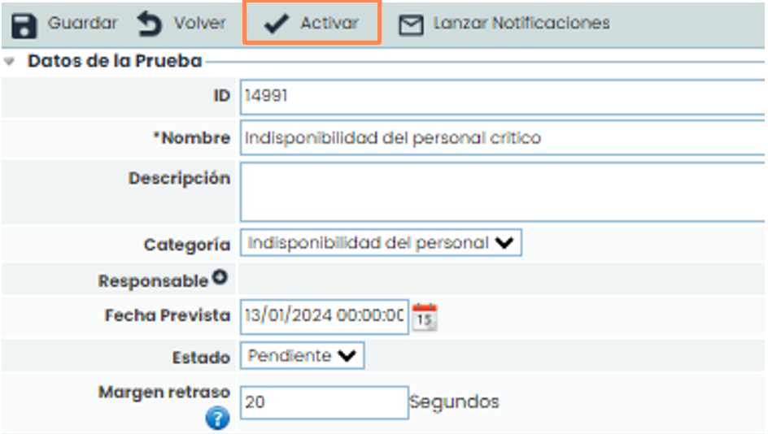

A continuación, aparecerán dos pop-ups preguntando si está seguro de activarlo, y si quiere avisar a los responsables de las actividades.

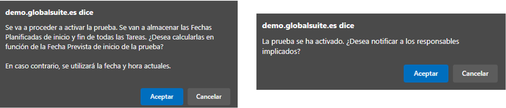

Al aceptar mandar notificaciones, se abre una tabla con diferente información de los responsables. En esta opción se podrá seleccionar si se quiere mandar dicha notificación a todos los empleados o solo a algunos de ellos que tengan habilitada la opción de ser seleccionados en la columna “**Enviar**”.

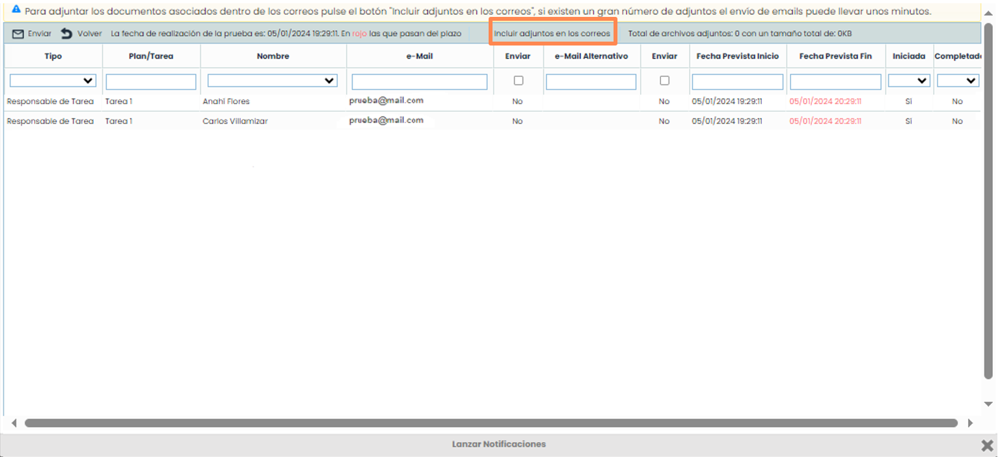

Adicionalmente se podrá adjuntar en el correo la documentación asociada a cada tarea pulsando el botón “**Incluir adjuntos en los correos**”.

Cuando ya se han completado los pasos anteriores, si se acepta notificar a los responsables, los responsables seleccionados serían notificados mediante un correo electrónico. En caso de no haber querido notificar a dichos responsables, esto se puede realizar más adelante pulsando el botón “**Lanzar** **notificaciones**”.

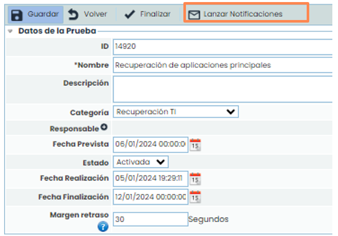

Este botón también puede ser usado para reenviar una notificación que ya se lanzó con anterioridad, es decir, que no solamente sirve para el caso de que no se les notifique, sino que también sirve para volver a avisar a los responsables.

Los responsables pueden entrar en iniciar las tareas que tienen que hacer, en el momento que las vayan a acometer. Esto mismo también puede realizarlo el Gestor de la Prueba.

Para ello hay que pulsar el botón “**Iniciar**” cuando se vaya a iniciar la tarea, y una vez se complete pulsar sobre el botón “**Completar**”.

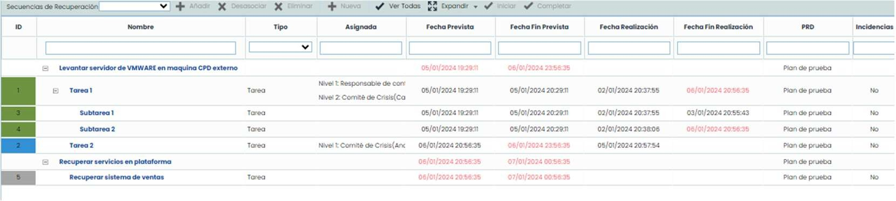

Las tareas en azul son las que están en curso, en rojo son las que no se ha cumplido el plazo, en gris las que aún no se han empezado a ejecutar y en verde aparecerían las tareas completadas.

Con esto lo que se consigue es recabar la información real de la duración de las diferentes tareas.

Cuando ya se han completado todas las tareas hay que finalizar la prueba. Esto se hace a través del botón “**Finalizar**”.

## Informe

Para poder visualizar y descargar el informe hay que cambiar de pestaña en la parte superior a **“Vista Previa**”.

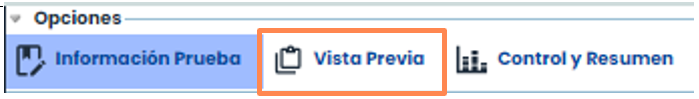

En esta opción se podrá ver la información que se haya plasmado en el propio plan de recuperación. Se permite consultar todo el texto o secciones que tenga planificadas, además se podrá descargar a modo informe.

Solo aparecerán los planes de recuperación que se hayan seleccionado.

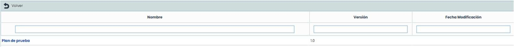

Para ver la información de este, hay que entrar en el mismo, y aparecerá la información parametrizada anteriormente en el propio plan.

## Control y Resumen

Para poder llevar un control y consultar el resumen hay que cambiar de pestaña en la parte superior a “**Control y resumen**”.

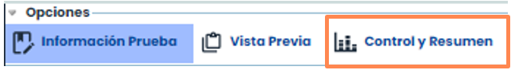

Es un cuadro de mando que permite ver a tiempo real como se encuentran cada una de las taras. Indica el progreso de la prueba, y qué tareas hay completadas, iniciadas, fuera de plazo, etc.

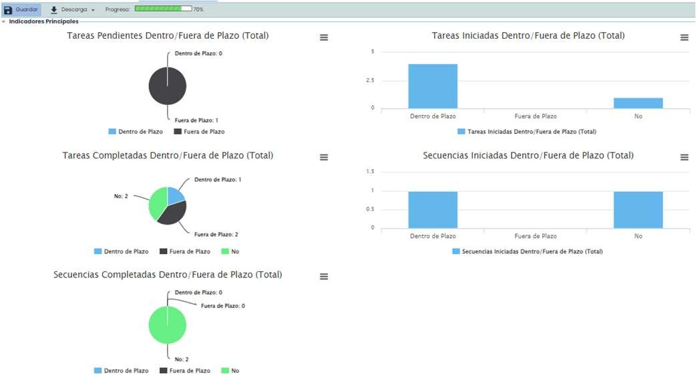

Más abajo aparecen los datos generales como fechas de fin y de inicio previstas, tiempo de retraso, duración total de la prueba, etc.. Dentro de estas opciones se pueden observar algunos cálculos que hace GlobalSuite®.

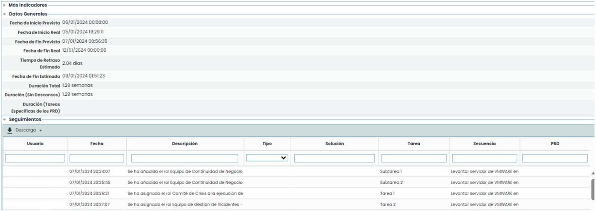

Además de ello, hay una tabla en la cual se van registrando automáticamente todos los seguimientos/tareas que se han ido realizando durante la prueba, y la posibilidad de descargar dicha información.

También hay un panel de control que, además de marcar el tiempo del RTO, si se pulsa el botón “**Panel Control**” se accede a una pantalla alternativa, donde se verá cuál es el progreso de la prueba, una gráfica con el progreso de las secuencias y una cuenta atrás. Sirve para poder saber el progreso de una manera más visual.

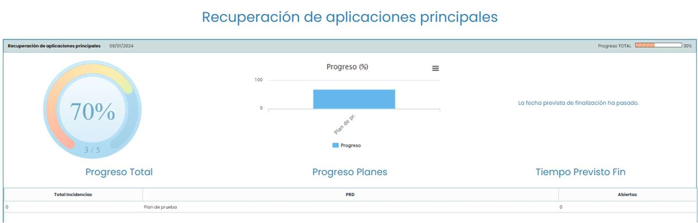

Si alguna tarea tuviera puntos de control aparecía en dicha opción. También aparecen las secuencias con su progreso y fechas. Y, al final de todo, las conclusiones, o la relación de cada tarea con una serie de incidencias, cambios, acciones correctivas, si se hubiera producido alguna.

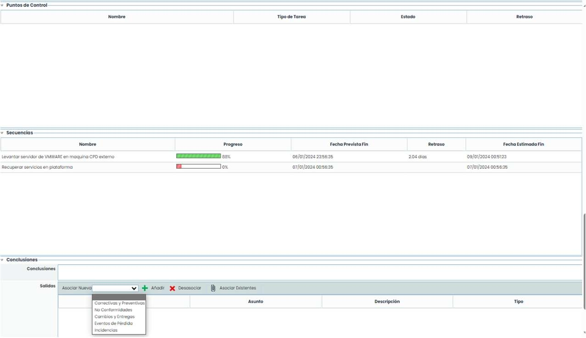
