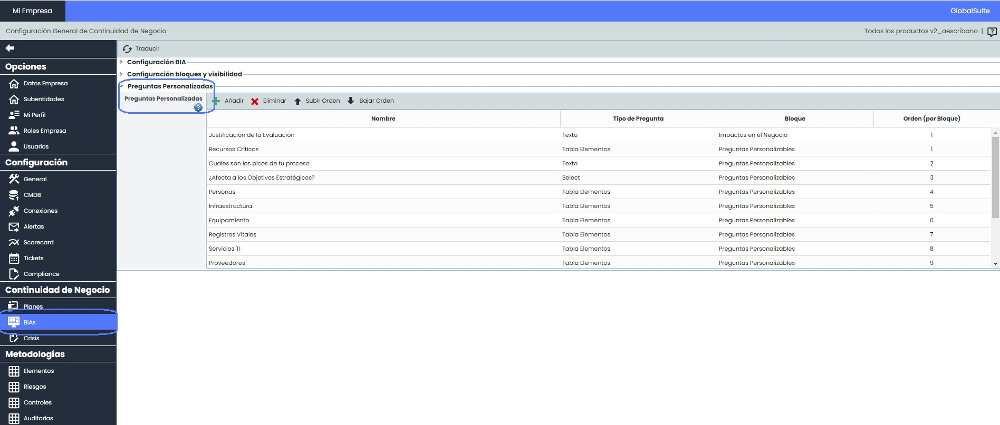
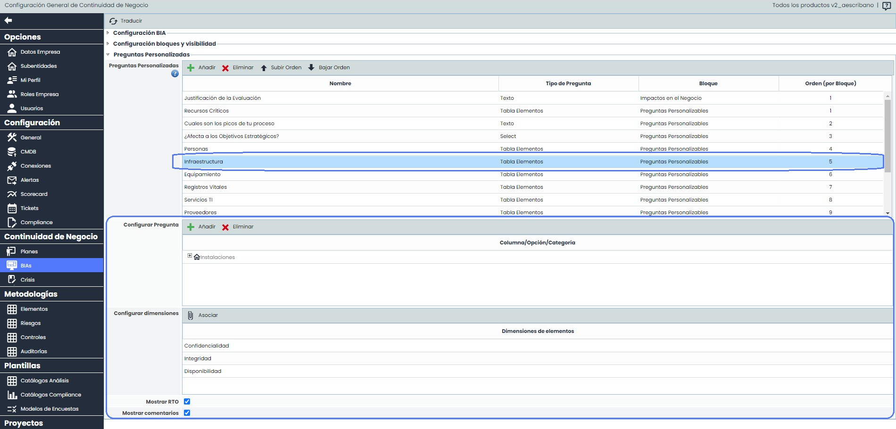
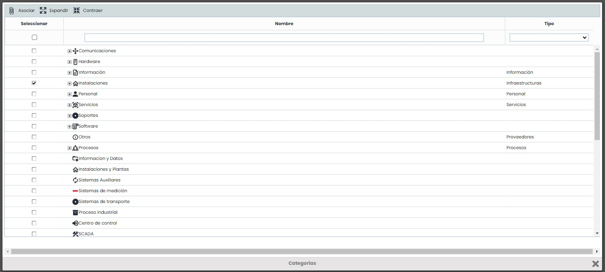
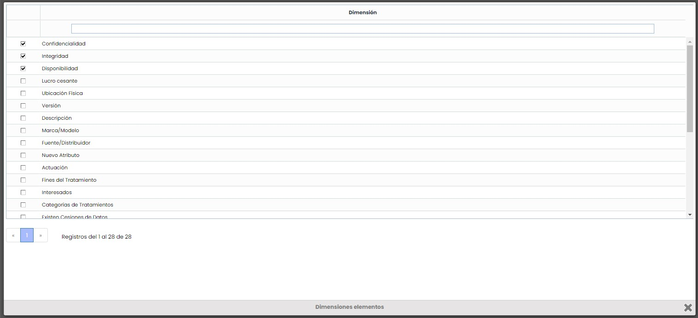
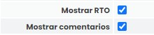
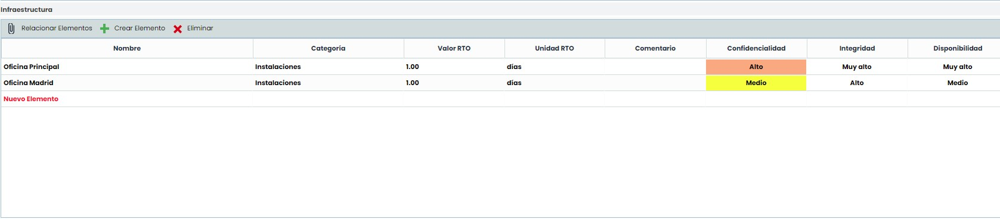
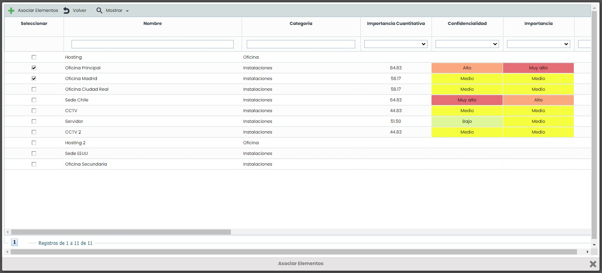
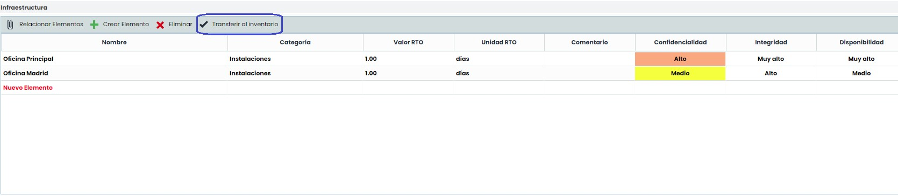

# ¿Cómo configurar y utilizar las Tablas de Elementos en los BIAs de GlobalSuite®?


En este artículo se explica cómo configurar las preguntas personalizadas de tipo Tabla Elementos para realizar los BIAs (Business Impact Analysis) en GlobalSuite®.


Este tipo de campos permite identificar, valorar las dimensiones o parámetros que consideremos y actualizar todos los elementos que son necesarios para llevar a cabo un Proceso de Negocio, que se puede evaluar a través del BIA, centralizando la recopilación de esta información a través de la funcionalidad, o incluso lanzar cuestionarios a los responsables a través del módulo de Encuestas.

## Configurar preguntas del BIA en Ajustes

En esta opción el objetivo es modelar qué preguntas se van a incluir en el formulario del BIA, y qué tipo o categorías de elementos se van a incluir en cada una de estas preguntas, además de las dimensiones a valorar.

1.  Accedemos a Ajustes> Continuidad de Negocio > [BIAs](https://help.globalsuitesolutions.com/es/globalsuite/v1/configuracion-bia) y dentro del formulario, vamos al apartado de Preguntas Personalizadas.

    
2.  En este apartado, podremos ver qué preguntas de distintos tipos (Texto, Selección, Tabla, o Tabla Elementos) tenemos configuradas. En este tutorial nos centraremos en las preguntas de tipo Tabla Elementos.\
    Al seleccionar una, nos aparecerán los parámetros que se pueden configurar para la pregunta. También podemos editar el nombre de la pregunta haciendo doble click en la celda.

    
3.  En el apartado “Configurar Pregunta” podemos seleccionar qué categorías de elementos será posible añadir o crear en la pregunta seleccionada cuando se utilice en el BIA. Al pulsar “Añadir” nos aparecerá una ventana con todas las categorías definidas en el sistema de gestión (configuradas en Ajustes > Metodologías > [Elementos](https://help.globalsuitesolutions.com/es/globalsuite/v1/metodologia-elementos), pudiendo seleccionar las que consideremos recopilar en esta pregunta (para aplicar los campos deberemos pulsar “Asociar”).

    
4.  En el apartado “Configurar Dimensiones” se pueden definir qué dimensiones del Inventario queremos que se puedan valorar para los elementos añadidos a esta pregunta. Esto permite obtener input de la criticidad de estos elementos durante el proceso del BIA.\
    Al pulsar “Asociar” nos aparecerá una ventana con el listado completo de dimensiones (definidas en Ajustes > Metodologías > [Elementos](https://help.globalsuitesolutions.com/es/globalsuite/v1/metodologia-elementos)), pudiendo marcar o desmarcar las que consideremos. Estos cambios se aplican directamente, y simplemente tendremos que cerrar la ventana para seguir con la configuración.

    
5. También, para cada pregunta de tipo Tabla Elementos se podrán habilitar los siguientes campos generales:

* Mostrar RTO: Este campo permite definir el tiempo de recuperación (Recovery Time Objective) para cada elemento añadido a la pregunta.
* Mostrar comentarios: Si se habilita este check, se incluirá una columna textual donde añadir aclaraciones respecto al elemento incluido en la tabla.

## Formulario del BIA

Una vez se ha configurado en ‘Ajustes’ la pregunta, en el formulario del BIA aparecerá la Tabla de Elementos en el apartado definido.

En ella se podrán asociar del Inventario elementos ya existentes a través del botón “Relacionar Elementos”, y modificar la valoración de las dimensiones, o añadir elementos nuevos que se hayan identificado (mediante el botón “Crear Elemento”), y que se distinguirán por tener el nombre en color rojo.


\*\*NOTA:\*\* Este mismo comportamiento es aplicable para el módulo de encuestas de BIA (tanto encuestas de BIA por Impacto como de BIA por Tiempo).


## Consolidación en el Inventario

Una vez se tenga completada la información del BIA, es posible consolidar en el Inventario tanto la valoración de los elementos existentes como añadir los nuevos elementos identificados. Esto se hace de manera automática al consolidar el BIA Consolidado a partir de un BIA Individual, o desde el BIA Consolidado, mediante el botón “Transferir al Inventario”, el cual creará el elemento en el Inventario con la valoración de las dimensiones que se le haya aplicado, y lo insertará en el árbol de elementos debajo del Proceso de Negocio que se está evaluando en el BIA.

