# ¿Cómo crear y gestionar encuestas de Análisis de Impacto de Negocio (BIA)?


Este tutorial explica, paso a paso, cómo crear, configurar, publicar y gestionar encuestas de Análisis de Impacto de Negocio (BIA) en GlobalSuite®. Estas encuestas permiten recopilar información clave de los responsables de procesos para determinar parámetros críticos como el MTPD, RTO, RPO, entre otros.


## 1️⃣ Crear el modelo de encuesta BIA

Para realizar los BIAs a través de encuestas enviadas a los distintos responsables de la organización, el primer paso consiste en crear el modelo de encuesta que se utilizará.\
Se pueden crear tantos modelos como se deseen y configurarlos según las necesidades específicas de cada análisis BIA.

* Accede a **Ajustes > Plantillas >** [**Modelos de encuestas**](https://help.globalsuitesolutions.com/es/globalsuite/v1/modelos-de-encuestas).
* Pulsa el botón **"Nueva Encuesta"**.
* Selecciona el tipo de modelo:
  * **BIA por tiempo**: Se valorará el impacto en función del tiempo y escalas temporales definidos.
  * **BIA por impacto**: Se valorará el impacto en función de los niveles de impacto configurados.

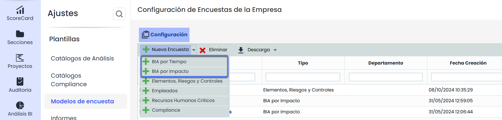

### Completa el formulario

Una vez seleccionado el modelo de encuesta, dentro del modelo podrán configurar aquellos campos necesarios para la encuesta.

#### Configuración Encuesta General

En este bloque se podrá definir el nombre, departamento o la fecha de creación del modelo. Así como también, será posible definir estados para la encuesta, determinar si las encuestas se consolidarán en el último estado en caso de tenerlos o la opción de habilitar o deshabilitar dicho modelo mediante la casilla **Habilitada**.

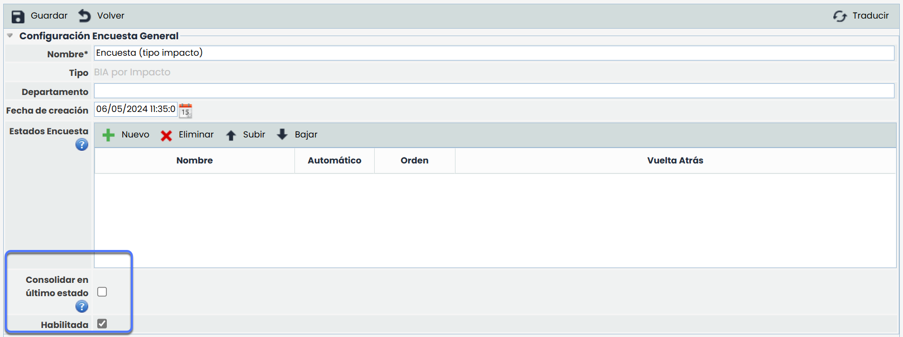

#### Información del BIA

En esta sección, se añadirá la información sobre los objetivos y requisitos de las encuestas. Estos datos serán informativos para las personas que rellenen las mismas.

Además, se dará la opción de mostrar la tabla de impactos en la encuesta mediante la casilla _Mostrar Tabla de Impactos_. De ese modo los diferentes tipos de impactos configurados y sus niveles se mostrarán en la encuesta.

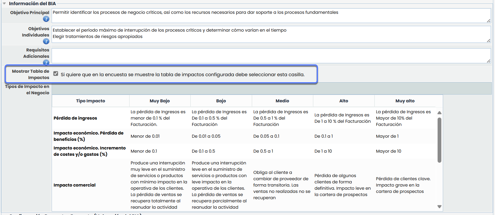

#### Configuración Preguntas Encuesta (Valoración BIA) y Configuración Preguntas Encuesta

Es fundamental prestar especial atención a las dimensiones del Inventario de Elementos y a los parámetros de recuperación (RTO, RPO, MTPD, entre otros) al configurar las preguntas de la encuesta.

Para facilitar la respuesta por parte del empleado, se permite incluir preguntas textuales asociadas a cada opción, tanto para las relacionadas con el inventario como para las específicas del análisis BIA.

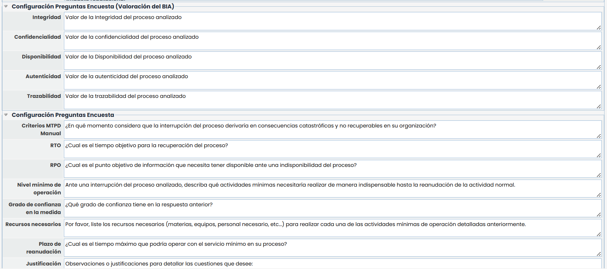

#### Configuración de campos y preguntas

Se podrá configurar la **visibilidad, obligatoriedad y el orden de los campos y preguntas** dentro de cada bloque, seleccionando el bloque correspondiente desde la columna _Bloque_ del BIA por defecto de GlobalSuite. Los campos y bloques predefinidos no son editables, aunque pueden ocultarse marcando o desmarcando la casilla _Visible_.

Adicionalmente, en el apartado **Ajustes > Continuidad de Negocio >** [**BIAs**](https://help.globalsuitesolutions.com/es/globalsuite/v1/configuracion-bia), será posible **añadir, eliminar y ordenar** las preguntas personalizables configuradas, dentro de cada bloque del BIA.

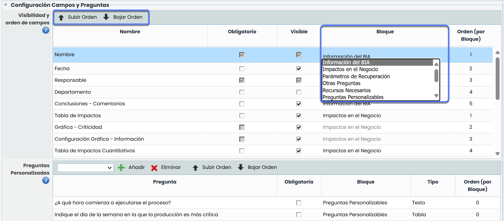

#### Adjuntos

Se podrán añadir documentos que estarán disponibles en la página de inicio (_landing page_) de la encuesta, en el apartado de _Información adicional_.

Además, estos documentos también estarán disponibles **desde la encuesta**, en la sección **Archivos adjuntos**, desde donde podrán descargarse en cualquier momento por el destinatario.


\*\*Nota\*\* Esta acción también podrá realizarse desde el apartado [\*\*Configuración de la encuesta\*\*](https://help.globalsuitesolutions.com/es/globalsuite/v1/configuracion-bia). (Paso 2)


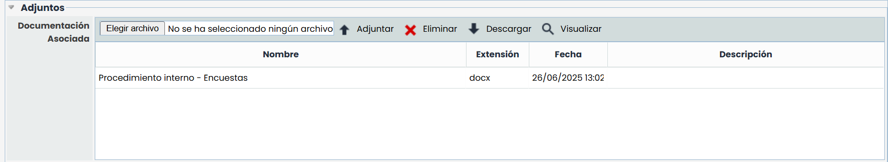 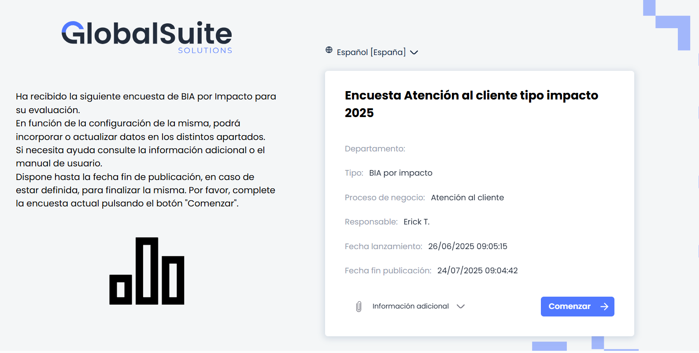

***

## 2️⃣ Configurar la encuesta BIA

Una vez creado y configurado el modelo de encuesta, el siguiente paso será seleccionar el **proceso de negocio** sobre el cual se desea realizar la evaluación.

En la pantalla principal se mostrarán todas las configuraciones existentes, incluyendo información relevante como el **tipo de encuesta**, los **modelos utilizados**, y otros datos asociados.\
Además, en la columna **Activado** podrás comprobar si cada configuración está habilitada para continuar con el proceso de envío.

* Accede a **Gestión > Encuestas >** [**Configurar Encuestas**](https://help.globalsuitesolutions.com/es/globalsuite/v1/configuracion-bia).
* Filtra por tipo de encuesta y selecciona el modelo.
* Pulsa **"Nuevo"** para iniciar la configuración.

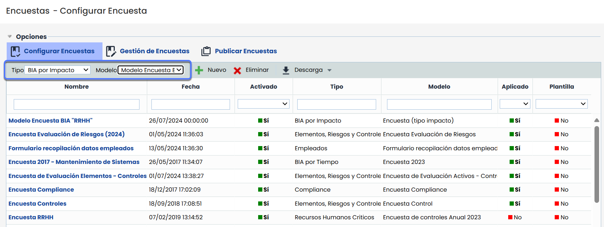

### Completa el formulario

Una vez accedas al formulario de configuración, encontrarás distintas secciones que permiten personalizar el contenido y alcance de la encuesta BIA.

#### Datos Generales

En esta sección podrás editar información básica como:

* El nombre de la configuración.
* La fecha de creación o referencia.
* Activar o desactivar la configuración para su uso en pasos posteriores.
* Seleccionar el idioma en que se enviarán las encuestas.
* Activar notificaciones.

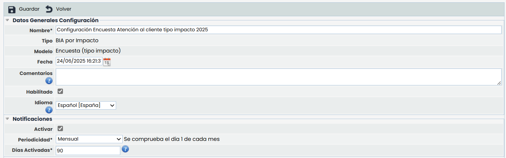

#### Configuración BIA

Aquí deberás seleccionar el **proceso de negocio** que deseas incluir en la encuesta. El formulario mostrará un listado con los procesos definidos en la organización, desde el cual podrás elegir el que corresponda.

Además, tendrás la opción de **añadir subprocesos** relacionados con el proceso de negocio seleccionado. Esto permitirá que, posteriormente, se publiquen encuestas individuales para cada uno de los subprocesos asociados.

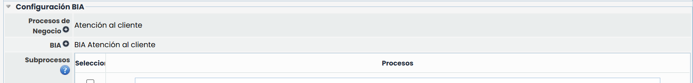

#### Adjuntos

Se podrán añadir documentos que estarán disponibles en la página de inicio (_landing page_) de la encuesta. También estarán disponibles desde la encuesta en la sección “Archivos adjuntos”.

***

## 3️⃣ Publicar la encuesta BIA

Para enviar la encuesta a los destinatarios, dirígete a la opción **Publicar Encuestas**, donde podrás configurar el proceso de publicación.

Al igual que en el paso de configuración, deberás seleccionar el **tipo de encuesta** y el **modelo correspondiente**, y luego pulsar el botón **“Nuevo”** para iniciar una nueva publicación.

En esta sección también podrás descargar la información en pantalla en formato Excel o PDF desde el botón “**Descarga**”.

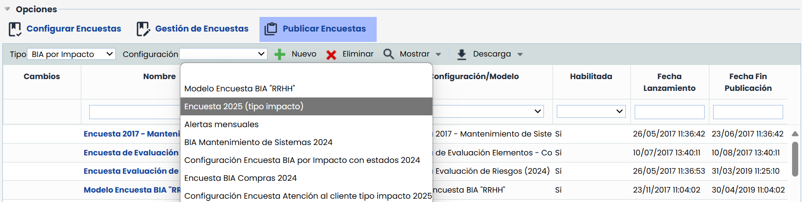

### Completa el formulario

Una vez se haya creado una nueva publicación, se deberá completar el formulario con los datos clave para gestionar el envío de la encuesta.

#### Datos Generales de la encuesta

En esta sección podrás definir los atributos principales del envío:

* **Responsable:** Persona encargada de gestionar la encuesta y recibir las respuestas de los destinatarios.
* **Fecha de cierre:** Fecha límite para que los usuarios puedan completar la encuesta.
* **Habilitada:** Este campo debe estar activado para que la encuesta esté disponible y pueda ser enviada.

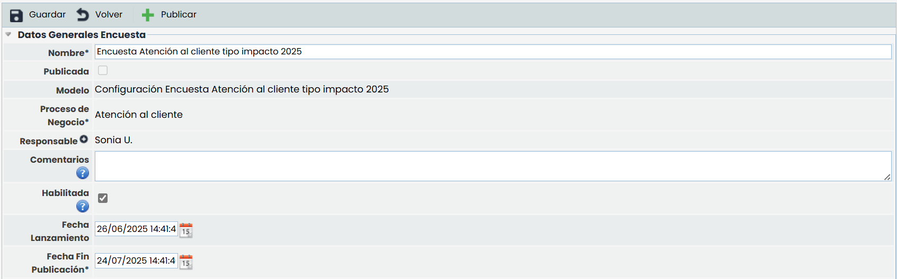

#### Notificaciones

Durante la publicación de la encuesta, es posible configurar distintos tipos de notificaciones automáticas para facilitar el seguimiento y la participación de los involucrados. Existen dos tipos principales: Notificaciones de caducidad al destinatario y Notificaciones de caducidad al responsable.

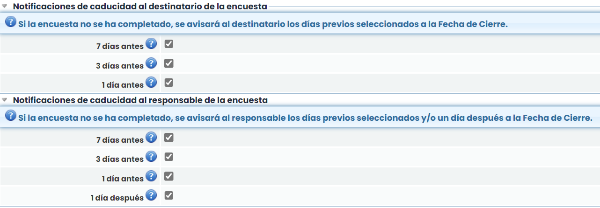


\*\*Más Información\*\* Para más información sobre la configuración de notificaciones, puedes consultar la documentación en el siguiente enlace: [Publicar encuestas - Notificaciones de Caducidad](https://help.globalsuitesolutions.com/es/globalsuite/v1/publicar-encuestas#Publicarencuestas-NotificacionesdeCaducidad)


#### Destinatarios Asociados

Una vez completados los campos anteriores, el siguiente paso consiste en **seleccionar a los destinatarios** de la encuesta. Estas personas recibirán un **correo con un enlace** directo para acceder a la encuesta.

> Para acceder al enlace, no será necesario que los destinatarios dispongan de usuario en GlobalSuite®.

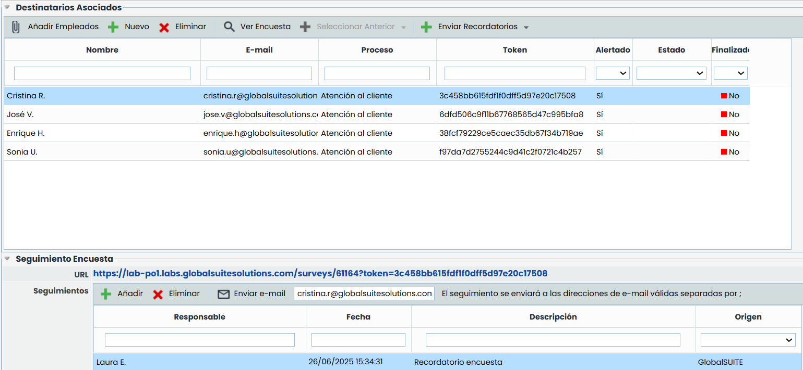

Para añadir destinatarios, se podrá:

* Seleccionar un **empleado ya existente** mediante el botón **“Añadir empleado”**.

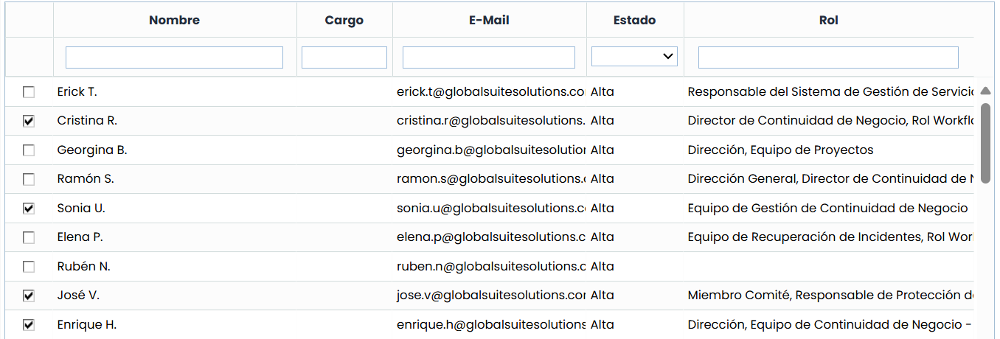

* Crear un **nuevo destinatario** con el botón **“Nuevo”**. Introduce manualmente los datos. Marca la opción para crear el empleado en el sistema si lo necesitas.

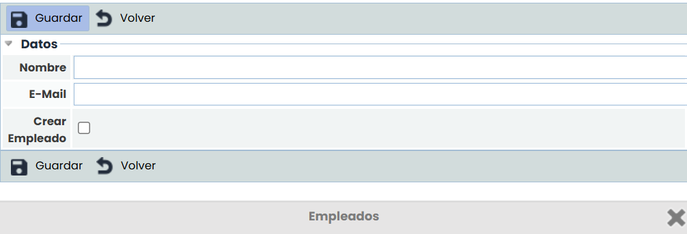

Además, desde la tabla de destinatarios será posible:

* **Enviar recordatorios** por correo a los destinatarios con el botón **“Enviar Recordatorio”**.
* **Recuperar destinatarios** de una encuesta anterior utilizando el botón **“Seleccionar Anterior”**.

#### Publicar

Una vez configurada la publicación y definidos los destinatarios, será necesario pulsar el botón **“Publicar”**.\
Al hacerlo, GlobalSuite® enviará automáticamente un **correo a cada destinatario** con el enlace directo para completar la encuesta.

Además:

* Al seleccionar un destinatario desde la pantalla de publicación, se podrá visualizar el **enlace específico** que ha recibido, permitiendo al responsable acceder directamente a la encuesta si fuera necesario.
* En la parte inferior de la pantalla, se mostrará una **tabla de seguimiento**, donde es posible consultar el estado de cada envío (por ejemplo, si la encuesta ha sido abierta o completada por el destinatario).

***

## 4️⃣ Gestionar encuestas BIA

Esta opción permite **consultar y administrar todas las encuestas generadas** a partir de la publicación realizada en el paso anterior.

* Al publicar una encuesta, el sistema crea automáticamente un **registro individual por cada destinatario**, por lo que en esta sección se visualizarán tantos registros como envíos se hayan realizado.

Además, desde esta misma opción también es posible:

* **Crear encuestas de forma manual**, sin necesidad de haberlas publicado previamente.

> El proceso de creación es similar al utilizado en los pasos anteriores.

* Acceder a cada encuesta para **consultar o editar los datos guardados hasta el momento** por el destinatario.

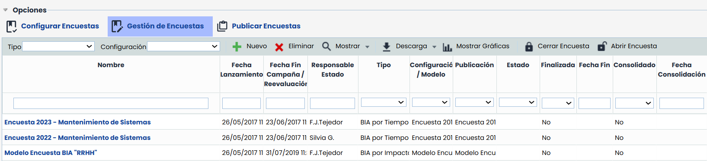

***

## 5️⃣ Crear/Modificar BIA

Una vez que la encuesta ha sido **respondida**, ya sea tras su publicación o mediante su creación manual desde la opción **Gestión de encuestas**, es posible crear o modificar el BIA **con los datos recogidos**.

Para ello:

1. Accede al registro de la encuesta desde la cual deseas crear o modificar el BIA.
2. En la barra de herramientas superior, se mostrará uno de los siguientes botones:
   * **“Crear BIA”**, si la encuesta no tiene un BIA asociado.
   * **“Modificar BIA”**, si la encuesta tiene un BIA asociado.

Al pulsar el botón correspondiente, se **creará un nuevo BIA asociado a la encuesta** o se **actualizará el ya existente**, incorporando la información recopilada en la encuesta.

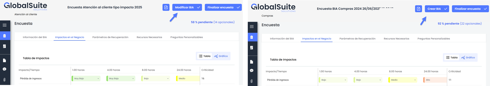

***
