# ¿Cómo realizar un BIA (Análisis de Impacto en el Negocio) en GlobalSuite®?


Este tutorial explica, paso a paso, cómo realizar el \*\*Análisis de Impacto en el Negocio (BIA)\*\* en GlobalSuite®, dentro del módulo de \*\*Continuidad de Negocio\*\*. En esta guía se describen las fases necesarias para ejecutar correctamente el proceso: desde la \*\*creación y cumplimentación de los BIAs individuales\*\*, hasta la \*\*consolidación de BIAs\*\*, el \*\*análisis de MTPD y RTO por proceso\*\*, y la \*\*creación de históricos\*\*. Además, se detallan las secciones de información general, impactos de negocio, parámetros de recuperación, recursos necesarios y preguntas personalizables, así como los criterios para consolidar la información y analizar los resultados de recuperación de cada proceso de negocio


El proceso o fases a ejecutar para la realización del Análisis de Impacto en el Negocio (BIA) son las siguientes:

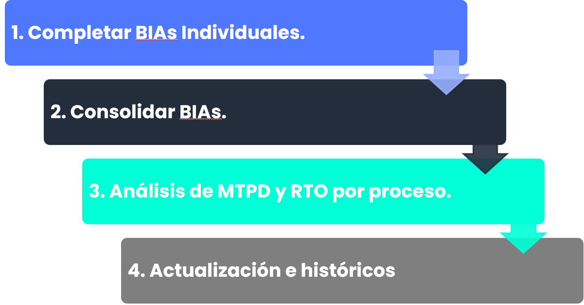

## BIAS individuales

La realización de los BIAs de la organización se efectúa en **Análisis > Opciones >** [**BIA**](https://help.globalsuitesolutions.com/es/globalsuite/v1/bia-business-impact-analysis)**.**

Esta opción permite generar todos los BIAs necesarios sobre los procesos de negocio que han sido incluidos dentro del alcance del Sistema de Continuidad, dentro de **Inicio > Opciones >** [**Alcance**](https://help.globalsuitesolutions.com/es/globalsuite/v1/alcance)**.**

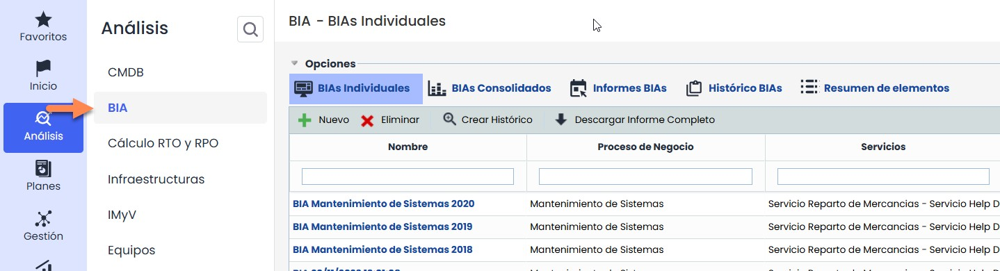

A continuación, se mostrarán los pasos a seguir para la realización de los BIAs Individuales.

### Creación del BIA Individual

Al acceder en la opción **BIA** se muestran todos los BIA que se han generado en la entidad. Esta opción está formada por cinco pestañas: **BIAs Individuales**, **BIAs Consolidados, Informes BIAs, Históricos BIAs y Resumen de elementos .** Al acceder, por defecto se carga la primera de ellas.

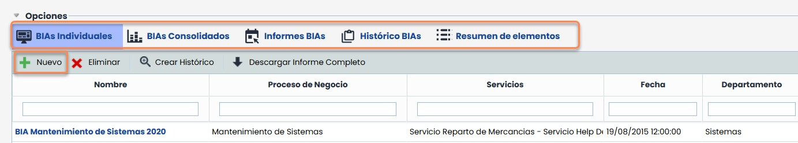

La generación de un nuevo BIA se realiza a través del botón **“Nuevo”,** que abre un modal con una tabla de procesos de negocio disponibles para ser evaluados.

Desde esta ventana, el usuario puede buscar y filtrar procesos por **nombre**, **categoría** o **ruta de categoría**, seleccionar el proceso deseado y pulsar **“Crear”**.

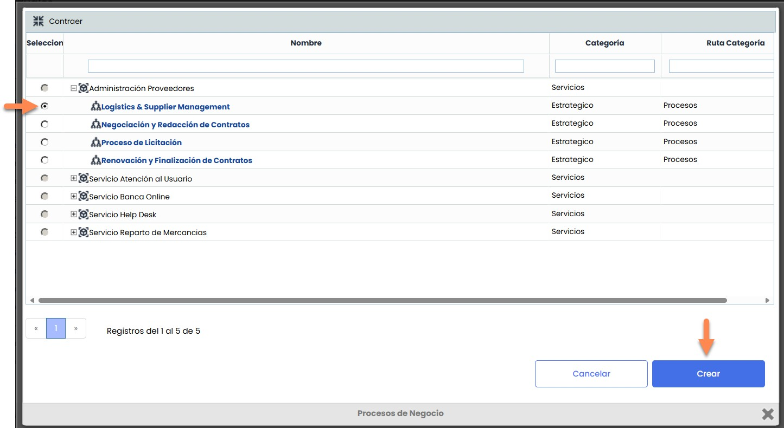

Al hacerlo, el modal se cierra, se regresa a la tabla principal y se muestra el nuevo registro de BIA generado.

### Información general e Impactos de Negocio

Seleccionando sobre el nombre del BIA se accede al formulario en detalle, comenzando por la información general.

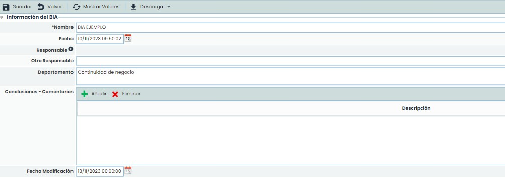

Tras esa sección se encuentra los Impactos de Negocio, con la tabla de impactos con todos los tipos de impactos y escalas temporales configuradas en la opción de configuración.

El valor del impacto en la relación Tipo de Impacto/Tiempo se realiza mediante doble click en cada celda.

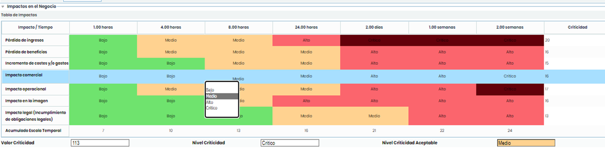

Una opción específica de la tabla de impactos es la posibilidad de visualizar la descripción de cada impacto mediante el botón **“Mostrar valores”,** en la parte superior del BIA.

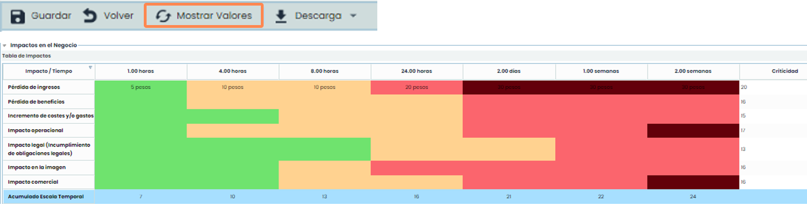

De este modo, será posible conocer la descripción de cada uno de los valores para cada tipo de impacto definidos en las opciones de **Ajustes >** [**BIA**](https://help.globalsuitesolutions.com/es/globalsuite/v1/configuracion-bia)**.**

### Evaluación gráfica de Impactos de negocio

También será posible analizar de manera gráfica los **Impactos específicos**, por cada tipo y en escala temporal.

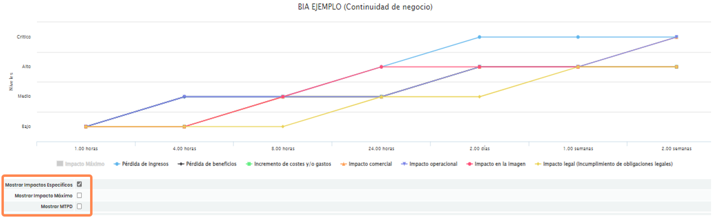

Es posible mostrar los valores de **Impacto Máximo** en cada valor de la escala temporal e incluso el valor **MTPD** (**Tiempo Máximo Tolerable de Indisponibilidad**), el cual se definirá en el siguiente paso.

### Parámetros de recuperación

Esta sección permitirá calcular los valores **MTPD, RTO y RPO** del proceso de negocio analizado.

Respecto al MTPD, éste se puede calcular de manera manual o automática. Para el caso del cálculo automático, GlobalSuite® utiliza la información registrada en la tabla de impactos superior e incorpora una serie de criterios para calcular el MTPD. Una vez seleccionado, hay que pulsar sobre el botón **“Obtener MTPD”.**

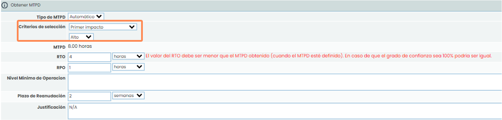

Obtenido el MTPD, se definirán los valores de **RTO y RPO**, así como el resto de información de recuperación del proceso: **Nivel de mínimo de operación**, **Plazo** **de reanudación** o la **Justificación** de los mismos.

### Recursos necesarios y preguntas personalizables

El BIA también dispone de una sección **Recursos necesarios** para registrar todos los recursos implicados en la recuperación del proceso de negocio, su categoría y las unidades necesarias para ello.

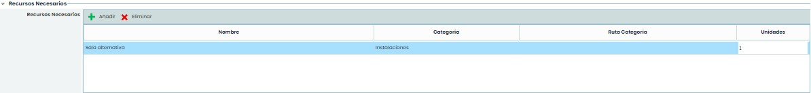

Además de todos estos aspectos, al final del BIA dispone de un bloque con **Preguntas personalizables** que se han configurado en **Ajustes**. Estos tipos de preguntas pueden ser de tipo texto, select mediante un desplegable, tipo tabla e incluso tipo tabla específica de elementos.

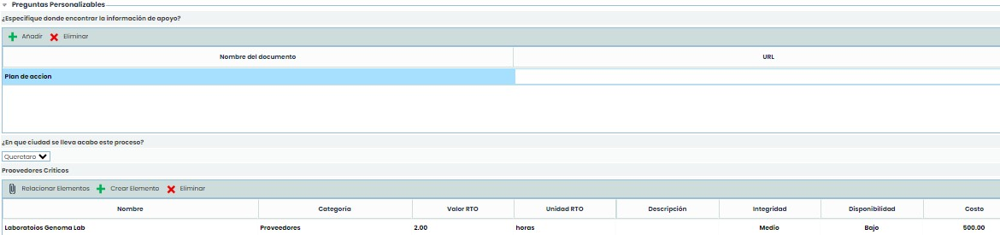

## BIAs consolidados

GlobalSuite® permite la consolidación de varios BIAs realizados sobre **un mismo** proceso de negocio. Esta funcionalidad permite al usuario obtener **un único BIA por proceso de negocio** utilizando para ello todos los BIAs individuales que se han realizado sobre el mismo proceso de negocio, así como los BIAs individuales de los subprocesos que dispone el proceso de negocio.

Para acceder a esta funcionalidad hay que pulsar sobre la pestaña **BIAs Consolidados** de la opción **BIA**. De esta forma, se muestran cada uno de los procesos de negocio incluidos en el alcance del Sistema de Continuidad indicando el número de BIAs Individuales que tiene cada uno de ellos.

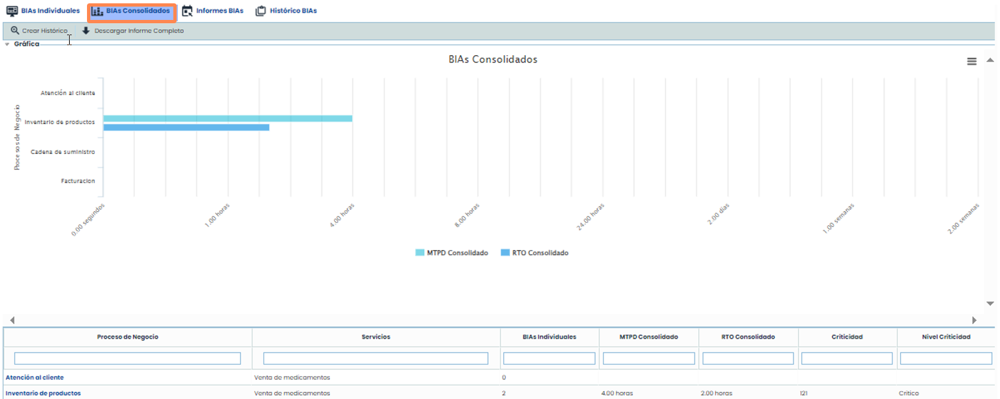

### Criterios de consolidación

Para realizar la consolidación de un BIA hay que seleccionar uno de los procesos de negocio de la tabla principal. La sección **Datos de Consolidación** permitirá seleccionar los criterios para realizar la consolidación de BIAs.

* **Tipo de Consolidación:** Ésta puede ser automática (recomendable) o manual (consolidación vacía).
* **Criterios de Tipos de Impacto:** Se puede seleccionar el mismo criterio para todos los tipos de impacto o seleccionar un criterio específico para cada tipo de impacto.
* **Incluir subprocesos:** Marcando esta casilla permite incluir en la consolidación los BIA de todos los subprocesos que tiene asociado el proceso de negocio que se está consolidando.
* **Criterios de Consolidación Generales**: En esta sección se permite seleccionar qué BIAs individuales se quieren utilizar para la consolidación y elegir el criterio a utilizar.

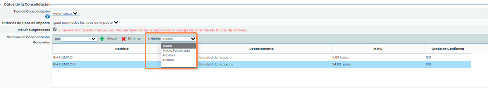

Una vez seleccionados todos los criterios, se calculará el BIA consolidado al pulsar sobre el botón **“Guardar”**.

### Información del BIA

En la sección de **Información del BIA**, y de una manera similar al BIA individual del proceso de negocio, se podrá añadir información general sobre el BIA consolidado.

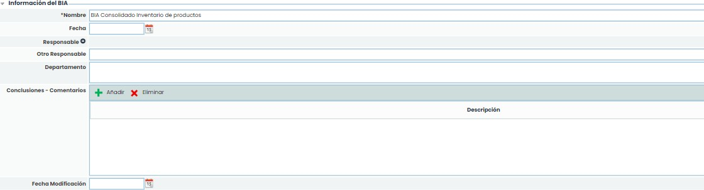

Partiendo de la denominación que se le dará al propio BIA consolidado, GlobalSuite® permitirá añadir información sobre la fecha de creación de este registro, el responsable del mismo, el departamento/área encargada, cualquier comentario o conclusión sobre este BIA consolidado, además de la fecha de última modificación o actualización en el sistema.

### Impactos en el Negocio

En caso de consolidación automática, GlobalSuite® calculará de manera automática la tabla de Impactos de negocio consolidada, siempre en función de los BIA Individuales seleccionados.

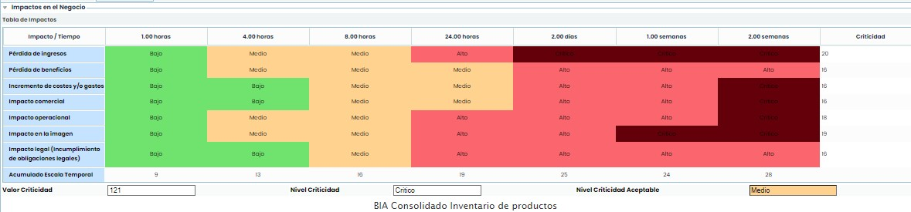

Análogo a los BIA individuales, también se mostrará en grafica con las opciones de Impacto Máximo y MTPD.

Por otro lado, en la botonera superior, es posible mostrar la descripción de cada tipo de impacto en la tabla de Impacto de negocio (botón

**“Mostrar Valores”**). Además, se incorporan varias vistas de resultados que permiten analizar los impactos comentados **Por Departamento** y **Por Tipo de impacto** (botones **“Por Departamento”** y **“Por Tipo de Impacto”).**

### Parámetros de recuperación y recursos necesarios

El resto de información del BIA (MTPD, RTO, recursos necesarios, etc.) se pueden registrar en el BIA consolidado consultando la información existente en cada BIA individual. Para ello, en cada una de las secciones existe un botón denominado **“Mostrar XXXXX Individuales”** que permite consultar la información que corresponda con la sección.

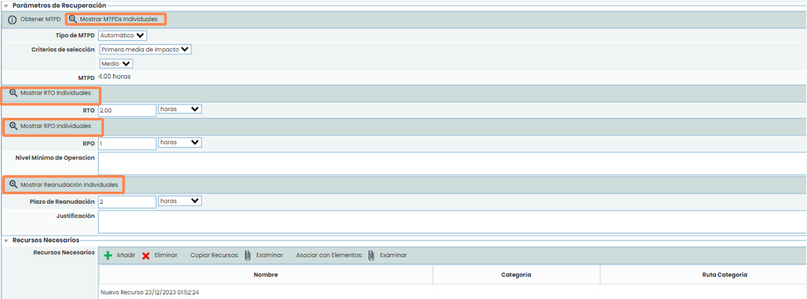

### Preguntas Personalizables

De manera similar a la información existente en los BIA Individuales, al final del BIA Consolidado dispone de un bloque con **Preguntas personalizables**, las cuales han sido configuradas previamente en la sección de Administración.

Estos tipos de preguntas pueden ser de tipo texto o select, mediante un desplegable e incluso tipo tabla, y harán referencia exclusivamente al BIA consolidado del proceso de negocio el cual se está tratando.

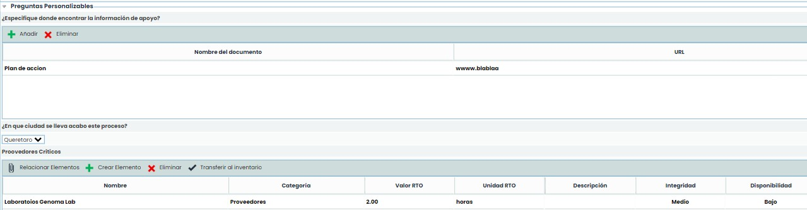

## Análisis de MTPD y RTO por proceso

La obtención de un valor de MTPD y RTO por proceso se realiza, tal como hemos visto antes, en los BIA. Concretamente, si bien los BIA individuales permiten identificar un MTPD y un RTO (entre otra información) por proceso de negocio, el MTPD y el RTO definitivo para el proceso corresponde al valor registrado en el BIA Consolidado correspondiente.

Esta información puede ser consultada en la pestaña Informes BIAs, dónde se analizará en detalle la información realizada en todos los pasos y fases anteriores.

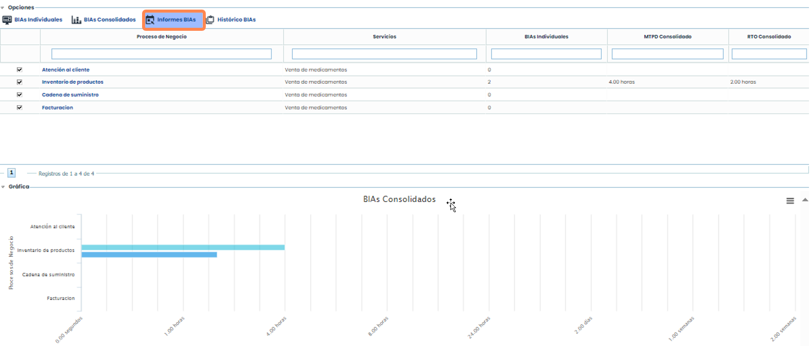

Al seleccionar la opción **Informe BIAs** se muestran los procesos de negocio y la información más importante hallada durante la realización de los BIA y BIA Consolidados.

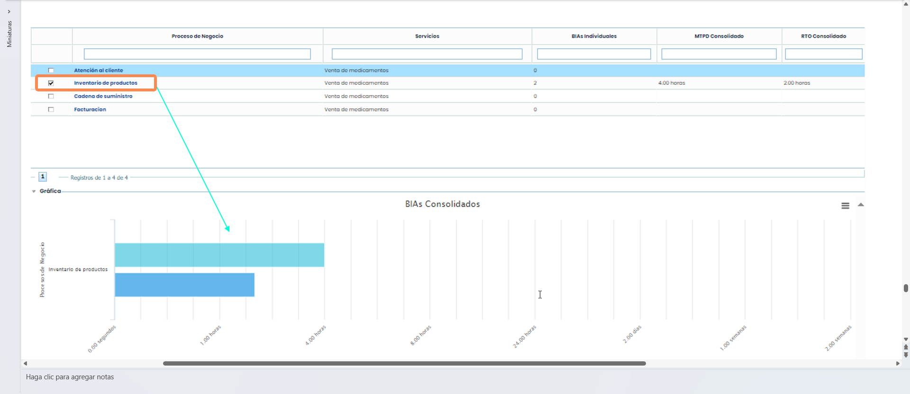

En la tabla, se podrá analizar la cantidad de BIA realizados, el MTPD y RTO para el mismo (consolidados) y se podrá analizar en gráfica estos valores seleccionando los procesos que se desean mediante su casilla correspondiente.

## Histórico BIAs

La funcionalidad de Histórico BIAs permitirá realizar una foto estática a los registros y valores de los BIAs individuales o consolidados existentes en la herramienta.

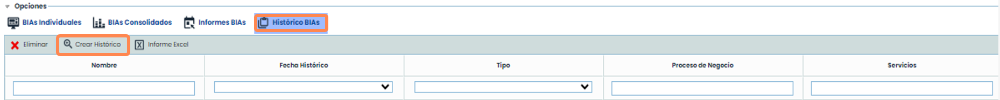

Mediante el botón **“Crear Histórico”**, se abrirá un pop up dónde se podrán seleccionar mediante las casillas correspondientes los BIAs que se deseen para crear el histórico de los mismos.

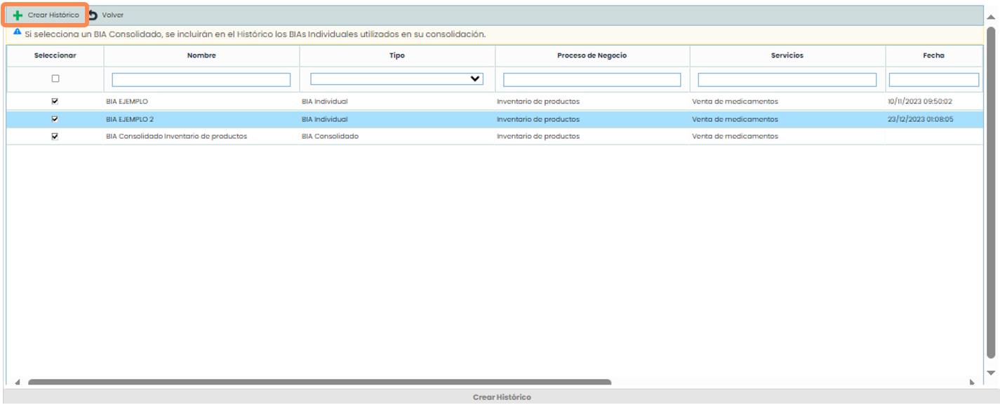

Una vez creados los históricos, éstos aparecerán en la pantalla principal al acceder.

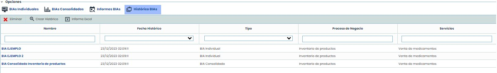

Haciendo click sobre cualquier de esos valores, GlobalSuite® mostrará el registro de una manera informativa y no será posible editar la información del mismo.

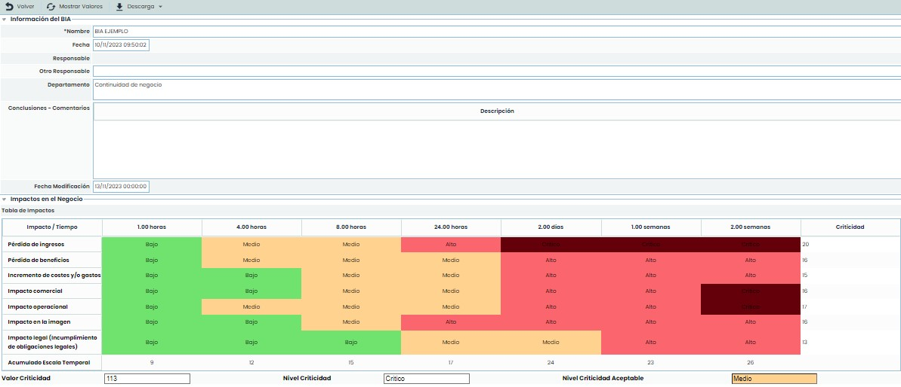
