# Cómo utilizar la Gestión de crisis en GlobalSuite®


Este tutorial explica, paso a paso, cómo gestionar una \*\*crisis en GlobalSuite®\*\* desde su activación hasta el cierre y análisis posterior, dentro del módulo de \*\*Continuidad de Negocio\*\*. En esta guía se detalla cómo \*\*activar un plan de gestión de crisis\*\*, crear una nueva entrada de gestión, y registrar los \*\*datos generales de la crisis\*\* como nombre, descripción, incidencias relacionadas, nivel de crisis y estado de avance. También se describe cómo \*\*asociar escenarios, infraestructuras, servicios, clientes, proveedores y comités de decisión\*\*, gestionar los \*\*eventos disruptivos y acciones resolutivas\*\*, y configurar los \*\*roles y permisos de acceso\*\* para los distintos usuarios. Además, se muestra cómo \*\*realizar el seguimiento de los planes de recuperación asociados\*\*, visualizar el \*\*progreso de las tareas y secuencias\*\*, y consultar la información consolidada en el \*\*Cuadro de Mando\*\*, que permite analizar el impacto, las acciones ejecutadas y los resultados globales de la crisis


## Fases para la configuración inicial de la Gestión de la Crisis

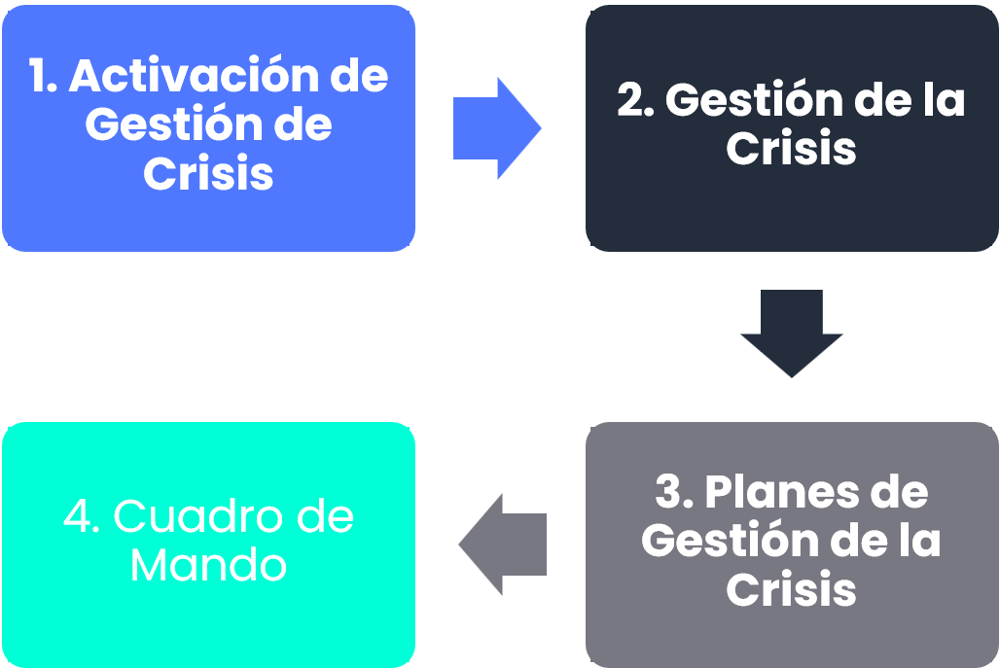

## Activación de la Gestión de la Crisis

La activación de la gestión de la crisis se realizará desde la opción **Planes >** [**Plan de Gestión de la Crisis**](https://help.globalsuitesolutions.com/es/globalsuite/v1/plan-de-gestion-de-crisis), pulsando los botones “**Activar**” o “**Simulacro**” dentro del formulario del plan.

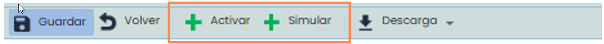

El conjunto de los planes activados o en simulacro se podrán visualizar en la opción **Gestión >** [**Gestión de la crisis**](https://help.globalsuitesolutions.com/es/globalsuite/v1/gestion-de-la-crisis). Si se ha pulsado el botón “**Simular**”, se creará con la etiqueta “SIMULACRO” seguido del nombre del plan. Si se ha pulsado el botón “**Activar**”, se creará con la etiqueta “Activación”

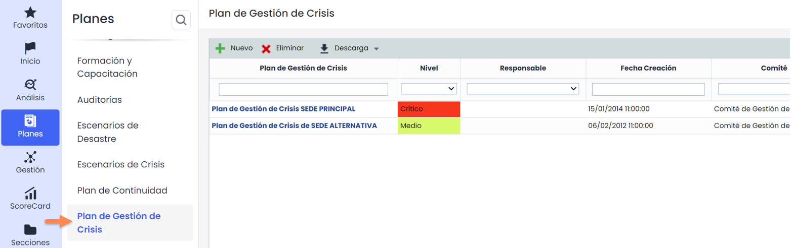

## Gestión de la Crisis

Cuando pulsamos sobre el nombre un plan de gestión de crisis, dentro de la opción **Gestión >** [**Gestión de la crisis**](https://help.globalsuitesolutions.com/es/globalsuite/v1/gestion-de-la-crisis), nos saldrán tres opciones en la parte superior.

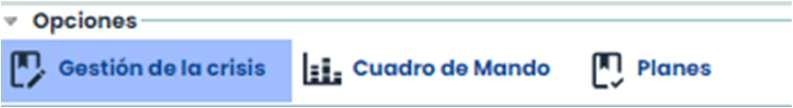

Por defecto se entra a la de **Cuadro de mando**, sin embargo, comenzaremos detallando la primera que es **Gestión de la crisis**, en la cual tendremos los datos generales de la gestión de la crisis, muchos de ellos vendrán copiados del plan de gestión de crisis que se ha activado.

En primer lugar, se especificará los datos de la activación o simulación, que son:

* **Nombre**: Nombre general de la crisis para identificarlo en el listado de gestión.
* **Simulación**: Etiqueta que indica si es simulación y de que plan viene.
* **Fecha prevista**: Fecha prevista de Inicio de la crisis después de detectarla.
* **Incidencias Relacionadas**: Incidencias que han provocado la crisis. Si la crisis se ha activado desde la opción Incidencias, esta tabla vendría con la incidencia ya relacionada. Es posible añadir más de una incidencia.
* **Descripción**: Descripción breve de la crisis.
* **Coordinador**: Persona encargada de gestionar la crisis. Se elegirá un empleado definido en **Gestión >** [**Empleados**](https://help.globalsuitesolutions.com/es/globalsuite/v1/empleados)
* F**echa de Detección**: Cuando se ha detectado la incidencia. Se completa automáticamente.
* **Estado**: Posibilidad de elegir cuando la crisis esta avisada, en progreso y finalizada.
* **Tickets relacionados**: Que permite añadir o asociar tickets relacionados al plan.

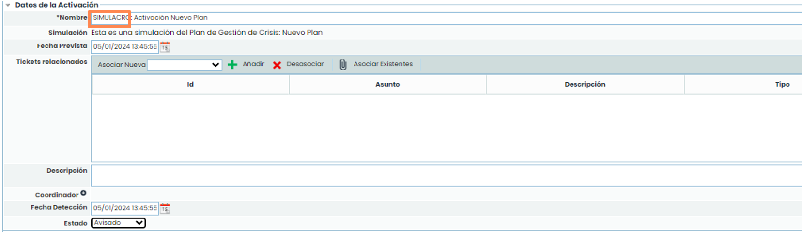 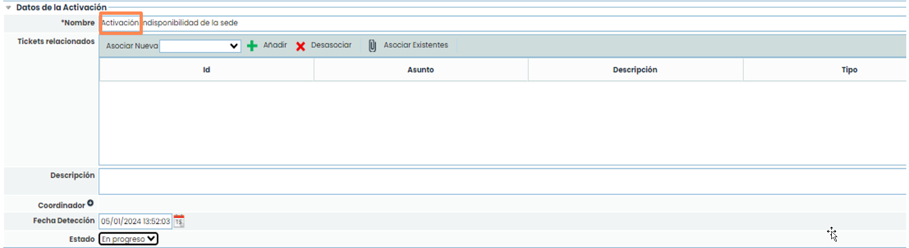

* **Nivel de Crisis**: Se copiará del plan con el nivel marcado y sus impactos
* **Escenarios de Referencia**: Son los escenarios del plan de gestión de crisis
* **Servicios**: Por defecto, vendrán los definidos en el plan de gestión de crisis, pero se da la opción de modificarlos.
* **Infraestructuras**: Por defecto, se copiarán las definidas en el plan de gestión de crisis, pero se podrá modificarlas.

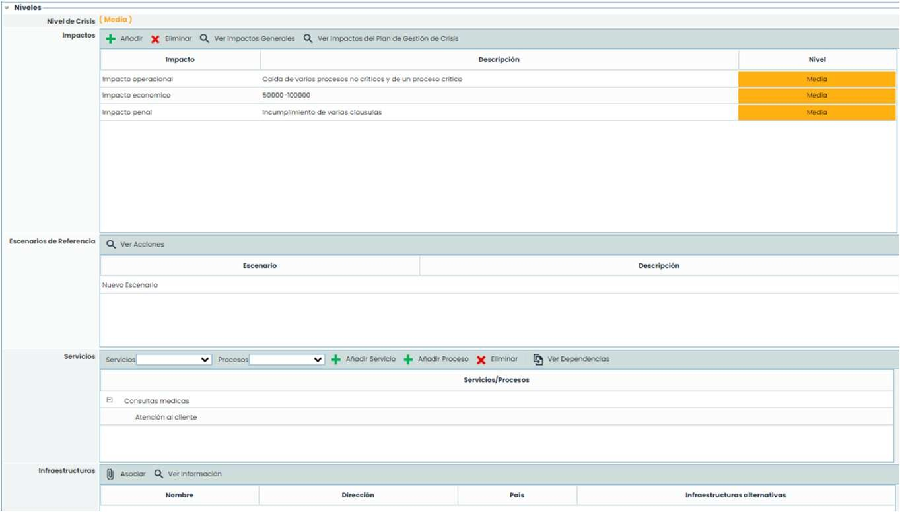

* **Comité de Decisión:** Es el comité configurado en el plan, estos miembros del comité han recibido una alerta.

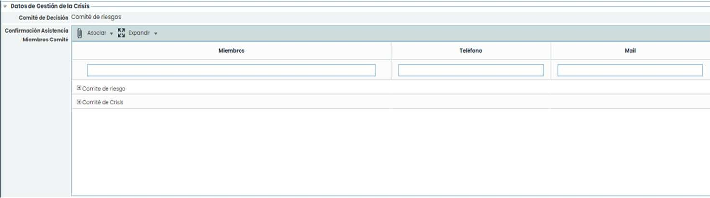

Los datos que también vienen del plan, pero se podrán modificar son: **Objetivos, Clientes y Proveedores.**

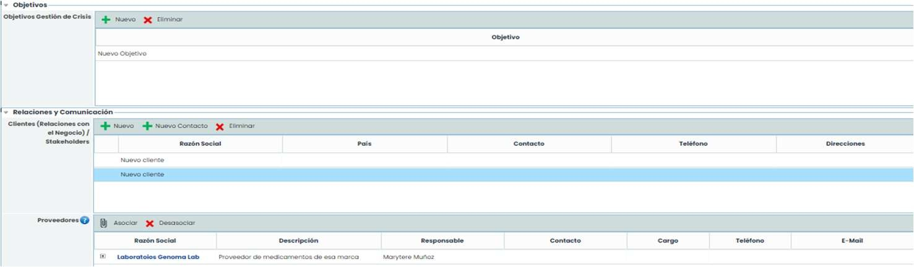

**Eventos Disruptivos (Entradas)** En esta tabla se pueden gestionar los eventos que se van sucediendo en una gestión de crisis, y que necesitan un tratamiento posterior. Además de crear y eliminar, se podría:

* **Asociar Impactos**: Permite asociar tipos de impactos que se están viendo afectado por dicho evento.
* **Asociar Acciones**: Permite asociar acciones de la tabla **Acciones Resolutivas**, que están tratando de resolver el evento disruptivo surgido.
* **Asociar Stakeholders**: Permite asociar clientes / stakeholders, que se han definido en la tabla **Clientes/Relaciones con el Negocio**, y que están siendo afectados por dicho evento.
* **Asociar Proveedores**: Permite asociar proveedores que se han definido en la tabla **Proveedores**, y que están siendo afectados por dicho evento.

**Escalado**: Si la crisis se agrava y existe un plan de crisis con mayores niveles de impacto, se podrá escalar la crisis a dicho plan. Al seleccionar el Nuevo plan y pulsar “**Escalar**”, saldrá el siguiente mensaje:

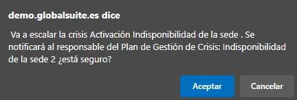 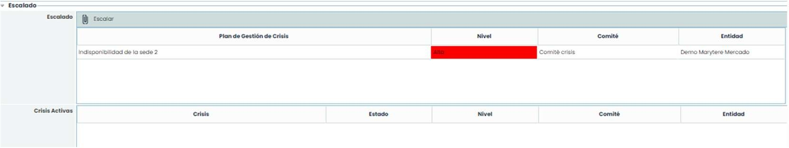

Otro aspecto a tener en cuenta, son los permisos de los usuarios en la modificación de las tareas. Por este motivo, se puede configurar un usuario para que solo tenga acceso a sus tareas.

En **Ajustes >** [**Roles Empresa**](https://help.globalsuitesolutions.com/es/globalsuite/v1/roles-de-empresa) marcar la gestión de la crisis con Accesoa Mi Información.

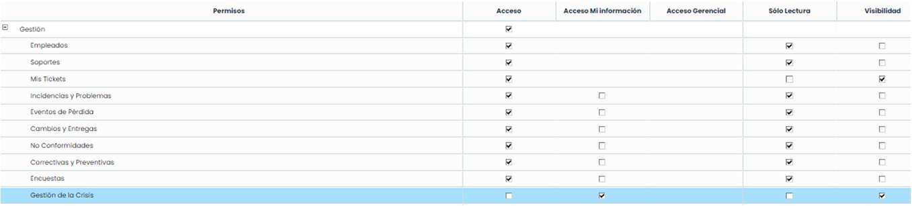

El árbol de tareas se verá de la siguiente forma: Solo tendrán link las tareas en las que tengan permiso

Se especificarán las alertas que se pueden generar desde la herramienta.

**Alertas Generales:** Botón “**Lanzar Notificaciones**”, si se pulsa en la pantalla general del plan se podrá mandar un mail a todos los empleados con responsabilidad en el plan. Si se pulsa en la pantalla de una tarea, solo salen los responsables asignados en esa tarea.

**Alertas Automáticas**: Cuando una tarea acabe se enviará la notificación a la tarea posterior.

Si es una tarea con subtareas, la alerta se enviará a la primera o primeras subtareas de la tarea padre.

Si esta tarea tiene una secuencia posterior, se enviará la alerta a la primera o primera tareas de la secuencia siguiente.

Si tiene varias tareas posteriores, se enviarán la alerta a todas las tareas posteriores

## Planes de la Gestión de Crisis

Desde esta opción se podrá llevar el seguimiento de los planes de recuperación involucrados en la crisis. Para activar los planes relacionados se debe pulsar sobre el botón “**Activar**” o elegir de la lista desplegable Estado, la opción Activado. Cuando se active el botón cambiará a “**Finalizar**”, para acabar los planes cuando sea necesario.

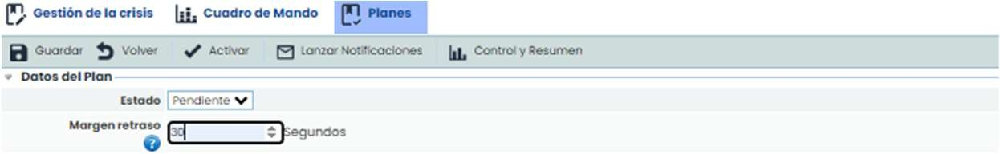

**Lanza Notificaciones**: Permite informar a través de correo electrónico al personal encargado de las tareas a realizar para completar la prueba en cuestión. Al pulsar se abrirá una ventana emergente con los empleados.

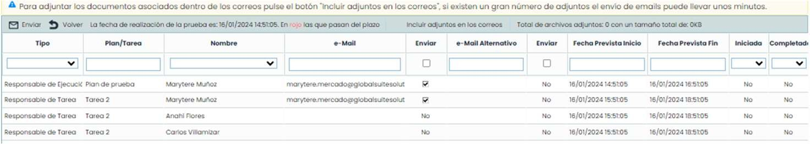

**Control y Resumen**: Cuadro de mando general de un plan.

**Estado**: Permite indicar el Estado en el que se encuentran los planes relacionados en la gestión de crisis.

**Fecha Realización**: Permite establecer la fecha de realización del plan.

**Fecha Finalización**: Permite establecer la fecha de finalización del plan.

**Margen retraso**: Permite introducir el margen de retraso con el cual con el cual pueden iniciarse o finalizarse las tareas.

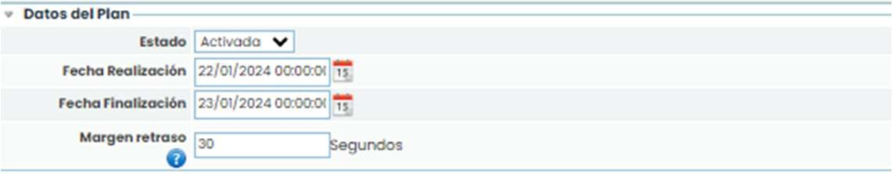

**Planes de Continuidad**: Permite asociar los planes establecidos para la gestión de la crisis.

**Planes de Recuperación:** Permite asociar los planes de recuperación definidos en **Planes >** [**Planes de Recuperación**](https://help.globalsuitesolutions.com/es/globalsuite/v1/planes-de-recuperacion)**.**

**Secuencias del Plan de Recuperación**: Al pulsar sobre el plan, se mostrarán sus secuencias. En la tabla derecha se podrá configurar el orden de estas secuencias. Para esto, se debe seleccionar la secuencia anterior y una tarea de dicha secuencia. La secuencia podrá empezar cuando se complete la tarea marcada.

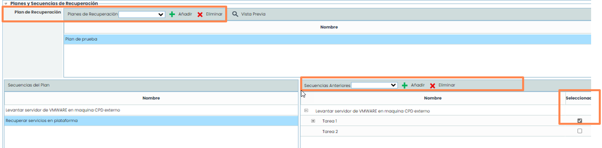

**Árbol de tareas:** esta opción permite elegir que secuencias de tu plan de recuperación configurar para la crisis. Al seleccionar la secuencia y pulsar Asociar se añadirá a la tabla ordenado por la fecha de inicio prevista.

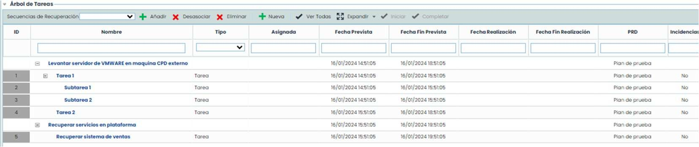

Para iniciar la crisis, se enviarán las notificaciones generales del plan para que los participantes sepan que tienen que realizar acciones sobre tareas concretas. El responsable de la primera tarea tendrá que acceder a su tarea y modificarla (iniciarla y completarla).


Nota: Las tareas con subtareas no se podrán iniciar y completar. Se completarán con las subtareas. Se tendrá que guardar la información.


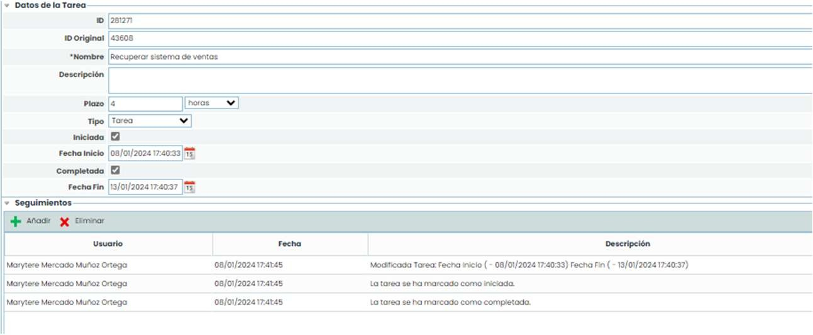

Al guardar la información y activar el plan, el sistema preguntara si se desea avisar a los responsables.

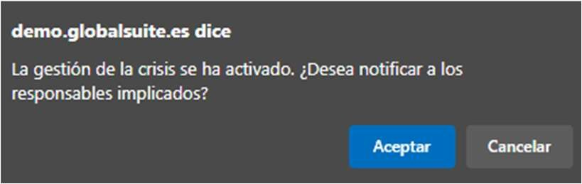

De esta forma, el sistema avisará automáticamente de todas las tareas del plan. Cuando el usuario reciba esta notificación su tarea ya está disponible para poder iniciar.


Nota: No se puede iniciar tareas que tengan alguna tarea dependiente que no haya sido completada.


El seguimiento de la tabla sería el siguiente:

Las tareas en verde se han finalizado correctamente. Las tareas en azul están en curso. Las tareas que han acabado con incidencia saldrán en rojo.

En gris las tareas que no han empezado. Además, las tareas que llevan retraso se pondrán con la fecha en rojo para poder identificarlas.

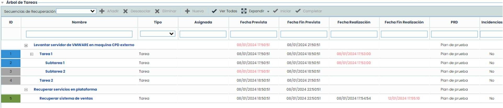

El botón “**Control y resumen**” sirve para ver el estado de los planes lanzados en la crisis. En primer lugar, se podrá ver varias gráficas que indican las tareas y secuencias en plazo.

Posteriormente tenemos los datos generales del plan.

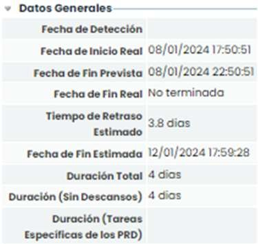

La siguiente tabla muestra todos los seguimientos que se han generado en el plan. Además de los seguimientos manuales y las incidencias que ha habido en la gestión de la crisis.

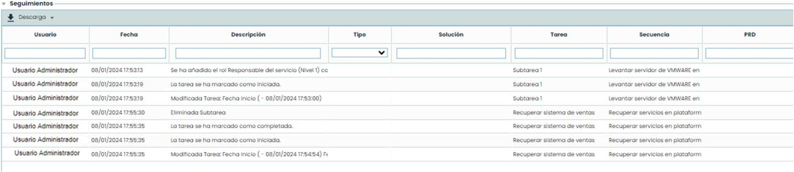

En la tabla de planes de recuperación hay una vista para poder ver el estado y el tiempo de fin de un plan. Pulsando el botón “**Panel de Control**”.

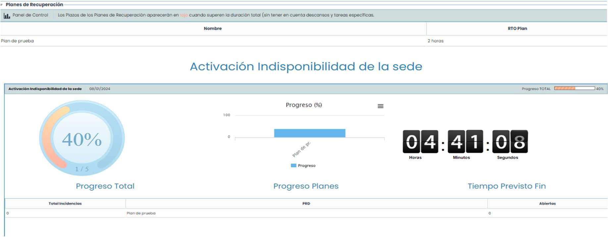

En la tabla de secuencias, hay un resumen de las secuencias de recuperación del plan.

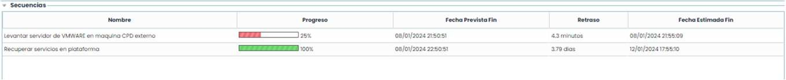

Y, por último, se muestra el apartado de conclusiones, donde se podrán insertar acciones correctivas, no conformidades, cambios detectados, etc.

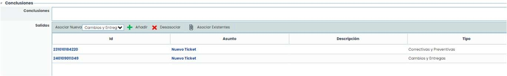

## Cuadro de mando

Existe una vista donde se podrá ver información específica de la crisis. Esta información se podrá visualizar en la opción de **Cuadro de mando**.

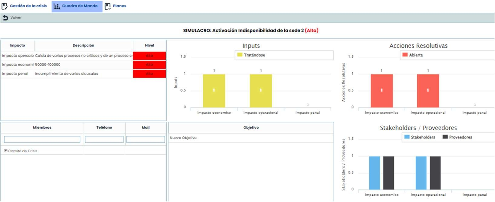
