# ¿Cómo realizar un GAP Analysis y crear un Plan de Adecuación en GlobalSuite®?


En este artículo tratamos cómo realizar un GAP Analysis en GlobalSuite® para evaluar el grado de cumplimiento de una normativa, aplicando requisitos, definiendo estados y valorando resultados mediante gráficas. Además, explicamos cómo generar un Plan de Adecuación a partir de los requisitos no cumplidos, asociar indicadores, definir acciones y hacer seguimiento de su implantación


* [GAP Analysis](como-realizar-un-gap-analysis-y-crear-un-plan-de-adecuacion-en-globalsuite-r.md#id-¿CómorealizarunGAPAnalysisycrearunPlandeAdecuaciónenGlobalSuite®?-GAPAnalysis)
  * [Configuración de la pantalla](como-realizar-un-gap-analysis-y-crear-un-plan-de-adecuacion-en-globalsuite-r.md#id-¿CómorealizarunGAPAnalysisycrearunPlandeAdecuaciónenGlobalSuite®?-Configuracióndelapantalla)
  * [Crear GAP Analysis](como-realizar-un-gap-analysis-y-crear-un-plan-de-adecuacion-en-globalsuite-r.md#id-¿CómorealizarunGAPAnalysisycrearunPlandeAdecuaciónenGlobalSuite®?-CrearGAPAnalysis)
  * [Aplicar y modificar requisitos](como-realizar-un-gap-analysis-y-crear-un-plan-de-adecuacion-en-globalsuite-r.md#id-¿CómorealizarunGAPAnalysisycrearunPlandeAdecuaciónenGlobalSuite®?-Aplicarymodificarrequisitos)
  * [Definir estados de GAP Analysis](como-realizar-un-gap-analysis-y-crear-un-plan-de-adecuacion-en-globalsuite-r.md#id-¿CómorealizarunGAPAnalysisycrearunPlandeAdecuaciónenGlobalSuite®?-DefinirestadosdeGAPAnalysis)
  * [Evaluar requisitos](como-realizar-un-gap-analysis-y-crear-un-plan-de-adecuacion-en-globalsuite-r.md#id-¿CómorealizarunGAPAnalysisycrearunPlandeAdecuaciónenGlobalSuite®?-Evaluarrequisitos)
    * [Definición Fecha.](como-realizar-un-gap-analysis-y-crear-un-plan-de-adecuacion-en-globalsuite-r.md#id-¿CómorealizarunGAPAnalysisycrearunPlandeAdecuaciónenGlobalSuite®?-DefiniciónFecha.)
    * [Asociación de Documentación.](como-realizar-un-gap-analysis-y-crear-un-plan-de-adecuacion-en-globalsuite-r.md#id-¿CómorealizarunGAPAnalysisycrearunPlandeAdecuaciónenGlobalSuite®?-AsociacióndeDocumentación.)
    * [Asociar Controles](como-realizar-un-gap-analysis-y-crear-un-plan-de-adecuacion-en-globalsuite-r.md#id-¿CómorealizarunGAPAnalysisycrearunPlandeAdecuaciónenGlobalSuite®?-AsociarControles)
    * [Asociar Tickets.](como-realizar-un-gap-analysis-y-crear-un-plan-de-adecuacion-en-globalsuite-r.md#id-¿CómorealizarunGAPAnalysisycrearunPlandeAdecuaciónenGlobalSuite®?-AsociarTickets.)
  * [Evaluar resultados](como-realizar-un-gap-analysis-y-crear-un-plan-de-adecuacion-en-globalsuite-r.md#id-¿CómorealizarunGAPAnalysisycrearunPlandeAdecuaciónenGlobalSuite®?-Evaluarresultados)
  * [Copiar GAP Analysis](como-realizar-un-gap-analysis-y-crear-un-plan-de-adecuacion-en-globalsuite-r.md#id-¿CómorealizarunGAPAnalysisycrearunPlandeAdecuaciónenGlobalSuite®?-CopiarGAPAnalysis)
* [Plan de Adecuación](como-realizar-un-gap-analysis-y-crear-un-plan-de-adecuacion-en-globalsuite-r.md#id-¿CómorealizarunGAPAnalysisycrearunPlandeAdecuaciónenGlobalSuite®?-PlandeAdecuación)
  * [Creación del Plan de Adecuación](como-realizar-un-gap-analysis-y-crear-un-plan-de-adecuacion-en-globalsuite-r.md#id-¿CómorealizarunGAPAnalysisycrearunPlandeAdecuaciónenGlobalSuite®?-CreacióndelPlandeAdecuación)
  * [Seguimiento del Plan de Adecuación](como-realizar-un-gap-analysis-y-crear-un-plan-de-adecuacion-en-globalsuite-r.md#id-¿CómorealizarunGAPAnalysisycrearunPlandeAdecuaciónenGlobalSuite®?-SeguimientodelPlandeAdecuación)

## GAP Analysis

Esta opción permite realizar un análisis de brecha sobre el cumplimiento de la organización respecto a cualquier normativa que se necesite evaluar. Genera un punto de partida desde el cual la empresa podrá saber qué tiene que hacer para cumplir completamente la norma que necesita.

Para empezar a realizar el GAP Analysis se tiene que tener un catálogo configurado en **Ajustes>**[**Catálogos Compliance**](https://help.globalsuitesolutions.com/es/globalsuite/v1/catalogos-compliance)


Ver guía \*\*¿Cómo crear y configurar un catálogo de Compliance en GlobalSuite®?\*\*


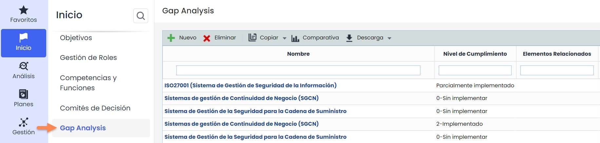

### Configuración de la pantalla

Los campos que aparecen en la siguiente imagen son los que vienen por defecto en la opción de GAP Analisys.

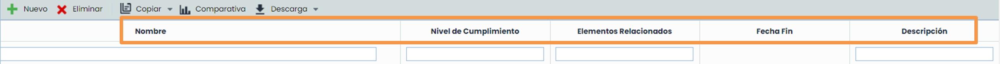

No obstante, se pueden configurar (eliminar, añadir, reordenar) desde **Ajustes > Configuración >** [**Compliance**](https://help.globalsuitesolutions.com/es/globalsuite/v1/configuracion-compliance). Se pueden añadir columnas con campos de tipo texto o fecha. Esta vista es común para las secciones de **GAP Analysis y Compliance.**

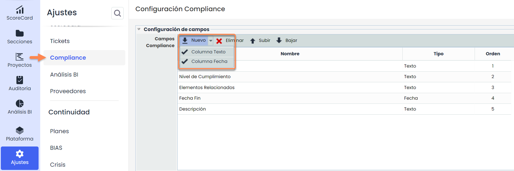

### Crear GAP Analysis

Una vez comprobado que el catálogo de Compliance necesario está configurado, accede a **Inicio >** [**Gap Analysis**](https://help.globalsuitesolutions.com/es/globalsuite/v1/gap-analysis) y pulsa **Nuevo**. Selecciona el catálogo en la lista (configurado previamente en **Ajustes >** [**Catálogos Compliance**](https://help.globalsuitesolutions.com/es/globalsuite/v1/catalogos-compliance)), haz clic en **Crear** y cierra la ventana emergente para volver a la pantalla inicial.

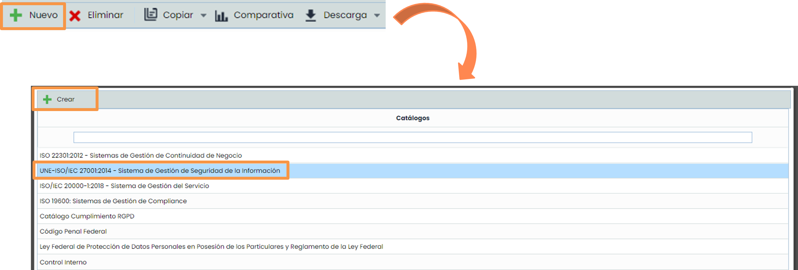

Para acceder al Gap Analysis, una vez creado en el paso anterior, se pulsará sobre el nombre del mismo.

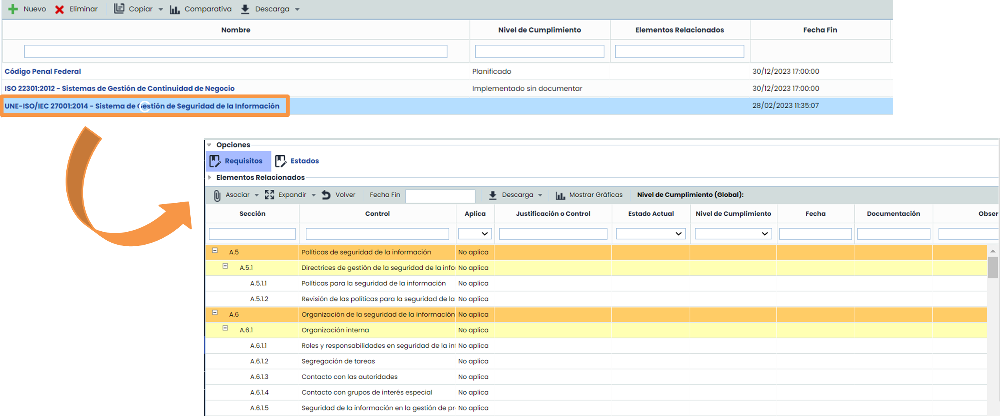

### Aplicar y modificar requisitos

Para realizar el GAP Analysis primero se deberá identificar qué requisitos le aplican a la organización. Haciendo doble click en la columna del requisito se podrá elegir entre “Aplica” y “No aplica”.

* **Aplica**: El requisito se puede dar en la organización o está incluido en el alcance de esta primera adecuación a la norma.
* **No aplica:** El requisito no se puede dar en la organización o no está incluido en el alcance de esta revisión de la norma.

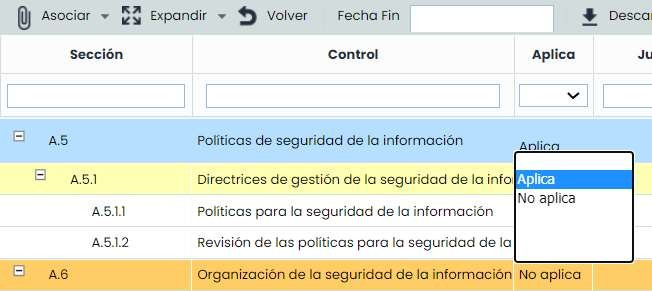

Una vez que elija la Aplicabilidad del requisito podrá modificar el resto de columnas.

* **Justificación o Control:** Campo de tipo texto donde podrá explicar la aplicabilidad del requisito.
* **Estado Actual:** Lista desplegable para seleccionar el grado de completitud del requisito. Estos estados podrán definirse en la pestaña de “Estados” (nombre y porcentaje de completitud).
* **Nivel de Cumplimiento:** A nivel de requisito muestra el Estado Actual; a nivel de subgrupo o grupo muestra el resultado de la fórmula seleccionada en la pestaña de “Estados” (véase paso 5).
* **Fecha:** Registro de la fecha de completitud del requisito.
* **Documentación**: Permite asociar documentación para evidenciar el cumplimiento del requisito.
* **Observaciones:** Campo de tipo texto donde se podrá añadir cualquier comentario al requisito.
* **Controles Agrupados\***: Permite asociar los controles de los análisis de riesgos que la organización tenga implantados para evidenciar el cumplimiento.
* **Tickets\*:** Permite asociar tickets de cualquier tipo a un requisito (Incidencias, No Conformidades, Requerimientos, Correctivas y Preventivas, etc.)


\*\*\\\*\*\* Estas opciones por defecto están ocultas a nivel de tabla, para visualizarlas deberá hacer click con el botón derecho en cualquiera de los títulos de las columnas y marcarlas con un tick en el desplegable.


A continuación, se explica en detalle las opciones anteriores.

### Definir estados de GAP Analysis

Los estados vienen definidos por defecto pero se pueden modificar pulsando la opción Estados.

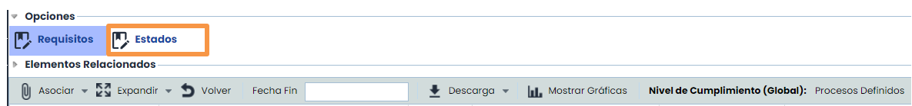

En esta pantalla podrá **añadir, eliminar, modificar el Nombre y el % de Completitud.** Estos nombres son los que se podrán elegir en los requisitos del GAP Analysis. El % de Completitud servirá para calcular el porcentaje de un conjunto de requisitos y las gráficas asociadas.\
Asimismo, deberá seleccionar del desplegable **Fórmula Nivel de Cumplimiento** cómo quiere que se muestre el Nivel de Cumplimiento de los grupos y subgrupos del GAP Analysis

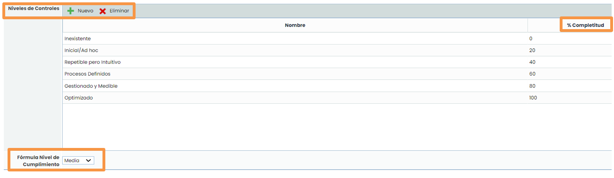

### Evaluar requisitos

Para la valoración del % de Cumplimiento dentro del GAP: hacer doble click en la columna “Estado Actual” .

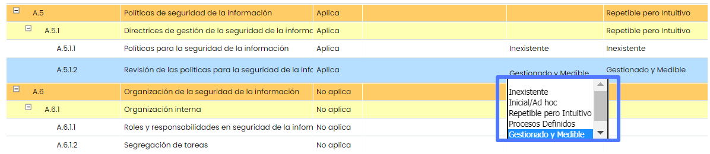

#### Definición Fecha.

Pulsando sobre la **columna Fecha**, saldrá un calendario donde podrá elegir el mes, día y hora del cumplimiento del control:

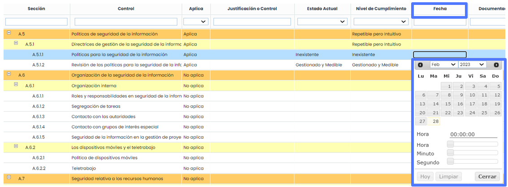

#### Asociación de Documentación.

Se deberá seleccionar el requisito que desea asociar. Pulsar el botón **Asociar** – Asociar Documentación. Se abrirá una ventana emergente con el gestor documental de la herramienta (imagen de la derecha).\
Pulsando el botón **Guardar Cambios** se relacionará con el requisito.

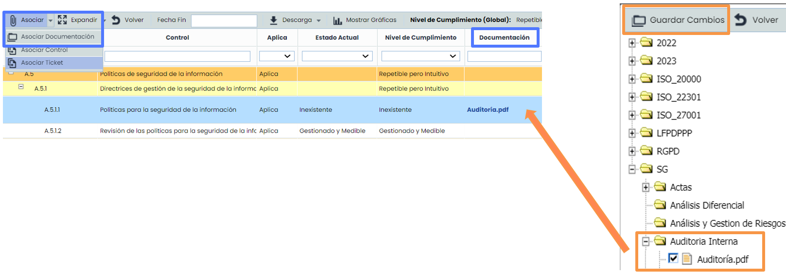


\*\*Solo\*\* se podrán asociar documentos que se hayan cargado previamente al Gestor Documental.


#### Asociar Controles

Seleccionar el requisito en la tabla, pulsar el botón **Asociar > Asociar Control**

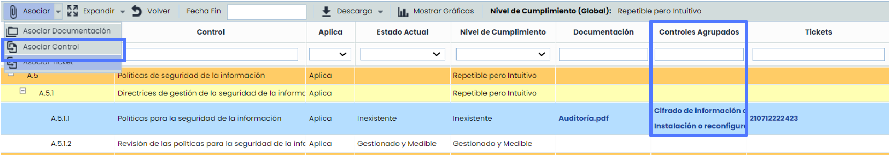

Se abrirá una ventana emergente con los controles de la organización (estos controles se gestionan en **Análisis >** [**Gestión de Controles**](https://help.globalsuitesolutions.com/es/globalsuite/v1/gestion-de-controles)). Debe marcarcar la columna izquierda los controles y pulse **Asociar Controles**

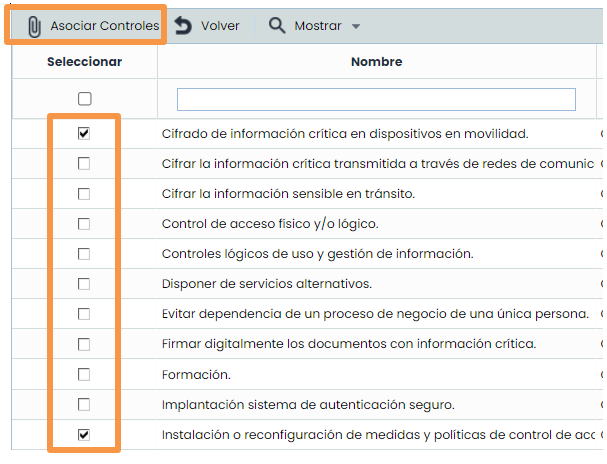

#### Asociar Tickets.

Seleccionar el registro en la tabla, pulsar el botón **Asociar> Asociar Tickets** (los tickets se registran en **Gestión** > Tickets / Incidencias / Eventos de Pérdida / etc.)

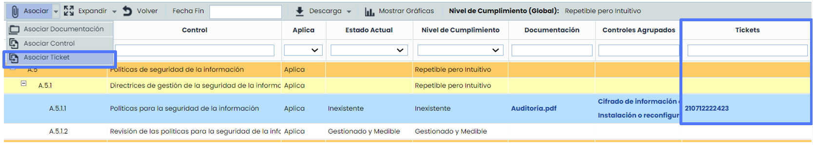

Se abrirá la siguiente ventana emergente, debe seleccionar los tickets marcando la columna izquierda y pulse la X para volver a la pantalla de requisitos.

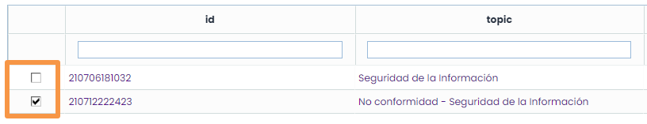

### Evaluar resultados

Pulsando el botón “Mostrar Gráficas” podrá ver de una forma visual el resultado del GAP Analysis.

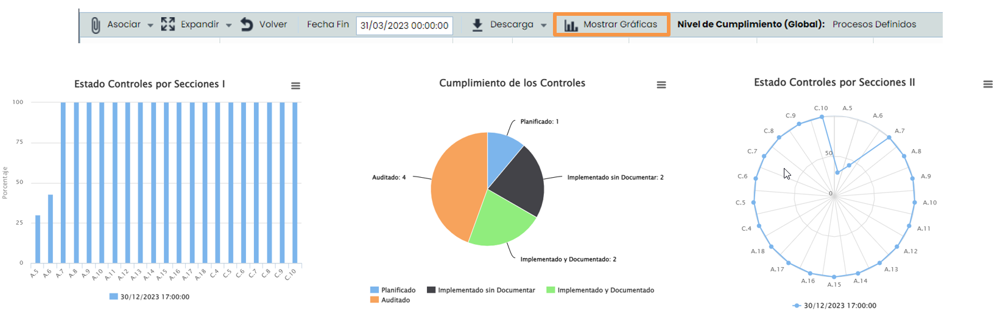

### Copiar GAP Analysis

Una vez que se realice el cumplimiento del análisis de brecha del GAP Analysis, GlobalSuite® permite realizar dos tipos que copias que tienen la siguiente finalidad:

* **Copiar en Compliance:** Si la organización quiere realizar un seguimiento continuo de la norma a la que se ha realizado el GAP, podrá pulsar el botón Copiar – Copiar en Compliance. Se creará un nuevo Compliance que podrá modificar en la opción Análisis – Compliance
* **Copiar en GAP:** Si la empresa necesita realizar un GAP Analysis parecido, deberá pulsar el botón Copiar – Copiar en GAP.

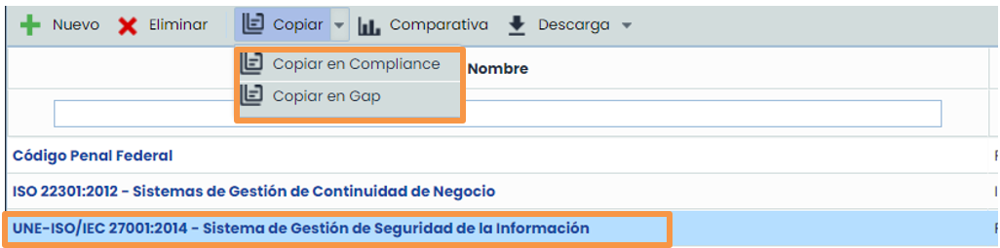

## Plan de Adecuación

### Creación del Plan de Adecuación

Una vez terminado el GAP Analysis, GlobalSuite® permite crear un plan con aquellos requisitos que la organización no cumple y por tanto el responsable del análisis de brecha debe realizar para cumplir con la norma.

En **Inicio >** [**Plan de Adecuación**](https://help.globalsuitesolutions.com/es/globalsuite/v1/plan-de-adecuacion), se puede elegir sobre qué norma se realizará dicho plan. En la lista desplegable saldrán las normas en las que se haya realizado un GAP Analysis.

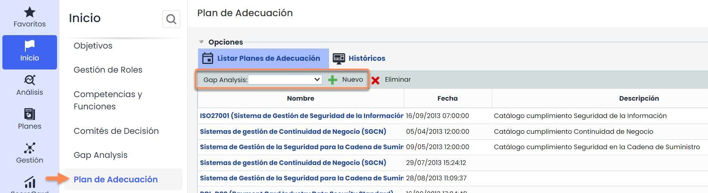

Después de seleccionar un GAP Analysis de la lista desplegable y crearlo, se hace click sobre el nombre y se abre una venta con aquellos requisitos de la norma que no estén implantados al 100% en la organización, es decir, que se mostrarán aquellos controles que aún no estén en el último estado (100%) de los estados definidos en el GAP.

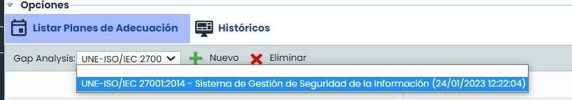 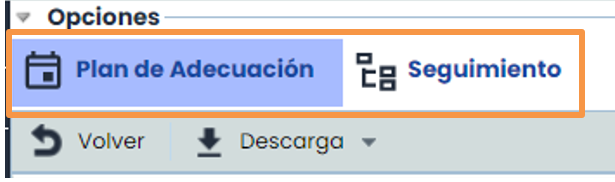

Al entrar se pueden ver dos opciones para gestionar el **Plan de Adecuación**:

1. Plan de Adecuación
2. Seguimiento

Una vez mostrados los requisitos se deberá hacer click en el nombre de cada uno para acceder a su ficha y editarla:

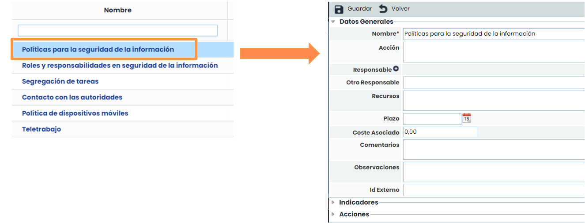 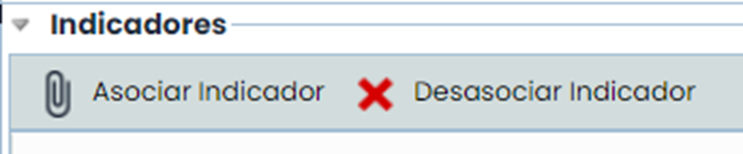

Además, se tendrá la opción de **Asociar Indicadores** que previamente hayan sido definidos en la opción **ScoreCard>** [**Indicadores**](https://help.globalsuitesolutions.com/es/globalsuite/v1/indicadores). En caso de no tener indicadores, se pasará a la pestaña de Acciones.

### Seguimiento del Plan de Adecuación

Por último, será necesario establecer las acciones que habrá que realizar para conseguir cada requisito y poder llevar acabo un seguimiento definiendo el grado de avance del plan de adecuación.\
Pulsando el botón **Nueva**, se podrá añadir las acciones deseadas.

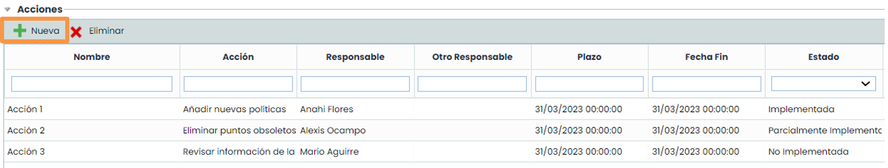

El resultado de lo anterior se podrá observar resumido de la siguiente forma en la opción de **Seguimiento**:

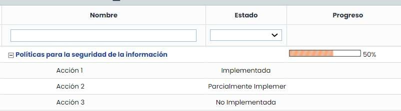

Para realizar el seguimiento, se deberá ingresen del submenú superior **Seguimiento**.

Acto seguido aparecerán los **requisitos** de plan de tratamiento junto con las acciones que se hayan determinado para cada uno; de esta forma se podrá valorar el grado de implantación en la organización de cada una de las acciones (configurable en **Ajustes > Metodologías >** [**Elementos**](https://help.globalsuitesolutions.com/es/globalsuite/v1/metodologia-elementos)).

Asimismo, se observará el **progreso** del conjunto de Acciones, que se calcula en función de los estados de estas.

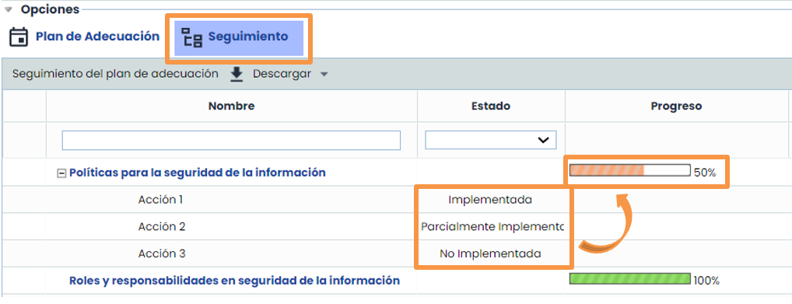
