# ¿Cómo configurar roles con Acceso Gerencial?


Este tutorial explica, cómo crear y asignar un \*\*Rol con Acceso Gerencial\*\* en GlobalSuite®. Este tipo de rol permite limitar la visibilidad de los usuarios a los elementos, procesos, servicios, indicadores y análisis que estén directamente asociados a los Serviciosde los que son responsables, garantizando así un acceso segmentado y seguro dentro de la organización


## Roles de Empresa

### Paso 1. Generación de Roles de Empresa

GlobalSuite® permite establecer diferentes tipos de roles de acceso que aseguren la confidencialidad en la utilización de opciones de la plataforma.

Para la gestión de los Roles se debe acceder a Ajustes > [Roles de Empresa](https://help.globalsuitesolutions.com/es/globalsuite/v1/roles-de-empresa)

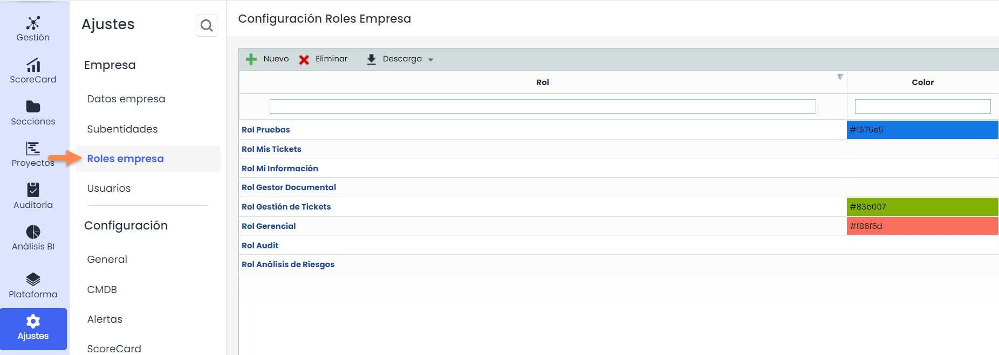

### Paso 2. Configuración de accesos de los Roles de Empresa

Para determinar los permisos de acceso del Rol generado, se hace accediendo a la pantalla de permisos donde se permite:

*

    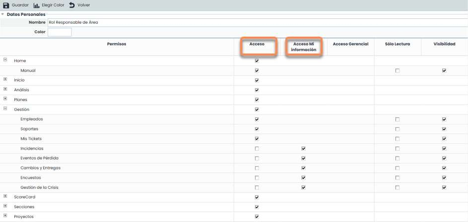

    Acceso: Al seleccionar la columna de acceso el usuario que disponga de este rol podrá acceder a todos los registros e información de la opción marcada.
* Acceso Mi Información: Este permiso permite acceder a la opción especificada pero únicamente accediendo a los registros de los que el usuario con este rol es responsable. El resto de registros de esa opción no serán visibles para el usuario.

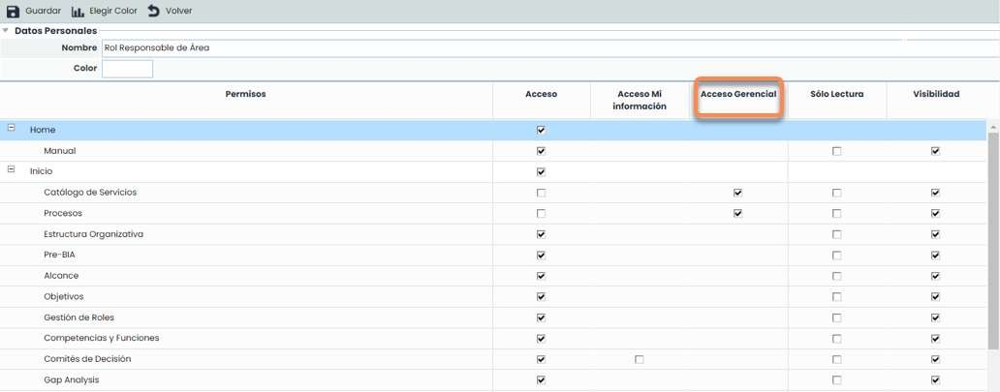

Acceso Gerencial: Este permiso permite acceder a la opción especificada, pero únicamente a los elementos que dependen de los Servicios donde el usuario-empleado que tiene asignado este rol es responsable.

Nota: las dependencias de los elementos (procesos, elementos…) con los servicios se visualizan en la opción Inventario > [Árbol de elementos](https://help.globalsuitesolutions.com/es/globalsuite/v1/arbol-de-elementos).

Ejemplo: este permiso permite acotar la visualización a toda la información que dependa de un determinado servicio, ocultando aquella que no esté directamente relacionada con el mismo.

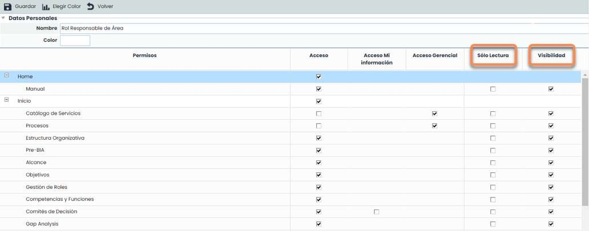

* Sólo Lectura: Permite definir el acceso (con independencia del tipo) a una determinada opción, pero tan sólo en modo consulta.
* Visibilidad: Permite utilizar información de la opción marcada, aún cuando no se tenga acceso de gestión a la misma. Ejemplo: desde la opción [Inventario](https://help.globalsuitesolutions.com/es/globalsuite/v1/inventario) se pude asignar un "Empleado" como responsable de un Elemento, pero no se quiere que ese usuario tenga acceso a la opción de [Empleados](https://help.globalsuitesolutions.com/es/globalsuite/v1/empleados). En ese caso, la opción de "Empleados" tendrá marcado el check de "Acceso", pero no el de "Visibilidad".

### Paso 3. Guardado del Rol de Empresa establecido

Para finalizar con la creación del Rol establecido, se precisa guardar la configuración establecida pulsando el botón guardar.

De forma complementaria a la acción anterior, GlobalSuite® permite realizar la asociación de colores que facilite la búsqueda y asignación del Rol a un determinado usuario que esté siendo configurado. Para ello se tendrá que seleccionar la opción Elegir Color, mostrando una escala de colores que permite asociarlos al Rol generado.

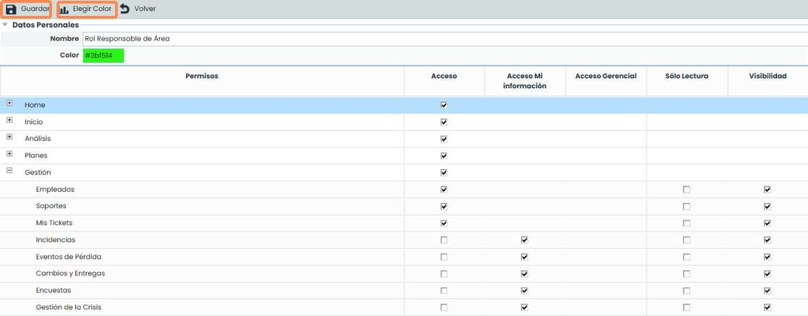

## Diferencia entre usuarios y empleados

En GlobalSuite®, un empleado es cualquier persona que tenga algún papel relevante dentro de la organización. La gestión de los mismos se hace a través de la opción Gestión > [Empleados](https://help.globalsuitesolutions.com/es/globalsuite/v1/empleados).

Los **usuarios** son las personas que acceden a GlobalSuite® para gestionar información. Éstos se gestionan a través de la opción Ajustes > Usuarios. Como se ha visto en esta guía los usuarios pueden tener asignado un Rol de Empresa.

Para el funcionamiento adecuado de algunas de las opciones de estos Roles de Empresa (como Acceso Gerencial o Acceso a Mi Información), es posible indicar que un empleado corresponde a un usuario.

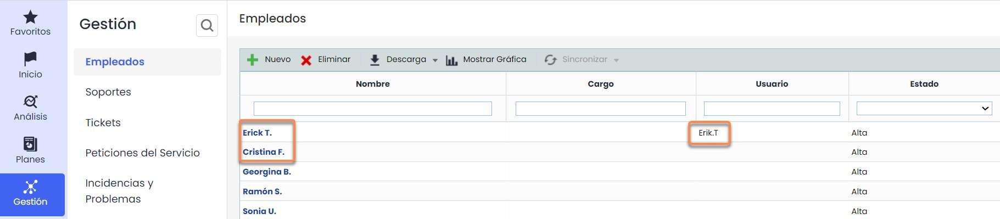

Para relacionar los usuarios y empleados se puede hacer de dos maneras:

* La primera, y más recomendable, es hacerlo cuando se está creando al usuario a través del check “Crear empleado”, que creará un empleado automáticamente en el sistema de gestión y lo relacionará con este Usuario.
* La segunda opción sería, en caso de tener ya el usuario creado sin haber marcado el check anterior, aparecerá en la opción Gestión/Empleados un campo desplegable llamado “Usuario” para realizar la asociación de manera manual dentro del formulario. Este desplegable contiene todos los usuarios que no tienen empleado asociado.

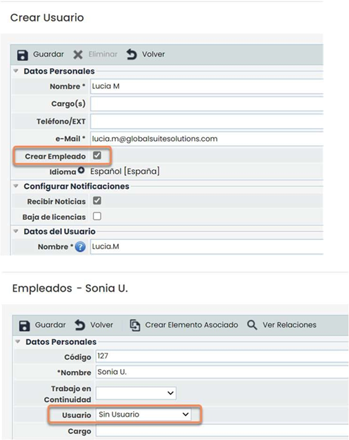

## Rol Acceso Gerencial

Para que este Rol tenga un funcionamiento correcto, se debe asociar a un usuario de GlobalSuite® que a su vez sea empleado.

Este usuario será un Usuario Enterprise, al que se le podrá asociar un Rol que se haya creado previamente, en este caso, un Rol con Acceso Gerencial.

Como se ha comentado anteriormente, el Acceso Gerencial permite acceder a la opción especificada, pero únicamente a los elementos que dependen de los Servicios donde el usuario/empleado que tiene asignado este rol es responsable. En otras palabras, permite al usuario entrar en las diferentes opciones en las que se le haya dado acceso, pero visualizando únicamente los elementos que dependan de los servicios que tiene asignados.

Para que esto suceda hay que seguir una serie de pasos, que se detallan en las siguientes diapositivas.

### Paso 1. Creación del Rol de Empresa

Primero hay que crear el Rol de Empresa con Acceso Gerencial.

En este caso se creará un Rol en el que se quitará el acceso a las diferentes opciones, y solo se le dejará el acceso a las opciones que tengan Acceso Gerencial.

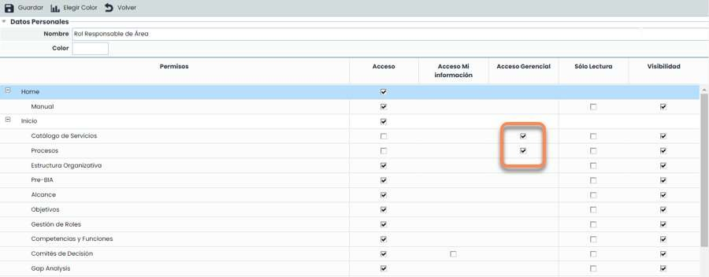

Con esto, se está configurando en la herramienta que las personas que tengan asociado este Rol no podrán ver ninguna de las opciones de las que se le haya quitado el acceso. Y en las opciones que tengan acceso gerencial, solo podrán ver información si pertenecen a servicios que se les haya asociado.

### Paso 2. Asociación usuario a Rol

Una vez creado el Rol, en la ficha de los usuarios se puede asignar a los mismos.

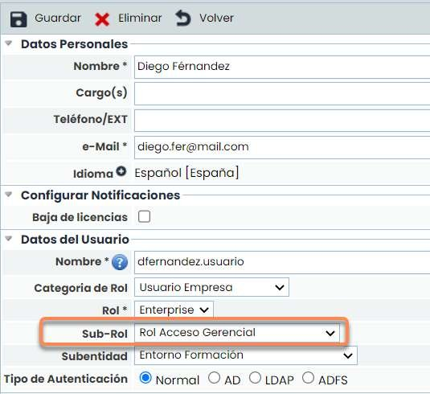

### Paso 3. Asignación de Rol a usuario

Como se ha explicado en el punto "2 - Diferencia entre usuarios y empleados", los usuarios a los que se les haya asociado este rol/perfil de acceso, deben tener un Empleado asociado. A su vez, estos empleados pueden ser organizados por roles (que sería equivalente al Cargo o Equipo de Trabajo en la organización). Esta organización de roles se realiza en la opción Inicio > [Gestión de Roles.](https://help.globalsuitesolutions.com/es/globalsuite/v1/gestion-de-roles)

En esta opción se podrá asociar a los usuarios con los Roles de la empresa a los que pertenezcan para, más adelante, poder asignarlos a los diferentes servicios.

Para poder asignarles a un Rol, primero hay que crear dichos Roles. Estos se crean en Ajustes > Configuración > [General](https://help.globalsuitesolutions.com/es/globalsuite/v1/configuracion-general).

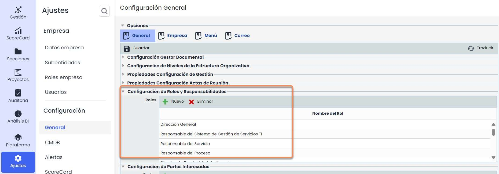

También se pueden crear los Roles si se accede desde Inicio > [Gestión de Roles](https://help.globalsuitesolutions.com/es/globalsuite/v1/gestion-de-roles) > Configurar Roles. Dicho botón llevará al usuario directamente a la pantalla de la diapositiva anterior.

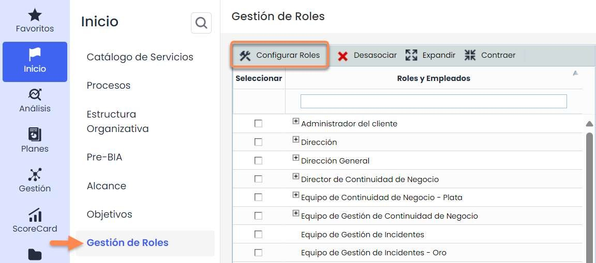

Una vez creados los Roles de la organización, se pasa al siguiente paso que es a la asociación de los Roles con los empleados.

Dicha asociación se realiza marcando con checks los empleados que se quieran asociar, a los roles que se quieran asociar, y pulsando el botón “Asociar”.

No es necesario que un Rol tenga asociado un empleado, ni viceversa, es decir, que el empleado esté asociado a ningún Rol. A su vez, un empleado puede estar asociado a 1 o “n” Roles.

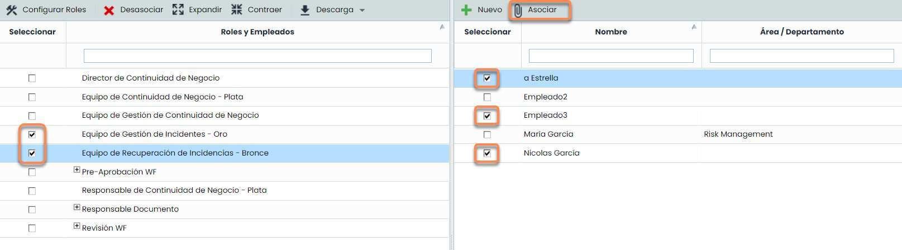

### Paso 4. Asignación a Servicios

Una vez asociados los empleados a los Roles, se asignarán estos Roles a los Servicios deseados.

Para ello hay que ir a Inicio > [Catálogo de Servicios](https://help.globalsuitesolutions.com/es/globalsuite/v1/catalogo-de-servicios), entrar en cada uno y asociarle uno o varios Roles. También se pueden seleccionar empleados concretos dentro del Rol asociado.

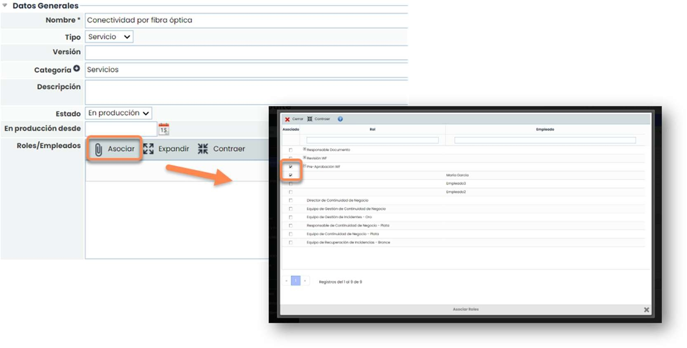

Estos usuarios que tienen el Rol Acceso Gerencial solo van a tener acceso a los Servicios a los que hayan sido asignados.

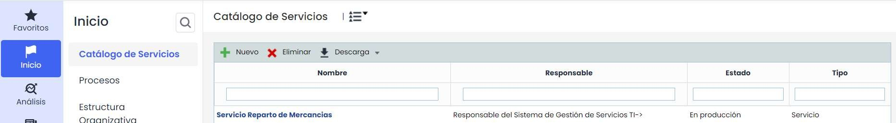

En cambio, un usuario con Acceso total a la opción de Servicios vería todos los Servicios de la organización.

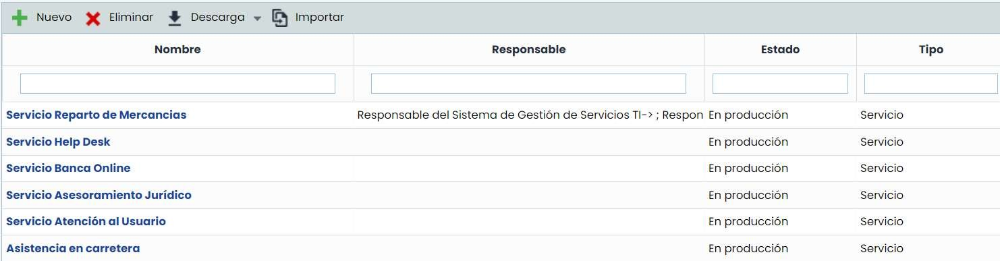

Un usuario con Rol Acceso Gerencial en la opción de Inventario podrá ver los procesos y elementos que estén asociados a dicho Servicio.

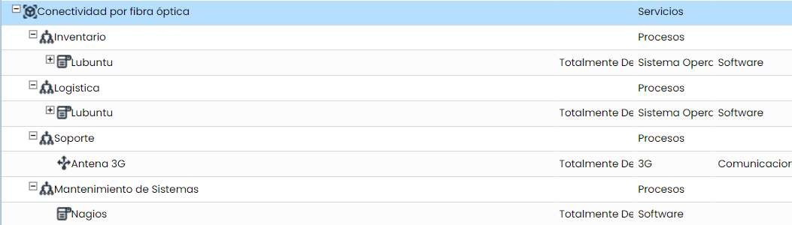

Pero un usuario con Acceso completo a la opción de Inventario podrá ver todos los procesos y elementos que estén asociados a los diferentes Servicios.

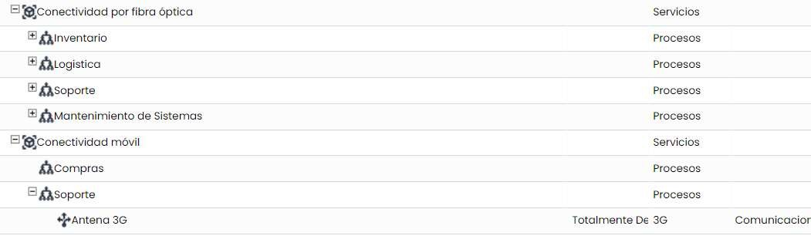 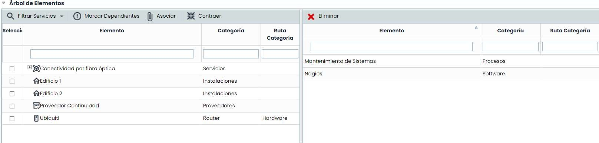

A la hora de realizar un análisis de riesgos, los usuarios con Rol Acceso Gerencial solo podrán realizarlo de los elementos que estén asociados al servicio de los que sean responsables.

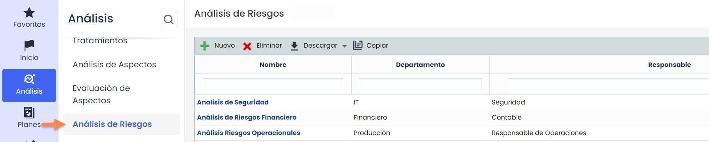

De hecho, si entra a cualquiera de estos análisis, en la “Información General”, el único servicio que aparece es el que los usuarios tienen asociado.

No aparece información relativa a otros servicios o elementos, salvo aquellos que no tengan vínculos en el árbol de dependencias.

En cambio, un usuario con Rol Acceso total a la opción de Análisis de Riesgos, podrá ver todos los análisis.

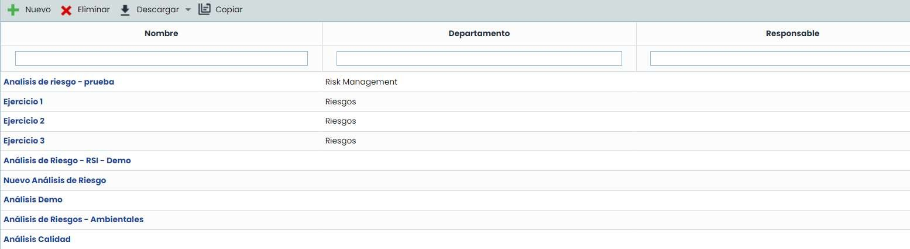

Y si entra a cualquiera de estos análisis, a la “Información General”, verá todos los servicios y elementos sin importar los usuarios que tienen asociados.

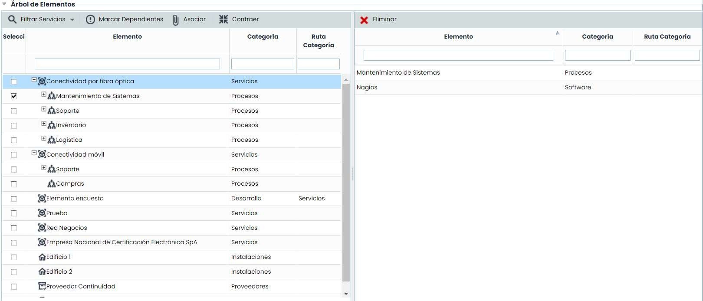

En el caso de los Indicadores y de las Métricas ocurre lo mismo. Solo aparecerán las que estén asignadas al Servicio en el que se ha asociado a los usuarios con Rol Acceso Gerencial.

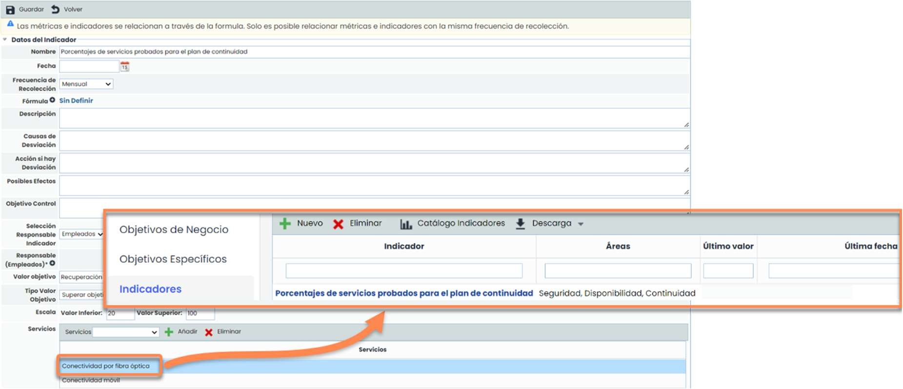

En cambio, los usuarios con Acceso total a las opciones de Indicadores y Métricas podrán ver todos los indicadores y métricas que estén configurados en la herramienta.

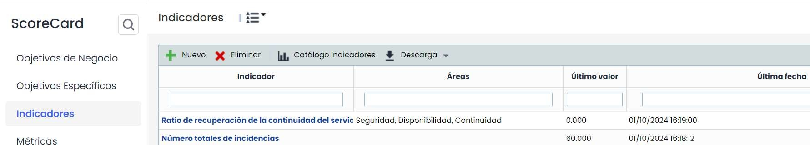 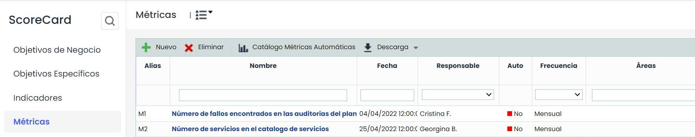
