# ¿Cómo configurar usuarios, roles y perfiles?

## Tipos de usuarios, roles y gestión de usuarios


En este tutorial aprenderás a configurar usuarios, roles y perfiles dentro de GlobalSuite®. Veremos los distintos tipos de usuarios, cómo crearlos y gestionarlos, además de cómo establecer roles de empresa y comprender la diferencia entre usuarios y empleados.


### Tipos de Usuarios

En GlobalSuite® existen dos grandes categorías de rol: **Administrador Empresa** y **Usuario Empresa**

#### Administrador Empresa

Por defecto GlobalSuite® dispone de diferentes roles administradores de empresa con distintos niveles de permisos:

* **Administrador Plataforma**: De los perfiles presentados, es el que mayores permisos posee. Es similar al siguiente rol _Administrador Enterprise_ pero siendo administrador plataforma se pueden crear nuevos usuarios Administradores Enterprise.
* **Administrador Enterprise**: Dispone de todos los permisos de administrador excepto crear otros usuarios Administradores Enterprise.

**Estos dos roles administradores tienen permisos para:**

* Acceso a cualquier entidad dentro de la estructura de la organización.
* Acceso a todas las opciones de GlobalSuite.
* De la misma forma, puede realizar consolidaciones de información disponible en otras entidades.
* Generar usuarios que pueden ser asociados a cualquier entidad.
* Realizar configuraciones en base a las opciones parametrizables de la plataforma, pudiendo propagar al resto de entidades generadas en niveles inferiores.
* **Administrador Configuración**: Perfil de administrador que permite la configuración de la organización sin acceso a la información. Accede a la sección de Administración de GlobalSuite® para la configuración de la empresa. No accede ni a las opciones de usuarios y roles. No accede a información del sistema de gestión de la empresa.
* **Administrador Accesos**: Este perfil permite la creación y gestión de usuarios en GlobalSuite® y acceso a los logs, sin disponer de acceso o administración en el resto de opciones y datos.
  * **Administrador Entidad** (sólo si se tienen entidades en la licencia GlobalSuite®): Este perfil dispone de permisos de administrador en determinadas entidades, pero no desde el primer nivel tal y como permite el Administrador Enterprise. De la misma forma permite llevar a cabo gestión de entidades, así como acciones de propagación y consolidación de información, pero no dispone de permisos para la generación de usuarios.

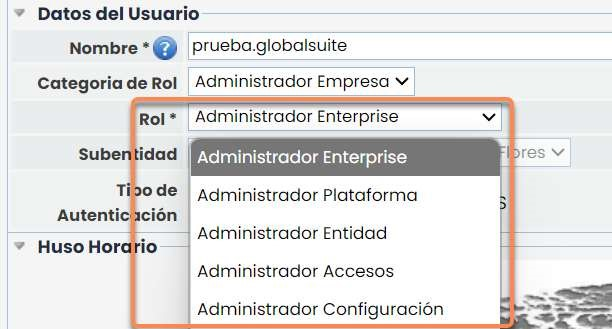

#### Usuario Empresa

Otros roles serían los de usuarios empresa que son descritos a continuación:

**Entidad**: Perfil de usuario que tendrá acceso a su propia entidad así como a las inferiores, pudiendo realizar propagación y consolidación de información entre diferentes niveles de entidades, pero no dispondrá de los permisos de administración de un Administrador Entidad.

**Enterprise**: Perfil de usuario que tendrá acceso a todas las opciones, pero no tiene acceso al menú de “Ajustes”, permitiendo tan sólo el uso de la configuración establecida de GlobalSuite®.

La selección de un determinado perfil se realizará a través del desplegable disponiblBe en la opción Categoría de rol y luego Rol.

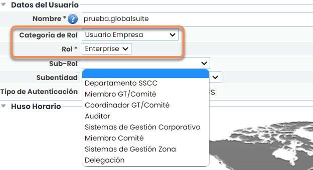

### Gestión de Usuarios

GlobalSuite® permite la generación de diferentes tipos de usuarios estableciendo diferentes roles y perfiles de acceso. Los pasos a seguir para la generación de usuarios son los siguientes:

#### Paso 1. Acceder a la Opción Usuarios

A través de la opción de Ajustes, en el menú principal, se podrá acceder a todas las opciones de configuración de la Plataforma y usuarios. Se debe seleccionar la opción “Usuarios”.

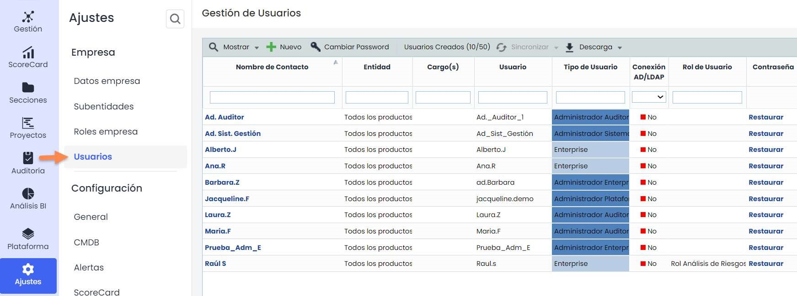

#### Paso 2. Definir información nuevo usuario

Se procederá a definir toda la información asociada al nuevo usuario. Las secciones de la presente opción de generación de usuario corresponde con:

Datos Personales: Permite determinar toda la información asociada al usuario, entre la que cabe destacar los campos obligatorios, correspondientes con el nombre de la persona y el email. En el email se recibirán las notificaciones de usuario, contraseña y link de acceso. El check de Crear empleado se explicará en la sección “Diferencia entre empleado y usuario”. De forma complementaria se tiene la definición del idioma.

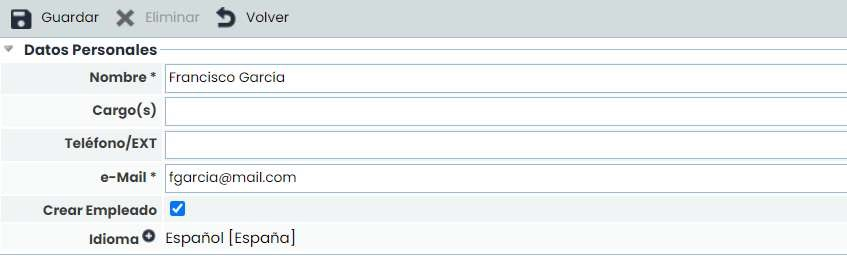

* Configurar Notificaciones: Permite configurar notificaciones acerca de las actualizaciones de GlobalSuite, así como de las bajas de alguno de los módulos contratados.
* Datos del Usuario: En la presente sección se permite establecer el nombre de usuario de acceso a la plataforma, así como el establecimiento de la Categoría del rol, Rol asociado y Subentidad.

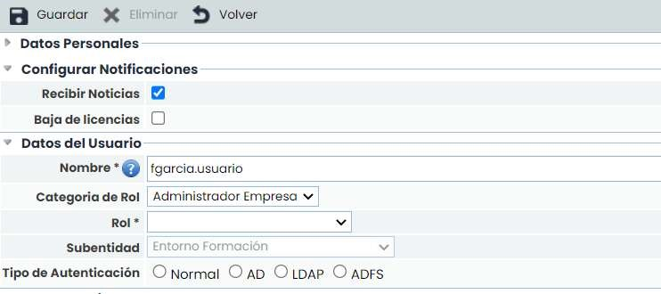

Huso Horario: Permite establecer el huso horario asociado a la plataforma y el país del usuario pinchando el país en el mapa o seleccionándolo en el desplegable País.

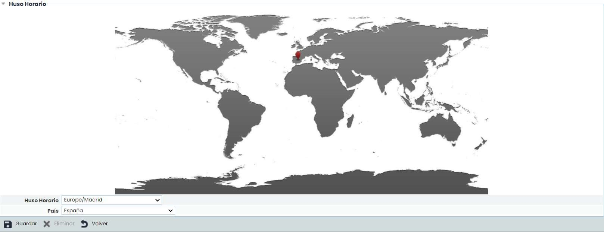

#### Paso 3. Asignación de perfiles, roles y otros

Para asignar los permisos adecuados a cada uno de los usuarios generados, se procederá a definir la Categoría de Rol, Rol, Sub-Rol y Subentidad. Para ello se deben rellenar los campos:

* Categoría de Rol: Permite diferenciar entre administradores y usuarios empresa.
* Rol: Permite indicar el tipo de administrador o usuario empresa.

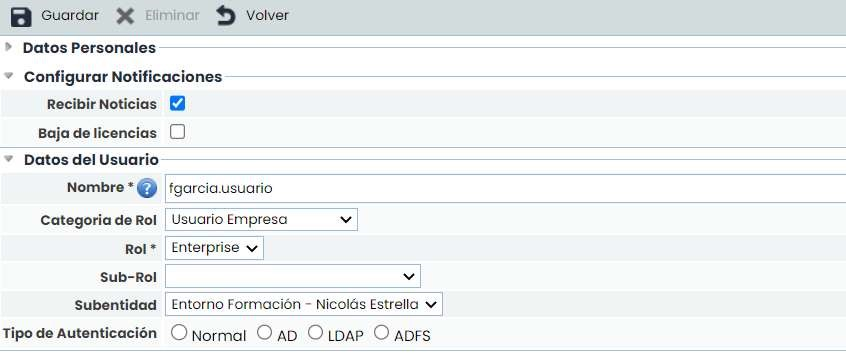

Sub-Rol: Permite asociar el sub-rol que determina los permisos de acceso del usuario generado. Los sub-roles que aparecerán en el desplegable son los configurados en GlobalSuite® (opción “Roles de Empresa”, que se explicará a continuación). Este sub-rol sólo es aplicable a usuarios Enterprise o Entidad.

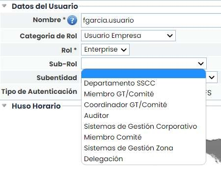

* Subentidad: Permite asociar a qué entidad tendrá acceso el usuario (sólo aparecen en aquellos entornos que dispongan de varias entidades).
  * Tipo de Autenticación:
* Normal: Es la autenticación propia que se implementa manualmente en GlobalSuite.
* AD: Se usa el usuario del Directorio Activo de la empresa cliente para acceder a GlobalSuite.
* LDAP: Similar a "AD", utilizando el protocolo específico de LDAP.
* ADFS: Permite el acceso a GlobalSuite mediante un Directorio Activo Federado.

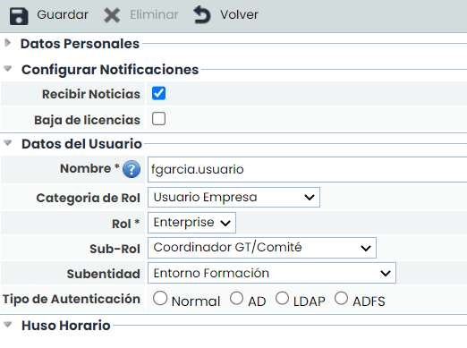

Tipo de Autenticación: Para relacionar un usuario mediante AD, LDAP o ADFS, se deberá hacer clic en el botón “usuario relacionado”. Se abrirá una ventana donde se debe seleccionar y asociar el usuario.

* La tabla de “Usuarios Dependientes” muestra los usuarios a los que tendrá acceso el propio usuario que está siendo creado. Esto permite que organizaciones con entidades, pueda facilitar un único usuario con acceso a varias entidades, sin necesidad de tener que crear un usuario por cada una de las entidades o empresas con licencia Enterprise.
* La opción “Acceso Empresa propia” permite marcar si se permite el acceso del usuario a su propia empresa o, por el contrario, solo tendrá acceso a las entidades con las que se ha relacionado y que se visualizan en el apartado anterior de “Usuarios Dependientes”.

#### Paso 4. Guardado y envío de correo electrónico automatizado

Para la generación definitiva del usuario, se debe pinchar en el botón guardar, lo que conlleva el envío automático de un correo electrónico al email indicado, donde aparecerá la siguiente información:

* Dirección acceso a la plataforma: Permite realizar el acceso a GlobalSuite®.
* Usuario: Usuario definido para realizar el acceso a GlobalSuite®.
* Contraseña: Se realiza el envío de la contraseña al mismo correo asignado en la definición del usuario.

Mediante esta forma de proceder se asegura la confidencialidad de los datos de acceso del usuario a la plataforma.

**Restauración de contraseñas**

* Una vez generados los usuarios, si se detecta o recibe aviso de que existe algún tipo de incidencia en el acceso, desde la pantalla principal de usuarios, donde GlobalSuite® nos muestra el listado completo de los usuarios con acceso a la plataforma, se puede realizar la restauración de la contraseña del usuario, a través del botón restaurar, disponible en la última columna de información asociada al mismo.
* Una vez restaurada, GlobalSuite® realizará el envío automático de la contraseña al e-mail asociado al usuario.

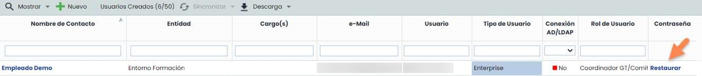

Por otra parte, para llevar a cabo la eliminación de un determinado usuario, será necesario realizar el acceso a la información de configuración del mismo, pulsando sobre su nombre. Una vez accedido, se procederá a seleccionar el botón “Eliminar”, desde donde se eliminará el usuario y por tanto todos los permisos de acceso a la plataforma asociados al mismo.

### Roles de Empresa

GlobalSuite® permite la gestión de cada uno de los usuarios a través de Roles de acceso, que se pueden configurar para que se tengan diferentes permisos de acceso para cada tipo de Rol.

#### Paso 1. Generación de Roles de Empresa

GlobalSuite® permite el establecimiento de diferentes tipos de roles de acceso que aseguren la confidencialidad en la utilización de opciones de la plataforma.

Para la gestión de los Roles se debe acceder a Ajustes > [Roles de Empresa](https://help.globalsuitesolutions.com/es/globalsuite/v1/roles-de-empresa).

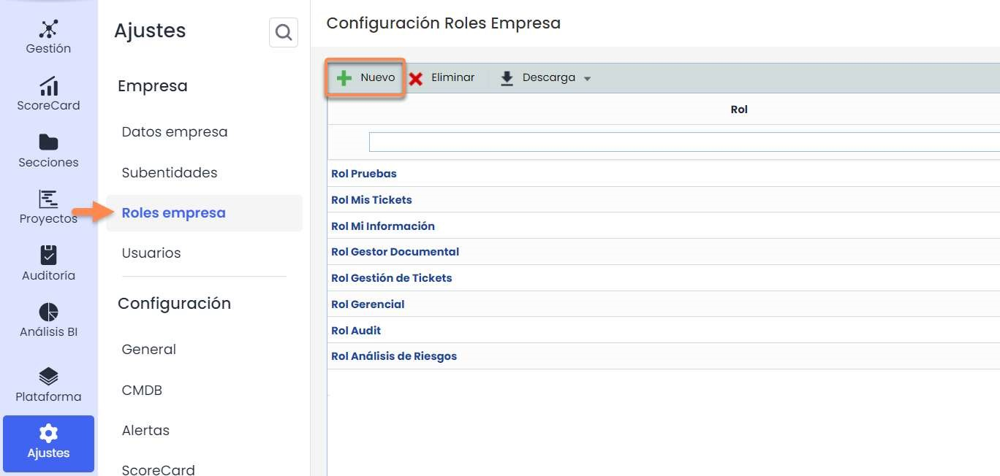

#### Paso 2. Configuración de accesos de los Roles de Empresa

Para determinar los permisos de acceso del Rol generado, se hace accediendo a la pantalla de permisos donde se permite:

* Acceso: Al seleccionar la columna de acceso el usuario que disponga de este rol podrá acceder a todos los registros e información de la opción marcada.
* Acceso Mi Información: Este permiso permite acceder a la opción especificada pero únicamente accediendo a los registros de los que el usuario con este sub-rol es responsable. El resto de registros de esa opción no serán visibles para el usuario.

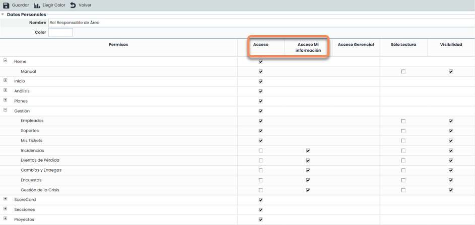

Acceso Gerencial: Este permiso permite acceder a la opción especificada, pero únicamente a los elementos que dependen de los Servicios donde el usuario-empleado que tiene asignado este rol es responsable.

Nota: las dependencias de los elementos (procesos, elementos…) con los servicios se visualizan en la opción “Inventario”.

Ejemplo: este permiso permite acotar la visualización a toda la información que dependa de un determinado servicio, ocultando aquella que no esté directamente relacionada con el mismo.

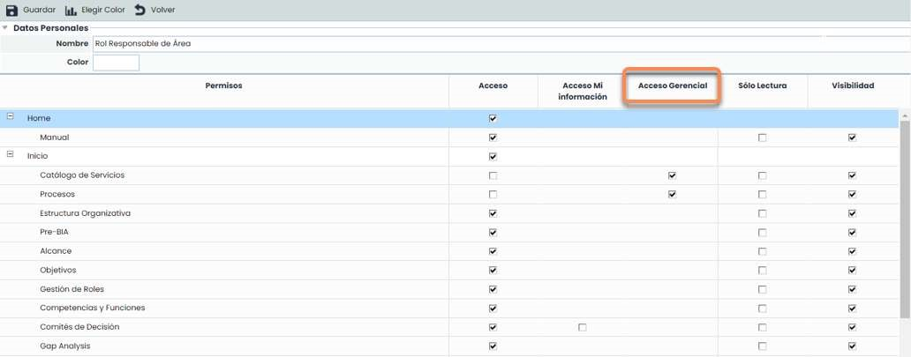

* Sólo Lectura: Permite definir el acceso (con independencia del tipo) a una determinada opción, pero tan sólo en modo consulta.
* Visibilidad: Permite utilizar información de la opción marcada, aún cuando no se tenga acceso de gestión a la misma. Ejemplo: desde la opción "Inventario" se pude asignar un "Empleado" como responsable de un Elemento, pero no se quiere que ese usuario tenga acceso a la opción de "Empleados". En ese caso, la opción de "Empleados" tendrá marcado el check de "Acceso", pero no el de "Visibilidad".

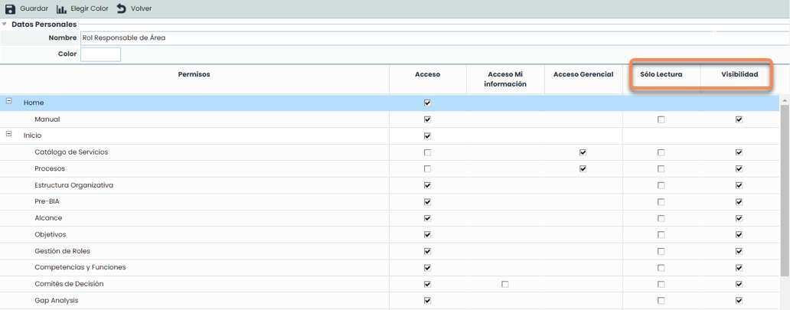

#### Paso 3. Guardado del Rol de Empresa establecido

Para finalizar con la creación del Rol establecido, se precisa guardar la configuración establecida pulsando el botón guardar.

De forma complementaria a la acción anterior, GlobalSuite® permite realizar la asociación de colores que facilite la búsqueda y asignación del Rol a un determinado usuario que esté siendo configurado. Para ello se tendrá que seleccionar la opción Elegir Color, mostrando una escala de colores que permite asociarlos al Rol generado.

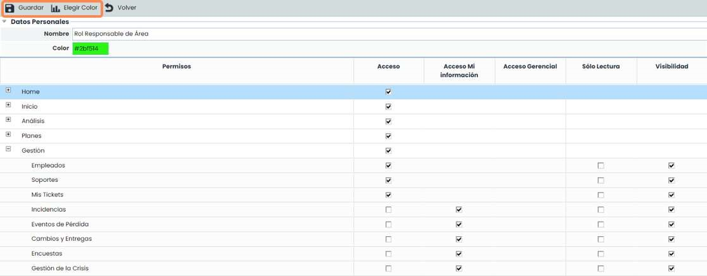

### Diferencia entre Usuarios y Empleados

En GlobalSuite®, un empleado es cualquier persona que tenga algún papel relevante dentro de la organización. La gestión de los mismos se hace a través de la opción Gestión > [Empleados](https://help.globalsuitesolutions.com/es/globalsuite/v1/empleados).

Los usuarios son las personas que acceden a GlobalSuite para gestionar información. Éstos se gestionan a través de la opción Ajustes > [Usuarios](https://help.globalsuitesolutions.com/es/globalsuite/v1/usuarios). Como se ha visto en este tutorial, los usuarios pueden tener asignado un Rol de Empresa.

Para el funcionamiento adecuado de algunas de las opciones de estos Roles de Empresa (como Acceso Gerencial o Acceso a Mi Información), es posible indicar que un empleado corresponde a un usuario.

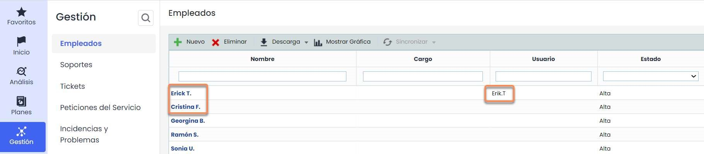

Para relacionar los usuarios y empleados se puede hacer de dos maneras:

* La primera, y más recomendable, es hacerlo cuando se está creando al usuario a través del check “Crear empleado”, que creará un empleado automáticamente en el sistema de gestión y lo relacionará con este Usuario.
* La segunda opción sería, en caso de tener ya el usuario creado sin haber marcado el check anterior, aparecerá en la opción Gestión > [Empleados](https://help.globalsuitesolutions.com/es/globalsuite/v1/empleados) un campo desplegable llamado “Usuario” para realizar la asociación de manera manual dentro del formulario. Este desplegable contiene todos los usuarios que no tienen empleado asociado.
