# ¿Cómo definir y gestionar servicios y procesos en GlobalSuite®?


En este artículo explicamos cómo registrar los servicios y procesos de negocio en GlobalSuite®, crear sus catálogos, definir dependencias entre ellos y visualizar su relación con la estructura organizativa y las partes interesadas. La gestión de servicios y procesos en GlobalSuite® permite documentar los servicios (y productos) ofrecidos por la organización y los procesos que los soportan. Todas estas opciones se encuentran disponibles desde el apartado \*\*Inicio\*\*.


## Configuración Inicial

### Fases para la configuración inicial del Sistema de Continuidad

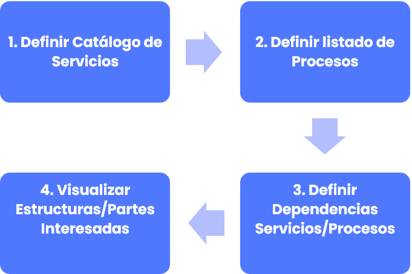

## 1. Definir Catálogo de Servicios

La opción “**Catálogo de Servicios**” permite la generación y consulta de los servicios de la entidad, así como la opción “Procesos” permite gestionar los procesos de la organización.

Ambas opciones se encuentran enlazadas a través de la pestaña “Árbol de Procesos” incluida dentro de la opción “Procesos”. Esta pestaña permite determinar las relaciones existentes entre los servicios y los procesos, identificando qué procesos son necesarios para prestar los servicios o entregar los productos.

### Definir Catálogo de Servicios

Para gestionar el catálogo de servicios y productos de la entidad hay que seleccionar la opción “[**Catálogo de Servicios**](https://help.globalsuitesolutions.com/es/globalsuite/v1/catalogo-de-servicios)”, disponible en el apartado “**Inicio**” de GlobalSuite®.

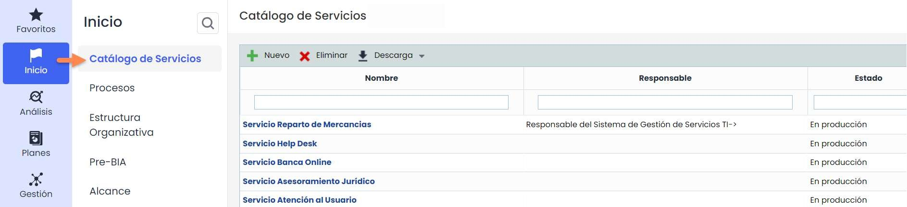

Al acceder a la opción “**Catálogo de Servicios**”, se muestra el listado de servicios y productos de la entidad. En esta opción se pueden crear, eliminar y modificar los servicios.

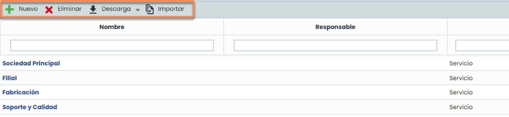

Como parte de la pantalla principal, GlobalSuite® permite ejecutar las siguientes acciones:

* **Nuevo**: permite generar nuevos servicios y productos.
* **Eliminar**: permite eliminar servicios y productos ya existentes.
* **Descarga**: permite descargar el listado de servicios y productos en diferentes formatos. Incluye también un archivo modelo que se utiliza para importar datos de forma masiva.
* **Importar**: permite importar un listado de Servicios de forma masiva. Es necesario utilizar el archivo modelo de la pestaña “Descarga” para realizar la carga.

#### Carga masiva de Servicios. _(Disponible solo con la licencia de Data Import.)_

* **Descarga del modelo de importación**

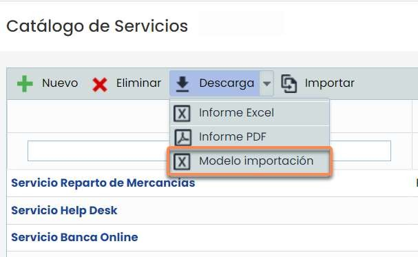

La descarga del archivo “Modelo Importación” se ejecutará en segundo plano y deberá acceder a la sección de descargas pendientes para abrirlo.

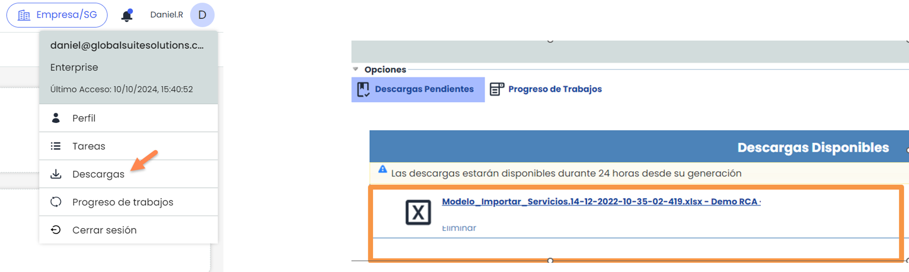

* **Importación**

Al pulsar el botón “Importar”, aparecerá la pantalla de importación. El archivo a cargar deberá tener formato XLSX, no deberá superar los 1000 registros y los campos obligatorios estarán marcados con un asterisco. Una vez seleccionado el archivo que desea cargar, pulse el botón “Continuar”.

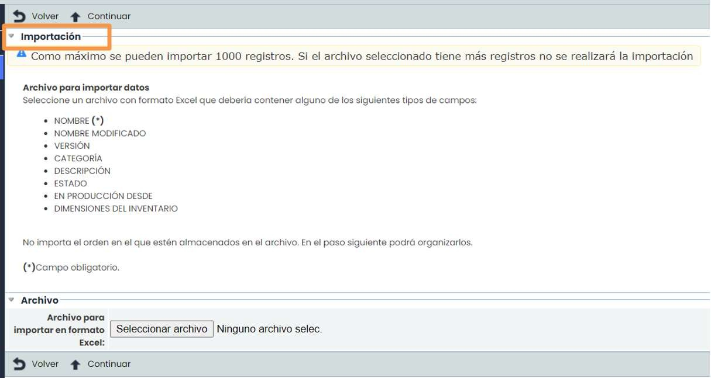

#### Nuevo servicio

La definición de un nuevo servicio se realiza pulsando sobre el botón “**Nuevo**”. Para registrar la información correspondiente hay que pulsar sobre el enlace existente en el propio nombre del servicio.

Al pulsar sobre el nombre de un servicio aparece un formulario que permite definir toda la información relacionada.

Una vez que se haya registrado la información, es necesario pulsar sobre el botón “Guardar” para almacenar los cambios. Para regresar al listado se deberá pulsar el botón “Volver”.

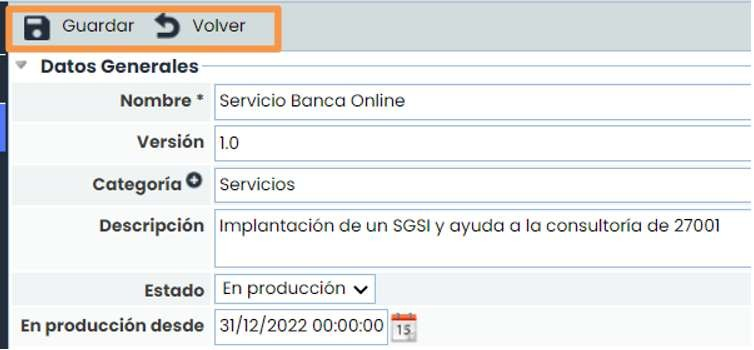

## 2. Definir Listado de Procesos

Para gestionar el listado de procesos de negocio de la entidad hay que seleccionar la opción “[Procesos](https://help.globalsuitesolutions.com/es/globalsuite/v1/procesos)”, disponible en la pestaña “**Inicio**” de GlobalSuite®.

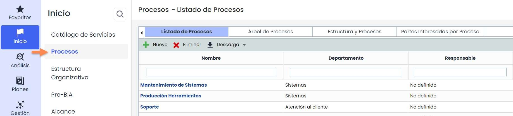

Al acceder a la opción “Procesos”, se muestra el listado de procesos de la entidad, dentro de la pestaña “Listado de Procesos”. En esta opción se pueden crear, eliminar y modificar los procesos.

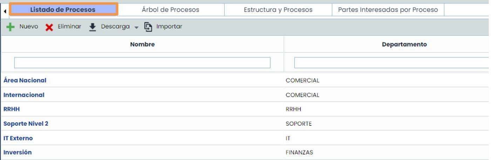

Desde la pestaña principal de “Listado de Procesos”, GlobalSuite® establece las siguientes opciones:

* **Nuevo**: Permite generar nuevos procesos de negocio específicos de la entidad.
* **Eliminar**: Permite eliminar procesos ya existentes.
* **Descarga**: Permite realizar la descarga del listado de procesos disponibles en diferentes formatos y un fichero modelo para la importación masiva de datos (xml).
* **Importar**: permite importar un listado de Servicios de forma masiva. Es necesario utilizar el archivo modelo de la pestaña “Descarga” para realizar la carga. Disponible solo con la licencia de Data Import.

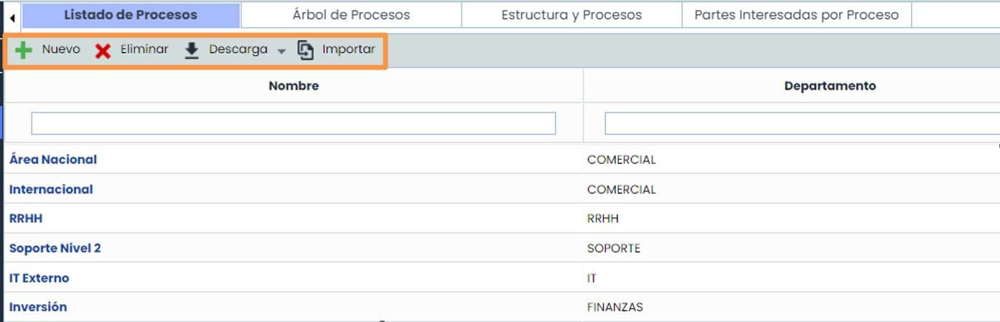

Para completar la definición de un proceso, se deberá pulsar en el link del nombre del Proceso para acceder al formulario donde se puede completar toda la información adicional relacionada con el proceso.

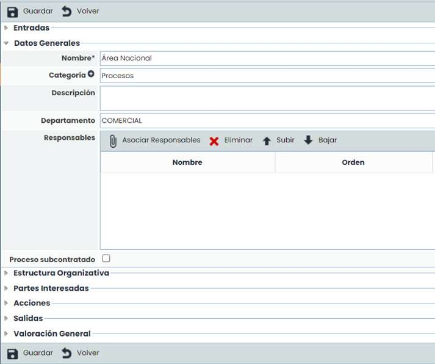 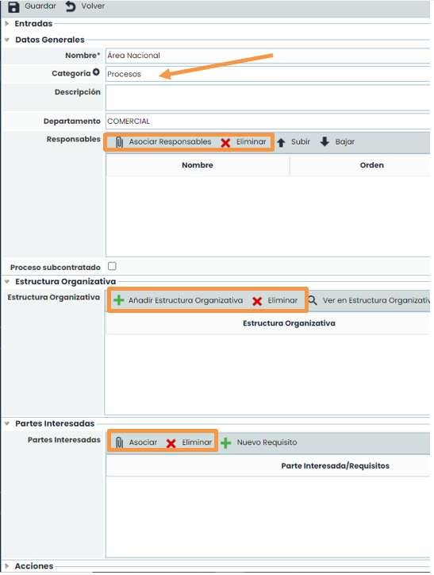

Los campos marcados con un asterisco son obligatorios. Podrá informar manualmente todos los campos a nivel de formulario, a excepción de los seleccionables que se configuran en otras pestañas y/o en el apartado de Ajustes:

* **“Categoría”**
* **“Responsables”**
* **“Estructura Organizativa”**
* **“Partes interesadas”**

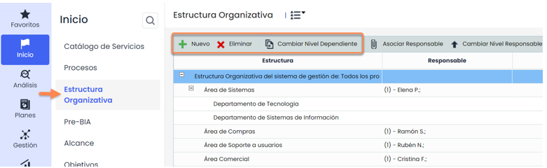

**“Estructura Organizativa”**: podrá vincular el Proceso con las secciones de la Organización involucradas. Si necesita realizar algún cambio en el organigrama, deberá ir a Inicio>Estructura Organizativa para añadir, eliminar o cambiar niveles de dependencia.

Asimismo, si necesita añadir o eliminar Niveles de la Estructura Organizativa, deberá realizarlo en **Ajustes > Configuración General >** [**Niveles Estructura Organizativa**.](https://help.globalsuitesolutions.com/es/globalsuite/v1/configuracion-estructura-organizativa)

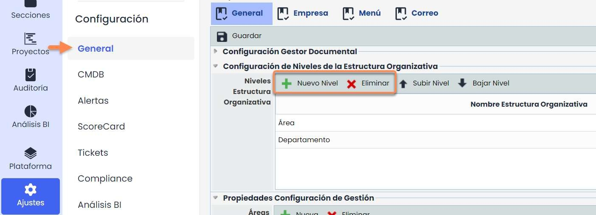 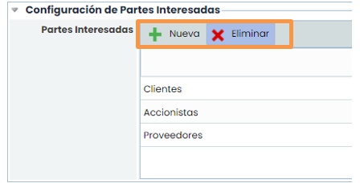

**“Partes Interesadas”**: podrá definir las partes interesadas en el proceso pulsando en el botón “Asociar”, si bien deberá definirlas previamente en **Ajustes > Configuración General >** [**Partes Interesadas.**](https://help.globalsuitesolutions.com/es/globalsuite/v1/configuracion-de-partes-interesadas)

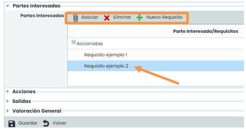

Asimismo, podrá especificar los requisitos de dichas Partes con respecto al proceso e indicar su tipo, si son una expectativa o una necesidad.

## 3. Definir dependencias entre Servicios y Procesos

La pestaña “**Árbol de Procesos**”, ubicada junto al “Listado de Procesos”, permite llevar a cabo la asociación de procesos y servicios a través de la definición de las relaciones y dependencias entre las diferentes actividades de la entidad, que permiten prestar el servicio final a clientes o entregar un producto determinado.

Para poder asociar procesos y servicios debemos realizar los siguientes pasos:

Seleccionar el proceso sobre la columna de la derecha que queremos relacionar con otros procesos o directamente con servicios.

Arrastrar el proceso a la columna de la izquierda en el orden oportuno, llevando a cabo dicha relación.

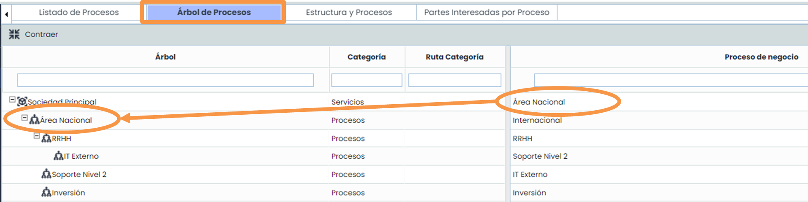

## 4. Visualizar Estructuras y Partes Interesadas

La pestaña “**Estructura y Procesos**”, ubicada junto al “Árbol de Procesos”, permite tener una visión general de todo el árbol de dependencia de servicios/procesos incluyendo la información sobre la estructura organizativa a la que pertenecen. Esta pestaña es de solo lectura. Si se necesita actualizar la información, será necesario hacerlo en las pestañas de “Listado de Procesos” o “Árbol de Procesos”.

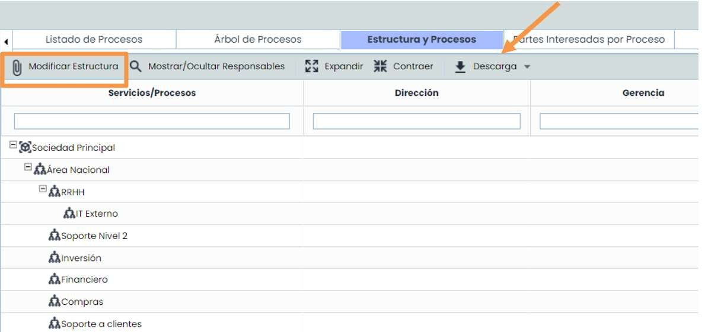

### Partes Interesadas

La pestaña “Partes Interesadas por Proceso”, ubicada junto a “Estructura y Procesos”, permite ver si a un Proceso se le han asociado Partes Interesadas en el formulario. Muestra también los Requisitos que se hayan vinculado a la Parte Interesada. Toda la información se puede descargar en diferentes formatos.

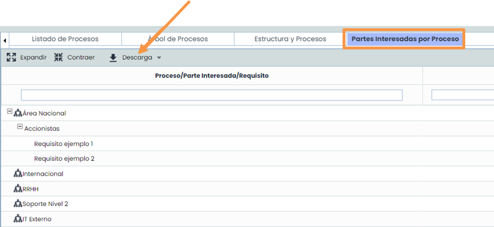
