# ¿Cómo realizar la configuración inicial en GlobalSuite®?


En este artículo trataremos cómo completar el catálogo de \*\*servicios y procesos\*\*, definir la \*\*estructura organizativa\*\*, establecer el \*\*alcance\*\* y los \*\*objetivos\*\* del sistema de gestión, y configurar \*\*roles, empleados, competencias y funciones\*\*, indicando en cada caso dónde hacerlo (Inicio o Ajustes) para dejar la plataforma lista para trabajar.


## Fases para la configuración inicial del Sistema de Continuidad

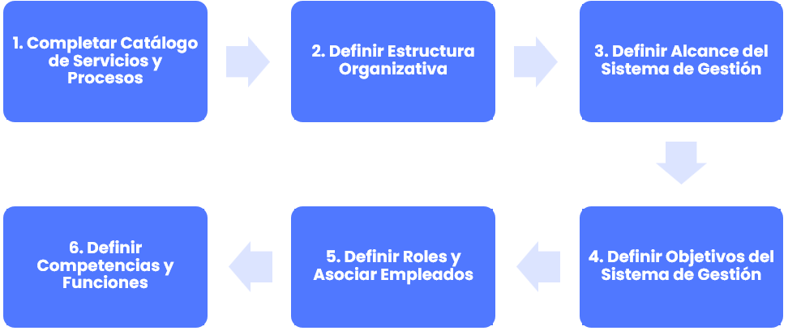

## 1. Completar Catálogo de Servicios y Procesos

Para realizar este paso, ver la Guía [¿Cómo definir y gestionar servicios y procesos en GlobalSuite®?](como-definir-y-gestionar-servicios-y-procesos-en-globalsuite-r.md)

## 2. Definir Estructura Organizativa

A través de la opción “Estructura Organizativa” ubicada en la pestaña “Inicio”, GlobalSuite® permite definir la estructura organizativa de la empresa.

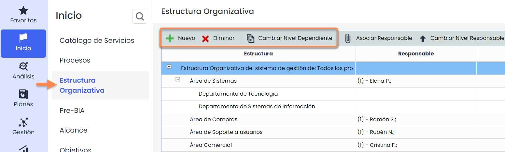

Para poder configurar correctamente esta jerarquía, es necesario previamente definir los niveles de la estructura organizativa de la empresa. Para ello, hay que dirigirse a la opción de **Ajustes > Configuración General** > [Configuración de Niveles de la Estructura organizativa](https://help.globalsuitesolutions.com/es/globalsuite/v1/configuracion-estructura-organizativa) y configurar los niveles deseados.

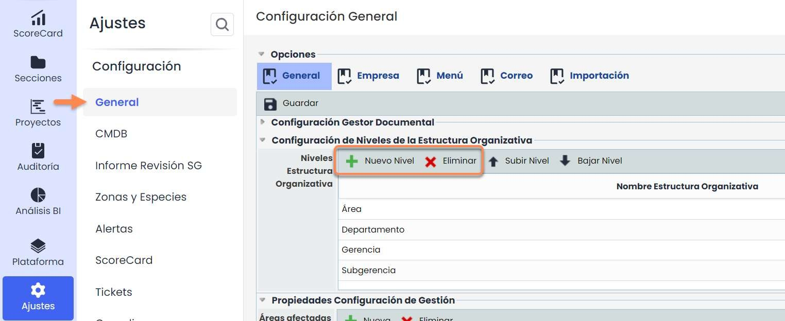

Una vez definidos los niveles, la opción de “Estructura Organizativa” permite realizar las siguientes acciones:

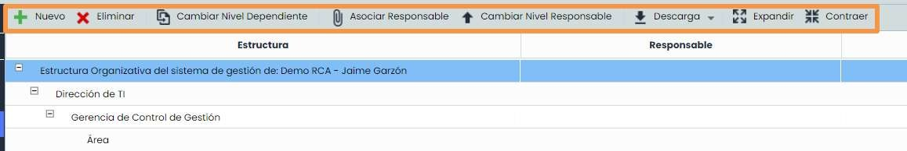

* **Nuevo**: Añadir nueva unidad de negocio. Se debe seleccionar la unidad de negocio dependiente de la nueva opción y pulsar el botón “Nuevo”.
* **Eliminar**: Se debe seleccionar en la tabla la unidad de negocio que se desea eliminar. Las unidades de negocio dependientes de esta también serán eliminadas.
* **Cambiar dependiente**: Permite cambiar una unidad de negocio (y sus unidades dependientes) a otra unidad de negocio distinta.
* **Asociar Responsable**: Permite vincular a un empleado al Sistema de Gestión. Se debe seleccionar la unidad de negocio y pulsar el botón. Saldrán todos los empleados definidos en GlobalSuite®.
* **Cambiar Nivel Responsable**: Permite cambiar el orden cuando hay más de un Responsable del SG.
* **Descarga**: Permite descargar en Excel y pdf de la estructura organizativa.

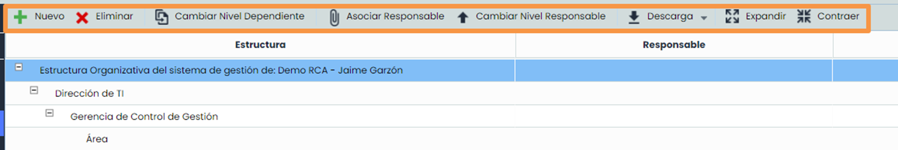

### Vista General de la Estructura Organizativa

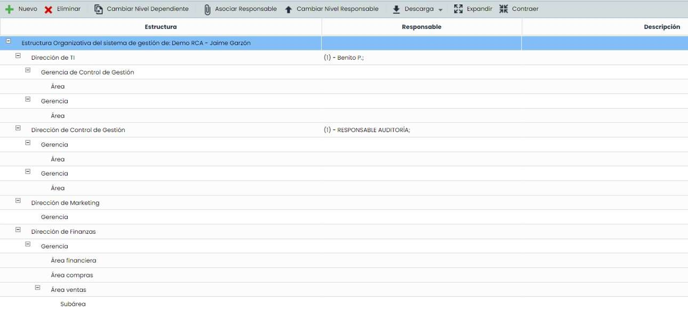

## 3. Definir Alcance del Sistema de Gestión

La definición del alcance del SG se realiza en la opción “[**Alcance**](https://help.globalsuitesolutions.com/es/globalsuite/v1/alcance)”, disponible en la pestaña “**Inicio**”.

Esta opción permite establecer de manera formal el alcance de nuestro Sistema de Gestión seleccionando los servicios que vamos a incluir dentro del mismo.

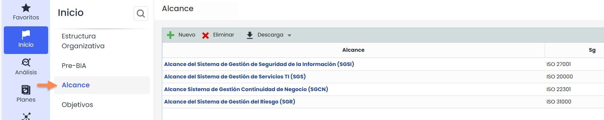

Al acceder en la opción “Alcance” se muestran todos los alcances definidos en la entidad.

La generación de un nuevo alcance se realiza pulsando sobre el botón “**Nuevo**”. Para registrar la información correspondiente al alcance deberá pulsar sobre el enlace existente en el propio nombre del alcance. En ese momento se mostrará un formulario que permite definir toda la información correspondiente.

De la misma forma, es posible eliminar alcances definidos previamente o descargar el listado de los mismos en esta pantalla principal.

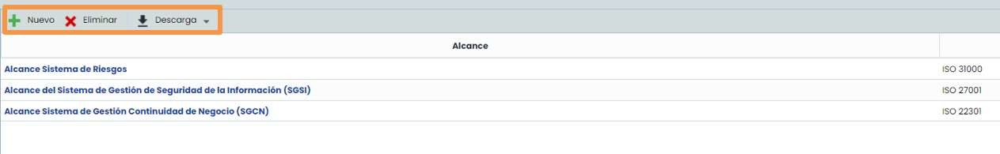

El formulario del alcance permite definir toda la información relacionada con el alcance del Sistema de Gestión que se ha definido.

En la sección denominada “SG” es necesario seleccionar el sistema de gestión al cual queramos hacer referencia. Además, se da la posibilidad de que dos sistemas de gestión puedan compartir un alcance. Habría que seleccionar el Sistema de Gestión y añadirlo a la tabla.

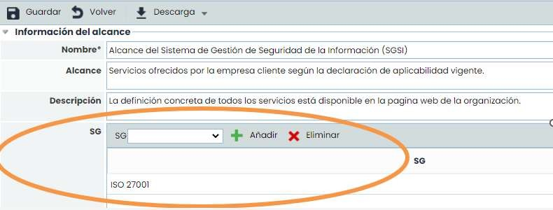

Los “SG” (Sistemas de Gestión) o normativas, que se definen en el Alcance, se pueden configurar en el apartado de **Ajustes > Configuración General>**[**Configuración de Normas**](https://help.globalsuitesolutions.com/es/globalsuite/v1/configuracion-de-normas)

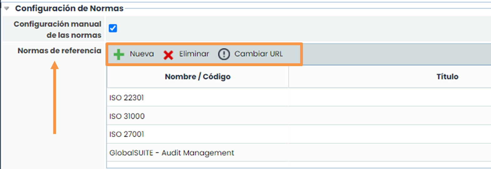

## 4. Definir Objetivos del Sistema de Gestión

La definición de los Objetivos del SG se realiza en la opción “[**Objetivos**](https://help.globalsuitesolutions.com/es/globalsuite/v1/objetivos)”, disponible en la pestaña “**Inicio**”. Esta opción permite establecer de manera formal el objetivo u objetivos marcados en nuestro Sistema de Gestión.

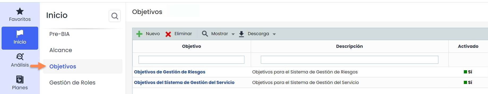

Al acceder en la opción “**Objetivos**” se muestran todos los objetivos activos definidos en la entidad. Para ver todos los objetivos (activos y no activos), es necesario pulsar en el botón **“Mostrar” – “Mostrar Todos”**.

La generación de un nuevo objetivo se realiza pulsando sobre el botón “**Nuevo**”. Para registrar la información correspondiente al objetivo deberá pulsar sobre el enlace existente en el propio nombre del objetivo. En ese momento, se mostrará un formulario que permite definir toda la información correspondiente.

De la misma forma, es posible eliminar objetivos definidos previamente o descargar el listado de los mismos en esta pantalla principal.

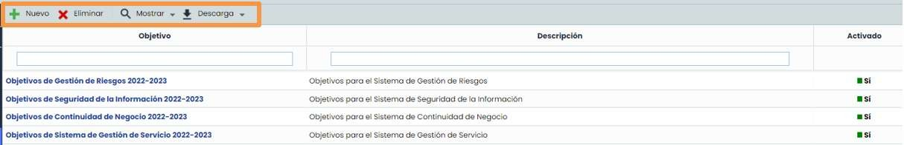

El formulario del Objetivo permite definir toda la información relacionada con el objetivo del Sistema de Gestión definido.

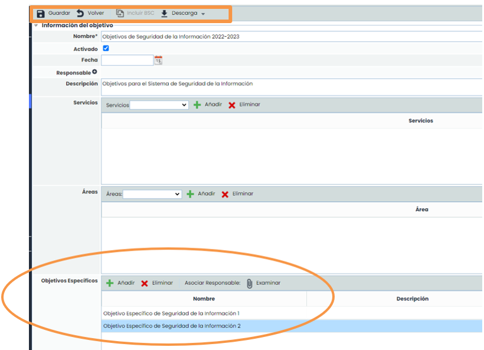

Además, se da la posibilidad de dividir el Objetivo en otros objetivos más específicos. Para guardar los datos introducidos es necesario pulsar el botón “**Guardar**”. Si quiere descargar un informe del Objetivo, deberá pulsar el botón **“Descarga” – “Informe Docx”**.

El botón de “**Incluir BSC**” sólo estará disponible si tiene habilitado el módulo de GlobalSuite® Balanced Scorecard.

Para realizar el seguimiento del objetivo, es necesario definir la frecuencia de evaluación del mismo.

Una vez definida la frecuencia, puede añadir y eliminar nuevas Evaluaciones, donde podrá elegir la fecha de esa evaluación y el resultado de la evaluación.

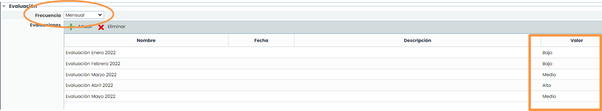

## 5. Definir Roles y Asociar Empleados

A través de la opción “[**Gestión de Roles**](https://help.globalsuitesolutions.com/es/globalsuite/v1/gestion-de-roles)” ubicada en la pestaña “**Inicio**”, GlobalSuite® permite:

* Asociar a los diferentes empleados que forman parte de la entidad a los distintos roles del Sistema de Gestión.
* sociar las competencias requeridas para cada uno de los roles definidos de la entidad, pudiendo llevar a cabo la asociación de dichas competencias a diferentes roles de forma simultánea.
* Definir las funciones y obligaciones a desarrollar por cada uno de los roles, también pudiendo ser asociados a varios perfiles de forma simultánea.

Mediante esta metodología establecida por parte de GlobalSuite®, la plataforma permite describir los diferentes perfiles de puesto de trabajo, asociando a estos los empleados que los desempeñan, las competencias necesarias para cada rol y todas las funciones y obligaciones relacionadas.

Para **gestionar los roles** y responsabilidades de la entidad hay que seleccionar la opción “[**Gestión de Roles**](https://help.globalsuitesolutions.com/es/globalsuite/v1/gestion-de-roles)”, disponible en la pestaña de “Inicio” de GlobalSuite®.

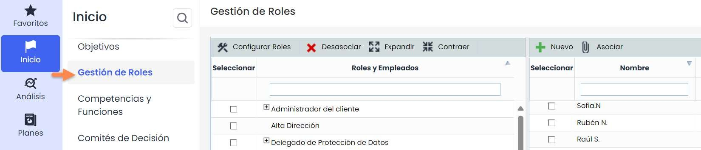

Los roles que aparecen en la pestaña “Gestión de Roles” son configurables a través del botón “**Configurar Roles**”.

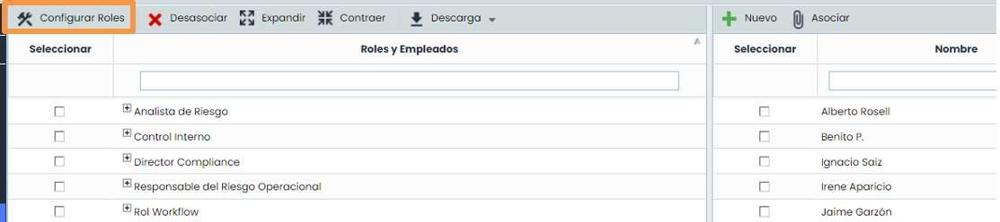

Al pulsar sobre el botón se abre una pestaña nueva del navegador correspondiente al apartado de Ajustes. Concretamente, en la opción “General” se encuentra el listado de Roles, pudiéndose crear, eliminar y modificar los roles existentes a través de las opciones marcadas.

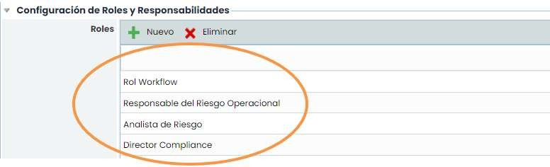

El listado de empleados que aparece en la tabla de la derecha corresponde a los empleados registrados en la opción “[**Empleados**](https://help.globalsuitesolutions.com/es/globalsuite/v1/empleados)” de la pestaña “**Gestión**”.

Para establecer las relaciones entre los roles y los empleados, bastaría con seleccionar (tick) al empleado de la tabla de la derecha y el perfil (o los perfiles) al que pertenece ubicado en la tabla de la izquierda, y pulsar el botón “Asociar”. Una vez realizada la asociación, el nombre del empleado aparecerá en un nivel inferior al del rol establecido en la entidad.

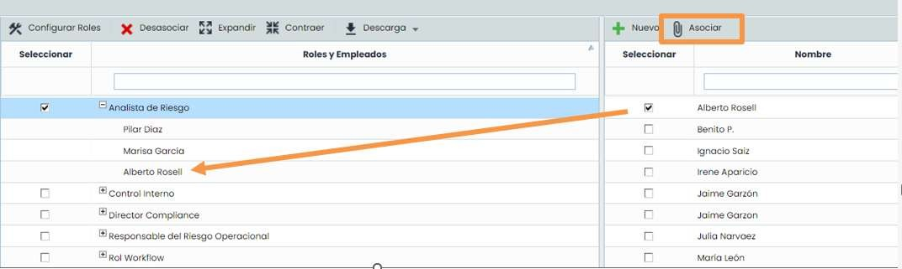

## 6. Definir Competencias y Funciones

Para gestionar los roles y sus competencias y obligaciones/funciones hay que seleccionar la opción “[**Competencias y Funciones**](https://help.globalsuitesolutions.com/es/globalsuite/v1/competencias-y-funciones)”, disponible en la pestaña de “**Inicio**” de GlobalSuite®.

Una vez relacionados los empleados a los roles de la entidad, deberá definir y vincular las competencias que están asociadas a cada rol. Esto se realiza en la pestaña “**Roles y Competencias**”.

Para realizar la definición de competencias es necesario pulsar el botón “**Nuevo**”, generando una nueva línea en el listado de competencias, la cual se puede editar. GlobalSuite® permite definir tantas competencias como se considere necesario. Asimismo, podrá eliminarlas o descargarlas en un archivo Excel.

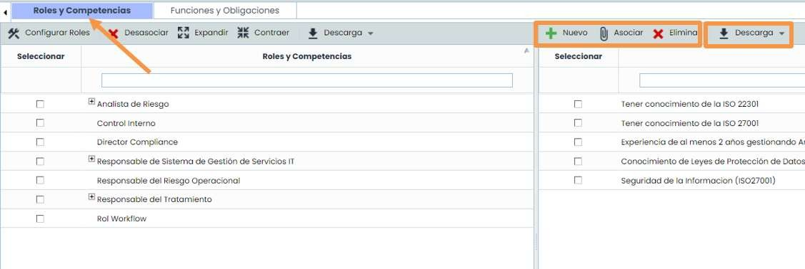

Una vez definido el listado de competencias necesarias para los roles de la entidad, la vinculación de competencias y roles se lleva a cabo a través del mismo mecanismo utilizado para realizar las relaciones entre empleados y roles de la pestaña “**Roles y Empleados**”. Por tanto, es necesario seleccionar (tick) la competencia a vincular y el rol, y pulsar el botón “**Asociar**”.

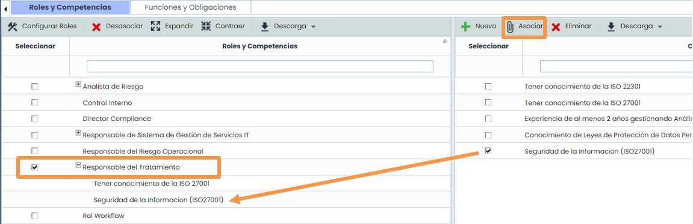

Una vez relacionados tanto los empleados como las competencias con los roles de la entidad, el último paso consiste definir y vincular las funciones y obligaciones. Esto se realiza en la pestaña “**Funciones y Obligaciones**”.

Para definir las funciones es necesario pulsar el botón “**Nuevo**”, que generará una nueva línea editable en el listado de funciones/obligaciones. GlobalSuite® permite definir tantas funciones y obligaciones como se considere necesario. Asimismo, podrá eliminarlas o descargarlas en un archivo Excel.

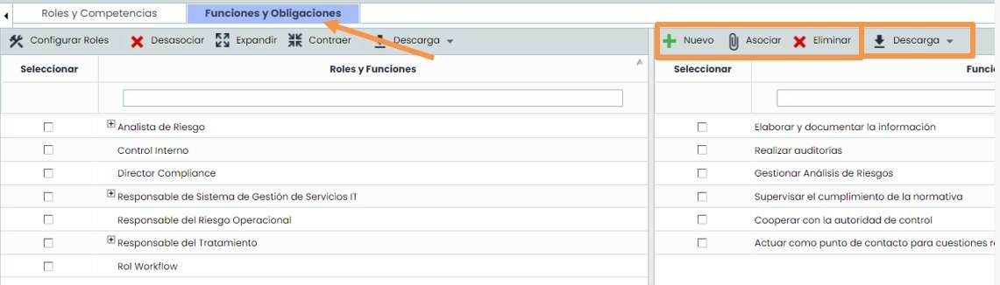

Una vez definido el listado de funciones/obligaciones necesarias para los roles de la entidad, la vinculación con los roles se lleva a cabo a través del mismo mecanismo utilizado para realizar las relaciones entre empleados y roles de la pestaña “**Roles y Empleados**”. Por tanto, es necesario seleccionar (tick) la función/obligación a vincular y el rol, y pulsar el botón “**Asociar**”.

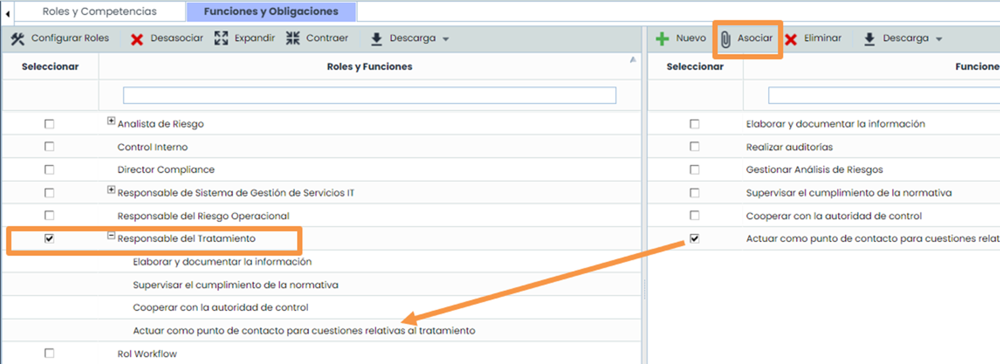
