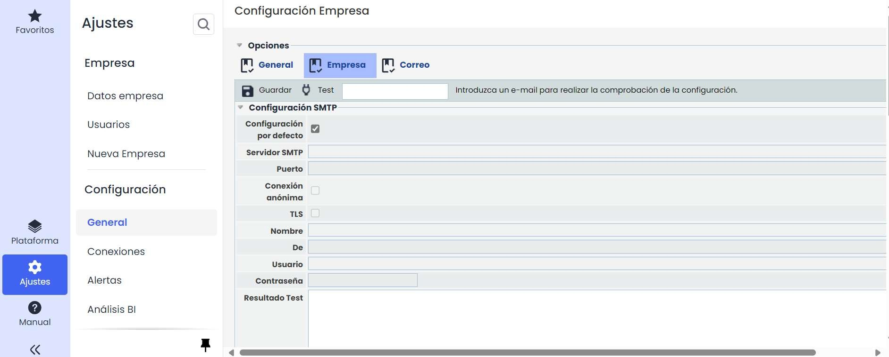

# ¿Cómo configurar un servidor de correo-e ?


Este tutorial explica, cómo configurar el \*\*servidor de correo-e (SMTP)\*\* en GlobalSuite®, permitiendo que la plataforma pueda enviar notificaciones automáticas, alertas y comunicaciones a los usuarios.
El objetivo es detallar la configuración de los parámetros del servidor, las opciones de conexión y la validación mediante el test de envío, disponible para los administradores.


## Configurar un servidor de correo-e

La configuración del correo-e a nivel Empresa pueden realizarla los Administradores: Plataforma, Enterprise y Configuración.

Para realizarla, es necesario acceder a la opción Configuración, General, desde la sección Ajustes > General > [Empresa](https://help.globalsuitesolutions.com/es/globalsuite/v1/configuracion-empresa).

Desmarcaremos el check de “Configuración por defecto” para que se habiliten las entradas de texto del formulario.

Los datos necesarios para realizar la configuración son los siguientes:

|  |  |
| --- | --- |
| Servidor SMTP (IP o FQDN)  La máquina de GlobalSuite debe tener conectividad a esta IP |  |
| Puerto |  |
| Remitente |  |
| Cuenta |  |
| Contraseña  (Sólo en el caso de buzón específico y puede ser introducida por el cliente durante la instalación inicial) |  |

En caso de que la conexión se realice de forma anónima, pueden obviarse los campos usuario y contraseña, que se deshabilitarán automáticamente al marcar el check “Conexión Anónima”.

Una vez completado el formulario, hacer click en el botón “Guardar” para que la nueva configuración quede registrada.

El formulario nos permite realizar un primer test de envío, introduciendo una dirección de correo electrónico válida en el input “test” y a continuación haciendo click en el botón “Test”. El resultado de la prueba podrá visualizarse en el área de texto “Resultado del Test”.

Si el check de “Configuración por defecto” está marcado, la configuración de aplicación será la registrada a nivel Plataforma (Plataforma – Correo). Esta sólo puede modificarse por los técnicos del Centro de Soporte a Clientes GlobalSuite®.
