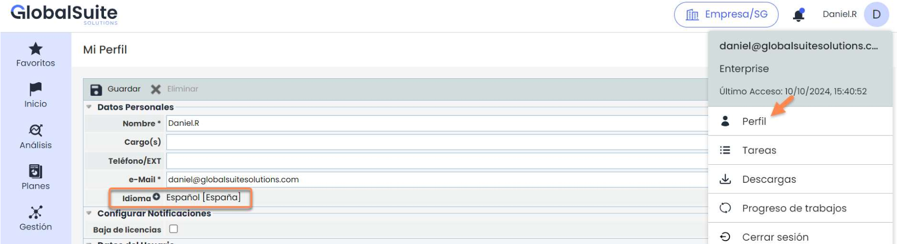
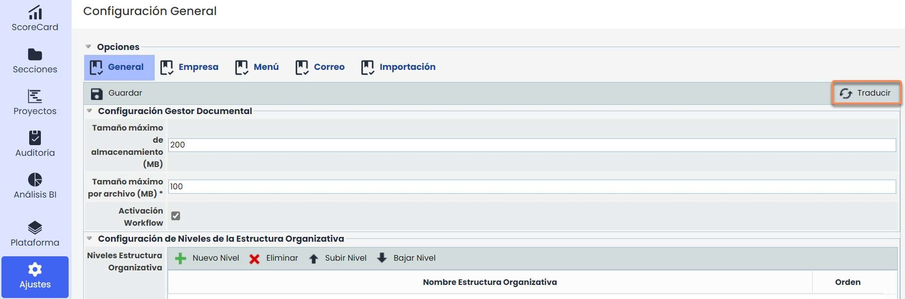
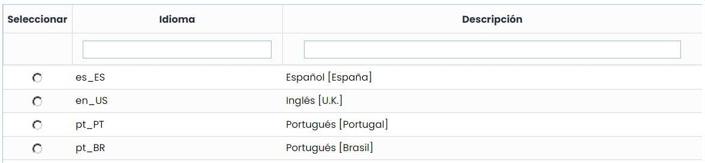
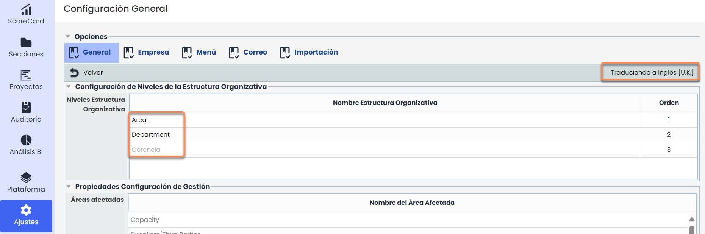
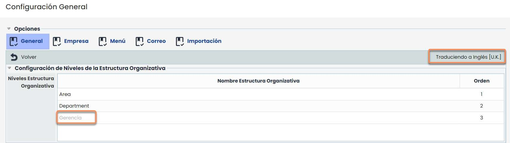

# ¿Cómo gestionar los idiomas en GlobalSuite?


Este tutorial explica cómo configurar y traducir los \*\*idiomas disponibles\*\* en GlobalSuite® para personalizar la experiencia de los usuarios según su idioma de trabajo.
El objetivo es mostrar cómo añadir nuevos idiomas a una empresa, definir el idioma por defecto y utilizar la función \*\*“Traducir”\*\* para adaptar las configuraciones, metodologías y textos a los distintos idiomas.


## Idiomas

### Idiomas disponibles

Actualmente hay 8 idiomas disponibles en la herramienta de GlobalSuite®:

* Castellano.
* Inglés.
* Portugués.
* Euskera.
* Alemán
* Catalán
* Francés
* Brasileño

El idioma Castellano e Inglés son idiomas que vienen por defecto en todas las empresas de la herramienta, pero para poder incluir en la configuración por defecto en una empresa alguno de los otros idiomas, hay que definirlos al dar de alta la empresa (bajo petición del cliente). La forma de dar de alta una empresa que incluya uno de estos idiomas (Euskera o Portugués), será cambiando el idioma del usuario que cree la empresa en Mi Perfil, a cualquiera de estos idiomas (Portugués o Euskera).

Se permite añadir un idioma nuevo a posteriori a una empresa ya existente.

Al añadir un nuevo idioma no se inserta la configuración en este idioma. Añadir un idioma solo sirve para poder modificar a mano la configuración de la empresa, es decir, no se carga nada por defecto.


\*\*Nota\*\*
Por el momento no se pueden tener por defecto los 4 idiomas, solo 3 de ellos y configurar a mano un 4º.


## Traducción

Al añadir un idioma a posteriori hace que las configuraciones de dicha empresa tengan ese nuevo idioma vacío, es decir, las configuraciones estarán en el idioma por defecto.

GlobalSuite® habilita la posibilidad de completar los textos que están en las diferentes configuraciones, metodologías, etc.... mediante la funcionalidad de “Traducir”, para que cuando un usuario con ese idioma entre en la empresa, pueda ver las diferentes configuraciones en ese idioma.

Una vez se pulsa sobre el botón traducir sale una ventana emergente que da la opción de traducir las opciones al idioma que se elija.

Al elegir el idioma al cuál se quiere traducir, se abrirá la opción en la que se ha presionado el botón, en este caso Configuración general. Y en la parte superior derecha mostrará un texto “Traduciendo a \_\_\_\_” y el idioma que se haya elegido.

Aparecerán en gris los textos en el idioma del que viene (en el ejemplo, en Español) para tomarlos como base en la traducción:

Una vez se modifican los registros, pasan a estar en un color negro para saber que esos campos han sido modificados. Y así les aparecerá a los usuarios que tengan ese idioma en esta empresa.

Todas las opciones que se creen nuevas o se modifiquen en el idioma por defecto, debido a que la herramienta no traduce automáticamente, en caso de necesitarlas en alguno de los otros idiomas se deberán traducir manualmente a través del botón de “Traducir”.

Es decir, aunque la configuración inicial sí aparezca en los idiomas en los que se ha creado la empresa, los cambios que se hagan deberán traducirse a los diferentes idiomas para que los usuarios con esos idiomas puedan verlo en su idioma correspondiente, y no en el idioma que está por defecto.

Por ejemplo, si se cambia o añade algún nivel en la estructura organizativa, sería necesario traducirlo para el resto de idiomas, ya que si no aparecerá en el que esté configurado por defecto.

Esta funcionalidad de traducción se encuentra en:

* Ajustes:

  * Configuración:

    * General.
    * CMDB.
    * ScoreCard.
    * Tickets.
    * Proveedores
  * Continuidad de Negocio.

    * Planes.
    * BIAs.
    * Crisis.
  * Metodologías:

    * Elementos.
    * Auditoría > General
