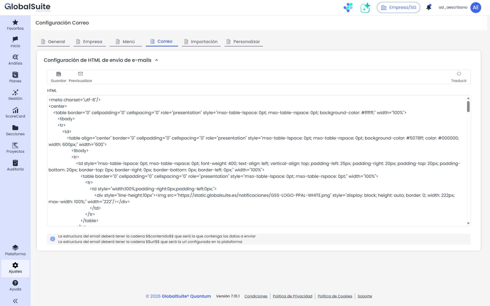

# ¿Cómo personalizar GlobalSuite®?


Esta guía explica cómo adaptar GlobalSuite® a la imagen corporativa de tu organización: el \*\*logotipo\*\*, los \*\*colores\*\* de la interfaz, la \*\*plantilla de los correos electrónicos\*\* y la \*\*pantalla de acceso (login)\*\*.


Todas las opciones de personalización visual se gestionan desde **Ajustes > Configuración General**, salvo la pantalla de login, que se configura a nivel de entorno.

## 1. Personalizar el logotipo y los colores

El logotipo y los colores corporativos se configuran en la pestaña **Personalizar** (**Ajustes > Configuración General > Personalizar**).

**Pasos:**

1. Accede a **Ajustes > Configuración General > Personalizar**.
2. En **Logotipo**, pulsa **Subir logo** y selecciona la imagen (tamaño máximo **48 x 186 px**, alto x ancho). Puedes sustituirlo o eliminarlo cuando lo necesites.
3. En **Colores de marca**, define el **Color principal** y el **Color secundario** con el selector visual o introduciendo su valor hexadecimal.
4. Revisa la **Asignación automática** (colores derivados) y el **Panel de validación WCAG**. Si alguna comprobación de contraste no se cumple, pulsa **Corregir** para ajustar automáticamente los colores.
5. Comprueba el resultado en la **Vista previa de componentes** (se actualiza en tiempo real).
6. Pulsa **Guardar marca** para aplicar la personalización. Con **Restaurar colores** puedes volver a los valores por defecto de GlobalSuite®.


Para el detalle completo de esta pantalla consulta [Personalización](https://globalsuitesolutions.atlassian.net/wiki/spaces/GlobalSUITEes/pages/2006417409/Personalizaci+n). La personalización se aplica por \*\*empresa\*\* y se incluye en la copia de empresa. La tipografía se mantiene en Poppins.


## 2. Personalizar la plantilla de los correos electrónicos

El formato de los correos que envía GlobalSuite® se configura en la pestaña **Correo** (**Ajustes > Configuración General > Correo**), en el bloque **Configuración de HTML de envío de e-mails**.

**Pasos:**

1. Accede a **Ajustes > Configuración General > Correo**.
2. Edita el **HTML** de la plantilla (cabecera, colores, logotipo del correo, pie, etc.).
3. Asegúrate de mantener las variables obligatorias: `$$contenido$$` (donde se insertará el contenido del mensaje) y `$$url$$` (la URL configurada de la plataforma).
4. Usa **Previsualizar** para comprobar el resultado y pulsa **Guardar**.


Si eliminas las variables `$$contenido$$` o `$$url$$`, los correos no se generarán correctamente.


## 3. Personalizar la pantalla de login

La apariencia de la **pantalla de acceso (login)** — fondo, imagen, textos de bienvenida, etc. — se configura a nivel de **entorno/instalación**, no desde la configuración de empresa.


Para personalizar la pantalla de login, contacta con el equipo de \*\*Soporte\*\* de GlobalSuite Solutions indicando los elementos a adaptar. Esta configuración es adicional a la personalización de colores de empresa descrita en los apartados anteriores.

