# Configuración del doble factor de autenticación (2FA)

## Configuración, habilitación y deshabilitación del 2FA


Esta guía explica cómo configurar el \*\*doble factor de autenticación (2FA)\*\* en GlobalSuite® para mejorar la seguridad de la plataforma. Incluye los pasos para habilitarlo de manera obligatoria u opcional, cómo activar el 2FA mediante TOTP o Correo Electrónico, la gestión de códigos de recuperación y cómo deshabilitarlo según el estado definido por el administrador del entorno.


### Configuración de 2FA

GlobalSuite® permite agregar un doble factor de autenticación (2FA) para mejorar la seguridad y privacidad. Los pasos a seguir para la configuración son los siguientes:

#### Paso 1. Acceder a la Opción Ajustes > General > Empresa

El 2FA puede estar desactivado, puede ser opcional o puede ser obligatorio para todos los usuarios del entorno.

Esto lo determina únicamente el/los administrador/es del entorno.

A través de la opción de Ajustes se podrá acceder a todas las opciones de configuración de la Plataforma y usuarios.

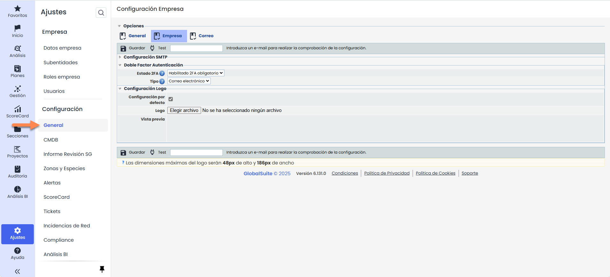

#### Paso 2. Configurar el Doble Factor de Autenticación

Se procederá a configurar el uso del doble factor de autenticación en el entorno. Aquí se podrá elegir el **Estado 2FA** haciendo clic en el desplegable y el **Tipo**:

Los posibles estados que se pueden indicar son:

* **Deshabilitado**: la opción de 2FA se deshabilita para todos los usuarios del entorno.
* **Habilitado 2FA opcional**: la opción de 2FA se habilita de forma opcional para todos los usuarios del entorno. En consecuencia, cada usuario puede optar por activar o no el 2FA.
* **Habilitado 2FA obligatorio**: la opción de 2FA se habilita de forma obligatoria. En consecuencia, el sistema fuerza a todos los usuarios a que activen el 2FA de forma inmediata.

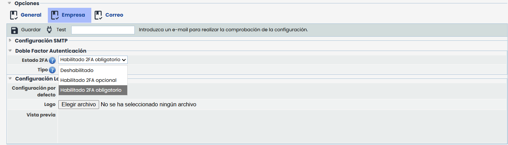

Los tipos que hay son TOTP o Correo Electrónico.

* **TOTP**: Cada vez que el usuario intente acceder a la aplicación, deberá ingresar un código numérico único generado por una aplicación móvil de autenticación.
* **Correo Electrónico**: Cada vez que el usuario intente acceder a la aplicación, deberá ingresar un código temporal que recibirá en su correo electrónico asociado.

### Habilitación de 2FA - TOTP - Obligatoria

En el momento en que el Administrador active el 2FA, si un usuario está conectado, le aparecerá de forma inmediata el mensaje que se muestra abajo. Si no lo está, las instrucciones aparecerán cuando vuelva a iniciar sesión.

Para activar el Doble Factor de Autenticación mediante TOTP, se deben realizar los siguientes pasos:

1. Descargar e instalar alguna aplicación que permita gestionar este doble factor.
2. Una vez la tenga instalada, se deberá escanear el código QR que le aparece en pantalla, o bien, introducir la **Cadena secreta** de forma textual que se encuentra en la pantalla.

   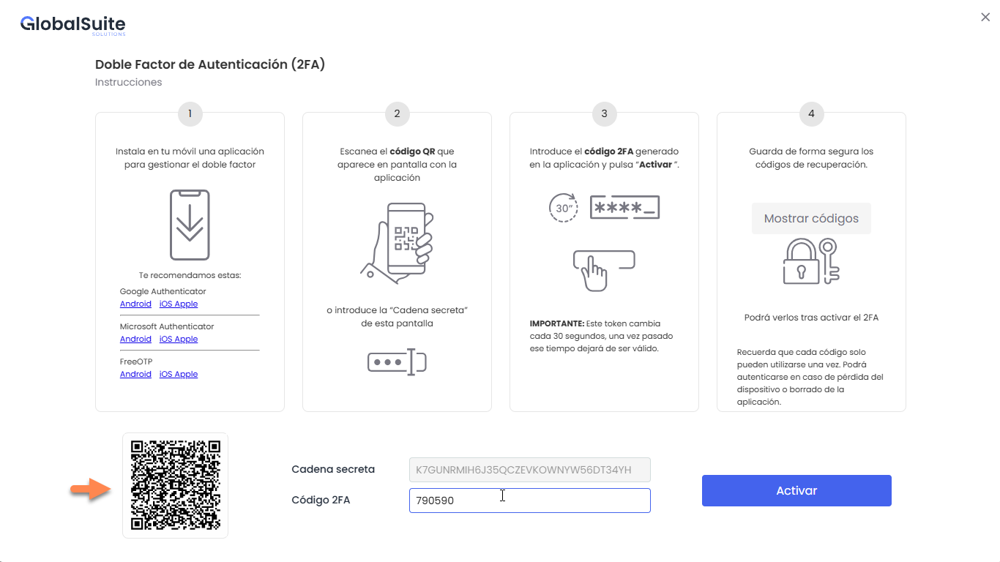
3. Una vez enlazada, se deberá introducir el token o código temporal obtenido mediante la aplicación en el campo **Código 2FA** y pulsar el botón **Activar**.
4. Por último, se deberá almacenar de forma segura los códigos de recuperación que aparecen al presionar “Mostrar códigos”

   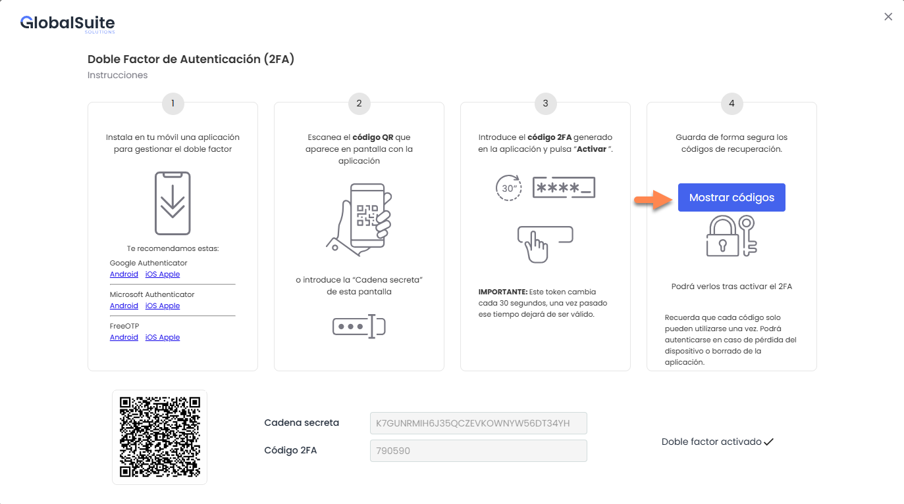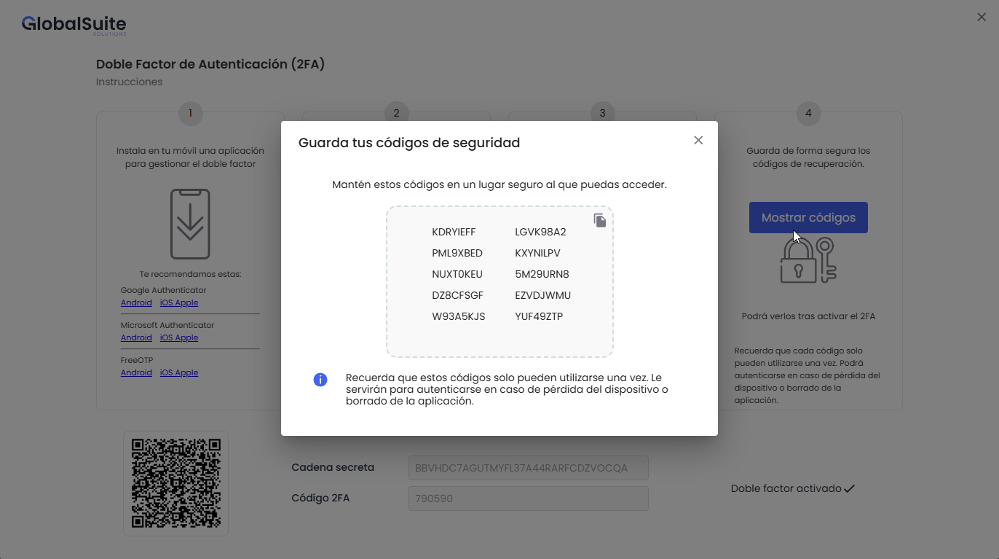

   Una vez realizada la activación, cada vez que se inicie sesión en GlobalSuite®, el sistema solicitará el código 2FA que aparece en el dispositivo configurado.

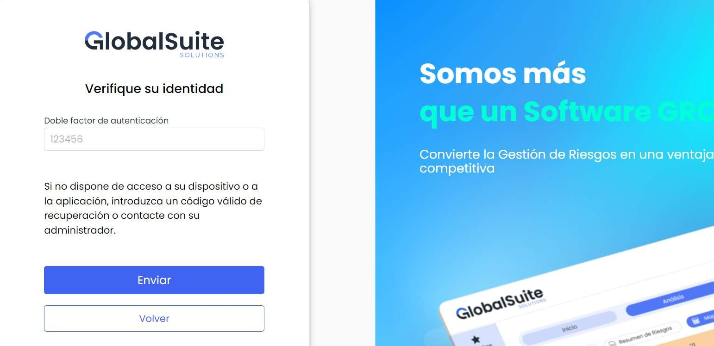

### Habilitación de 2FA - Correo Electrónico - Obligatoria

En el momento en que el Administrador active el 2FA, si un usuario está conectado, le aparecerá de forma inmediata el mensaje que se muestra abajo. Si no lo está, las instrucciones aparecerán cuando vuelva a iniciar sesión.

Para activar el Doble Factor de Autenticación mediante Correo Electronico, se deben realizar los siguientes pasos:

1. Se abrirá una ventana para realizar la configuración. En el Paso 1, el usuario debe pulsar el botón **Enviar**, lo que generará el envío de un correo electrónico con un código único y temporal a la dirección asociada a su cuenta.

   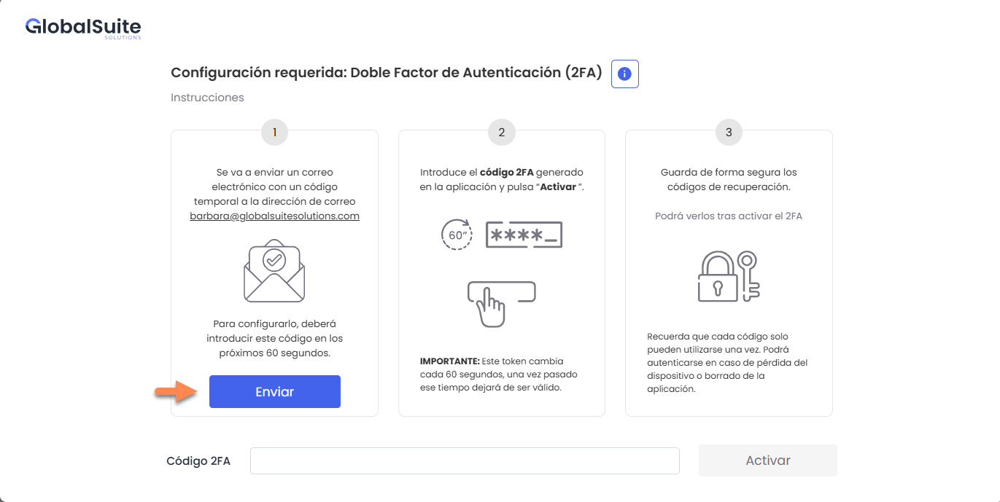
   1. En caso de ser necesario se podrá **reenviar** el código, aunque estará limitado a un máximo de 3 reenvíos por usuario en un periodo de 5 minutos.

      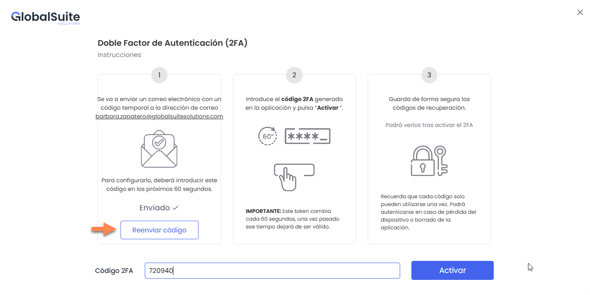
2. Copiar y pegar el código de 6 dígitos que llegó al correo en el campo **Código 2FA** y presionar **Activar**. Si es correcto se habilitara el 2FA y se mostrará el botón “Ver códigos”

   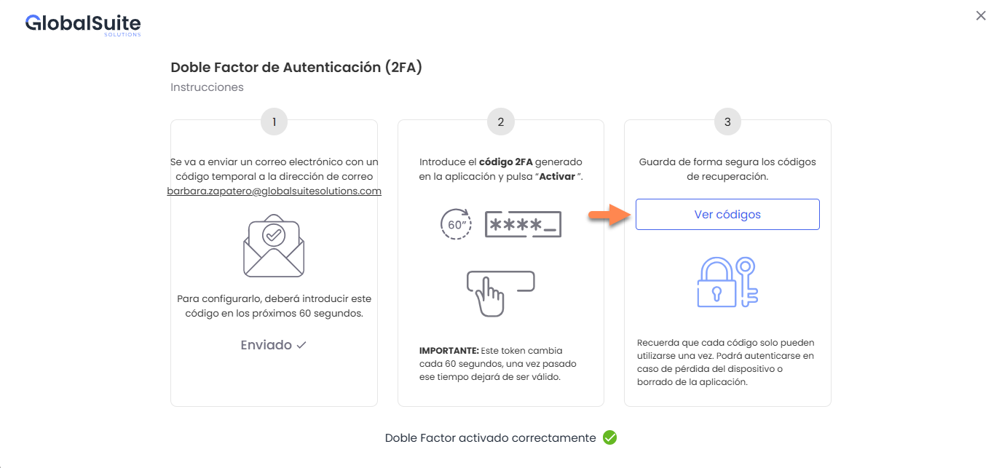
3. Por último, se deberá almacenar de forma segura los códigos de recuperación que aparecen al hacer click en “Ver Códigos”

   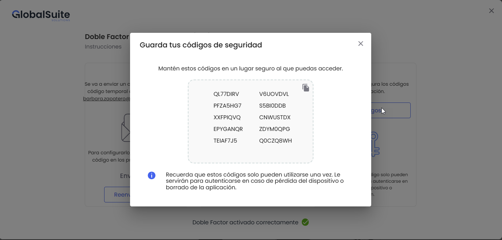

Una vez realizada la activación, cada vez que se inicie sesión en GlobalSuite®, el sistema enviará un correo electrónico con el código.

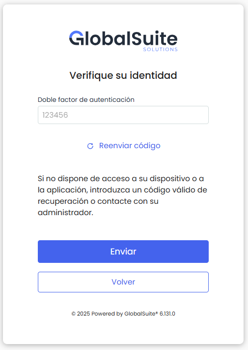

### Habilitación de 2FA - Opcional

#### Configuración de 2FA

GlobalSuite® permite que cada usuario active de forma opcional un doble factor de autenticación (2FA) para mejorar la seguridad y privacidad, siempre y cuando el administrador del entorno así lo decida. Los pasos a seguir para la activación opcional del 2FA son los siguientes:

#### Paso 1. Acceder a la Opción de Perfil

A través de la opción de Perfil (en la parte superior derecha de la pantalla) el usuario podrá acceder a la configuración de su propio perfil.

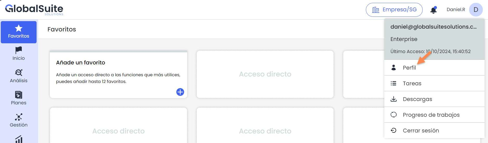

#### Paso 2. Activar el Doble Factor

Se procederá a activar el doble factor de autenticación haciendo clic en el botón **Activar Doble Factor** .

Seguidamente, se deben realizar las instrucciones que aparecerán en pantalla (ver siguiente diapositiva).

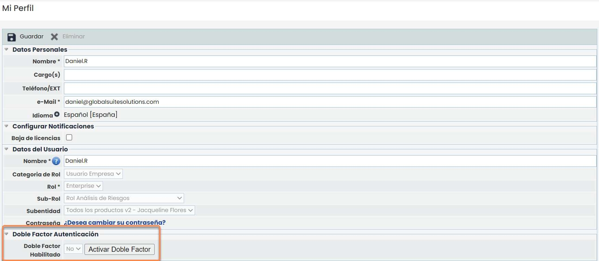

##### Activar el Doble Factor - TOTP

1. Descargar e instalar alguna aplicación que permita gestionar este doble factor.
2. Una vez la tenga instalada, se deberá escanear el código QR que le aparece en pantalla, o bien, introducir la **Cadena secreta** de forma textual que se encuentra en la pantalla.

   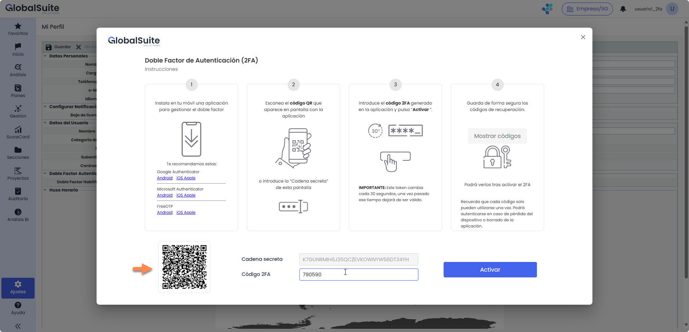
3. Una vez enlazada, se deberá introducir el token o código temporal obtenido mediante la aplicación en el campo **Código 2FA** y pulsar el botón **Activar**.

   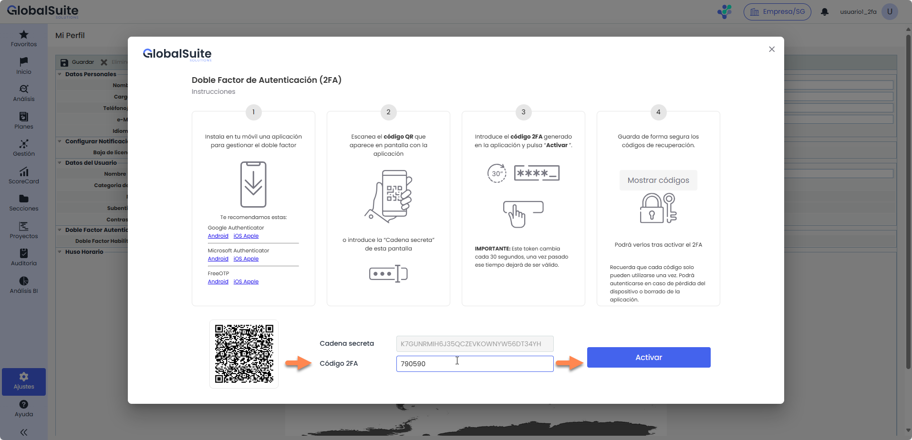
4. Por último, se deberá almacenar de forma segura los códigos de recuperación que aparecen al presionar

   

   Una vez realizada la activación, cada vez que se inicie sesión en GlobalSuite®, el sistema solicitará el código 2FA que aparece en el dispositivo configurado.

##### Activar el Doble Factor - Correo Electrónico

Para activar el Doble Factor de Autenticación mediante Correo Electronico, se deben realizar los siguientes pasos:

1. Se abrirá una ventana para realizar la configuración. En el Paso 1, el usuario debe pulsar el botón **Enviar**, lo que generará el envío de un correo electrónico con un código único y temporal a la dirección asociada a su cuenta.

   
   1. En caso de ser necesario se podrá **reenviar** el código, aunque estará limitado a un máximo de 3 reenvíos por usuario en un periodo de 5 minutos.

      
2. Copiar y pegar el código de 6 dígitos que llegó al correo en el campo **Código 2FA** y presionar **Activar**. Si es correcto se habilitara el 2FA y se mostrará el botón “Ver códigos”

   
3. Por último, se deberá almacenar de forma segura los códigos de recuperación que aparecen al hacer click en “Ver Códigos”

   

Una vez realizada la activación, cada vez que se inicie sesión en GlobalSuite®, el sistema enviará un correo electrónico con el código.

### Deshabilitación de 2FA

#### Deshabilitar el Doble Factor de Autenticación obligatorio

Para desactivar el doble factor de autenticación cuando es obligatorio, el Administrador del entorno deberá seguir los indicados en la sección Configuración de 2FA, luego seleccionar del desplegable el valor **Deshabilitado** y guardar el cambio.

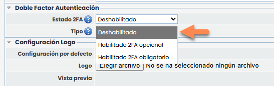

#### Deshabilitar el Doble Factor de Autenticación opcional

Para desactivar el doble factor de autenticación cuando es opcional, se deberá seguir los pasos 1 y 2 de la sección Habilitación de 2FA - Opcional, luego hacer clic en el botón Desactivar Doble Factor .

Posteriormente, se deberá confirmar la acción haciendo clic en el botón Aceptar de la ventana emergente.

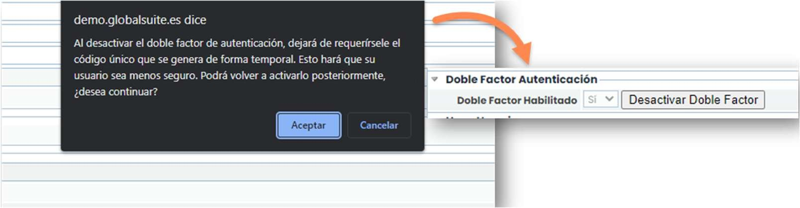
