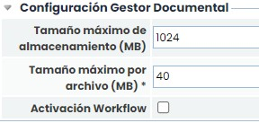
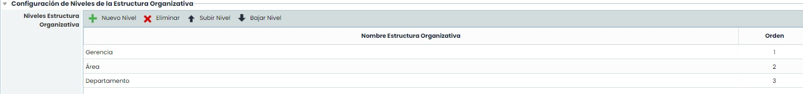
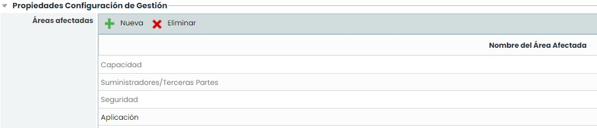
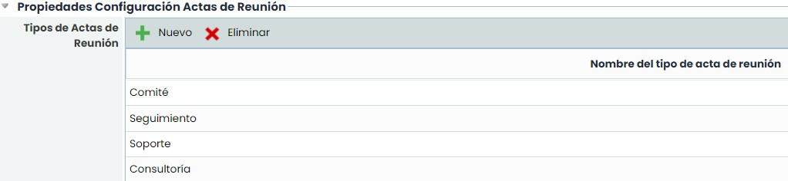
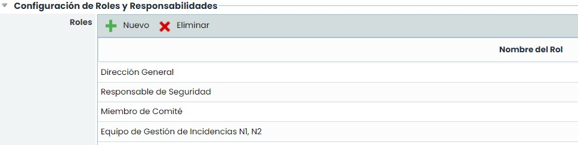
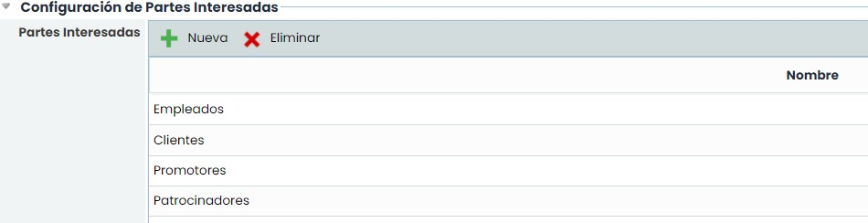
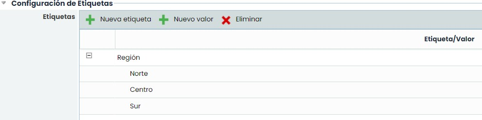
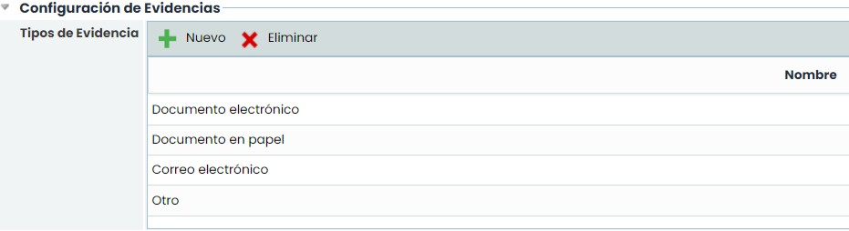
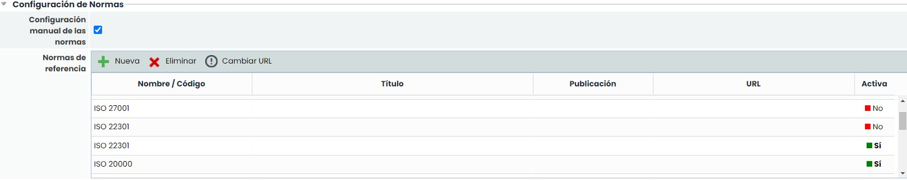
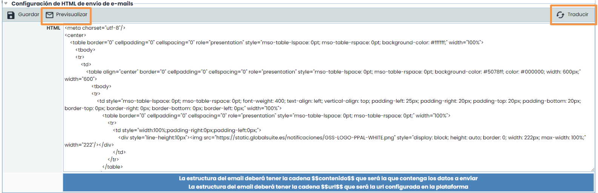

# Configuración general de GlobalSuite®


Este tutorial describe las principales opciones de \*\*Configuración General\*\* de GlobalSuite®, que permiten adaptar la plataforma a la estructura organizativa, operativa y normativa de la empresa.
En la guía se resumen las configuraciones disponibles para el \*\*gestor documental\*\*, la \*\*estructura organizativa\*\*, la \*\*gestión de listas y roles\*\*, las \*\*partes interesadas\*\*, las \*\*etiquetas y evidencias\*\*, la \*\*configuración de normas\*\* y la \*\*personalización del envío de correos electrónicos\*\*.


## Índice

* [Índice](#ConfiguracióngeneraldeGlobalSuite®-Índice)
* [Gestor Documental](#ConfiguracióngeneraldeGlobalSuite®-GestorDocumental)
* [Niveles de la Estructura Organizativa](#ConfiguracióngeneraldeGlobalSuite®-NivelesdelaEstructuraOrganizativa)
* [Gestión](#ConfiguracióngeneraldeGlobalSuite®-Gestión)
* [Actas de Reunión](#ConfiguracióngeneraldeGlobalSuite®-ActasdeReunión)
* [Roles y Responsabilidades](#ConfiguracióngeneraldeGlobalSuite®-RolesyResponsabilidades)
* [Partes Interesadas](#ConfiguracióngeneraldeGlobalSuite®-PartesInteresadas)
* [Etiquetas](#ConfiguracióngeneraldeGlobalSuite®-Etiquetas)
* [Evidencias](#ConfiguracióngeneraldeGlobalSuite®-Evidencias)
* [Configuración de Normas](#ConfiguracióngeneraldeGlobalSuite®-ConfiguracióndeNormas)
* [HTML de envío de e-mails](#ConfiguracióngeneraldeGlobalSuite®-HTMLdeenvíodee-mails)

## Gestor Documental

Este apartado permite configurar aspectos específicos del Gestor Documental:

* **Tamaño máximo de almacenamiento (MB):** Permite establecer el límite de almacenamiento (Megabytes) del gestor documental. Este límite sólo puede ser modificado por el departamento de CSC de GlobalSuite®, el cual corresponde al licenciamiento contratado.
* **Tamaño máximo por archivo (MB):** Es el tamaño máximo que puede tener un archivo para cargarlo en GlobalSuite®.
* **Activación Workflow:** Permite activar la funcionalidad de workflows de gestión documental.

## Niveles de la Estructura Organizativa

Esta opción ofrece la posibilidad de establecer los niveles existentes para la definición de la estructura organizativa de la organización. Para ello se establecen las siguientes opciones:

* **Nuevo Nivel:** Permite insertar una nueva entrada en la tabla para la definición de una unidad estructural. Para poder modificar el nombre se ha de pulsar dos veces sobre la celda e incluir el nombre deseado.
* **Eliminar:** Permite eliminar una entrada de la tabla. Para ello se ha de seleccionar la entrada y pulsar sobre el botón para suprimir el nivel.
* **Subir Nivel:** Ofrece la posibilidad de elevar uno o varios niveles jerárquicamente de una entrada ya definida.
* **Bajar Nivel:** Ofrece la posibilidad de descender uno o varios niveles jerárquicamente de una entrada ya definida.


\*\*NOTA\*\*: La definición de elementos de la estructura organizativa se realiza en la opción Inicio> [\*\*Estructura Organizativa\*\*](https://help.globalsuitesolutions.com/es/globalsuite/v1/estructura-organizativa)


## Gestión

Este apartado permite la parametrización de listas desplegables ubicadas en las opciones del menú Gestión.

**Áreas afectadas:** Permite al usuario incorporar diferentes áreas afectadas que podrán asignarse a los tickets. Utilizando los botones ‘Nueva’ y ’Eliminar’ se permite crear nuevas áreas o eliminar las áreas ya existentes, así como editar su nombre haciendo doble click sobre la fila.

La herramienta propone por defecto las áreas de Capacidad, Suministradores, Seguridad, Disponibilidad en función de los módulos habilitados. Estas áreas no se pueden modificar ni eliminar ya que están relacionadas con opciones de GlobalSuite® para proveer funcionalidad específica. En concreto:

* **Capacidad: Las incidencias**, no conformidades e indicadores que tienen esta área asignada se podrán consultar en los planes de capacidad elaborados en la opción 'Capacidad' del menú 'Planes'.
* **Suministradores/Terceras Partes**: Las incidencias, no conformidades e indicadores que tienen esta área asignada se podrán asociar a un proveedor registrado en la opción 'Proveedores' del menú 'Inicio'. Una vez registrado a un proveedor, en el formulario de cada proveedor se podrá consultar todas las incidencias y no conformidades que tiene asignadas durante la evaluación, así como visualizar la gráfica del indicador que tenga relacionado.
* **Seguridad:** Todos los tickets se pueden asignar a esta área para indicar que se trata de un ticket relacionado con la seguridad.
* **Disponibilidad:** Las incidencias, no conformidades e indicadores que tienen esta área asignada se podrán consultar en los planes de disponibilidad elaborados en la opción 'Disponibilidad' del menú 'Planes'.
* **Tipos de teléfonos de Empleados:** Permite crear diferentes tipos de teléfonos para identificar el teléfono de cada empleado (fijo, personal, móvil, trabajo, etc.). Los tipos configurados en esta tabla aparecen en el formulario de Empleados, donde para cada empleado se permite crear más de un teléfono. Utilizando los botones 'Nuevo' y 'Eliminar' se permite crear nuevos tipos o eliminar los tipos ya existentes, así como editar su nombre haciendo doble click sobre la fila.

  

## Actas de Reunión

El apartado de configuración de actas de reunión permite parametrizar las diferentes tipologías de actas de reunión. GlobalSuite® identifica por defecto comité, seguimiento, soporte, consultoría y auditoría, pero se pueden añadir nuevas o eliminar pulsando los botones ‘Nuevo’ y ‘Eliminar’.

## Roles y Responsabilidades

La definición de roles y responsabilidades es parte fundamental de los sistemas de gestión. Para ello, la plataforma posibilita definir los roles existentes en la organización, que serán los encargados de la gestión del sistema.

Para añadir nuevos roles, se pulsa el botón ‘Nuevo’. Para eliminar un rol se selecciona la línea deseada y se pulsa el botón ‘Eliminar’.

## Partes Interesadas

**Partes Interesadas:** Esta tabla contiene las partes interesadas de la organización, que podrán asociarse a los procesos de negocio definidos en la herramienta. La tabla permite las siguientes acciones:

* **Nueva:** Permite insertar una parte interesada en la tabla.
* **Eliminar:** Permite eliminar una o varias partes interesadas en la tabla. Para ello se debe seleccionar la fila o filas deseadas y pulsar sobre el botón ‘Eliminar’.

## Etiquetas

Esta sección sólo está disponible en aquellas empresas que dispongan de subentidades. Las empresas que tengan una única entidad, la sección no aparece visible.

Esta tabla permite definir un conjunto de etiquetas que podrán asociarse a las subentidades. Una etiqueta es un campo adicional que se asocia a la entidad, para definir cualquier parámetro que deseemos. Una subentidad podrá tener una o varias etiquetas, con los valores correspondientes. La tabla permite las siguientes acciones:

* **Nueva etiqueta**: Este botón permite crear una etiqueta nueva. El nombre de la etiqueta se puede editar haciendo doble click sobre el nombre.
* **Nuevo valor:** Este botón permite crear un valor a una etiqueta. Para ello, se debe seleccionar previamente la etiqueta deseada y pulsar sobre el botón. Los valores de las etiquetas pueden editarse haciendo doble click sobre el nombre.
* **Eliminar:** Permite eliminar una etiqueta o un valor de la tabla, seleccionado la fila deseada y pulsando sobre el botón.

## Evidencias

Esta sección sólo está disponible en las empresas que dispongan de la opción "Gestión de Evidencias", en función de los módulos contratados. Las empresas que no tengan dicha opción, la sección no aparece visible.

La tabla permite crear tipos de evidencia, que estarán disponibles para su asociación con las evidencias registradas en la herramienta. La tabla permite las siguientes acciones:

* **Nuevo:** Este botón permite crear una nueva fila en la tabla.
* **Eliminar:** Permite eliminar uno o varios tipos en la tabla. Para ello se debe seleccionar la fila o filas deseadas y pulsar sobre el botón ‘Eliminar’.

## Configuración de Normas

Esta sección sirve para nombrar en forma de listado las Normas que tenga su compañía en vigor. Estas normas que se tengan configuradas aparecerán como opción a la hora de elegir el Sistema de Gestión (SG) en las opciones de **Inicio >** [**Alcance y Planes**](https://help.globalsuitesolutions.com/es/globalsuite/v1/alcance) **> Auditorías.**

Esta sección permite las siguientes acciones:

* **Configuración manual de las normas**: Este campo permite que la configuración de las normas se realice desde la tabla inferior. En caso de estar desactivado no se podrán configurar.
* **Nuevo**: Este botón permite crear una nueva fila en la tabla. El nombre de la norma se puede editar haciendo doble click en la fila correspondiente.
* **Eliminar**: Permite eliminar uno o varios tipos en la tabla. Para ello se debe seleccionar la fila o filas deseadas y pulsar sobre el botón ‘Eliminar’.
* **Cambiar URL**: Sirve para modificar el campo URL (enlace o dirección web de la norma).
* Los campos de **Nombre/Código** (campo principal), Título (descripción o nombre extenso de la norma) y **Publicación** (período en el que se publicó la norma) pueden editarse haciendo doble click. El *check* de la columna **Activa** sirve para indicar si la norma está vigente en la empresa.

## HTML de envío de e-mails

Para acceder a esta opción hay que entrar en la opción de correo que se encuentra en la parte superior.

Esta opción ofrece la posibilidad al usuario de parametrizar el formato de envío de notificaciones realizadas por la plataforma. Por defecto GlobalSuite ofrece un formato específico, el cual se puede modificar por el formato deseado. En caso de modificar el formato por defecto, no hay que olvidar incluir, en algún lugar del formato, la cadena de caracteres **$$contenido$$,** ya que es la cadena que utiliza la herramienta para incorporar el contenido correspondiente a la notificación que se envía. Pulsando Traducir se puede añadir el mensaje en otros idiomas en los que se ha contratado la plataforma. El botón **‘Previsualizar’** permite al usuario ver cómo se mostrarán las notificaciones a los usuarios.

