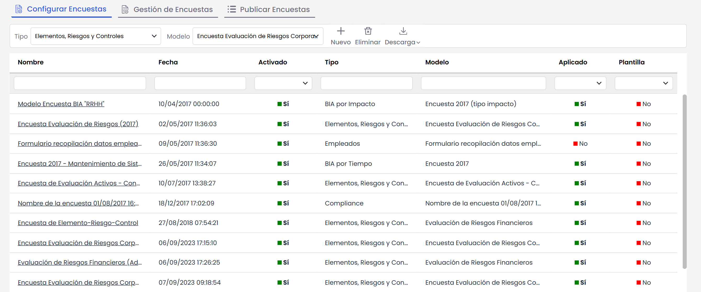
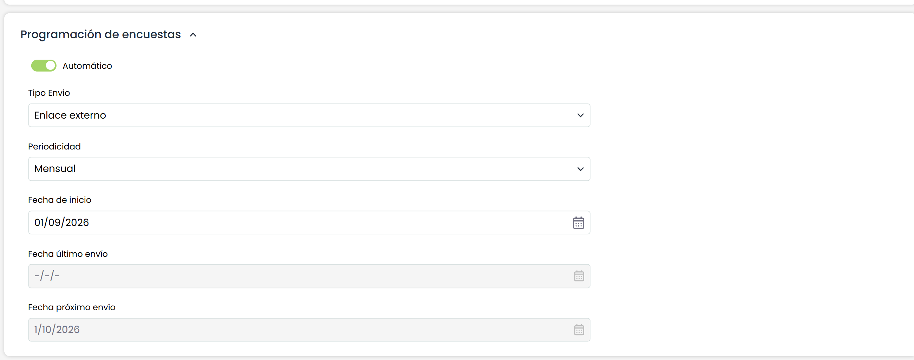
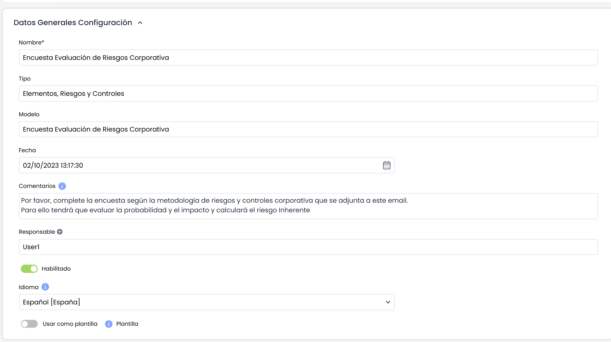
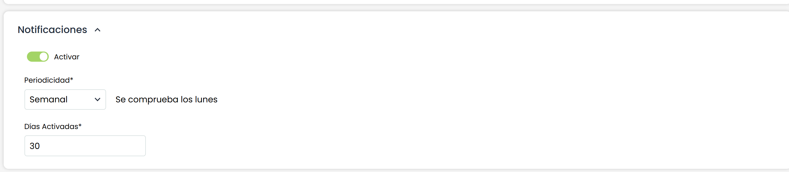
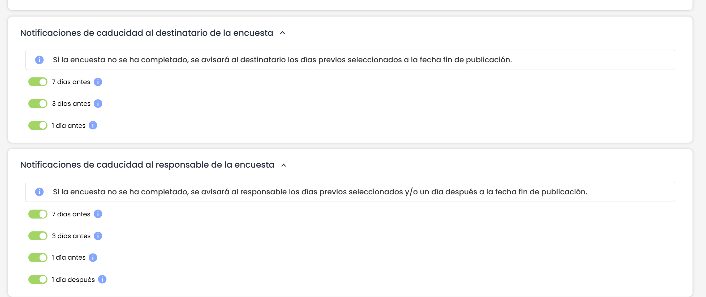

# ¿Cómo automatizar la evaluación de riesgos y controles a través de la opción de Encuestas de GlobalSuite®?

Con la automatización de encuestas y la configuración de notificaciones conseguirá ahorrar tiempo en todas las evaluaciones de activos, riesgos y controles que tenga tu compañía. Podrá programar el envío de estas encuestas y directamente GlobalSuite® enviará la encuesta con una frecuencia definida a la persona responsable en contestar la evaluación. Si tiene evaluaciones mensuales y/o anuales, solo tendrá que configurar la frecuencia y realizar el seguimiento a través de las notificaciones recibidas. Ahorre tiempo en la operativa para centrar los esfuerzos en las conclusiones de los resultados obtenidos.

Con el lanzamiento automático, podrá a su vez, configurar varios tipos de alertas para realizar recordatorios al responsable de la respuesta de riesgos y controles y ayudar en el seguimiento de la misma. Son dos funcionalidades que se pueden configurar de manera individual pero con una configuración conjunta podrá aprovechar su potencia al máximo.


\*\*NOTA:\*\* Recuerde que las encuestas de GlobalSuite® pueden ir dirigidas a cualquier elemento de la organización (software, procesos, áreas, proveedores, etc.) y podrán tener riesgos asociados y controles que mitigan estos riesgos, por lo que podrá olvidarse del envío de hojas de cálculo donde las respuestas no se pueden consolidar. Con esta funcionalidad podrá delegar aún más su proceso en GlobalSuite®.


## ¿Cómo automatizar la evaluación de riesgos y controles a través de la opción de Encuestas de GlobalSuite® y las opciones de programación de encuestas y notificaciones?

En un primer paso, vamos a configurar y a automatizar el lanzamiento de encuestas. Este lanzamiento se podrá automatizar para encuestas con link externo o encuetas con link interno. Las encuestas con Link Externo podrán ser respondidas por empleados que no tengan acceso a GlobalSuite®. Esto permitirá también un ahorro importante en el tiempo de configuración de la aplicación ya que la persona que reciba el email con el enlace podrá acceder. La encuesta con link externo está securizada con un token.

Si por otro lado se quiere utilizar la opción de link interno podrá elegir a un usuario de la aplicación que recibirá esta encuesta.

En este ejemplo completo, se podrá ver la automatización con link externo.

#### ¿Cómo configurar la plantilla de Encuestas?

 En primer lugar, recuerde que tendrá que tener un modelo de encuestas que se configurará en Ajustes > [Modelos de Encuestas](https://help.globalsuitesolutions.com/es/globalsuite/v1/modelos-de-encuestas). En esta opción tendrá que elegir la encuesta de Tipo Elemento, Riesgo y Control.

Una vez configurado y creado el modelo, se procederá a Configurar la Encuesta. En esta opción el objetivo es decir sobre qué elementos, riesgos y controles (también se podrá realizar sobre elementos individuales o solo de controles, la configuración será la misma independientemente del modelo elegido). Desde esta opción se podrá elegir sobre qué Análisis de Riesgos hacerlo, qué Elementos, Riesgos y Controles y podrá elegir a qué persona quiere enviarse esta información. Con esta configuración se enviará la encuesta según la frecuencia definida. Para ello, hay que seguir estos pasos:

Se accederá a Gestión > Encuestas > [Configurar Encuestas](https://help.globalsuitesolutions.com/es/globalsuite/v1/configurar-encuestas)  y seleccionamos el tipo de Encuesta y el Modelo que se elegirá.

 Al acceder, además de seleccionar el alcance de la evaluación o los datos propios de la encuesta se podrá configurar notificaciones periódicas y se podrá programar para que la encuesta se envíe automáticamente a partir del primer envío.

## ¿Es posible programar encuestas según una frecuencia determinada?

Para poder configurar una encuesta de forma automática, tendremos que irnos al apartado de Programación de Encuestas y lo primero que habría que hacer es marcar la opción Automático. Con este paso, se activarán los campos específicos y que son necesarios para el envío.

Los campos para la definición son:

* Tipo de Envío: Enlace externo o Enlace interno. Para el de enlace externo se utilizará al opción de Publicación de Encuestas y el destinario de la misma no necesitará usuario.
* Periodicidad: Elegir entre Mensual, Trimestral, Semestral y Anual.
* Fecha de Inicio: Fecha que se utilizará para el primer envío. Para este primer envío se sumará la fecha de inicio y la periodicidad. En este primer envío también puede hacerse manualmente desde Publicación. Si quiere dejar preparado todo para lanzarlo en una fecha, podrá configurar la fecha de inicio para que la Fecha de Próximo Envío sea el día del envío de encuestas.
* Fecha Último Envío: Fecha de cuando fue el último envío de esta Configuración de Encuestas.
* Fecha Próximo Envío: Fecha calculada en función de la periodicidad y de la fecha de envío.

Adicionalmente, hay dos campos necesarios para este tipo de envíos. El campo Comentarios que si está completo se enviará con la notificación por lo que podrá rellenarlo con instrucciones de la campaña de evaluación de riesgos y controles, sobre la metodología de evaluación o cualquier otro tema que considere relevante. El segundo campo se corresponde con el campo Responsable, habrá que añadir a la persona o personas que quiere enviar esta encuesta. Podrá utilizar Workflows de aprobación o solo un estado.

## ¿Cómo configurar las notificaciones de encuestas para hacer seguimiento?

Dentro de este proceso, GlobalSuite® cuenta con varios tipos de notificaciones que permitirán hacer seguimiento y no perder la fecha objetivo para el responsable de la publicación y para el destinatario de la encuesta. Todos los responsables en participar en este proceso de evaluación tendrán sus notificaciones automáticas cuando sean los responsables de contestar. De esta forma, ante cualquier envío de encuesta, finalización de encuesta cambio de estado de WF, GlobalSuite® enviará en ese momento una notificación. Además de estas alertas, se podrán configurar alertas periódicas que se enviarán en función de las fechas definidas.

#### ¿Cómo puedo configurar las notificaciones periódicas según la fecha de inicio?

Esta alerta se enviará al destinatario de la encuesta en forma de seguimiento. Será una alerta periódica que se enviará según una periodicidad definida. Aunque se le dará un plazo de respuesta, el usuario podrá configurar a modo de recordatorio esta notificación y se enviará al destinatario para evitar que llegue al deadline dado y no haya revisado la encuesta. Esta alerta funcionará tanto para Enlace externo como para enlace interno.

Para ello, tendrá que Activar este apartado y configurar la periodicidad y los días que quiere tener activado esta alerta. En el ejemplo se puede ver una periodicidad semanal (se envía todos los lunes) durante 30 días, que es el plazo que tienen los responsables de riesgos y controles para esta encuesta.

## ¿Cómo configurar las notificaciones de fin de plazo?

Completando a las alertas periódicas, hay otras alertas que ayudarán a controlar el deadline definido para poder obtener las respuestas sobre Elementos, Riesgos y Controles. Estas alertas solo están disponibles cuando se ha elegido en la configuración Enlace Externo o lo que es lo mismo, desde la opción de Publicar Encuestas.

Para ir a esta opción tendrá que pulsar en Encuestas > Publicación de Encuestas. Al acceder, podrá definir qué alertas de plazo fin enviar tanto al destinatario como al responsable de la publicación que será el responsable de revisar los resultados de la encuesta.

Esta alerta es muy útil para el responsable de la publicación ya que normalmente tendrá varias publicaciones a las que tendrá que acceder seguimiento. De esta forma, GlobalSuite® realizará el seguimiento en función de la fecha de cierre.

Una de las notificaciones para el responsable de la encuesta, es la de 1 día después de la fecha cierre. Con esta notificación se podrá saber qué encuestas han finalizado y que encuestas están por finalizar y el enlace de la encuesta ha caducado. Esto provocará ponerse en contacto con el destinatario asociado para extender el periodo de la misma.

