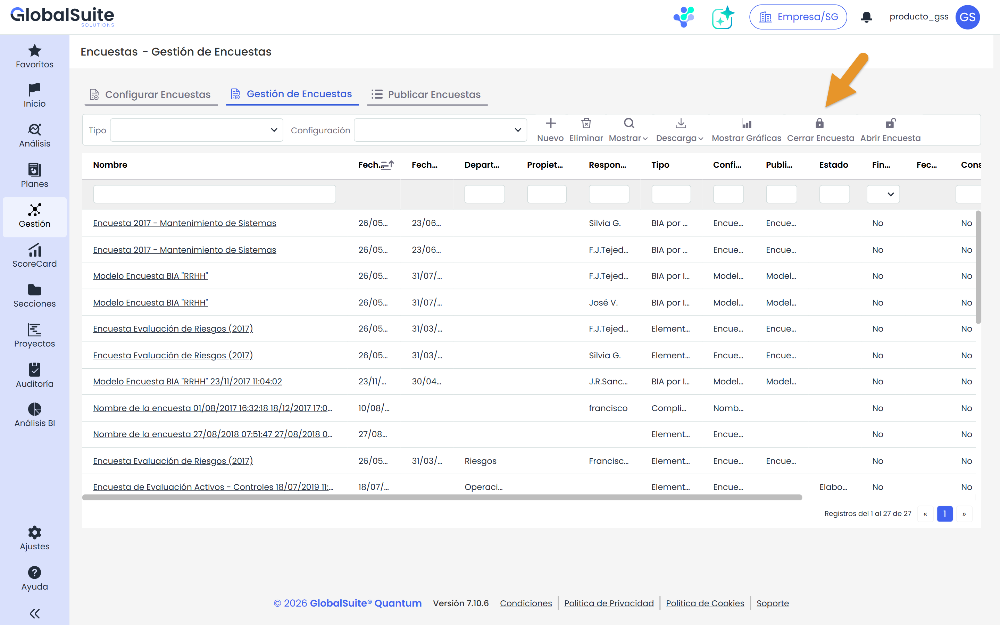
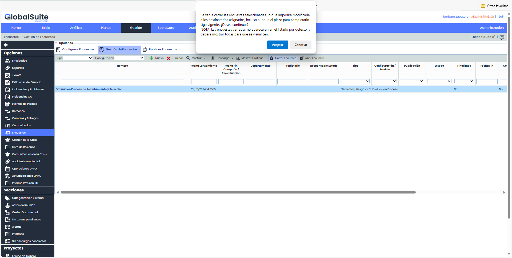
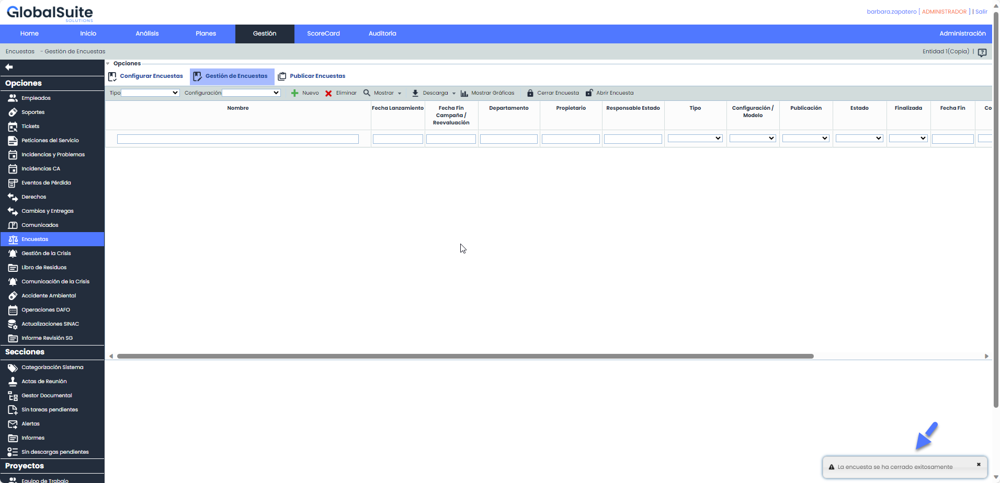
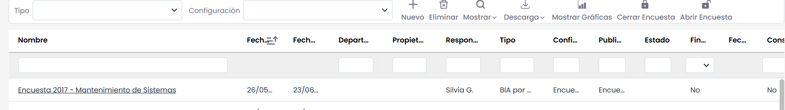
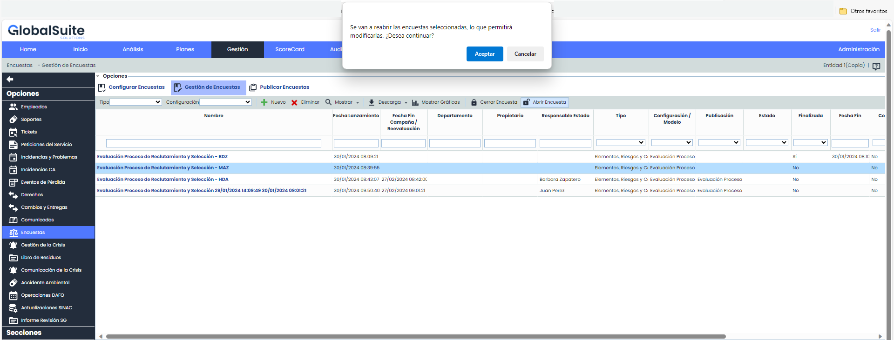
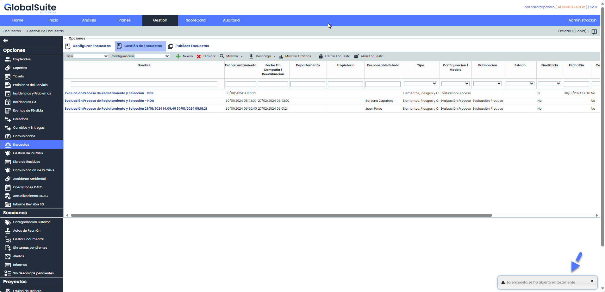
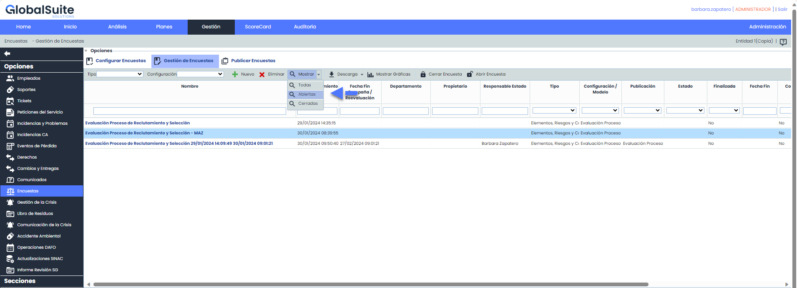
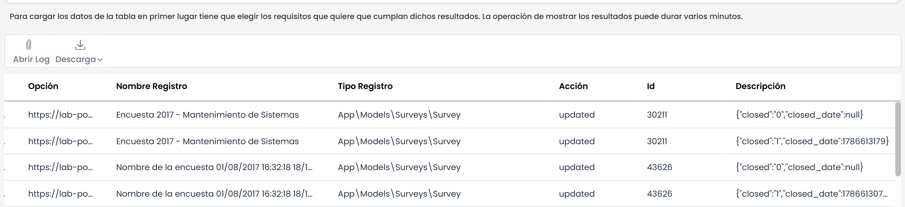
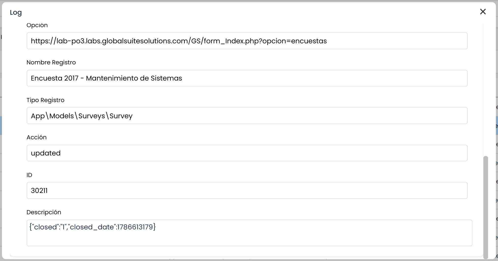
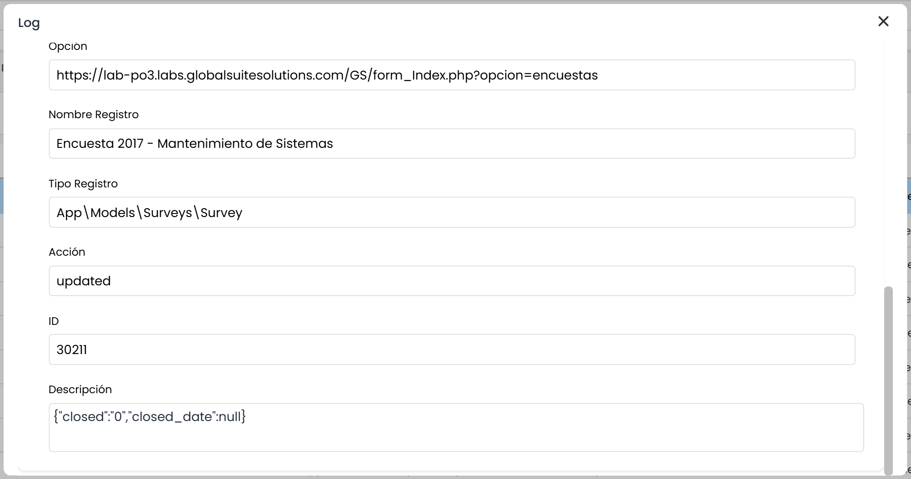

# ¿Cómo cerrar encuestas?

## Cerrar encuestas en GlobalSuite®.


Este artículo detalla la funcionalidad que permite cerrar y archivar encuestas y publicaciones en GlobalSuite®. Con estas acciones, se obtiene un mayor control sobre la administración de las encuestas y se garantiza la integridad de los datos.


### ¿Cómo cerrar encuestas?

Para cerrar una encuesta, simplemente se accede a la sección de Gestión de Encuestas. Se podrá cerrar una encuesta en cualquier momento, independientemente de si aún está en curso o si el plazo para responder aún no ha concluido.

1. Ir a la sección de Gestión de Encuestas de GlobalSuite®. Puede accederse a esta sección desde Gestión > Encuestas o según la estructura configurada por la empresa en nuestra plataforma.
2. Una vez dentro de la gestión de encuestas, se elige la encuesta que se desea cerrar. Si se prefiere, se pueden seleccionar varias a la vez haciendo clic con la tecla 'Shift' presionada.
3. Luego, en las opciones de la barra superior, presionar "Cerrar encuesta"

   
4. Se mostrará un mensaje de confirmación que deberá ser aceptado para cerrar efectivamente la encuesta.

   
5. Al cerrar una encuesta, se mostrará un mensaje indicando que la acción se ha realizado con éxito.

La encuesta se archivará automáticamente, por lo cual las encuestas cerradas no aparecen en el listado principal de forma predeterminada.

### ¿Cómo puedo ver las encuestas Cerradas?

Para ver las encuestas cerradas, se debe utilizar la opción “Mostrar”, de la barra superior. Las opciones son las siguientes:

* Todas: Mostrara las encuestas abiertas y cerradas.
* Abiertas: Encuestas abiertas únicamente.
* Cerradas: Encuestas cerradas.

Por defecto, cuando se accede a Gestión de encuestas se muestran solamente las encuestas abiertas que se tienen que gestionar.

### ¿Qué implica que una encuesta esté cerrada?

Una vez cerrada, los destinatarios no podrán acceder ni modificar el contenido de una encuesta (Usuarios que acceden por link externo, de forma anónima o usuario con acceso de Mi información en Encuestas)

Una encuesta que esté cerrada no se incluirá ni generará notificaciones que pueda tener configurada la empresa.

### ¿Se pueden reabrir las encuestas cerradas?

Sí, al lado de la opción de “Cerrar encuesta” está la opción “Abrir encuesta”

Aparecerá un mensaje de confirmación que deberá ser aceptado para reabrir efectivamente la encuesta.

Si la acción se realizó correctamente, se mostrará un mensaje informándolo:

La encuesta se verá de nuevo en la tabla principal de gestión y se podrá acceder a ella mediante el enlace original, sin necesidad de reenviarla.

### ¿Se pueden cerrar Publicaciones?

No hay una función específica para cerrar directamente una publicación. Sin embargo, al cerrar todas las encuestas asociadas a una publicación, esta se considerará automáticamente cerrada.

Por lo que al igual que las encuestas, las publicaciones cerradas, dejaran de estar visibles por defecto en la tabla principal donde se listan todas las publicaciones.

Para ver las publicaciones cerradas, se debe utilizar la opción “Mostrar”, de la barra superior. Las opciones son las siguientes:

* Todas: Mostrara las publicaciones abiertas y cerradas.
* Abiertas: Publicación abiertas únicamente. Esta opción es la que se muestra por defecto.
* Cerradas: Publicaciones en donde todas sus encuestas están cerradas.

### ¿Dónde puedo visualizar los cambios de estado que ha experimentado una encuesta?

Existe un detallado log de auditoría que registra las acciones de cerrar y reabrir encuestas. Esto proporciona transparencia y un historial de cambios para una gestión más efectiva.

Para consultarlos debes tener acceso a Ajustes >Logs de Acciones.

* Log al cerrar una encuesta:

* Log al abrir una encuesta:

Al cerrar una encuesta, se registra la fecha de cierre y se establece el indicador en 1. Al abrir la encuesta, la fecha se borra y el indicador vuelve a 0.
