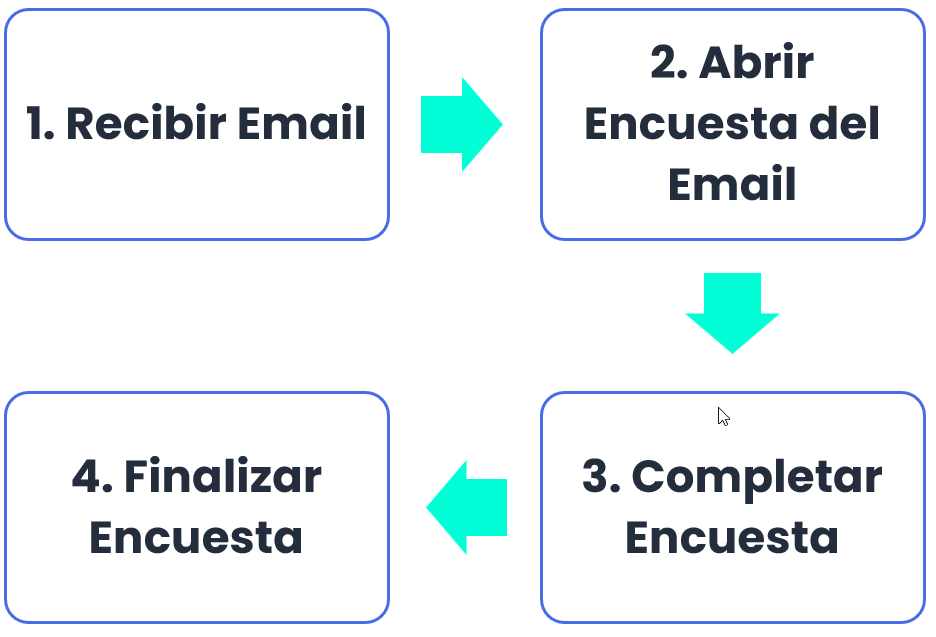
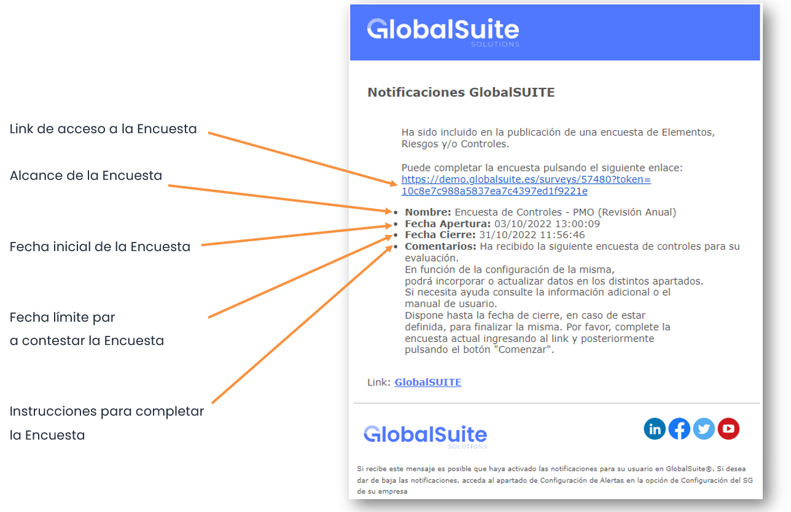
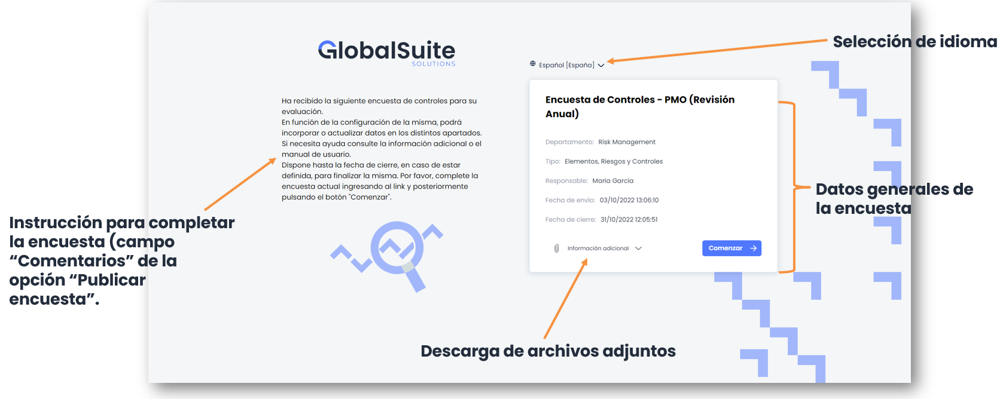
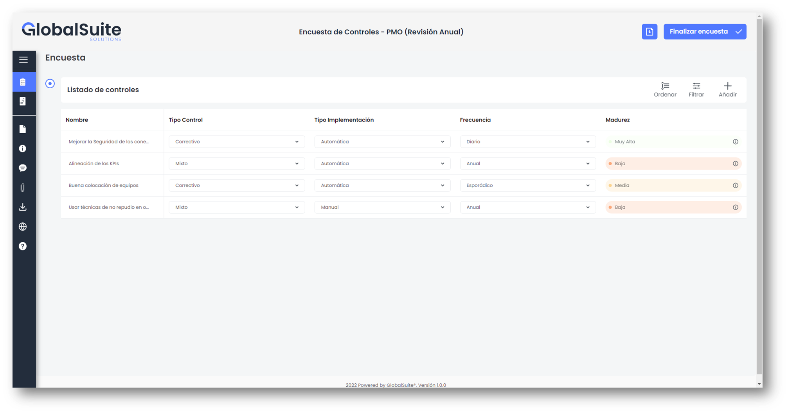
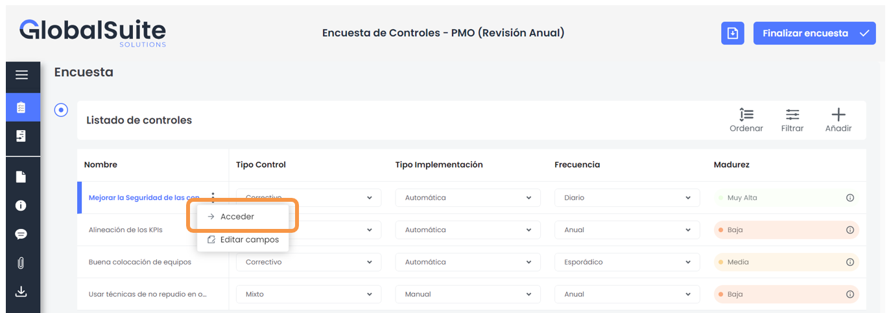
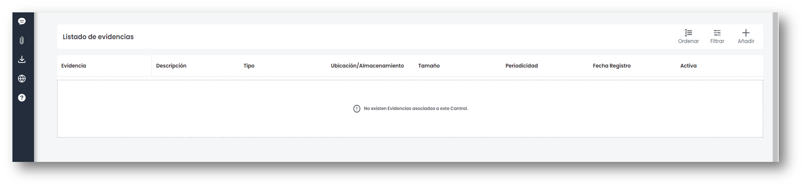
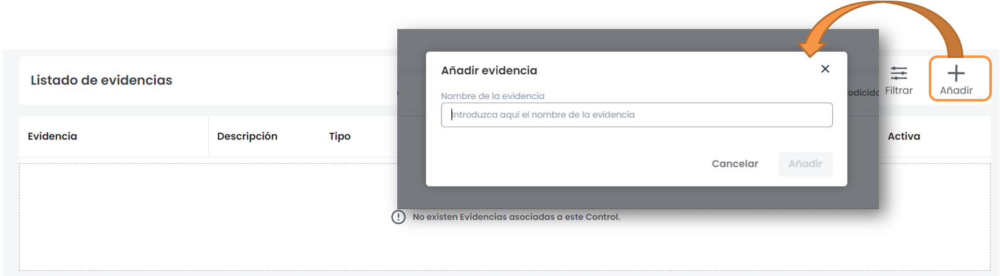
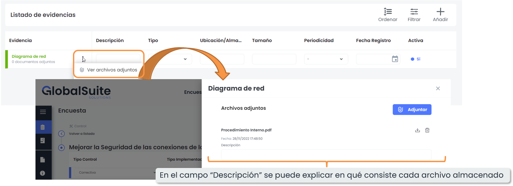
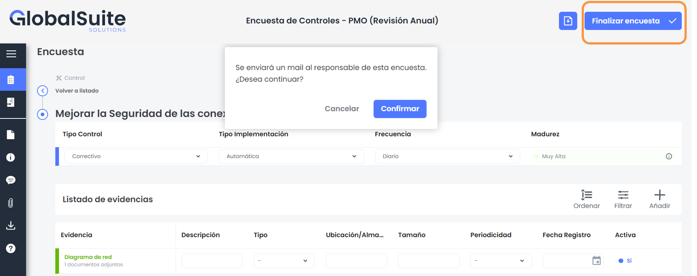

# Cómo completar encuestas de controles con evidencias en GlobalSuite


Este tutorial explica, paso a paso, cómo recibir, completar y enviar las \*\*encuestas de controles con evidencias\*\* en GlobalSuite®.
En esta guía se detalla el proceso completo desde la \*\*recepción del correo de notificación\*\* hasta la \*\*finalización y envío de la encuesta\*\*, incluyendo la apertura del enlace recibido, la cumplimentación de los campos de control, y la \*\*incorporación de evidencias adjuntas\*\*.
Además, se muestra cómo crear nuevos registros de evidencia, añadir archivos asociados, y confirmar la finalización de la encuesta para notificar automáticamente al responsable del sistema de gestión


### Fases para la realización de Encuestas de Controles

## 1. Recibir Email

Cada empleado que sea responsable de, al menos, un control, recibirá un Email de GlobalSuite® con la información de la Encuesta de Controles que debe completar. El Email se recibirá desde la siguiente dirección: Alertas GlobalSuite <n[oreply@GlobalSuitesoftware.com>](mailto:noreply@GlobalSuitesoftware.com)

## 2. Abrir Encuesta del Email

Para acceder a la Encuesta de Controles asignada, sólo debe hacer click sobre el enlace que aparece en el correo electrónico recibido ).  Al pulsar el link se abrirá la encuesta en el navegador. Para dar inicio a la completitud de la encuesta debe hacer click en **Comenzar** .

## 3. Completar Encuesta

A continuación aparece la tabla de Controles asignados. Esta tabla contiene varias columnas, dependiendo de la Metodología de Controles de su empresa. En este ejemplo, las columnas que pueden visualizarse son las siguientes:

* **Nombre: Nombre del Control**
* **Tipo Control**
* **Tipo Implementación**
* **Frecuencia**
* **Madurez**

Para cada control es necesario registrar las evidencias. Para ello, hay que hacer click sobre un control del Listado de Controles y acceder al mismo. Una vez dentro del control se puede ubicar la sección de “Listado de evidencias”

La creación de una evidencia se realiza pulsando el botón “**Añadir**”. Al realizarlo, aparece una nueva ventana dónde se puede escribir un nombre descriptivo de la evidencia.

Una vez creada la evidencia, el último paso es adjuntar el archivo/s correspondientes. Para ello, se deberá hacer clic en los 3 puntos de la evidencia y luego clickear la opción “Ver archivos adjuntos”.

Al pulsar sobre el botón, aparece una ventana en el cual se mostrarán los archivos adjuntos ya existentes y el botón **Adjuntar** , el cuál abrirá una ventana emergente para seleccionar el archivo.

## 4. Finalizar Encuesta

Una vez terminada la encuesta, hay que pulsar sobre el botón **Finalizar Encuesta** ubicado en la parte superior. Esta acción permitirá avisar de manera automática a los responsables del Sistema de Gestión de que ha terminado la encuesta.

En las encuestas no existe un botón “guardar”, todo cambio es almacenado de forma automática. Se podrá acceder a la encuesta en otro momento a través del mismo enlace recibido en el correo.
