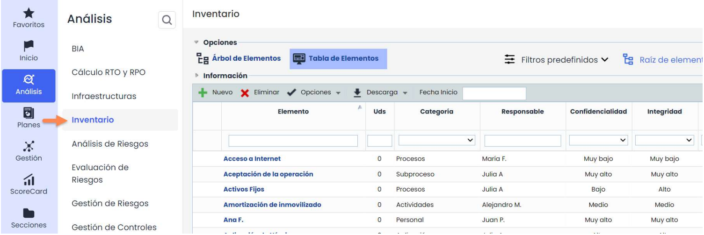
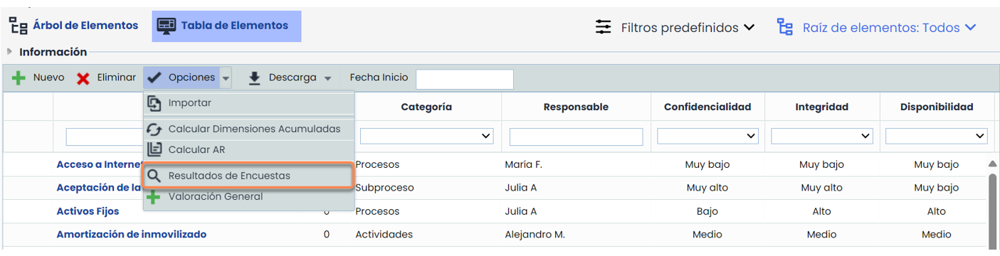
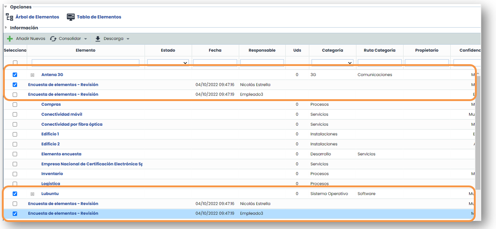
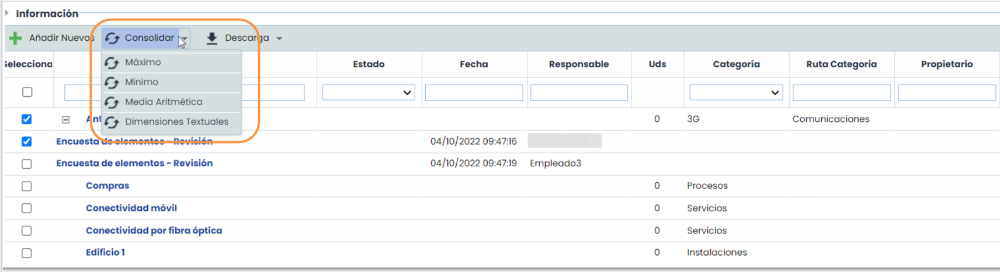
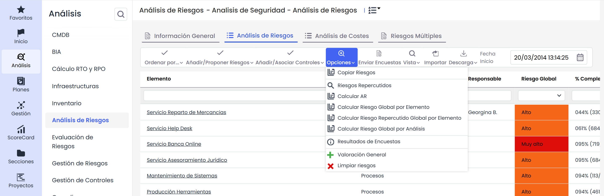
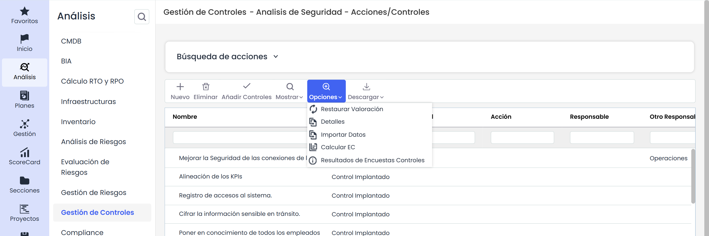
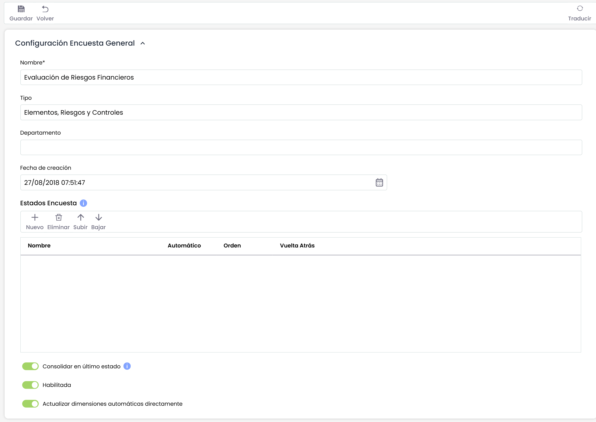
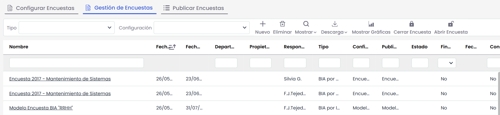
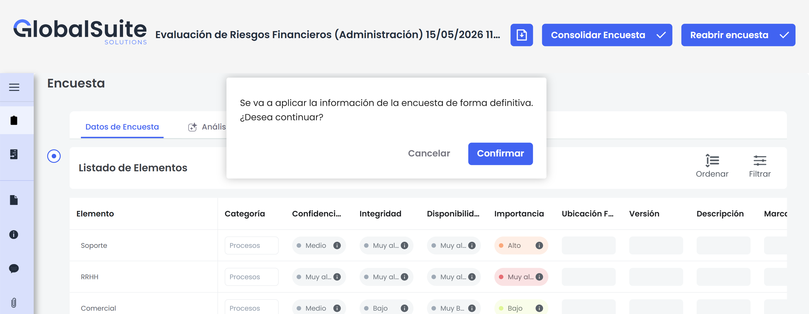

# Cómo consolidar encuestas de elementos, riesgos y controles en GlobalSuite


Este tutorial explica, paso a paso, cómo realizar la \*\*consolidación de encuestas\*\* en GlobalSuite® una vez que los responsables han completado y enviado sus respuestas.
En esta guía se detalla cómo consolidar encuestas desde las opciones de \*\*Inventario, Análisis de Riesgos y Gestión de Controles\*\*, así como directamente desde la propia encuesta. Se describen los distintos \*\*métodos de consolidación\*\* disponibles —\*\*máximo, mínimo, media aritmética o dimensiones textuales\*\*— y se explica cómo añadir nuevos elementos y seleccionar las encuestas que deben incluirse en el proceso.
Además, se muestra cómo realizar la consolidación manual desde el área de \*\*Gestión de Encuestas\*\*, permitiendo a los administradores un control completo sobre los resultados integrados en el sistema


## Consolidación de Encuestas de Inventario de Elementos.

Desde la opción **Análisis**>[**Inventario**](https://help.globalsuitesolutions.com/es/globalsuite/v1/tabla-de-elementos) se permiten consolidar las encuestas de Elementos que se han realizado. Al acceder se muestra por defecto la pestaña “Árbol de Elementos” (si se encuentra habilitado); se debe acceder a la opción “Tabla de Elementos”

Dentro de la pestaña “Tabla de Elementos” para acceder a la consolidación de encuestas se debe pulsar en “**Resultados de Encuestas**” que aparece al pulsar sobre el botón “**Opciones**”

Una vez pulsado el botón “**Resultado de Encuestas**” se muestran los elementos del inventario, y un desplegable por cada uno de ellos con las distintas encuestas realizadas sobre los elementos. Aquellos elementos que no disponen de desplegable no se encuentran en ninguna encuesta. Los elementos que se encuentran marcados en verde son los nuevos elementos que se han añadido en la encuesta, aparecen por defecto al final del listado, en este ejemplo se ha ordenado por nombre de elemento.

Para añadir el nuevo elemento, hay que marcarlo y pulsar el botón “**Añadir nuevos**”.

Para seleccionar las encuestas que se quieren consolidar, es necesario marcar las casillas que hay en la parte izquierda de la tabla. Aquellas encuestas no marcadas no se tendrán en cuenta en la consolidación.

El siguiente paso es pulsar el botón “Consolidar” que propone 4 opciones:

* **Máximo**: Esta opción toma los valores máximos de cada encuesta para consolidar.
* **Mínimo**: Esta opción toma los valores mínimos de cada encuesta para consolidar.
* **Media Aritmética**: Esta opción realiza la media aritmética de cada encuesta para consolidar.
* Por otro lado, para consolidar dimensiones de tipo Texto, habrá que seleccionar el botón **Dimensiones Textuales**.

## Consolidación de Encuestas de Análisis de Riesgos.

La consolidación de las encuestas de análisis de riesgos se realiza en la opción **Análisis>**[**Análisis de Riesgos**](https://help.globalsuitesolutions.com/es/globalsuite/v1/analisis-de-riesgos)

Hay un seleccionar un análisis y posteriormente un elemento para acceder a la ventana de consolidación. La opción de consolidación se encuentra en el botón “**Opciones**”.

El proceso para realizar la consolidación es el mismo que el descrito para las encuestas de elementos.

## Consolidación de Encuestas de Controles.

La consolidación de las encuestas de controles se realiza en la opción **Analisis>** [**Gestión de Controles**](https://help.globalsuitesolutions.com/es/globalsuite/v1/gestion-de-controles)

Hay que seleccionar un análisis para acceder a la ventana de consolidación. La opción de consolidación se encuentra en el botón “**Opciones**”.

El proceso para realizar la consolidación es el mismo que el descrito para las encuestas de elementos.

## Consolidación de Encuestas desde la propia encuesta.

Es posible consolidar los datos a través de la encuesta, esta acción la realiza el responsable de GlobalSuite una vez que ha comprobado que los datos son correctos, para ello en el modelado,  (**Ajustes >** [**Modelos de Encuestas**](https://help.globalsuitesolutions.com/es/globalsuite/v1/modelos-de-encuestas)) se ha tenido que marcar el siguiente check:

Esta consolidación se realiza en la opción **Gestión>** [**Encuestas**](https://help.globalsuitesolutions.com/es/globalsuite/v1/encuestas) y seleccionando el icono “**Gestión de Encuestas**”.

Una vez dentro de la encuesta seleccionada, aparece el botón **Consolidar Encuesta**. Al hacer click, aparecerá un mensaje para confirmar el proceso.

Una vez que se consolida, se recargará la página.
