# Cómo publicar y gestionar encuestas en GlobalSuite®


Este tutorial explica, paso a paso, cómo \*\*publicar y gestionar encuestas\*\* en GlobalSuite® una vez configurado el modelo y la estructura de la encuesta. En esta guía se detalla el proceso completo de \*\*publicación de encuestas\*\*, desde la selección del tipo y configuración hasta la asignación de \*\*destinatarios\*\*, fechas de apertura y cierre, y el envío automático de notificaciones con enlaces de acceso. También se explica cómo utilizar la sección de \*\*Gestión de encuestas\*\* para supervisar las respuestas recibidas, aplicar filtros y ordenaciones, exportar información, revisar el seguimiento de cambios y acceder a los \*\*adjuntos asociados\*\* a cada encuesta


## Fases para la realización de Encuestas de Elementos, Riesgos y Controles

En esta guía se explicarán fases 3 y 4 del transcurso de creación de una encuesta.

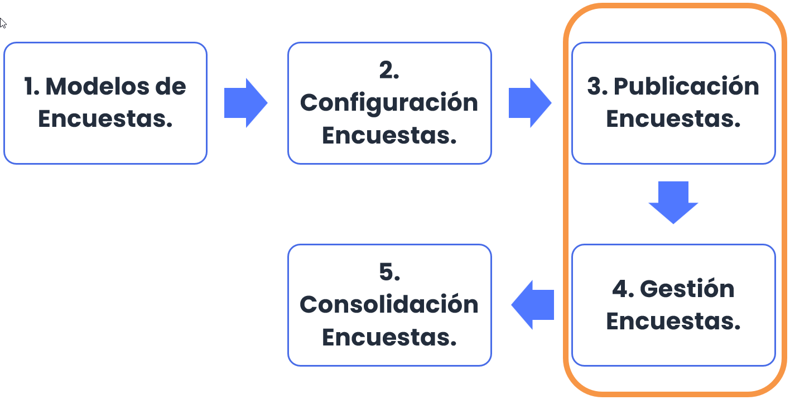

## Publicación de Encuestas

Una vez configurado el modelo de encuesta, y la configuración de la misma, es el momento de crear la publicación. Para ello, hay que dirigirse a la opción “Encuestas” ubicada en la pestaña “Gestión” y seleccionar el icono “Publicar Encuestas”.

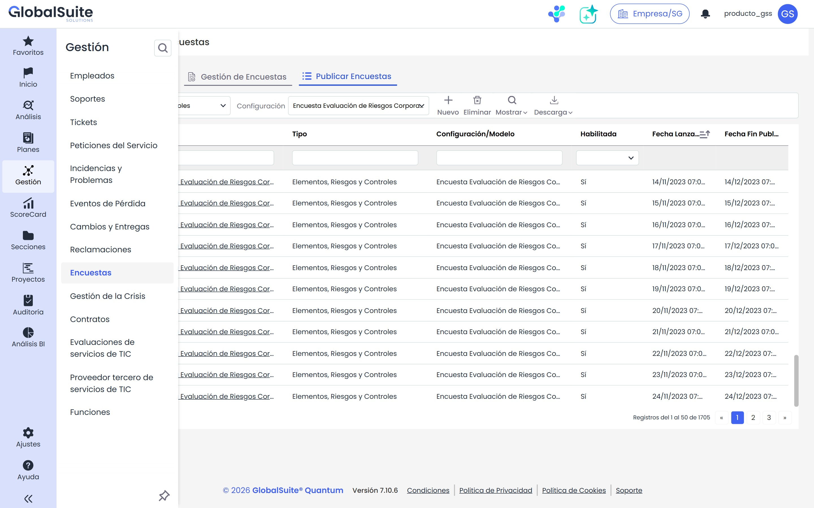

En esta opción, “**Publicar Encuestas**”, se podrá configurar la publicación de la encuesta a los destinatarios deseados. En primer lugar, se debe proceder de la misma forma que la configuración, es decir, habrá que elegir el tipo y la Configuración de Encuesta, y pulsar el botón “Nuevo”.

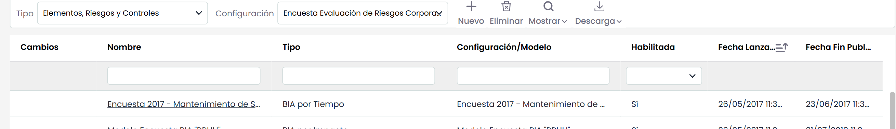

Al ingresar en un registro permite al usuario configurar la publicación. Los atributos más importantes son:

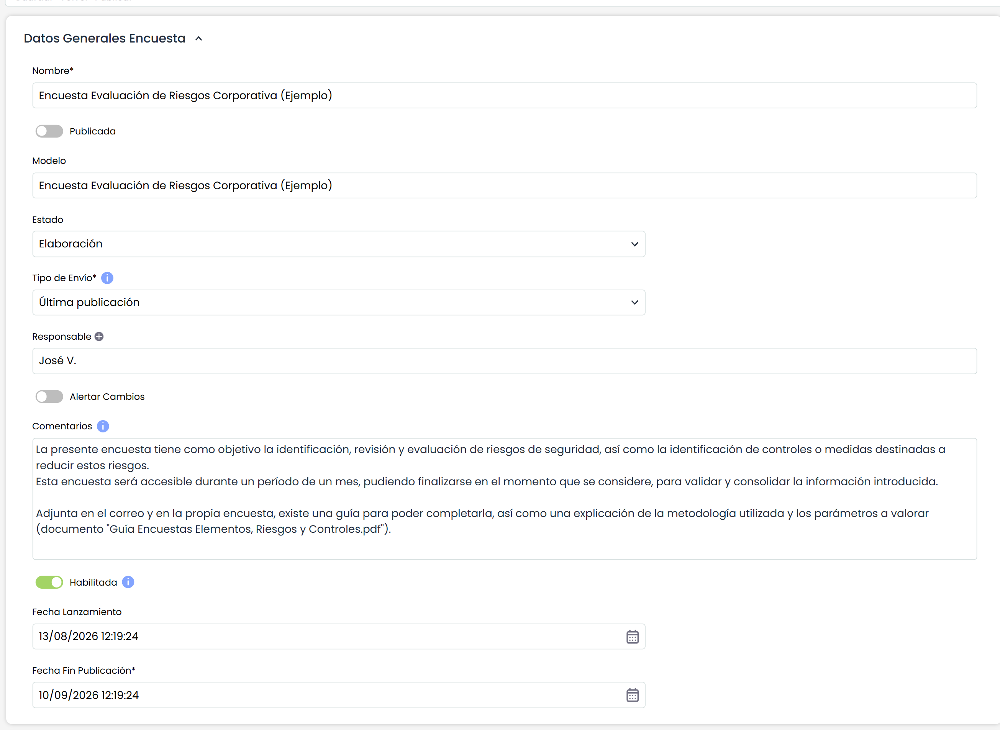

* **Estado**: Esta opción sólo aparece cuando se ha configurado la encuesta por estados en el modelado.
* **Tipo de envío:** permite seleccionar si se quieren enviar los campos con información de otras publicaciones o con información actual registrada en GlobalSuite® en referencia a los Elementos, Riesgos y/o Controles.
* **Responsable:** Corresponde al usuario de GlobalSuite® encargado de recibir las respuestas de las encuestas.
* **Alertar Cambios:** Si se selecciona, el responsable será avisado mediante email de los cambios realizados.
* **Comentarios:** Permite ingresar un texto que se incorpora tanto en el email que recibe cada destinatario como en la página principal de la encuesta.
* **Habilitada:** Campo que permite habilitar la encuesta.
* **Fecha Apertura:** Es la fecha de inicio de la publicación, a partir de la cual las encuestas asociadas a la publicación están disponibles.
* **Fecha de Cierre:** Es la fecha de cierre de la publicación, a partir de la cual las encuestas asociadas a la publicación ya no están disponibles.

Una vez configurados los campos anteriores se tendrá que elegir a los destinatarios de la encuesta. Estos destinatarios recibirán un correo con un enlace para acceder a la encuesta. Para acceder al enlace no hará falta que el destinatario disponga de usuario de GlobalSuite®.

Para elegir los destinatarios se podrá elegir a un empleado ya registrado en la herramienta (botón “Añadir Empleados”) o a un nuevo empleado (botón “Nuevo”). En cualquier caso, se muestra una ventana emergente para configurar los destinatarios.

En esta tabla también podrá eliminar (botón “Eliminar”), alertar a través de e-mail (botón “Enviar Recordatorio”).

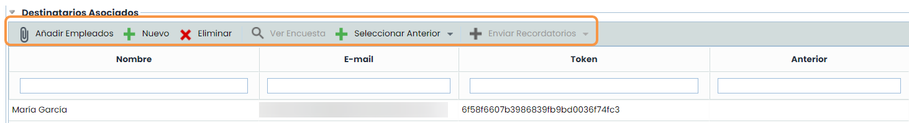

En el momento que se pulsa el botón “**Publicar**”, la herramienta envía un correo a los destinatarios con el enlace de la encuesta para poder completarla.

En la pantalla de publicación también aparece el enlace recibido por cada destinatario, de forma que el responsable puede acceder a la encuesta.

También existe una tabla con los seguimientos de la encuesta.

Una vez enviada la publicación, se pulsa guardar y ya estaría terminada la fase de publicación de encuestas.

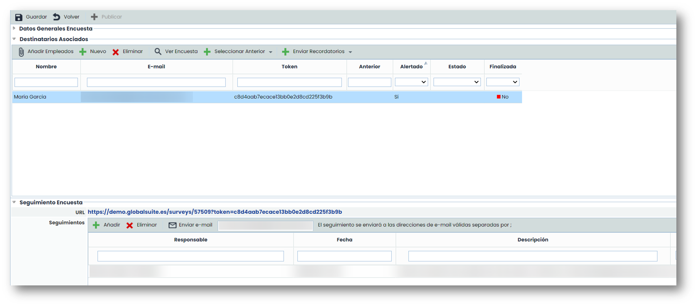

A continuación, se muestra un ejemplo de correo recibido tras la publicación de una encuesta.

En esta notificación aparece el enlace para acceder a la encuesta, el nombre de la encuesta, la fecha en la que se creó y hasta cuándo estará disponible (fecha cierre) y los comentarios que se han registrado en la publicación.

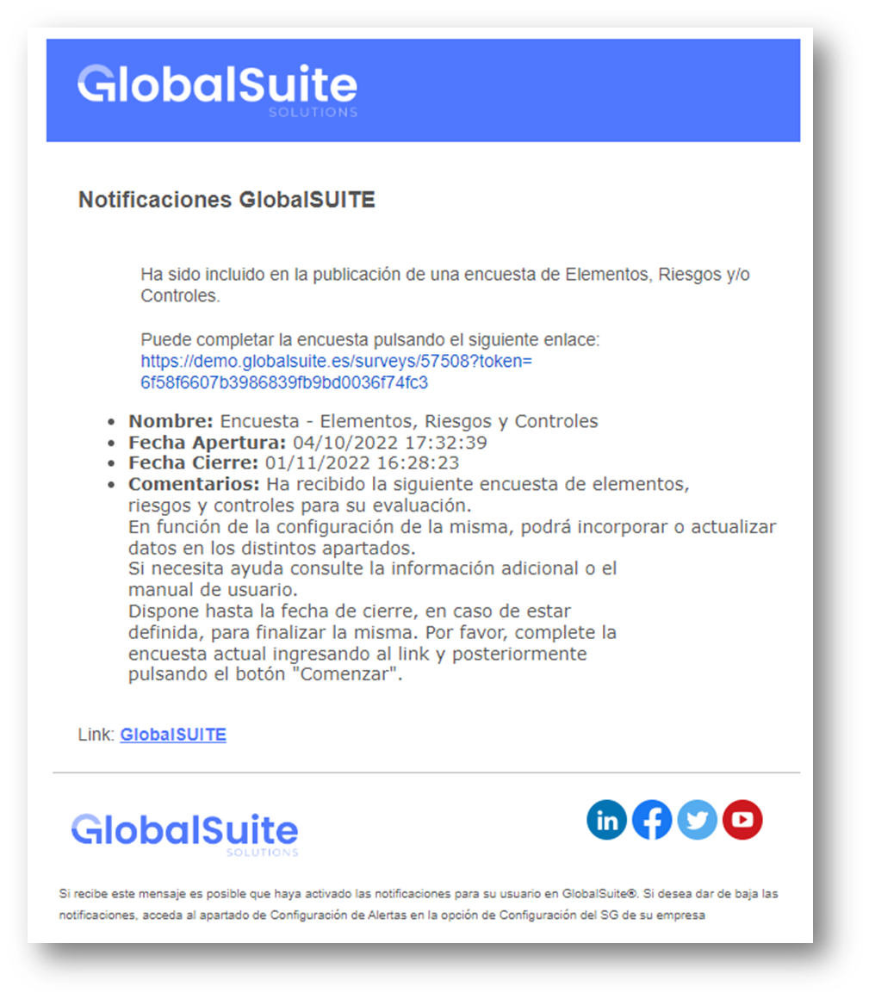 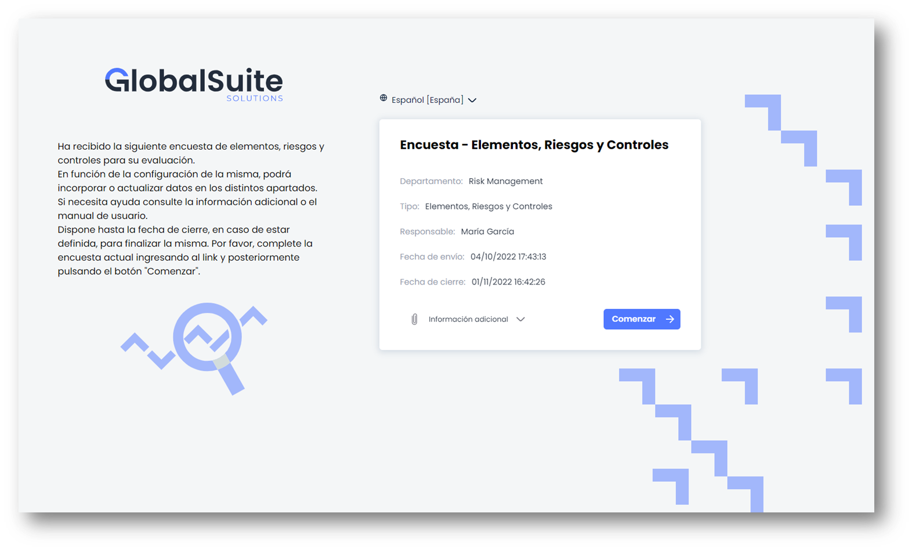

Una vez que se accede al enlace, se puede comprobar que no existe un menú como el de GlobalSuite®.

En un primer vistazo se muestran los datos generales de la encuesta, instrucciones para completar la encuesta, la posibilidad de seleccionar el idioma y descargar archivos adjuntos.

Para dar completar la encuesta se debe pulsar el botón **Comenzar.**

## Gestión de Encuestas

Esta opción permite gestionar todas las encuestas creadas en la publicación de encuestas. Al realizar la publicación, todas las encuestas enviadas a los destinatarios se generan en esta opción.

Además, en esta opción también podrá crear encuestas sin necesidad de que ésta sea publicada. La creación de una encuesta funciona igual que las opciones anteriores. Al acceder a una encuesta podrá ver los datos guardados actualmente.

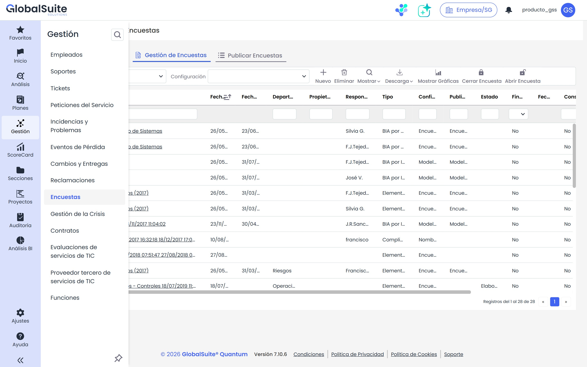

Al acceder a la encuesta a través de GlobalSuite® también se pueden modificar los datos. Es posible ordenar, filtrar, avisar al responsable mediante correo, exportar la información, y por último, se pueden consolidar los cambios (esta opción se explica en la guía específica de consolidación)

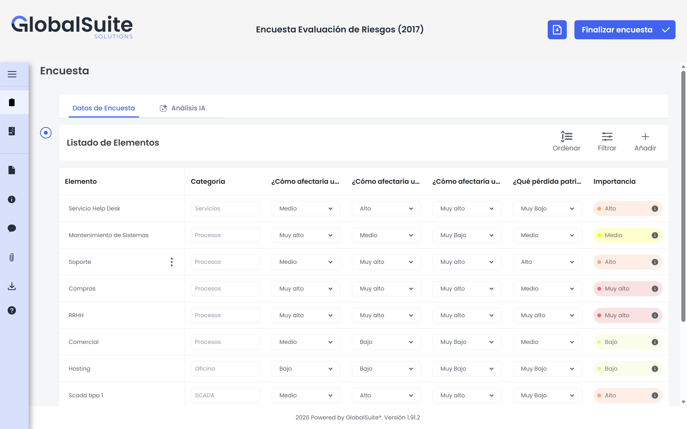

### Menú lateral

Desde el menú lateral se puede acceder a varias opciones, las cuales se detallan a continuación:

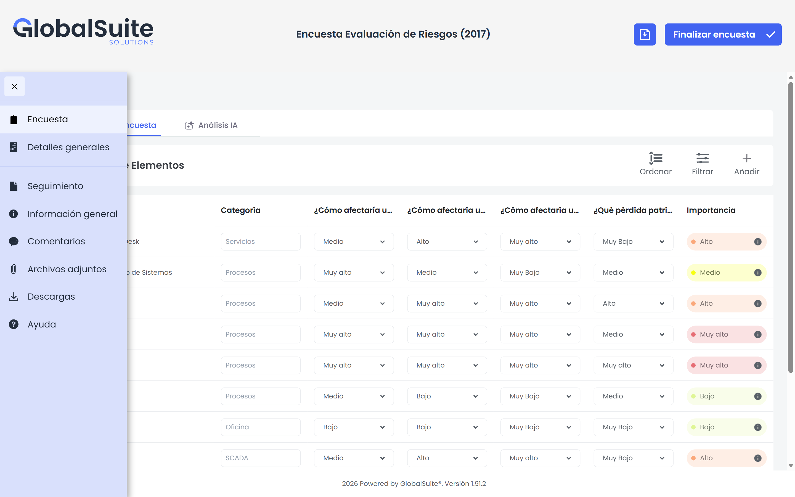

* **Encuesta**: es la primera vista que aparece al acceder a la encuesta. Muestra los datos de la encuesta según su tipo.
* **Detalles generales**: se visualizan los datos generales de la encuesta, tales como: nombre, tipo, responsable, email, departamento, fecha de envío y fecha de cierre. Desde esta opción se pueden modificar algunos datos y guardarlos.
* **Seguimiento**: este apartado permite visualizar los diferentes cambios que se han realizado sobre la encuesta.
* **Información general**: desde aquí, se puede visualizar la información relacionada al tipo de encuesta.
* **Comentarios**: en este apartado, se puede escribir/visualizar comentarios.
* **Archivos adjuntos**: se pueden descargar los archivos que hayan sido adjuntados al configurar la encuesta.
* **Descargas**: esta sección permite visualizar la descarga del informe de la encuesta.
* **Ayuda**: Permite acceder al Manual de GlobalSuite®.

### Ordenar

La opción de “Ordenar” permite mostrar u ocultar las columnas de la vista y también ordenarlas según la ubicación deseada por medio de la funcionalidad de arrastrar y soltar.

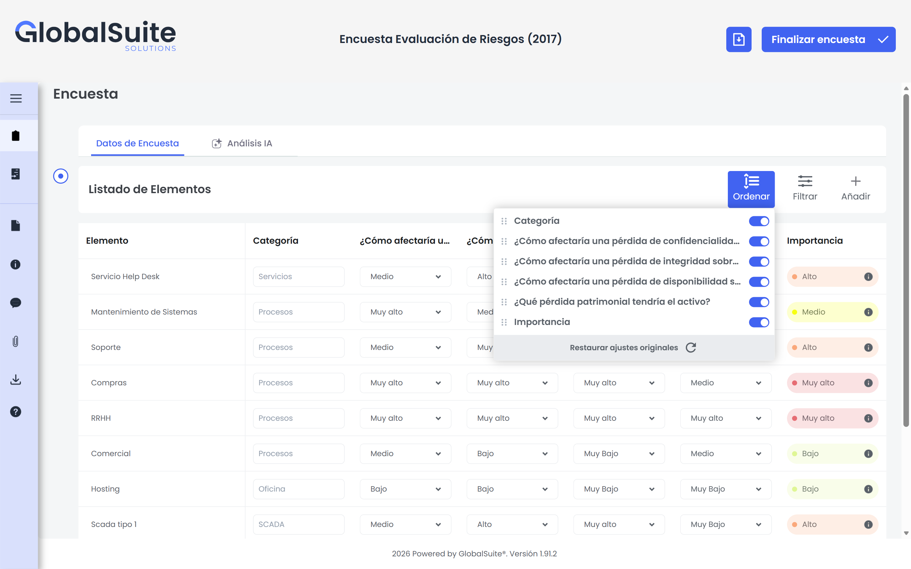

### Filtrar

La opción de “Filtrar” muestra los campos de filtrado en cada una de las columnas con el fin de ajustar la vista según la necesidad de la persona encuestada.

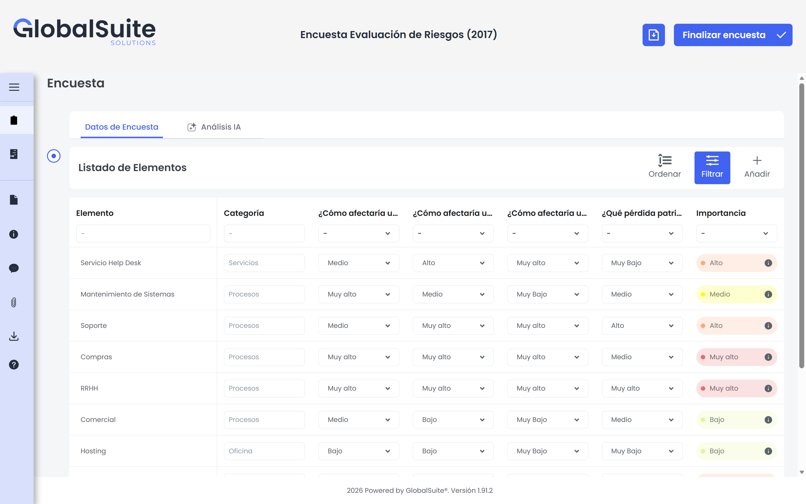
