# ¿Cómo gestionar evidencias en GlobalSuite®?


En este artículo tratamos cómo registrar y organizar evidencias en GlobalSuite®, relacionarlas con documentos del [\*\*Gestor Documental\*\*](https://help.globalsuitesolutions.com/es/globalsuite/v1/gestor-documental)y vincularlas con controles y planes de tratamiento dentro del módulo de Riesgos, permitiendo demostrar la implantación y seguimiento de los controles de la organización.


La **Gestión de Evidencias**, tiene como objetivo registrar y gestionar las evidencias de la organización haciendo que posteriormente se puedan vincular a controles y planes de tratamiento.

A continuación se visualizará un manual de su función y el cómo se relaciona en las siguientes secciones:

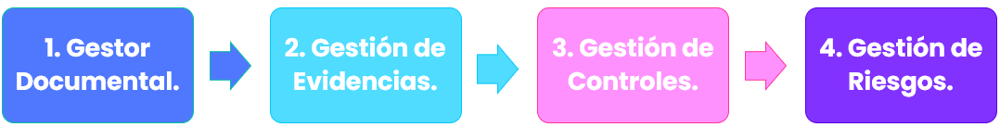

## 1. Gestor Documental

En la sección [**Gestor Documental**](https://help.globalsuitesolutions.com/es/globalsuite/v1/gestor-documental), se visualizará la estructura de carpetas y la documentación que ha sido cargada y asociada a su carpeta correspondiente. En la parte superior se encuentran:

* **Opciones**: Se despliega **Nueva Carpeta** y **Mover** (mover archivos/carpetas a otra ruta, para más detalle ver guía específica del Gestor Documental).
* **Subir**: Cargar un documento a su carpeta correspondiente.
* **Detalles**: Se consultan los detalles específicos del documento.
* **Visualización**: Se puede realizar una pre-visualización del documento (aplica para documentos PDF, JPG, JPEG, BMP y PNG).
* **Descarga**: Se puede descargar un informe CSV o el contenido de la carpeta (para más detalle, ver guía específica del Gestor Documental).

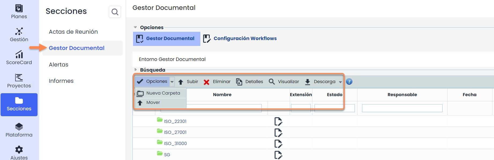

Para cada documento, existen una serie de campos que se pueden consultar. Los principales campos son:

* **Estado**: Su funcionalidad es definir y conocer el estado en el que se encuentra cada uno de los documentos


Recordar que la configuración de los estados es en apartado [Configuración Workflow](https://help.globalsuitesolutions.com/es/globalsuite/v1/configuracion-workflows) y con los estados de preferencia de cada organización


* **Versión**: Última versión del documento que ha sido publicado.

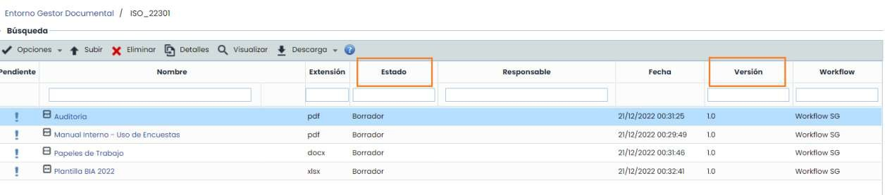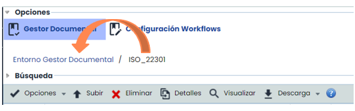

Por último, en la parte superior se observará el desglose de todas las carpetas a las que se va entrando, de forma que si se desea regresar a una carpeta en específico o carpeta raíz, se hará click en la carpeta anterior.

## 2. Gestión de Evidencias

Como se ha comentado anteriormente, en la sección **Análisis >** [**Gestión de Evidencias**](https://help.globalsuitesolutions.com/es/globalsuite/v1/gestion-de-evidencias), se podrán crear evidencias (algunas con sus respectivos documentos) que posteriormente se vincularán a los controles implantados o a los planes del tratamiento de riesgos. Al entrar se encuentran las siguientes opciones:

* **Tipo**: en **Ajustes > General > Configuración de Evidencias >** [**Tipo de Evidencias**](https://help.globalsuitesolutions.com/es/globalsuite/v1/configuracion-de-evidencias), se podrá configurar los **tipos** de evidencias con los que se clasificarán los registros.
* **Documentación Asociada:** se refleja el documento que ha sido asociado a la evidencia.
* **Activa:** para saber si la evidencia está actualmente activa o no.

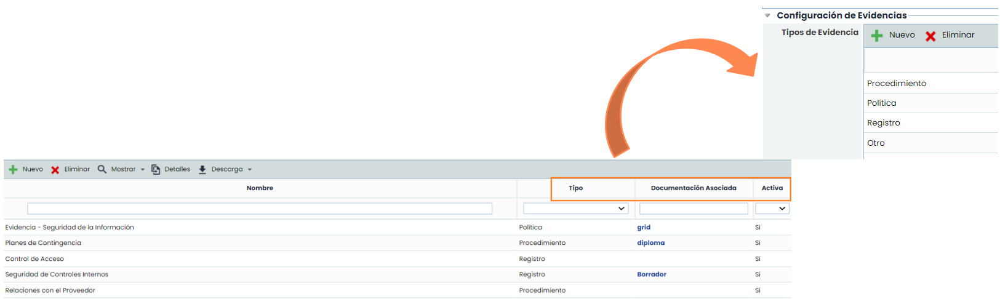

Para acceder al detalle de la evidencia, hay que seleccionar una fila y pulsar en **Detalle**:

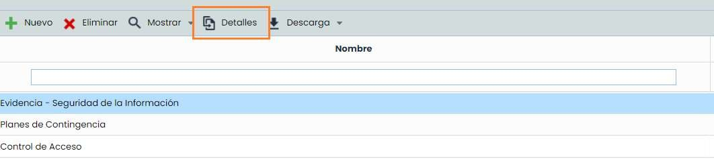

Al entrar, aparece un formulario con los siguientes campos:

* **Responsable:** será la persona responsable de gestionar la evidencia.

  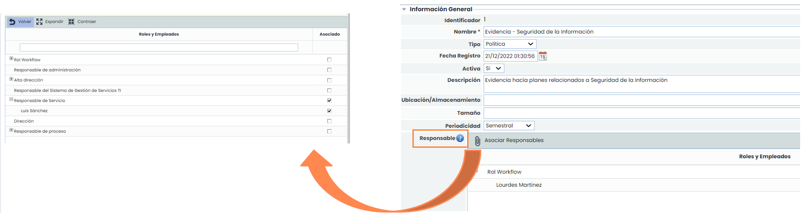
* **Documentos**: se puede vincular uno o más documentos. Estos previamente deberán estar cargados en el Gestor Documental.

  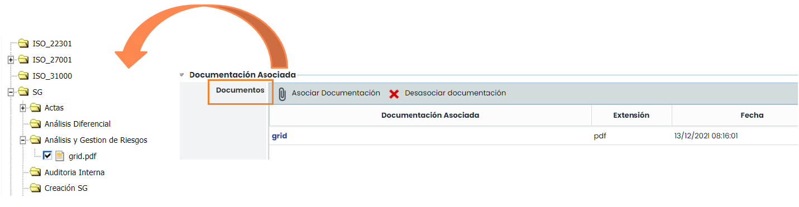
* **Controles:** con la evidencia se puede justificar la existencia/ejecución de un control o plan de tratamiento. Se puede asociar a más de un control/plan.

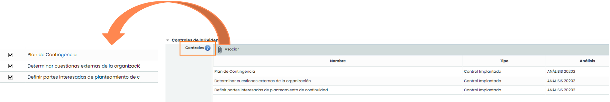

## 3. Gestión de Controles

Desde el apartado **Análisis >** [**Gestión de Controles**](https://help.globalsuitesolutions.com/es/globalsuite/v1/gestion-de-evidencias) también se pueden asociar las evidencias existentes.  
Se deberá seleccionar el control y entrar en **detalles**:

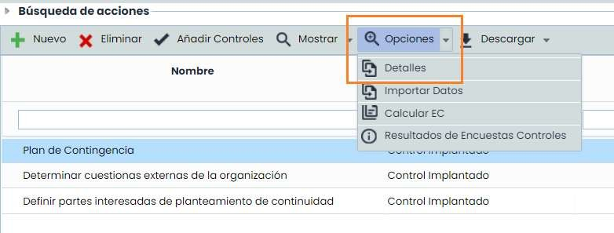

Se podrá asociar una o varias evidencias a un mismo control, siempre y cuando hayan sido previamente registradas y configuradas en la opción de “[**Gestión de Evidencias**](https://help.globalsuitesolutions.com/es/globalsuite/v1/gestion-de-evidencias)**”**. El botón **Desasociar** permite desvincular una evidencia de un control. Si se pulsa en **Detalle**, se abrirá directamente el detalle de la evidencia.

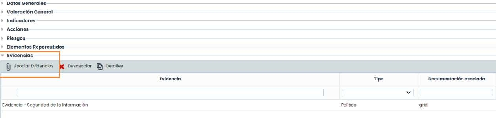

## 4. Gestión de Riesgos

Las **Evidencias** también se pueden asociar a los **Planes de Tratamiento** a través de la opción de **Gestión de Riesgos.** Para ello hay que ir a: Análisis > Gestión de Riesgos > seleccionar el Análisis de Riesgos > pulsar en el nombre del [**Plan de Tratamiento.**](https://help.globalsuitesolutions.com/es/globalsuite/v1/planificacion-de-la-gestion-de-riesgos#Planificaci%C3%B3ndelagesti%C3%B3nderiesgos-PlandeTratamiento)

Al igual que en Gestión de Controles, se podrá asociar una o varias evidencias a un mismo control, siempre y cuando hayan sido previamente registradas y configuradas en la opción de “Gestión de Evidencias”. El botón **Desasociar** permite desvincular una evidencia de un plan de tratamiento. Si se pulsa en **Detalle**, se abrirá directamente el formulario de la evidencia

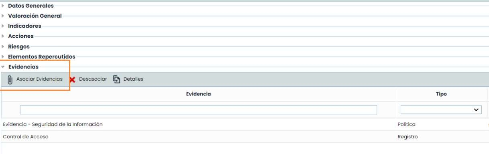
