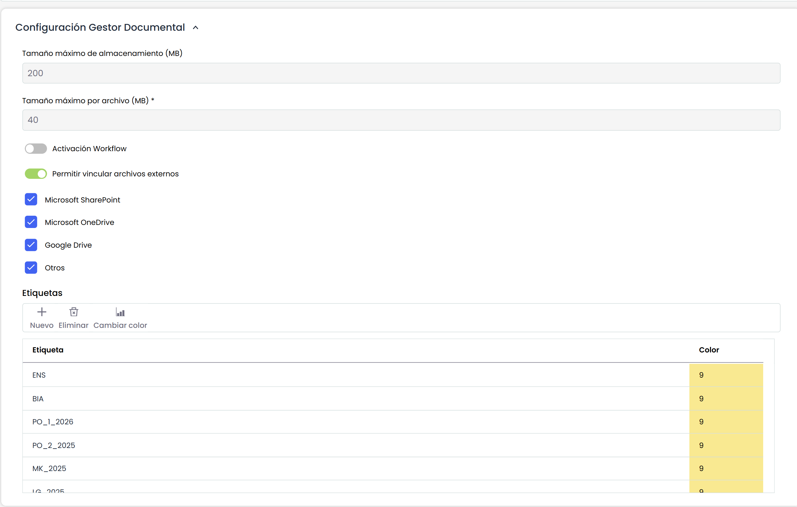
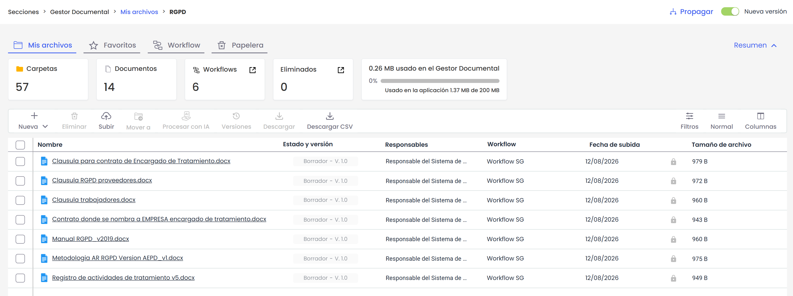
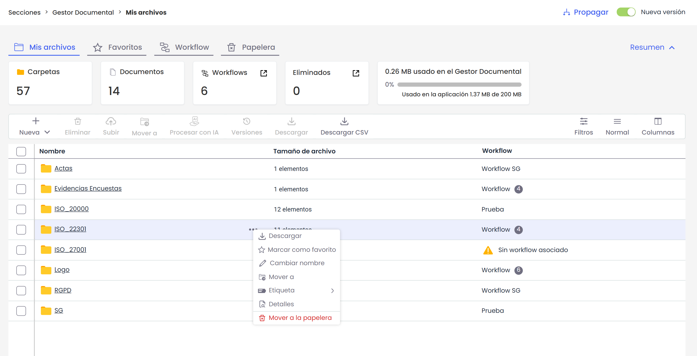
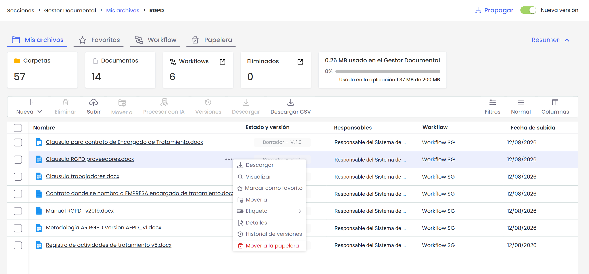
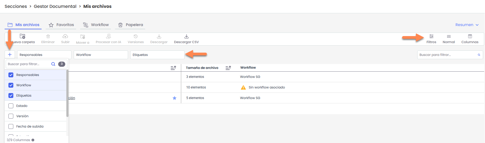
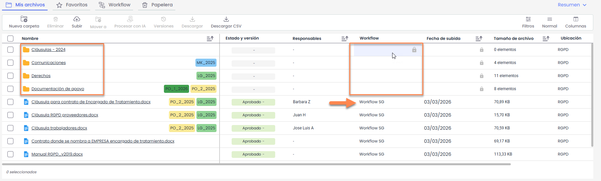
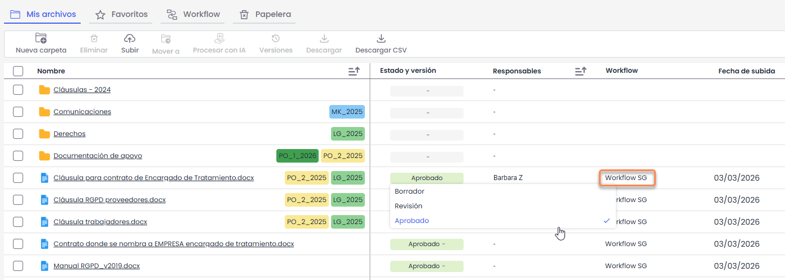
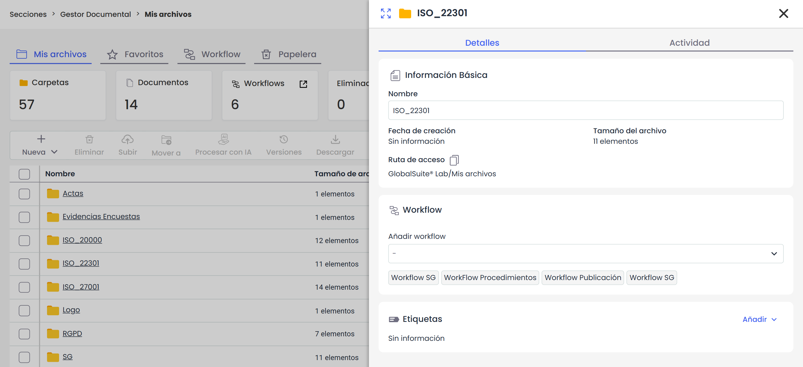
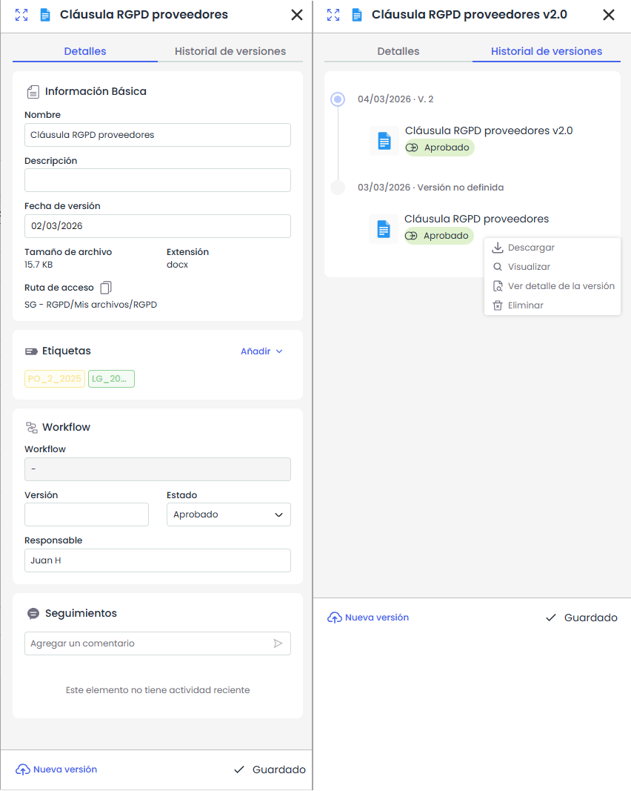

# ¿Cómo gestionar documentación en GlobalSuite®?


Este tutorial explica cómo utilizar el \*\*Gestor Documental\*\* de GlobalSuite® para administrar la documentación del sistema de gestión, incluyendo la creación y organización de carpetas, la carga y actualización de documentos, la gestión de versiones y estados, y la eliminación de documentación.
En la guía se detalla el funcionamiento del gestor con el \*\*workflow desactivado\*\*, así como las opciones disponibles para descargar contenido, filtrar documentos, modificar versiones y gestionar permisos sobre carpetas y archivos.


## 1. Opciones Configurables en Ajustes

En el apartado de **Ajustes>Configuración General** > [**Configuración Gestor Documental**](https://help.globalsuitesolutions.com/es/globalsuite/v1/configuracion-gestor-documental) se puede habilitar la “Activación del Workflow”, que permite disponer de Flujos de Aprobación o Workflows, para que se puedan realizar comprobaciones por parte de varios usuarios en los archivos del Gestor Documental y se deban aprobar los documentos. En caso de querer una versión simplificada del Gestor Documental se deberá tener desmarcada la casilla.

En esta guía se explica el funcionamiento del Gestor Documental con el workflow desactivado.

## 2. Gestor Documental

Todas las soluciones que componen GlobalSuite® disponen de la funcionalidad asociada del gestor documental.

Este Gestor Documental permite tanto disponer de un repositorio compartido y único para concentrar toda la documentación derivada del Sistema de Gestión de la organización como poder realizar a través del mismo la aprobación de los documentos a través de Flujos de Aprobación configurables por cada organización. En esta guía se explicará el uso del Gestor Documental con el worfklow desactivado.

Al acceder a la opción se visualizará en la pestaña **Mis archivos** toda la estructura de carpetas y documentos que representa el gestor.

Mediante la barra de navegación se puede ver en qué carpeta se está y pulsando en los nombres en color azul se retrocede a los niveles anteriores.

En la pantalla principal es posible:

* **Navegar entre carpetas**, haciendo clic sobre el nombre de la carpeta.
* **Visualizar los documentos** contenidos en cada carpeta.
* Consultar información como **estado, responsables y workflow**.
* Acceder a **acciones rápidas** sobre carpetas y documentos desde la tabla.

### Opciones sobre carpetas

Al situar el cursor sobre una carpeta, se mostrará el icono de **tres puntos (…)** en la parte derecha del registro.  
Al hacer clic en este icono, se desplegará un menú con las distintas opciones disponibles para la gestión de la carpeta.

A continuación se explican cada una:

* **Descargar:** Permite descargar el contenido completo de la carpeta en formato *.zip*. Una vez finalizado el proceso, el archivo estará disponible en **Perfil de usuario > Descargas**.
* **Marcar como favorito:** Añade la carpeta a la sección de favoritos para facilitar su acceso rápido.
* **Cambiar nombre:** Permite modificar el nombre de la carpeta.
* **Mover a:** Permite trasladar la carpeta a otra ubicación dentro del Gestor Documental.
* **Etiquetas:** Permite asociar o gestionar etiquetas vinculadas a la carpeta.
* **Detalles:** Muestra la información detallada de la carpeta.
* **Mover a la papelera:** Envía la carpeta a la papelera, desde donde podrá gestionarse posteriormente según los permisos disponibles.

### Opciones sobre ficheros

En el caso de los **ficheros**, el funcionamiento es el mismo.  
Al situar el cursor sobre el documento, se mostrará el icono de **tres puntos (…)** en la parte derecha del registro.

Al hacer clic en este icono, se desplegará el menú con las siguientes opciones:

* **Descargar:** Permite descargar el archivo en su formato original. La descarga es directa.
* **Visualizar:** Permite previsualizar el documento sin necesidad de descargarlo (disponible para ficheros con extensión PDF, JPEG, JPG, BMP o PNG)
* **Marcar como favorito:** Añade el documento a la sección de favoritos para facilitar su acceso rápido.
* **Mover a:** Permite trasladar el documento a otra carpeta dentro del Gestor Documental.
* **Etiquetas:** Permite asociar o gestionar etiquetas vinculadas al documento.
* **Detalles:** Muestra la información general del documento y permite acceder a su configuración.
* **Historial de versiones:** Permite consultar las distintas versiones del documento, así como su estado y cambios asociados.
* **Mover a la papelera:** Envía el documento a la papelera, desde donde podrá gestionarse posteriormente según los permisos disponibles.

### Acciones disponibles en la barra superior

En la parte superior del Gestor Documental se encuentran las distintas opciones de acción disponibles sobre los elementos mostrados en la tabla.

Estas opciones se habilitan o deshabilitan en función de si existen elementos seleccionados y del número de elementos marcados.

* **Nueva carpeta:** Permite crear una nueva carpeta dentro de la ubicación actual. Solo estará activa cuando no haya documentos ni carpetas seleccionados.
* **Subir:** Permite cargar un nuevo documento en la carpeta actual. Se encuentra activa cuando no hay elementos seleccionados.
* **Procesar con IA:** Permite ejecutar el procesamiento automático del documento mediante funcionalidades de Inteligencia Artificial (si están habilitadas). Esta opción solo se activa cuando hay un único documento seleccionado. Para más informacion: [¿Cómo procesar documentos con IA desde el Gestor Documental de GlobalSuite®? | GlobalSuite Solutions](https://help.globalsuitesolutions.com/es/globalsuite/v1/asistente-documental)
* **Versiones:** Permite acceder al historial de versiones del documento seleccionado. Se habilita únicamente cuando hay un solo documento seleccionado.
* **Eliminar:** Permite eliminar uno o varios documentos y/o carpetas seleccionados simultáneamente. Los elementos eliminados se envían siempre a la **Papelera**.
* **Mover a:** Permite trasladar uno o varios documentos y/o carpetas seleccionados a otra ubicación dentro del Gestor Documental.  
  Al seleccionar esta opción, se abrirá una ventana para elegir la carpeta de destino. Será necesario navegar hasta la ubicación deseada y pulsar **“Mover aquí”** para confirmar el traslado.

  
* **Descargar:** Permite descargar uno o varios elementos seleccionados simultáneamente.
* **Descargar CSV:** Genera un archivo CSV con la información de los elementos mostrados en la vista actual. Esta opción se encuentra siempre disponible, independientemente de la selección.

### Filtros y búsqueda

El Gestor Documental permite filtrar la información mostrada en la tabla mediante distintos criterios.

Por defecto, se muestran los siguientes campos de filtrado:

* **Responsables**
* **Workflow**
* **Etiquetas**

Al pulsar el botón **“+”**, se desplegarán todos los campos adicionales disponibles para filtrar (por ejemplo, versión, fecha de subida u otros campos configurados).

Dependiendo del tipo de campo seleccionado, el sistema mostrará diferentes opciones de filtrado. Por ejemplo:

* En campos tipo lista (como **Etiquetas o Estados**), se mostrarán los valores disponibles para su selección.

  
* En campos de fecha (como **Fecha de subida**), se habilitará la opción de filtrar por una **fecha puntual** o por un **rango de fechas**.  
  El rango puede seleccionarse manualmente mediante el calendario o mediante rangos predefinidos mostrados a la izquierda (por ejemplo: *Esta semana*, *Mes actual*, *Últimos 3 meses*, etc.).

  
* En campos de texto, se permitirá introducir valores manualmente.

#### Búsqueda rápida por nombre

En la parte derecha se encuentra el campo **“Buscar para filtrar…”**, que permite realizar una búsqueda rápida por nombre de carpeta o fichero.

Al introducir las primeras letras, el sistema mostrará automáticamente las coincidencias encontradas.

En los resultados desplegados:

* Al situar el cursor sobre un elemento, se mostrará la opción **“Ver ubicación”**, que permite acceder directamente a la carpeta donde se encuentra el archivo.
* Al hacer clic sobre el nombre del fichero, el sistema abrirá el documento si el formato es compatible con visualización. En caso contrario, se procederá a su descarga automática.
* Al presionar **Enter**, se mostrarán todas las coincidencias en la tabla.

#### Alcance de los filtros y búsquedas

Los filtros y búsquedas se aplican desde la ubicación en la que el usuario se encuentra posicionado, incluyendo sus subcarpetas.  
No se realizan búsquedas en carpetas superiores.

Cuando se aplican filtros o búsquedas, la tabla añade automáticamente la columna **“Ubicación”**, que indica la carpeta en la que se encuentra cada archivo o carpeta que coincide con los criterios aplicados.

Para volver a la vista original, será necesario limpiar los filtros activos.

## 3. Permisos y Carpetas

El Gestor Documental viene configurado con un conjunto de carpetas creadas por defecto según los sistemas de gestión que tenga la empresa. Estas carpetas pueden modificarse, eliminarse o crearse nuevas por los responsables (administradores del gestor documental).

* Cuando el flag de “Activación Workflow” **no está activado** no se le puede asociar ningún Workflow a las carpetas. En caso de que se suba un archivo, se establecerá por defecto el “Workflow SG”. Se adjuntan un par de ejemplos:
* Se puede visualizar que en la creación de carpetas no se puede asociar ningún WF.
* Se aprecia que al subir un archivo se aplica por defecto un Workflow sin dar opción a elegir otro. Se podrá cambiar de WF cuando se active el flag de “Activación Workflow” en Ajustes.

  

## 4. Actualizar Documentación

Los documentos pueden subirse seleccionando la carpeta donde se quiere ubicar el documento y pulsando el botón “Subir”. Aparecerá una pantalla para seleccionar el documento y una vez elegido se subirá a la carpeta seleccionada. Es posible seleccionar hasta **10 ficheros simultáneamente** en una misma carga.

### Cambio de estado de la documentación

El estado de un documento puede modificarse haciendo doble clic sobre el campo **“Estado”** correspondiente en la tabla.

A continuación, se desplegará el listado de estados configurados en el flujo de aprobación (por ejemplo, **“Workflow SG”**), permitiendo seleccionar el estado deseado.

### Actualizar datos de una carpeta

Para consultar la información detallada de una carpeta, será necesario situar el cursor sobre ella. Se mostrará el icono de **tres puntos (…)** en la parte derecha del registro.

Al hacer clic en este icono, se desplegará un menú de opciones. Para acceder a la información detallada, deberá seleccionarse la opción **“Detalles”**.

Se abrirá un panel lateral con la información de la carpeta, en el cual es posible:

* Ver y modificar el **nombre**.
* Consultar la **fecha de creación** y la **cantidad de elementos** que contiene.
* Visualizar la **ruta de acceso**.
* Ver y añadir **etiquetas**.

### Actualizar datos de un documento

Al seleccionar **“Detalles”** sobre un documento, se abrirá un panel lateral con su información.  
Este panel se divide en dos pestañas y muestra los datos correspondientes a la **versión activa/vigente** del documento.

#### Detalles

Desde la pestaña **“Detalles”** es posible:

* Ver y modificar el **nombre** y la **descripción** del documento.
* Consultar la **fecha de versión**, el **tamaño**, la **extensión** y la **ruta de acceso**.
* Visualizar y cambiar el **estado** del documento (según el workflow configurado).
* Consultar o asignar el **responsable**.
* Añadir o gestionar **etiquetas**.
* Subir una **nueva versión** del documento (sin límite de versiones).
* Añadir **seguimientos**.

### Historial de versiones

En la pestaña **“Historial de versiones”** se muestran todas las versiones del documento, ordenadas cronológicamente de la más reciente a la más antigua.

Desde aquí es posible:

* Consultar el detalle de versiones anteriores.
* Visualizar o descargar versiones previas.
* Eliminar versiones.
* Marcar una versión como **“versión activa”**.

## 5.Eliminación de documentación

La eliminación de documentos y carpetas se realiza mediante la opción **“Mover a la papelera”**, disponible:

* Desde el menú contextual (icono de tres puntos).
* Desde el panel de **Detalles**.
* Desde la barra superior, seleccionando uno o varios elementos.

Al seleccionar esta opción, los documentos o carpetas se trasladarán a la **Papelera**.

### Papelera

Los documentos y carpetas enviados a la **Papelera** permanecerán allí durante **30 días** antes de eliminarse automáticamente.

Desde la pestaña **Papelera** es posible:

* **Restaurar:** devuelve el documento o carpeta a su ubicación original.
* **Eliminar:** elimina definitivamente el elemento seleccionado.
* **Descargar CSV:** descarga un archivo con el **listado de los elementos** que se encuentran en la papelera.

Cuando se envía una **carpeta** a la papelera, esta se traslada **completa con todo su contenido** (archivos y subcarpetas).  
En la papelera **no es posible explorar su contenido**, únicamente se muestra la carpeta como un único elemento.

Al restaurar una carpeta o documento, estos **vuelven a su ubicación original y mantienen el mismo estado** que tenían antes de ser enviados a la papelera.


El espacio ocupado no se libera hasta que el elemento se elimine definitivamente de la papelera.


### Eliminación de versiones

Cuando se envía un documento a la papelera, se traslada la **versión activa junto con todas sus versiones asociadas**.

No es posible enviar a la papelera versiones intermedias de forma individual.  
Si se elimina una versión concreta desde el **Historial de versiones**, esta se elimina de forma definitiva y no pasa por la papelera.
