# ¿Cómo gestionar documentos con Workflow activado en GlobalSuite®?


Este tutorial explica cómo utilizar el \*\*Gestor Documental con el Workflow activado\*\* en GlobalSuite®, permitiendo gestionar la documentación mediante \*\*flujos de aprobación configurables\*\*. En la guía se detalla cómo asociar workflows a carpetas, subir documentos seleccionando el flujo correspondiente, gestionar los distintos \*\*estados de aprobación\*\*, aprobar o rechazar versiones, recibir notificaciones automáticas y administrar la actualización y eliminación de documentos dentro del ciclo completo de aprobación.


## 1. Opciones Configurables en Ajustes

En el apartado de **Ajustes>Configuración General** > [**Configuración Gestor Documenta**](https://help.globalsuitesolutions.com/es/globalsuite/v1/configuracion-gestor-documental)se puede habilitar la “Activación del Workflow”, que permite disponer de Flujos de Aprobación o Workflows, para que se puedan realizar comprobaciones por parte de varios usuarios en los archivos del Gestor Documental y se deban aprobar los documentos

En esta guía se explica el funcionamiento del Gestor Documental con el workflow activado.

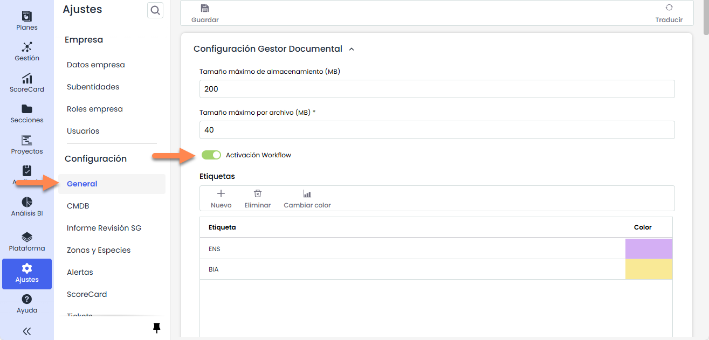

## 2. Opción Gestor Documental

Todas las soluciones que componen GlobalSuite® disponen de la funcionalidad asociada del gestor documental.

Este Gestor Documental permite tanto disponer de un repositorio compartido y único para concentrar toda la documentación derivada del Sistema de Gestión de la organización como poder realizar a través del mismo la aprobación de los documentos a través de Flujos de Aprobación configurables por cada organización. En esta guía se explicará el uso del Gestor Documental con el worfklow activado.

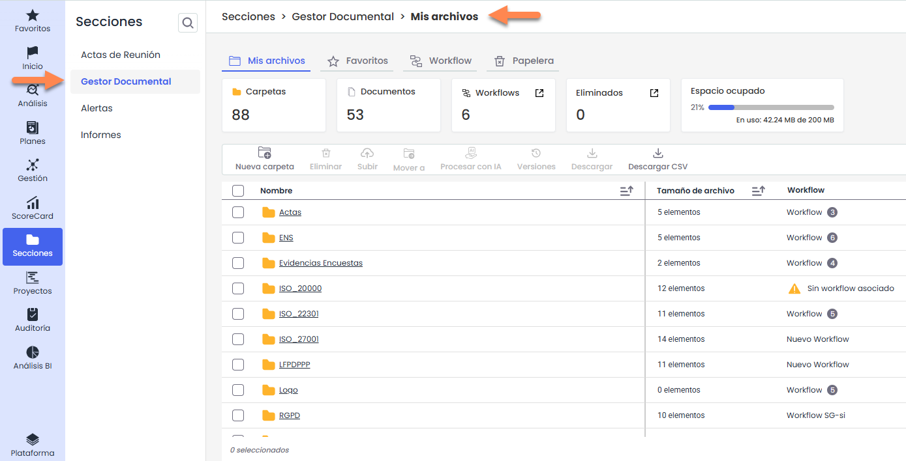

Al acceder a la opción se visualizará en la pestaña **Mis archivos** toda la estructura de carpetas y documentos que representa el gestor.

Mediante la barra de navegación se puede ver en qué carpeta se está y pulsando en los nombres en color azul se retrocede a los niveles anteriores.

En la pantalla principal es posible:

* **Navegar entre carpetas**, haciendo clic sobre el nombre de la carpeta.
* **Visualizar los documentos** contenidos en cada carpeta.
* Consultar información como **estado, responsables y workflow**.
* Acceder a **acciones rápidas** sobre carpetas y documentos desde la tabla.

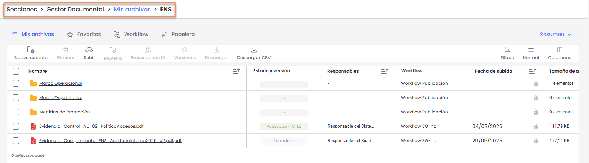

### Opciones sobre carpetas

Al situar el cursor sobre una carpeta, se mostrará el icono de **tres puntos (…)** en la parte derecha del registro.\
Al hacer clic en este icono, se desplegará un menú con las distintas opciones disponibles para la gestión de la carpeta.

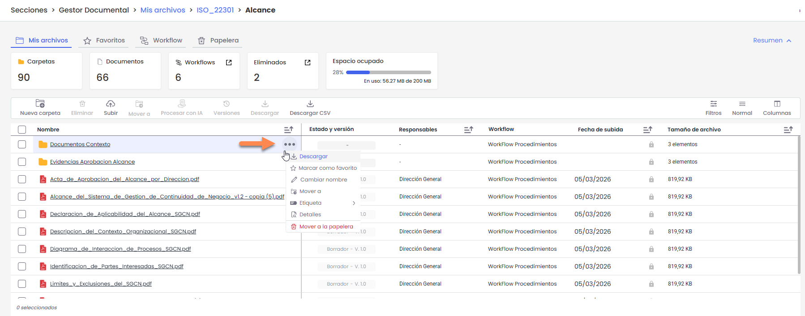

A continuación se explican cada una:

* **Descargar:** Permite descargar el contenido completo de la carpeta en formato _.zip_. Una vez finalizado el proceso, el archivo estará disponible en **Perfil de usuario > Descargas**.
* **Marcar como favorito:** Añade la carpeta a la sección de favoritos para facilitar su acceso rápido.
* **Cambiar nombre:** Permite modificar el nombre de la carpeta.
* **Mover a:** Permite trasladar la carpeta a otra ubicación dentro del Gestor Documental.
* **Etiquetas:** Permite asociar o gestionar etiquetas vinculadas a la carpeta.
* **Detalles:** Muestra la información detallada de la carpeta.
* **Mover a la papelera:** Envía la carpeta a la papelera, desde donde podrá gestionarse posteriormente según los permisos disponibles

### Opciones sobre ficheros

En el caso de los **ficheros**, el funcionamiento es el mismo.\
Al situar el cursor sobre el documento, se mostrará el icono de **tres puntos (…)** en la parte derecha del registro.

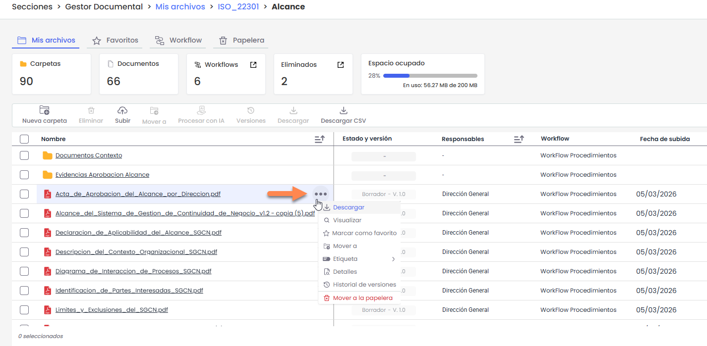

Al hacer clic en este icono, se desplegará el menú con las siguientes opciones:

* **Descargar:** Permite descargar el archivo en su formato original. La descarga es directa.
* **Visualizar:** Permite previsualizar el documento sin necesidad de descargarlo (disponible para ficheros con extensión PDF, JPEG, JPG, BMP o PNG)
* **Marcar como favorito:** Añade el documento a la sección de favoritos para facilitar su acceso rápido.
* **Mover a:** Permite trasladar el documento a otra carpeta dentro del Gestor Documental.
* **Etiquetas:** Permite asociar o gestionar etiquetas vinculadas al documento.
* **Detalles:** Muestra la información general del documento y permite acceder a su configuración.
* **Historial de versiones:** Permite consultar las distintas versiones del documento, así como su estado y cambios asociados.
* **Mover a la papelera:** Envía el documento a la papelera, desde donde podrá gestionarse posteriormente según los permisos disponibles.

### Acciones disponibles en la barra superior

En la parte superior del Gestor Documental se encuentran las distintas opciones de acción disponibles sobre los elementos mostrados en la tabla.

Estas opciones se habilitan o deshabilitan en función de si existen elementos seleccionados y del número de elementos marcados.

*   **Nueva carpeta:** Permite crear una nueva carpeta dentro de la ubicación actual. Solo estará activa cuando no haya documentos ni carpetas seleccionados

    Al hacer clic en **Nueva carpeta**, se abrirá una ventana en la que será necesario:

    * Introducir el **nombre de la carpeta**.
    * Seleccionar el **workflow o los workflows** que se asignarán a la carpeta.

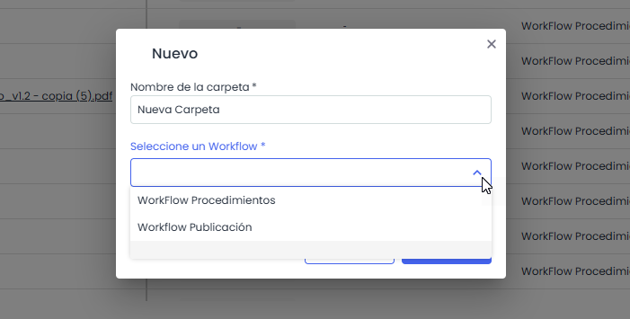

*   **Subir:** Permite **cargar uno o más documentos en la carpeta actual**. Esta opción estará activa cuando **no haya elementos seleccionados**.

    Al pulsar **Subir**, se podrán seleccionar hasta **10 ficheros** desde el equipo.\
    Una vez seleccionados, el sistema mostrará una ventana en la que será necesario **elegir el workflow** que se asignará a la **carga completa** (es decir, el mismo workflow para todos los ficheros seleccionados).

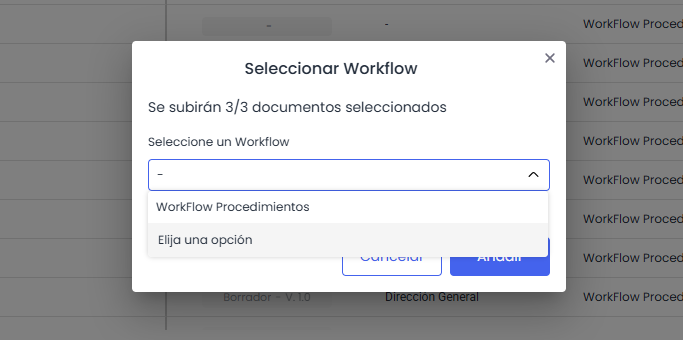

* **Procesar con IA:** Permite ejecutar el procesamiento automático del documento mediante funcionalidades de Inteligencia Artificial (si están habilitadas). Esta opción solo se activa cuando hay un único documento seleccionado. Para más informacion: [¿Cómo procesar documentos con IA desde el Gestor Documental de GlobalSuite®? | GlobalSuite Solutions](https://help.globalsuitesolutions.com/es/globalsuite/v1/asistente-documental)
* **Versiones:** Permite acceder al historial de versiones del documento seleccionado. Se habilita únicamente cuando hay un solo documento seleccionado.
* **Eliminar:** Permite eliminar uno o varios documentos y/o carpetas seleccionados simultáneamente. Los elementos eliminados se envían siempre a la **Papelera**.
*   **Mover a:** Permite trasladar uno o varios documentos y/o carpetas seleccionados a otra ubicación dentro del Gestor Documental.\
    Al seleccionar esta opción, se abrirá una ventana para elegir la carpeta de destino. Será necesario navegar hasta la ubicación deseada y pulsar **“Mover aquí”** para confirmar el traslado.

    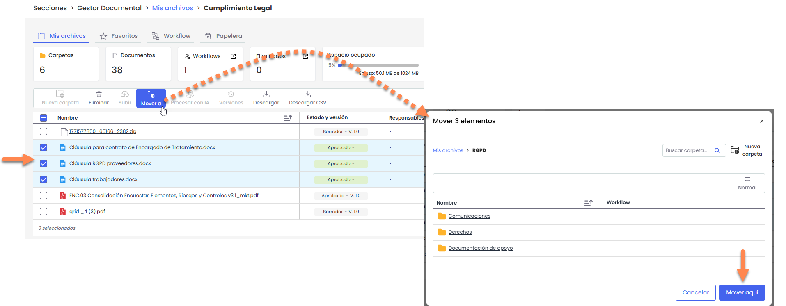


En el selector de destino solo se mostrarán las carpetas \*\*compatibles\*\* con los elementos seleccionados. Para poder realizar el traslado, las carpetas de origen y destino deben tener \*\*los mismos workflows asociados\*\*.


* **Descargar:** Permite descargar uno o varios elementos seleccionados simultáneamente.
* **Descargar CSV:** Genera un archivo CSV con la información de los elementos mostrados en la vista actual. Esta opción se encuentra siempre disponible, independientemente de la selección.

### Filtros y búsqueda

El Gestor Documental permite filtrar la información mostrada en la tabla mediante distintos criterios.

Por defecto, se muestran los siguientes campos de filtrado:

* **Responsables**
* **Workflow**
* **Etiquetas**

Al pulsar el botón **“+”**, se desplegarán todos los campos adicionales disponibles para filtrar (por ejemplo, versión, fecha de subida u otros campos configurados).

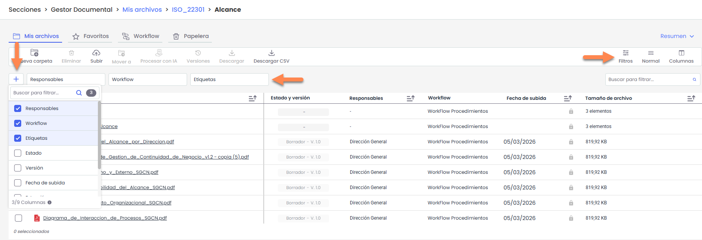

Dependiendo del tipo de campo seleccionado, el sistema mostrará diferentes opciones de filtrado. Por ejemplo:

*   En campos tipo lista (como **Etiquetas o Estados**), se mostrarán los valores disponibles para su selección.

    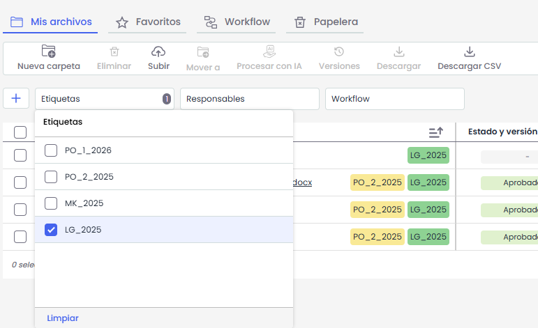
*   En campos de fecha (como **Fecha de subida**), se habilitará la opción de filtrar por una **fecha puntual** o por un **rango de fechas**.\
    El rango puede seleccionarse manualmente mediante el calendario o mediante rangos predefinidos mostrados a la izquierda (por ejemplo: _Esta semana_, _Mes actual_, _Últimos 3 meses_, etc.).

    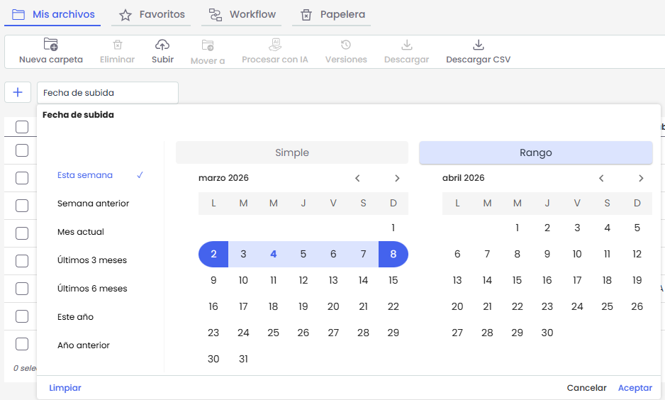
* En campos de texto, se permitirá introducir valores manualmente.

#### Búsqueda rápida por nombre

En la parte derecha se encuentra el campo **“Buscar para filtrar…”**, que permite realizar una búsqueda rápida por nombre de carpeta o fichero.

Al introducir las primeras letras, el sistema mostrará automáticamente las coincidencias encontradas.

En los resultados desplegados:

* Al situar el cursor sobre un elemento, se mostrará la opción **“Ver ubicación”**, que permite acceder directamente a la carpeta donde se encuentra el archivo.
* Al hacer clic sobre el nombre del fichero, el sistema abrirá el documento si el formato es compatible con visualización. En caso contrario, se procederá a su descarga automática.
*   Al presionar **Enter**, se mostrarán todas las coincidencias en la tabla.

    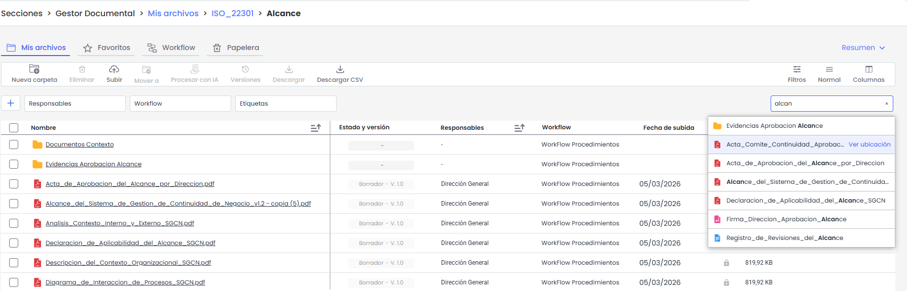

#### Alcance de los filtros y búsquedas

Los filtros y búsquedas se aplican desde la ubicación en la que el usuario se encuentra posicionado, incluyendo sus subcarpetas.\
No se realizan búsquedas en carpetas superiores.

Cuando se aplican filtros o búsquedas, la tabla añade automáticamente la columna **“Ubicación”**, que indica la carpeta en la que se encuentra cada archivo o carpeta que coincide con los criterios aplicados.

Para volver a la vista original, será necesario limpiar los filtros activos.

## 3. Permisos y Carpetas

* El Gestor Documental viene configurado con un conjunto de carpetas creadas por defecto según los sistemas de gestión que tenga la empresa. Estas carpetas pueden modificarse, eliminarse o crearse nuevas por los responsables (administradores del gestor documental).
*   A cada una de las carpetas se le puede asociar uno o varios WorkFlow, es decir, se podrá indicar qué flujo o flujos de aprobación pueden utilizarse en una determinada carpeta. Se elegirá el WF haciendo click sobre el campo “Workflow”

    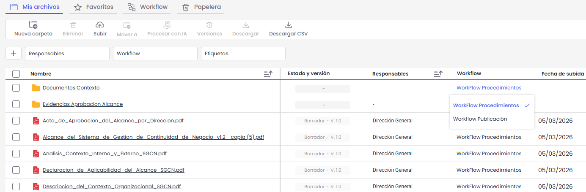

## 4. Flujo de Aprobación

Los usuarios únicamente visualizan aquellas carpetas asociadas a flujos de aprobación donde ellos estén como responsables de alguno de los estados.

Para explicar el funcionamiento de los flujos de aprobación del gestor documental se mostrará a continuación un ejemplo con un flujo de aprobación previamente configurado

El flujo posee los siguientes estados:

* **Borrador**. Primer estado. Podrán visualizarlo los empleados con el perfil “Rol WorkFlow”. Para pasar el estado, una de las personas con este rol deberá aprobar el documento en este estado.
* **Revisado**. Segundo estado. Podrán visualizarlo los empleados con el perfil “Rol WorkFlow”. Para pasar el estado, dos de las personas con este rol deberán aprobar el documento en este estado.
* **Aprobado**. Este estado es automático y se aprobará directamente sin necesidad de intervención de ningún usuario.
* **Publicado**. Estado de visualización de documentos. Podrán visualizarlo todos los usuarios del sistema que estén identificados en este estado.

### Paso 1

Como se explicó anteriormente, los documentos pueden subirse seleccionando la carpeta donde se desea cargar el archivo y pulsando el botón **“Subir”**.

Primero se abrirá una ventana para **seleccionar el documento** que se desea cargar. A continuación, el sistema solicitará **seleccionar el workflow (WF)** correspondiente.

Una vez elegido, el documento se **subirá a la carpeta seleccionada**.

### Paso 2

Únicamente los **administradores de la organización** o los **responsables del primer estado del flujo de aprobación seleccionado** podrán subir documentación al Gestor Documental.

En el ejemplo planteado, solo los usuarios asociados al estado **“Borrador”** podrán subir documentación.

Cuando un usuario sube un documento, el resto de los usuarios asociados a ese mismo estado podrán **visualizarlo en dicho estado** (en este caso, _Borrador_).

Desde la opción **“Detalles”** del documento es posible acceder a la **información de sus revisiones**.

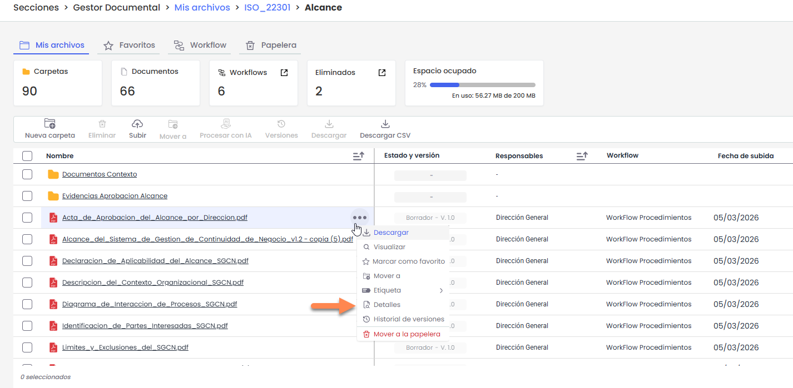

### Paso 3

Al seleccionar la opción **“Detalles”**, se abrirá una barra lateral con la información de la **versión actual del documento**.

Si el **usuario** que ha iniciado sesión es uno de los **responsables del estado actual del workflow**, se mostrará una sección adicional con las opciones **“Aprobar”** o **“Rechazar”**.

Desde esta pantalla, cada uno de los usuarios implicados podrá **aprobar o rechazar el documento**, provocando el **cambio de estado correspondiente** dentro del flujo de aprobación.

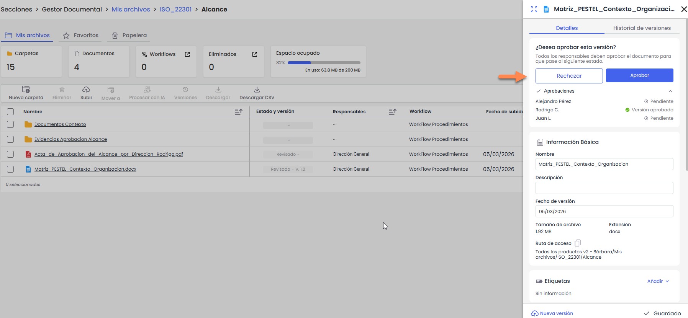

En caso de ser administrador y querer ver el progreso de las aprobaciones, existen los apartados Workflow y Aprobaciones en donde se pueden ver detalles del estado actual del documento.

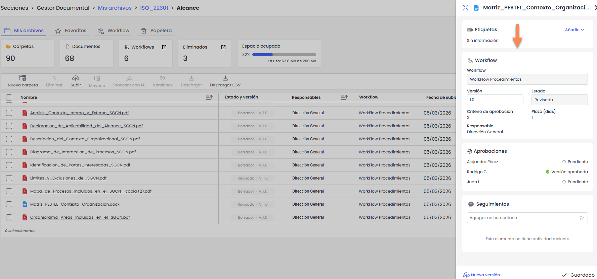

#### Paso 3

En el ejemplo aplicado, los responsables del estado **“Borrador”** podrán **aprobar el cambio de estado**. Una vez cumplido el criterio de aprobación, el documento pasará al estado **“Revisado”**.

Posteriormente, el responsable del estado **“Revisado”** podrá aprobar nuevamente el documento, que pasará automáticamente por el estado **“Distribuido”** hasta llegar a su estado final **“Publicado”**.

La **versión activa del documento** es la que aparece **marcada en verde**, y es la que se muestra por defecto en el Gestor Documental.

Para **consultar o modificar versiones anteriores**, se debe acceder a su menú contextual y seleccionar la opción **“Ver detalles de la versión”**.

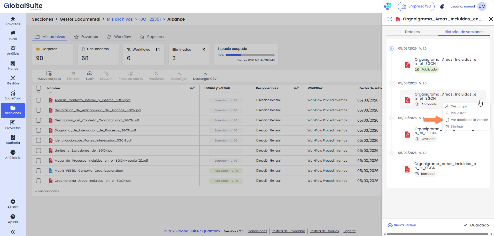

### Paso 4

Este procedimiento se repite en cada uno de los estados por los que pasa el flujo de aprobación.

Cuando un documento pasa de estado los responsables del siguiente reciben una notificación mediante correo electrónico avisándoles del nuevo estado. En el mensaje viene un link que permite acceder a GlobalSuite para revisar y aprobar (si procede) el documento.

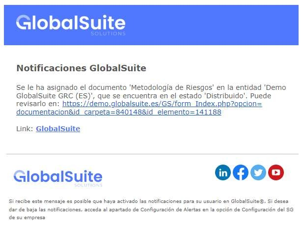

Paso 5

Una vez que se ha pasado por todos los estados del WorkFlow asignado al documento y se llega al último de ellos (estado Publicado), el documento será accesible por todos los roles y personas asignadas a este estado.

En el ejemplo aplicado, una vez que se está en el estado “Publicado”, todos los usuarios de la organización con acceso a GlobalSuite® podrán visualizar el documento (ya que todos han sido asociados al estado).

## 5. Eliminación de documentación

La eliminación de documentos y carpetas se realiza mediante la opción **“Mover a la papelera”**, disponible:

* Desde el menú contextual (icono de tres puntos).
* Desde el panel de **Detalles**.
* Desde la barra superior, seleccionando uno o varios elementos.

Al seleccionar esta opción, los documentos o carpetas se trasladarán a la **Papelera**.

### Papelera

Los documentos y carpetas enviados a la **Papelera** permanecerán allí durante **30 días** antes de eliminarse automáticamente.

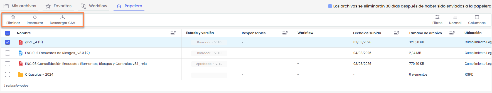

Desde la pestaña **Papelera** es posible:

* **Restaurar:** devuelve el documento o carpeta a su ubicación original.
* **Eliminar:** elimina definitivamente el elemento seleccionado.
* **Descargar CSV:** descarga un archivo con el **listado de los elementos** que se encuentran en la papelera.

Cuando se envía una **carpeta** a la papelera, esta se traslada **completa con todo su contenido** (archivos y subcarpetas).\
En la papelera **no es posible explorar su contenido**, únicamente se muestra la carpeta como un único elemento.

Al restaurar una carpeta o documento, estos **vuelven a su ubicación original y mantienen el mismo estado** que tenían antes de ser enviados a la papelera.


El espacio ocupado no se libera hasta que el elemento se elimine definitivamente de la papelera.


### Eliminación de versiones

Cuando se envía un documento a la papelera, se traslada la **versión activa junto con todas sus versiones asociadas**.

No es posible enviar a la papelera versiones intermedias de forma individual.\
Si se elimina una versión concreta desde el **Historial de versiones**, esta se elimina de forma definitiva y no pasa por la papelera.
