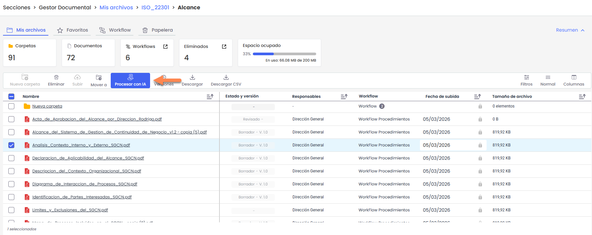
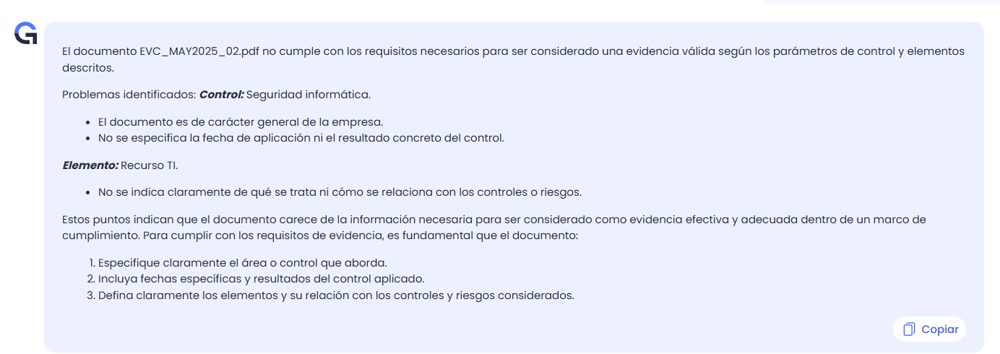

# ¿Cómo procesar documentos con IA desde el Gestor Documental de GlobalSuite®?


Este tutorial muestra cómo utilizar la funcionalidad \*\*“Procesar con IA”\*\* desde el Gestor Documental de GlobalSuite®, permitiendo analizar automáticamente el contenido de un archivo y obtener información útil de forma rápida y contextualizada.
Gracias al asistente inteligente integrado, es posible interactuar con el contenido mediante preguntas, generar resúmenes, extraer datos clave o compararlo con modelos normativos, entre otras capacidades.



Recuerde que el asistente está disponible para las licencias Enterprise, Plus y Corporate.


## ¿Cómo funciona el Asistente?

### Accede al Gestor Documental

1. Entra en **Secciones > Gestor Documental** desde el menú principal.
2. Localiza el documento que deseas analizar utilizando los filtros o navegando por la tabla de documentos.
3. **Selecciona el archivo desde la tabla** haciendo clic en su fila.

> Solo se puede procesar un archivo a la vez. El sistema no habilitará la opción no hay documentos seleccionados o si hay mas de uno.

---

### Procesar el archivo con IA

4. Una vez seleccionado, haz clic en la opción **“Procesar con IA”** disponible en el menú de acciones del documento.
5. El asistente se abrirá automáticamente en una nueva vista. Verás una confirmación con el nombre del archivo cargado y un mensaje de bienvenida.

### Utiliza el asistente

El asistente te explicará qué puede hacer con el documento, incluyendo:

* ✅ Resumir su contenido.
* ✅ Extraer datos importantes como nombres, fechas o cifras.
* ✅ Analizar patrones si el archivo contiene datos estructurados (por ejemplo, Excel o CSV).
* ✅ Responder preguntas específicas que le plantees.
* ✅ Comparar el documento con modelos normativos.
* ✅ Revisar ortografía y gramática.
* ✅ Hacer comentarios o sugerencias de mejora.

En la parte inferior verás un cuadro de diálogo donde podrás escribir directamente tus peticiones o preguntas.

---

## Ejemplos Reales

**Evidencias de controles.**

* Identifica si las evidencias que han subido cumplen con la evidencia que has demandado sobre los controles o sobre los elementos.

**Identificar mejoras en políticas o procedimientos.**

* Con tus procedimientos/políticas ya cargados, pregúntale si puedes mejorar un punto en concreto, si te falta algún dato para asegurarte que tienes todo lo que pide la normativa, qué te haga un resumen concreto.

**Informes o dashboards de tus sistemas de gestión.**

* Pregunta sobre gráficas para buscar tendencias o patrones, que te identifique los controles más débiles o los riesgos más críticos. Cualquier dato relevante del dashboard te lo identificará y te podrá proponer planes de acción.

**Evaluación de proveedores.**

* Puedes analizar la documentación de tus proveedores directamente desde la IA y obtener cualquier tipo de información. Si cumple con determinados requisitos, si tiene evidenciado el requisito o que te diga dónde tiene que mejorar.

## Consideraciones importantes

* El análisis solo se puede realizar sobre **un archivo a la vez**.
* Si el archivo tiene un formato no admitido, el sistema mostrará un aviso. Los tipos compatibles actualmente son: **pdf**, **doc**, **docx**, **txt**, **pptx**, **xlsx**, **png**, **jpg**, **jpeg**, **csv** y **zip**.
* Si el entorno no dispone de **tokens disponibles**, el acceso al asistente estará deshabilitado.
* El asistente **no permite subir nuevos archivos**: solo trabaja con el documento seleccionado desde el Gestor Documental.
* Se recomienda que el documento esté correctamente nombrado o estructurado si se desea un análisis más preciso y contextualizado.
