# Configuración del Gestor Documental en GlobalSuite®


Este tutorial explica, paso a paso, cómo realizar la configuración inicial del \*\*Gestor Documental\*\* en GlobalSuite®, incluyendo la activación de la funcionalidad de \*\*workflows de aprobación\*\*, la \*\*gestión de roles\*\* (asociación de empleados a roles del sistema) y la configuración del \*\*Workflow Documental\*\* (estados, responsables y criterios de aprobación) para controlar el ciclo de revisión hasta la \*\*publicación\*\* de la documentación.


## Fases para la configuración inicial del Sistema Documental

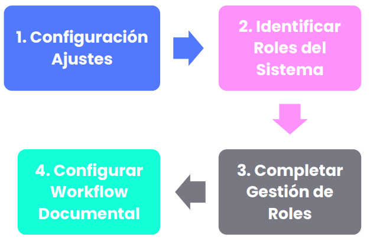

## Opciones Configurables en Ajustes

Para acceder a la opción configurable del Gestor Documental se debe pulsar el apartado de **Ajustes>** [**Configuración General.**](https://help.globalsuitesolutions.com/es/globalsuite/v1/configuracion-general)

La funcionalidad de la opción configurable es la siguiente:

* **Habilitar la opción “Activación del Workflow”**: permite disponer de varios Workflows, cada uno con sus estados, para que distintos usuarios puedan hacer comprobaciones en los archivos del Gestor Documental y los aprueben hasta llegar al último estado de “publicación”.
* **Etiquetas:** Desde aquí se podrán crear, editar y eliminar las etiquetas que se utilizan en el gestor documental.

Junto a esta opción aparecen otras no editables:

* Tamaño máximo de almacenamiento: indica el límite de almacenamiento (MB) del gestor documental.
* Tamaño máximo por archivo: indica cuál es el tamaño máximo de los archivos adjuntos que se pueden subir a la herramienta.

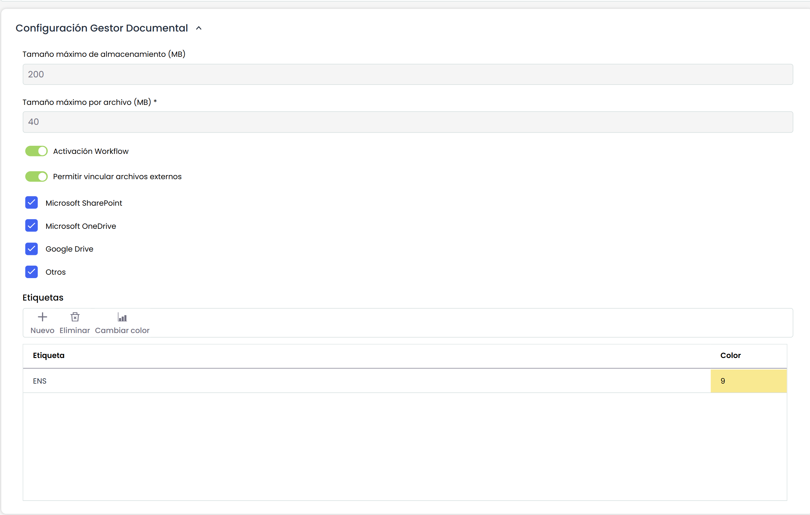

## Gestión de Roles

A través de la opción **Inicio>**[**Gestión de Roles**](https://help.globalsuitesolutions.com/es/globalsuite/v1/gestion-de-roles), GlobalSuite® permite asociar los diferentes empleados que forman parte de la entidad a los diferentes roles del Sistema de Gestión.

Esta opción está relacionada de manera directa con la opción “Competencia y Funciones”.

Entre las dos opciones, con esta metodología establecida por parte de GlobalSuite®, la plataforma permite describir los diferentes perfiles de puesto de trabajo, asociando a estos los empleados que lo desempeñan, las competencias necesarias para cada rol y todas las funciones y obligaciones relacionadas

### Paso 1

Para gestionar los roles de la entidad hay que seleccionar la opción Gestión de Roles, disponible en la pestaña de Inicio de GlobalSuite®.

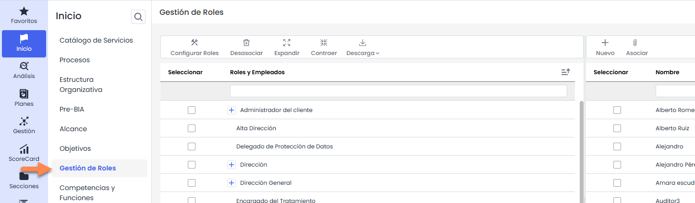

### Paso 2

Los roles que aparecen en la tabla “**Roles y Empleados**” son configurables a través del botón “**Configurar Roles**”.

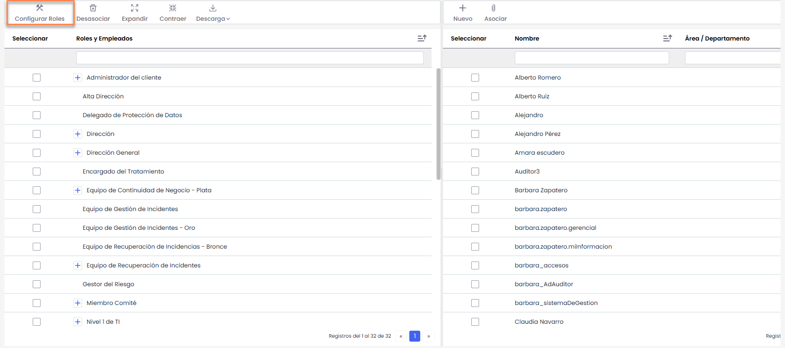

Al pulsar sobre el botón se abre una pestaña nueva del navegador correspondiente al apartado de Ajustes > Configuración General >[**Configuración de Roles y Responsabilidades**](https://help.globalsuitesolutions.com/es/globalsuite/v1/configuracion-de-roles-y-responsabilidades) se encuentra el listado de Roles pudiéndose crear, eliminar y modificar los roles existentes a través de las opciones marcadas.

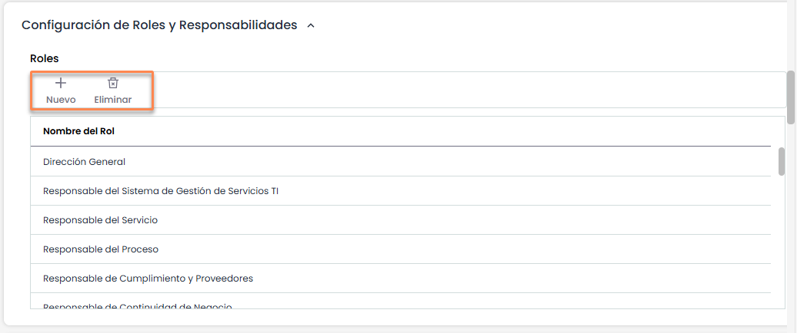

### Paso 3

El listado de empleados que aparece en la tabla de la derecha corresponde a los empleados registrados en la opción **Gestión >** [**Empleados**](https://help.globalsuitesolutions.com/es/globalsuite/v1/empleados).

Para establecer las relaciones entre los roles y los empleados, se debe marcar o checkear el Empleado en la parte derecha, también se debe marcar el Rol en la parte izquierda y posteriormente pulsar el botón “Asociar”. Tras este paso si se pulsa el “+” del Rol se visualizarán los empleados que tiene asociados.

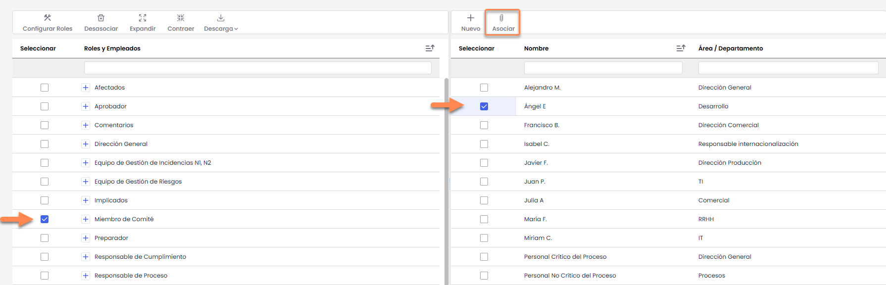

### Paso 4

Para poder utilizar los Flujos de Trabajo del gestor documental, es necesario que todos los empleados involucrados en la gestión documental tengan **asociado** un usuario de GlobalSuite®.

La asociación se realiza desde **Gestión >** [**Empleados**](https://help.globalsuitesolutions.com/es/globalsuite/v1/empleados). Al seleccionar un empleado podrá modificar el usuario de acceso a GlobalSuite® correspondiente.


Nota: Esta acción se puede realizar automáticamente al crear usuarios de la herramienta


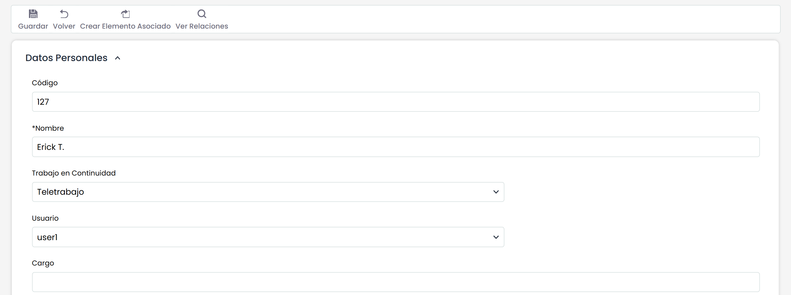

## Configuración WorkFlow Documental

GlobalSuite® permite la definición y gestión de flujos de trabajo para la aprobación de la documentación asociada al sistema.

La plataforma no está limitada en número de flujos de trabajo, estados o responsables, sino que se adaptará a las necesidades de cada organización.

Para comenzar a utilizar los flujos de aprobación, en primer lugar, es necesario definir y configurar dichos workflows en la opción **Gestor Documental>**[**Configuración de Workflows**](https://help.globalsuitesolutions.com/es/globalsuite/v1/configuracion-workflows)

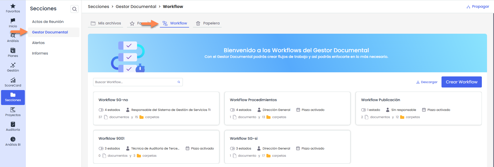

### Paso 1

El primer paso será la configuración de los diferentes flujos de aprobación de la documentación. Para ello, se deberá acceder o crear un Workflow en la opción de configuración. Haciendo click sobre el nombre del Workflow se accede a la información de dicho flujo.

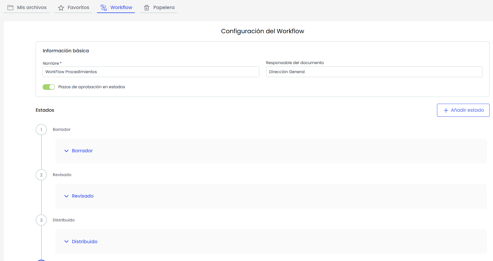

### Paso 2

Dentro del formulario de un Workflow se deberán definir diferentes elementos para su configuración:

**Información básica**

* Nombre del Workflow: Corresponde al nombre con el que se identifique dicho flujo.
* Responsable del Documento: Corresponde al responsable por defecto de los documentos asignados al Workflow.

**Estados**

A continuación se listan los estados que posee el flujo. Los mismos se muestran en orden y por defecto contraídos.  
El último de los estados corresponde con la publicación de los documentos.

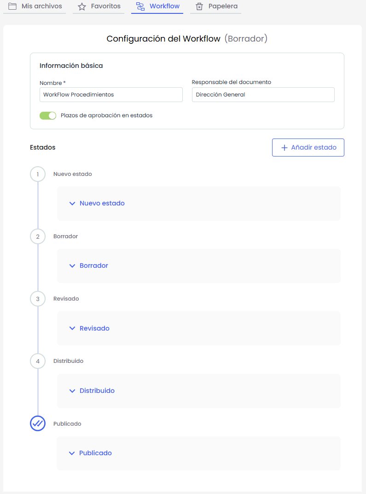

Se pueden crear nuevos estados presionando “**Añadir Estado**”. El nuevo estado se insertará al principio, en el primer estado del flujo

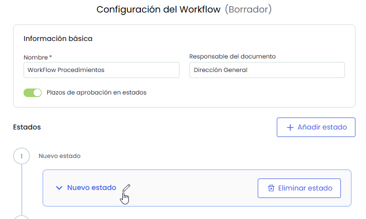

### Paso 3

Una vez definidos los estados se deberán establecer los responsables asignados a cada uno de ellos:

* Al expandir un estado, se mostrará la tabla **“Responsables”**, donde es posible asociar roles tanto a nivel **rol** como a nivel **rol-empleado**. Los usuarios asignados podrán visualizar los documentos que se encuentren en ese estado y, en función de la configuración, **aprobarlos o rechazarlos**.

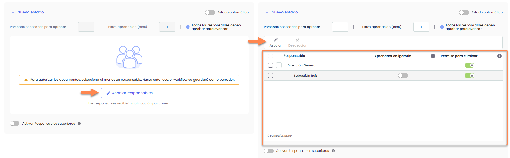

* En el caso de contar con un sistema multientidad, se podrá activar el switch “Responsables superiores”, lo que permitirá asignar roles o empleados pertenecientes a entidades superiores, quienes también podrán visualizar el gestor documental de la entidad actual.

  Al activar este switch, se mostrará debajo de la tabla “**Responsables**” una nueva tabla denominada “**Responsables superiores**”, desde donde se gestionarán dichas asignaciones.

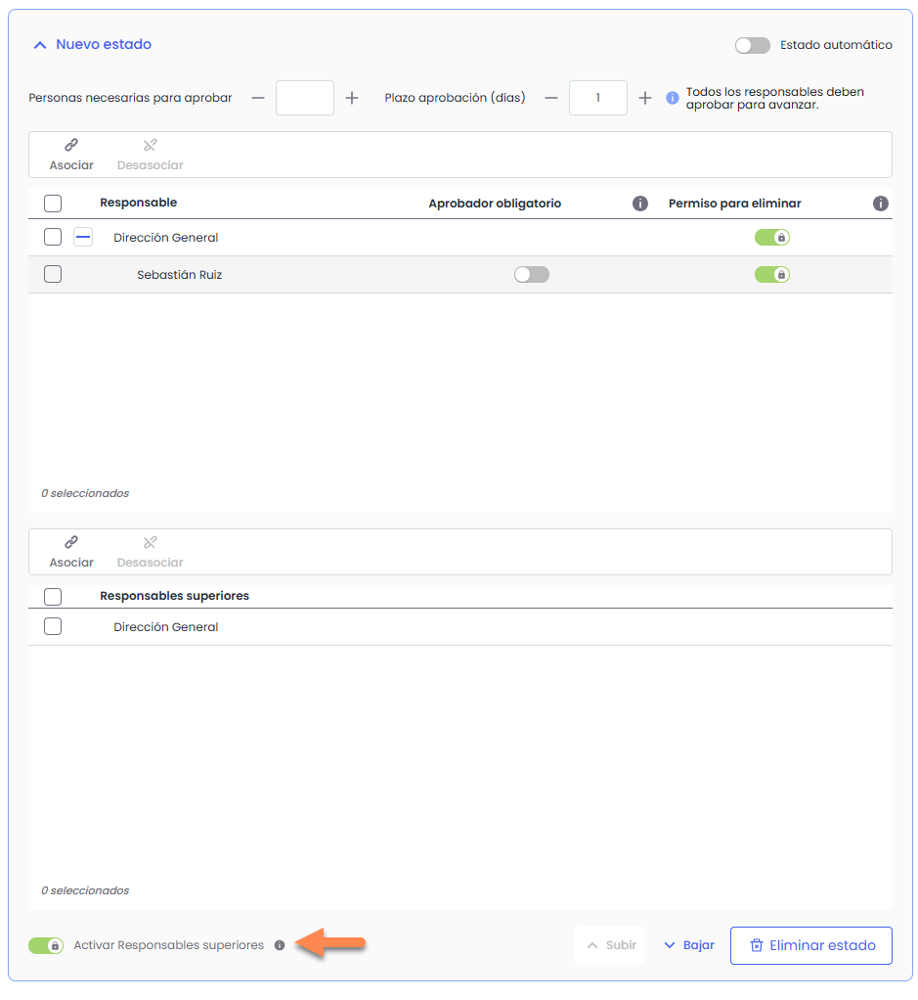

### Paso 4

Por último, se deben definir los criterios de aprobación para cada estado:

* El campo “**Personas necesarias para aprobar**” indica el número de empleados (respecto los seleccionados como responsables del estado) que deberán aprobar dicho estado para poder pasar al siguiente.
* Si se quiere indicar uno o varios empleados como obligatorios para realizar la aprobación, hay que marcar la columna “Aprobador obligatorio”
* De igual forma se permite indicar qué empleados pueden eliminar un documento que se encuentra en un estado intermedio.

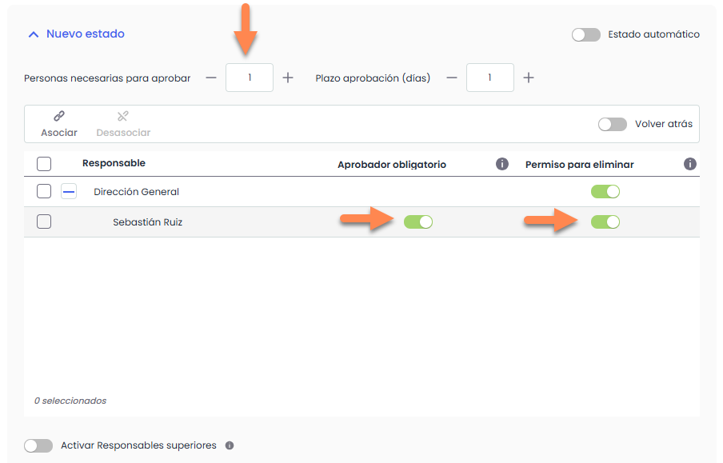

* El campo **“Plazo de aprobación (días)”** se habilita de forma general desde los **Datos básicos del Workflow**, activando la opción *“Plazos de aprobación en estados”*.

  Una vez activado, el campo estará disponible en todos los estados del workflow y permitirá definir el **número máximo de días** que un documento puede permanecer en ese estado.

  Si se cumple el criterio de aprobación pero aún existen responsables pendientes de aprobar o rechazar, el documento permanecerá en el estado hasta que se alcance el plazo definido. No obstante, el cambio de estado podrá forzarse manualmente si así se requiere.
* En caso de que no se alcance el número de **“Personas necesarias para aprobar”** dentro del plazo establecido, el switch **“Atrás”** permite definir el comportamiento del documento: podrá configurarse para que **regrese al estado anterior** o para que **permanezca en el estado actual**.


Esta comprobación se realiza mediante un \*\*proceso automático diario de actualización de documentos\*\*. Si la configuración seleccionada así lo indica, la aplicación revertirá automáticamente los documentos al estado anterior.

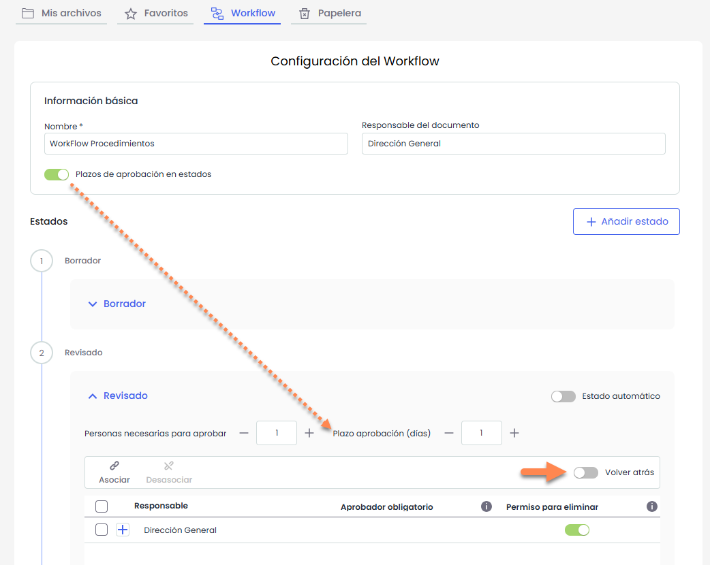

* La opción **“Estado automático”** permite configurar el estado como automático. En este caso, no será posible editar los campos **“Personas necesarias para aprobar”** ni **“Plazo de aprobación (días)”**.

  Estos estados se utilizan para registrar que el documento ha pasado por una fase del workflow **sin requerir intervención de los responsables**. Por este motivo, los campos **“Personas necesarias para aprobar”** y **“Plazo de aprobación (días)”** tendrán siempre el valor **0**.

  No obstante, se permite la **asociación de responsables**, ya que puede ser necesario notificarles el cambio de estado del documento.
