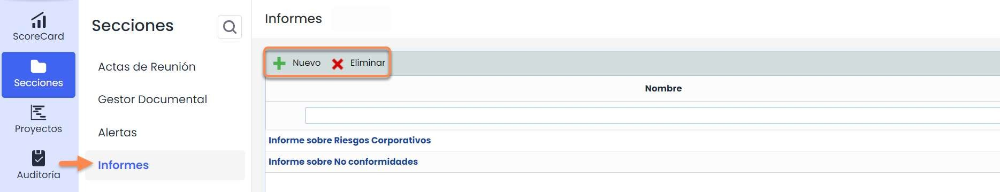
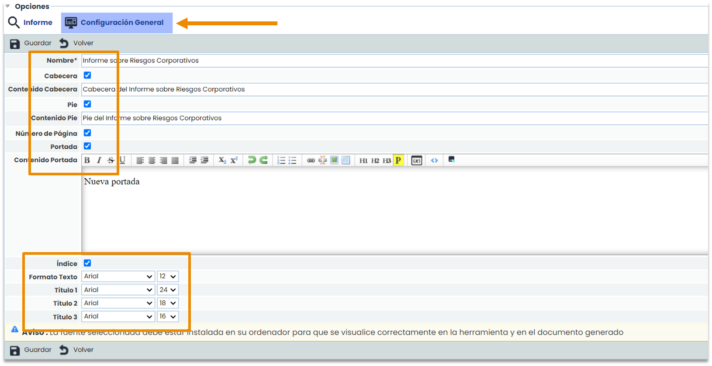
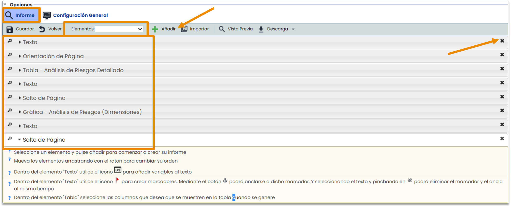
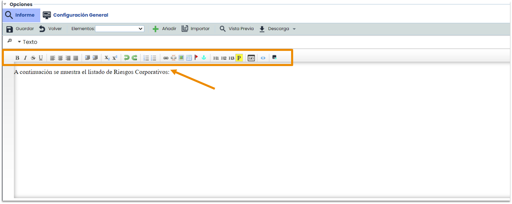
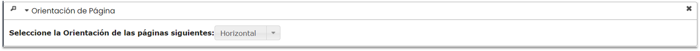
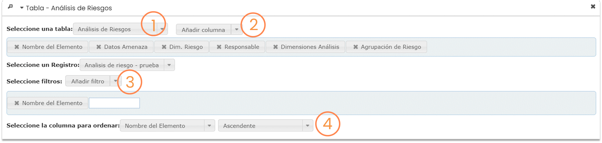
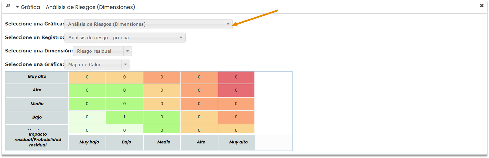
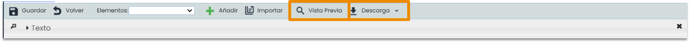
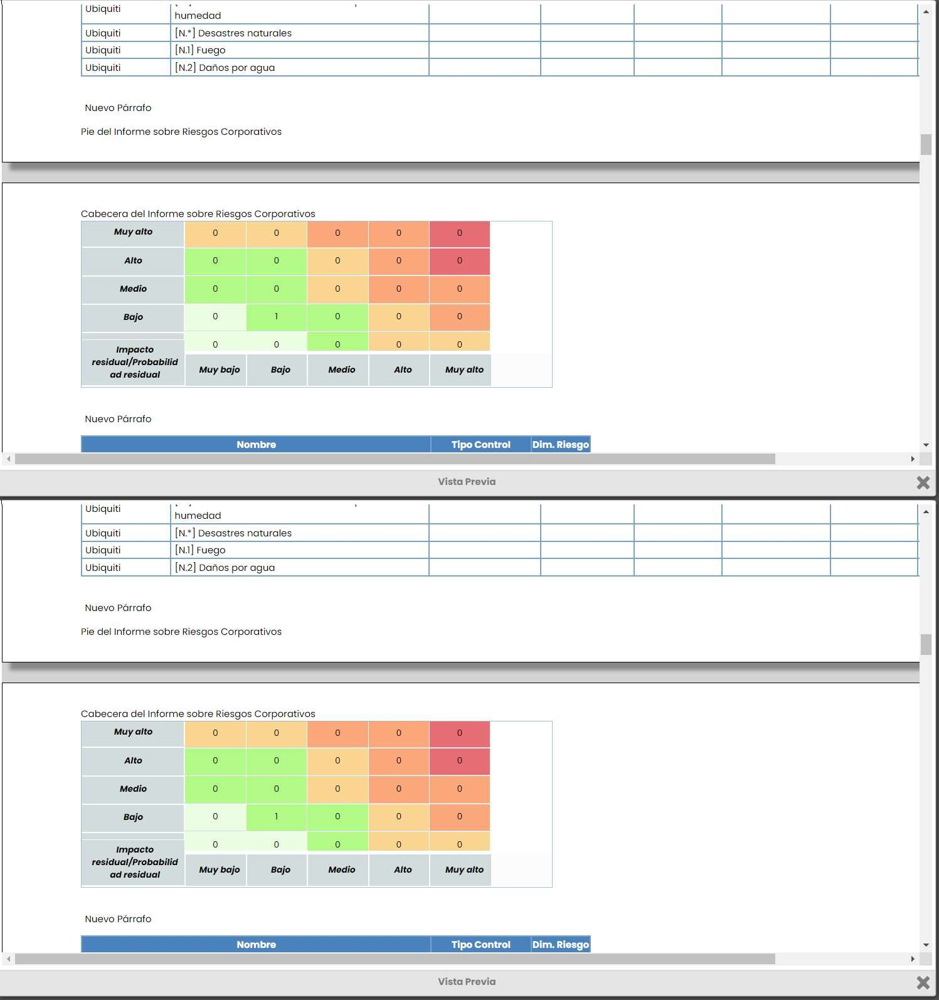
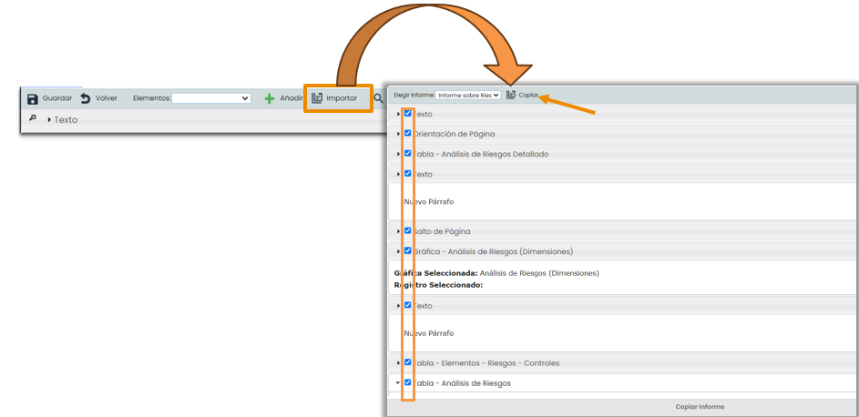

# ¿Cómo crear y configurar informes en GlobalSuite®?


La opción de [\*\*Informes\*\*](https://help.globalsuitesolutions.com/es/globalsuite/v1/informes) se encuentra en el apartado trasversal de \*\*Secciones\*\*, común a todos los módulos de GlobalSuite®.
Su función consiste en permitir realizar informes o reportes a partir de los datos registrados en la aplicación.


* [1. Creación de un nuevo Informe](#id-¿CómocrearyconfigurarinformesenGlobalSuite®?-1.CreacióndeunnuevoInforme)
* [2. Configuración general de un Informe](#id-¿CómocrearyconfigurarinformesenGlobalSuite®?-2.ConfiguracióngeneraldeunInforme)
* [3. Configuración de las secciones de un Informe](#id-¿CómocrearyconfigurarinformesenGlobalSuite®?-3.ConfiguracióndelasseccionesdeunInforme)
  * [Configuración de Texto](#id-¿CómocrearyconfigurarinformesenGlobalSuite®?-ConfiguracióndeTexto)
  * [Configuración de Orientación de Página y Salto de Página](#id-¿CómocrearyconfigurarinformesenGlobalSuite®?-ConfiguracióndeOrientacióndePáginaySaltodePágina)
  * [Configuración de Tabla](#id-¿CómocrearyconfigurarinformesenGlobalSuite®?-ConfiguracióndeTabla)
  * [Configuración de Gráfica](#id-¿CómocrearyconfigurarinformesenGlobalSuite®?-ConfiguracióndeGráfica)
* [4. Guardado y descarga del Informe](#id-¿CómocrearyconfigurarinformesenGlobalSuite®?-4.GuardadoydescargadelInforme)

## 1. Creación de un nuevo Informe

En la pantalla principal se muestra un listado de todos los informes disponibles. Para crear un informe será necesario hacer click en el botón **Nuevo** y seguidamente pinchar en el nombre para acceder a la configuración del informe. También se puede **eliminar** los informes existentes.

## 2. Configuración general de un Informe

Al crear un nuevo informe se accede a la pestaña de “**Informe**”, pero se puede seleccionar previamente la pestaña “**Configuración General**”. El nombre es el único dato obligatorio. Las demás funcionalidades se pueden habilitar marcando las casillas de cabecera, pie de página o portada y será necesario rellenar el cuadro correspondiente con la información que se quiera que aparezca en el informe.

Asimismo, se podrá incluir una numeración automática de las páginas, un índice y establecer la fuente y el tamaño de la letra de los diferentes títulos y del cuerpo del informe

## 3. Configuración de las secciones de un Informe

Los siguientes pasos de configuración específica se llevan a cabo en la pestaña de “**Informe**”. En esta pantalla se pueden añadir 5 **elementos** diferentes al informe. Deben seleccionarse del desplegable de elementos y posteriormente se pulsa en el botón de añadir. El orden de las secciones se puede cambiar pinchando en una y arrastrándola a la posición deseada. También se pueden eliminar haciendo click en la cruz lateral derecha.

### Configuración de Texto

Se pueden añadir tantas secciones de cualquier tipo como se desee. La sección de **texto** permite registrar introducciones, comentarios o el cuerpo del informe. Contiene varias opciones para la edición del texto, similar a un procesador de texto tradicional (Word).

### Configuración de Orientación de Página y Salto de Página

La funcionalidad de **Orientación de Página** permite cambiar las hojas de una posición a otra, ya sea horizontal o vertical. Por ejemplo, si solo una de las páginas del informe debe estar en posición horizontal, será necesario añadir un cambio de orientación de página, la sección que debe ser horizontal y, finalmente, un nuevo cambio de página, esta vez vertical.

El **salto de página** intercala una página en blanco entre dos páginas con contenido.

### Configuración de Tabla

La sección de Tabla se utiliza para importar datos de diferentes opciones de GlobalSuite. En primer lugar, se seleccionará del menú desplegable la opción de donde proceden los datos (1) y, en segundo lugar, se añadirán las **columnas o dimensiones** de dicha opción, que se visualizarán en la tabla del informe (2). Además, cabe la posibilidad de filtrar los datos que se van a mostrar seleccionando uno o varios de los filtros propuestos (3) y de ordenar los datos de una columna determinada de forma ascendente o descendente (4). Los distintos tipos de filtros y el orden de los datos se podrán aplicar de manera simultánea.

### Configuración de Gráfica

Por último, la sección de Gráficas permite mostrar todas aquellas que estén disponible dentro de las opciones especificadas en el menú desplegable.

## 4. Guardado y descarga del Informe

Una vez finalizada la configuración del informe, para previsualizarlo, se podrá pinchar en **Vista Previa** y ver una muestra del resultado final en tiempo real. Seguidamente se deberá guardar y se podrá **descargar** en formato Word (.docx).

El botón de **Importar** permite seleccionar un informe existente e importar su configuración al nuevo.

Al pulsar el botón Importar aparecerá un **pop-up** como el que se muestra a la derecha. Aquí es donde se deberá seleccionar del listado de informes existentes el que se quiere reutilizar. También se podrá decidir qué partes van a conformar el nuevo informe marcándolas y desmarcándolas con un tick. Finalmente se pinchará en el botón de **Copiar** y aparecerán las secciones configurables del informe, es decir, en este momento se partiría desde punto 2 de esta Guía Rápida.
