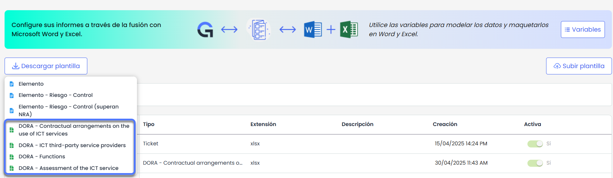
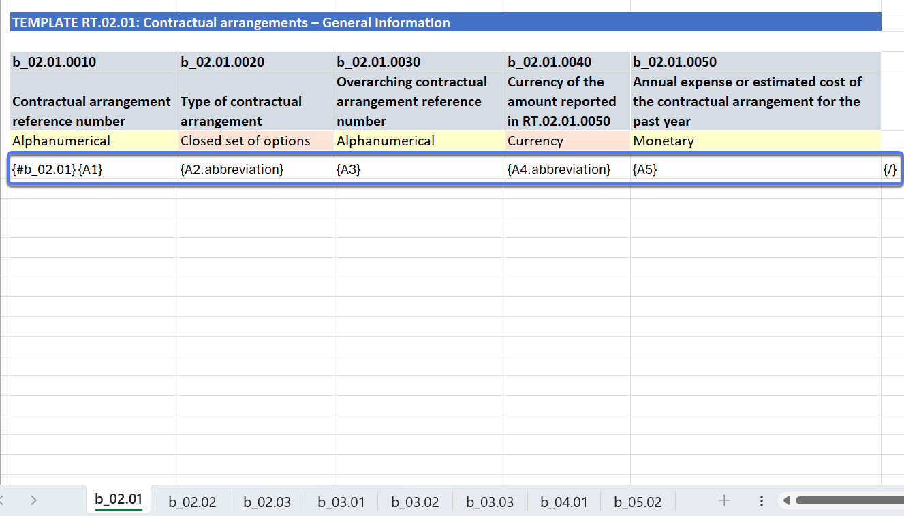
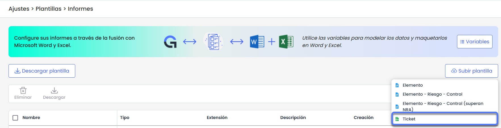
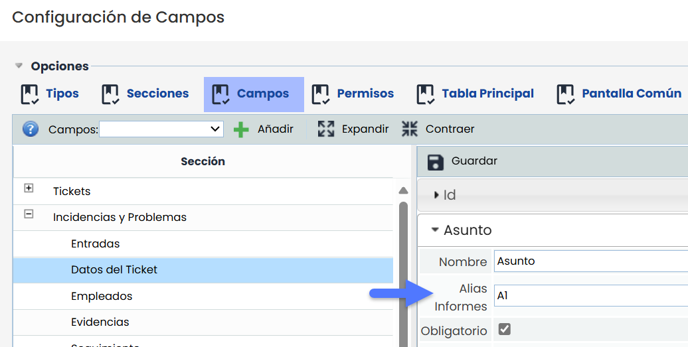
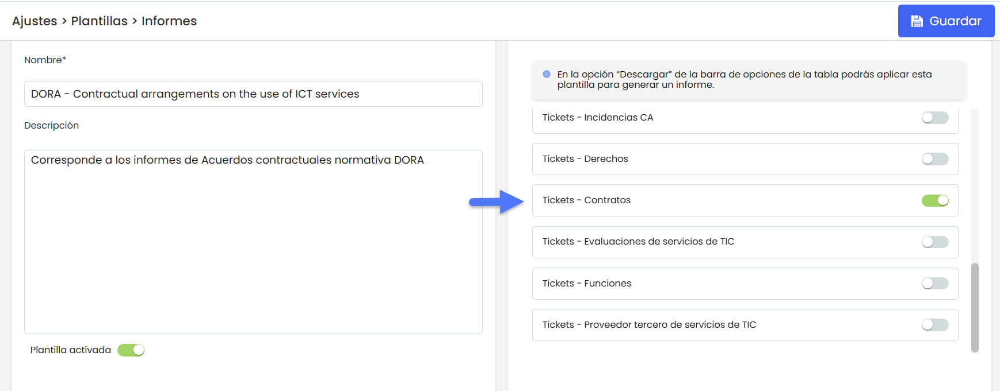
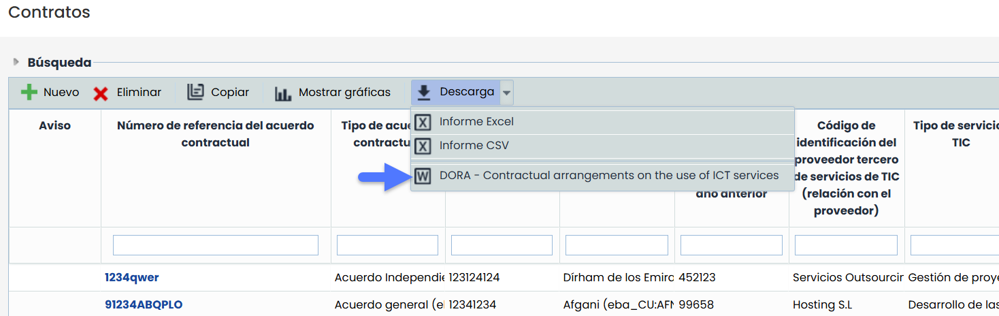

# Personaliza y descarga informes con nuestras plantillas dinámicas en Excel


Este tutorial muestra cómo configurar y utilizar informes dinámicos en Excel aplicados a la normativa \*\*DORA\*\* en GlobalSuite®, utilizando plantillas predefinidas y campos de tickets y alias configurados por defecto.


## Ejemplo Generación de Informes en Excel para la normativa DORA

### 1️⃣ Descarga de la plantilla predefinida

1. Accede a Ajustes > Plantillas > [**Informes**](https://help.globalsuitesolutions.com/es/globalsuite/v1/plantillas-de-informes)
2. Pulsa el botón **Descargar Plantilla**.

3. Selecciona la plantilla predefinida relacionada con **DORA** que deseas utilizar. En este caso descargaremos la plantilla llamada “Contractual arrangements on the use of ICT ”.


Las plantillas DORA incluyen los \*\*Alias de Campos\*\* ya configurados por defecto para la normativa.



Para la descarga de listados, es importante iniciar el bucle con el símbolo \*\*#\*\* seguido del nombre de la hoja de Excel y cerrarlo con \*\*{/}\*\*, tal como se muestra en la imagen anterior


---

### 2️⃣ Subida de la plantilla a GlobalSuite

1. Una vez descargada la plantilla en tu equipo, en la misma sección pulsa **Subir Plantilla**.
2. Carga el archivo Excel que has descargado.

### ⚠️ Importante para informes no relacionados con DORA

Para generar informes en Excel de otros tipos de tickets (no relacionados con DORA), es necesario configurar manualmente los **Alias Informes** en los campos que se deseen mostrar en los informes.

Esta configuración se realiza desde:  
**Ajustes > Configuración >** [**Tickets**](https://help.globalsuitesolutions.com/es/globalsuite/v1/campos), editando cada campo específico donde podrás definir su alias correspondiente.

📌 **Recuerda:**

* Los alias deben ser **valores únicos**, **alfanuméricos** y tener una **longitud máxima de 5 caracteres**.
* Al subir la plantilla, deberás seleccionar la opción **Tickets**, ya que estos informes están vinculados a ese tipo de estructura.

En las plantillas Excel que se suban posteriormente, deberás utilizar **exactamente el mismo alias** configurado en el campo para que el sistema pueda identificarlo y sustituirlo correctamente por su valor en el informe.

De esta forma, aseguras que los datos se muestren de forma dinámica y coherente en el archivo Excel generado.

### Variables

Para consultar el listado completo de **variables disponibles** y los **tipos de campos** que pueden mostrarse en los informes, puedes acceder al siguiente enlace: [Variables Excel](https://help.globalsuitesolutions.com/es/globalsuite/v1/plantillas-informes-excel#PlantillasdeinformesenExcel-Variables)

---

### 3️⃣ Configuración de la plantilla en GlobalSuite

1. La plantilla se visualizará en la tabla de plantillas disponibles.
2. Haz clic sobre el **nombre del archivo (enlace)** para editar su configuración.
3. En la ventana de edición:

   * Cambia el **nombre de la plantilla**, si lo deseas.
   * Añade una **descripción** para identificar su propósito.
   * Define el **tipo de ticket** en el que estará disponible la descarga del informe.  
     Para DORA, en este caso, será el tipo **Contratos**.


Es fundamental seleccionar el tipo correcto de ticket, ya que los informes listan \*\*tickets por tipo\*\*.


---

### 4️⃣ Generación del informe desde el módulo correspondiente

1. Accede a **Gestión > Contratos**. (o la opción del ticket que hayas habilitado en el paso anterior)
2. Verás disponible la opción de **descargar el informe Excel** basado en la plantilla configurada.
3. Al pulsar en **Descargar**, se generará un archivo con los datos dinámicos del sistema, según los campos definidos en la plantilla.

