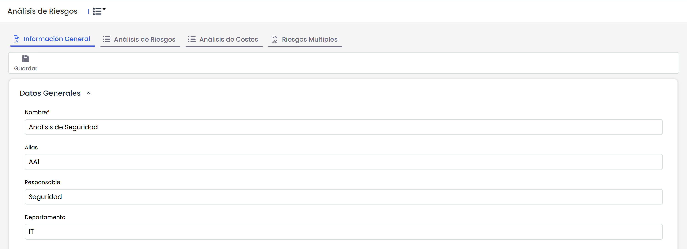
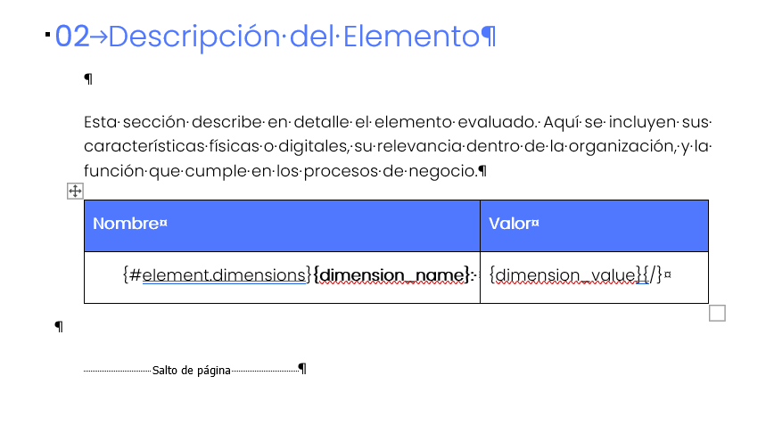
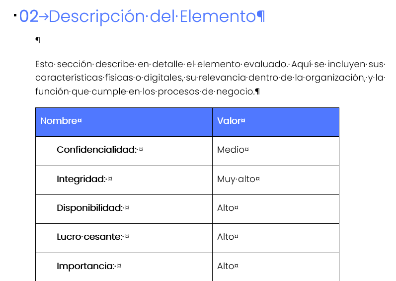
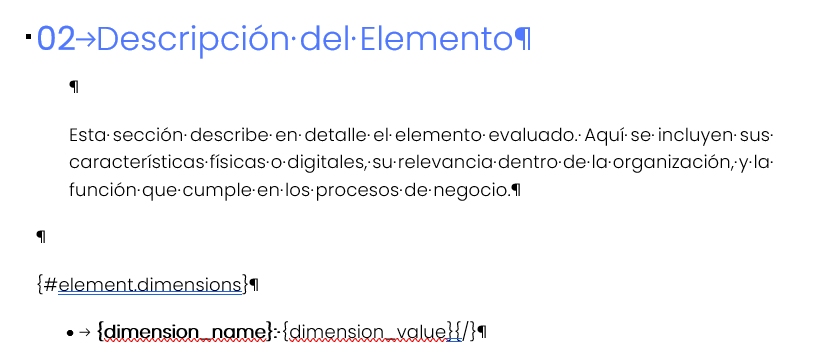
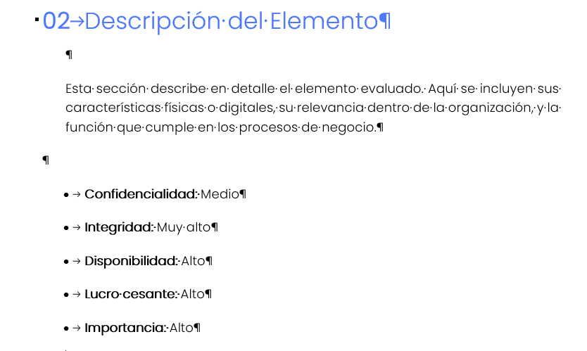
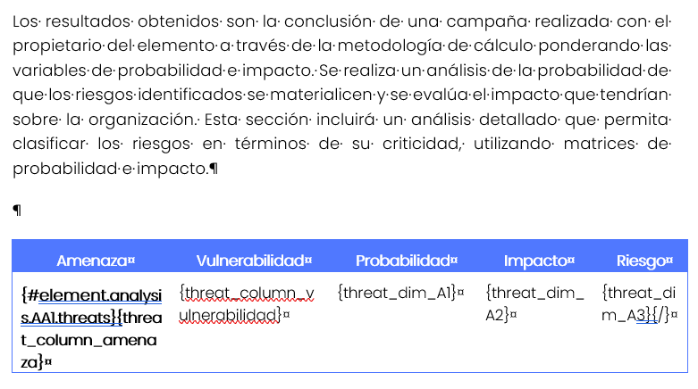
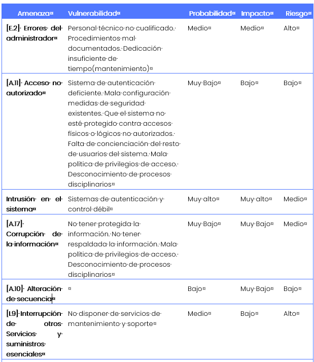
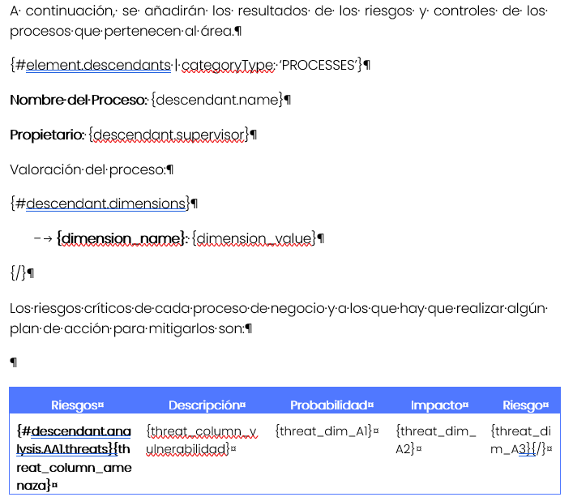

# Personaliza y descarga informes con nuestras plantillas dinámicas en Word

En GlobalSuite Solutions, entendemos que una gestión documental eficiente y personalizada es clave para optimizar los procesos empresariales. Por eso, hemos diseñado funcionalidades que simplifican las tareas más esenciales, como la generación de informes. Una de nuestras herramientas más destacadas es la posibilidad de generar documentos personalizados en formato Word utilizando plantillas dinámicas.

**¿Cómo funciona esta funcionalidad?**  
Nuestra funcionalidad de plantillas dinámicas aprovecha la potencia de Microsoft Word, una herramienta ampliamente conocida y utilizada en el ámbito empresarial. Crear una plantilla en Word es sencillo: simplemente diseña tu documento base e introduce las variables necesarias utilizando un formato intuitivo, como `{element.name}`, `{element.category}` o `{control.name}`.

Además, la herramienta permite reutilizar estas plantillas en diferentes procesos, adaptándolas a distintas necesidades sin necesidad de rediseñar cada documento desde cero.

**Ventajas principales**

1. **Personalización sin límites**: Diseña documentos adaptados a tu estilo corporativo o necesidades específicas.
2. **Ahorro de tiempo**: Genera informes en segundos sin copiar y pegar manualmente datos.
3. **Reducción de errores**: Al automatizar el llenado de datos, minimizas inconsistencias y errores humanos.
4. **Integración directa con GlobalSuite**: Aprovecha las variables configuradas previamente para que todo esté sincronizado.

**Conclusión**  
La descarga de informes Word a partir de plantillas es una herramienta clave para quienes buscan eficiencia y precisión en sus procesos documentales. ¿Aún no la utilizas? Descubre cómo esta funcionalidad puede ayudarte a optimizar tu trabajo diario.

## Listado de Variables para su uso

En esta sección podremos ver todas las variables para su uso.

### Variables de Elementos.

|  |  |
| --- | --- |
| **Variable** | **Descripción** |
| {element.name} | Nombre del Elemento |
| {element.units} | Unidades del Elemento |
| {element.category} | Categoría del Elemento |
| {element.category\_path} | Ruta Categoría del Elemento |
| {element.supervisor} | Responsable del Elemento |
| {element.other\_supervisor} | Otros Responsables del Elemento |
| {element.owner} | Propietario del Elemento |
| {element.dim\_IX.dimension\_name} | Nombre de la Dimensión con alias IX. Sustituir la X por el número del alias. |
| {element.dim\_IX.dimension\_alias} | Alias de la dimensión del elemento.  Sustituir la X por el número del alias. (I1, I2, …, IN) |
| {element.dim\_IX.dimension\_value} | Valor específico de la dimensión IX en el elemento.  Sustituir la X por el número del alias. |
| {element.element\_customAttr\_Atributo\_Nombre} | Atributos Configurables identificando el atributo por el nombre. |
| {#element.custom\_attrs} {custom\_attr\_name}: {custom\_attr\_value} {/} | Listado de atributos configurables. etiqueta de inicio y otra de fin (inicio con '#' y fin con '/'), y el bloque de texto que hay dentro se repite tantas veces como elementos de ese tipo existan |
| {#element.dimensions} {dimension\_name} ({dimension\_alias}): {dimension\_value} {/} | Bucle de todas las dimensiones donde se pueden añadir todos los valores de la dimensión del elemento, sus alias y sus nombres. |
| {#element.descendants} {descendant.name}  {descendant.category}  {descendant.supervisor}  {descendant.dim\_I1.dimension\_value} {/} | Bucle que recorre todos los hijos del elemento según el árbol de dependencias. Esto listaría todos los elementos que dependen del elemento  seleccionado como una lista plana, mostrando su nombre y sus atributos. También estarían disponibles los mismos requisitos y las mismas variables que para un elemento, es decir, los que aparecen en el anterior comentario poniendo ‘descendant.’ delante al estar dentro del bucle.  Importante resaltar que dentro de esta información también se pueden obtener riesgos y controles como se verán en el apartado siguiente. |
| {#element.descendants | categoryType: ‘PROCESSES’}  {descendant.name}  {descendant.category}  {descendant.supervisor}  {descendant.dim\_I1.dimension\_value} {/} | Bucle para obtener los elementos configurados en el árbol de dependencias con una categoría especial.  SERVICES PROCESSES INFORMATION INFRASTRUCTURES APPLICATIONS AREAS PERSONAL SUPPLIERS TREATMENT BUSINESS\_RELATIONS |
| {element.analysis.AA1.rge} | Cálculo de Riesgo Global por Elemento (RGE) del Análisis de Riesgos donde AA1 es el alias del análisis. Este valor aunque corresponde a un elemento está asociado a un Análisis de Riesgos. |
| {element.analysis.AA1.rrge} | Cálculo de Riesgo Repercutido Global por Elemento (RRGE) del Análisis de Riesgos donde AA1 es el alias del análisis. Este valor aunque corresponde a un elemento está asociado a un Análisis de Riesgos. |

### Variables de Amenazas/Riesgos. Opción de GlobalSuite Análisis de Riesgos.

La información de esta tabla representan toda la información que se puede conseguir desde la opción de Análisis de Riesgos. Esta información vendrá asociada a un elemento que será el elemento del informe descargado.

Para obtener la información del **Análisis de Riesgos**, se necesita añadir su alias que es un campo que se puede configurar en GlobalSuite en la configuración general del análisis de riesgos (Análisis - Análisis de Riesgos - Información General)

| **Variable** | **Descripción** |
| --- | --- |
| {#element.analysis.AA1.threats} {threat\_column\_amenaza} {threat\_column\_vulnerabilidad} {/} | Valor de las Columnas principales de los riesgos (son los campos de texto). Ejemplo con Amenaza y Vulnerabilidad. El alias AA1, se corresponde con el alias del análisis donde están los riesgos y controles que se quieren obtener en el informe. |
| {#element.analysis.AA1.threats} {threat\_dim\_A1}  {threat\_dim\_A2}  ….  {threat\_dim\_AXX} {/} | Dentro del bucle de amenazas/riesgos también se puede obtener las dimensiones específicas una a una a través del alias de la dimensión. El resultado será el valor de esa dimensión por cada una de las amenazas. Este bucle se utilizará cuando se quiere un valor concreto del riesgo/amenaza. El alias AA1, se corresponde con el alias del análisis donde están los riesgos y controles que se quieren obtener en el informe. |
| {#element.analysis.AA1.threats | where: ‘threat\_dim\_A2 == “Alto” || threat\_dim\_A2 == “Muy Alto”’} {threat\_dim\_A1} {threat\_dim\_AXX} {/} | Bucle anterior con la posibilidad de recorrer solo los riesgos/amenazas que cumplan con la condición. En el ejemplo se puede ver que la dimensión con alias A2 = Alto y Muy Alto. El alias AA1, se corresponde con el alias del análisis donde están los riesgos y controles que se quieren obtener en el informe. |
| {#element.analysis.AA1.threats} Riesgo: {threat\_column\_riesgo}  {#threat\_dimensions}  {dimension\_name} {dimension\_alias} {dimension\_value} {/} {/} | Dentro del bucle de amenazas también se puede obtener otro bucle con todas las dimensiones, para obtener su nombre, alias y valor. Este bucle sirve para representar toda la información de los riesgos/amenazas. El alias AA1, se corresponde con el alias del análisis donde están los riesgos y controles que se quieren obtener en el informe. Aquí también se podría añadir un where al bucle de threats. |
| {#element.descendants} {descendant.name}  {descendant.dim\_I1.dimension\_value}  {#descendant.analysis.AA1.threats} Riesgo: {threat\_column\_riesgo}  Dimensión:{threat\_dim\_A2} {/}  {/}  {/} | Obtener los riesgos/amenazas de un descendiente del árbol de dependencias que depende del elemento del informe.  En primer lugar se define el bucle de descendientes donde ya se puede obtener toda la información de los hijos del árbol de dependencias.  Para obtener los riesgos/amenazas hay que incluir el mismo bucle pero con la palabra descendant al principio. Todas las variables de riesgos/amenazas están disponibles y son iguales que las del elemento principal. |


\*\*Nota sobre campos configurables\*\*
Para que los campos configurables (se configuran en metodologías > [Riesgos](https://help.globalsuitesolutions.com/es/globalsuite/v1/metodologia-riesgos)), se muestren correctamente en los informes, al configurar la plantilla debes tener en cuenta lo siguiente:
\* Todos los caracteres que no sean letras (A-Z, a-z) o números (0-9) deben ser reemplazados por un guion bajo (\\_).
\* Además, el nombre del campo debe estar en minúsculas, tal como sucede con las variables del sistema.
Por ejemplo, si el nombre original del campo es \*Ámbito\*, el identificador correcto que deberás usar en la plantilla es:
threat\\_column\\_\\_mbito
(el carácter con tilde ha sido reemplazado por guion bajo y todo está en minúsculas).


### Listado de Controles

Las filas de esta tabla representan toda la información que se puede conseguir desde la opción de GlobalSuite de Gestión de Controles. Esta información se podrá obtener dentro del bucle de riesgos/amenazas.

| **Variable** | **Descripción** |
| --- | --- |
| {#element.analysis.AA1.threats} Amenaza: {threat\_column\_amenaza} {#threat\_controls} {control\_name} {control\_soa\_control} {control\_supervisor} {control\_another\_supervisor} {control\_resources} {control\_deadline} {control\_observations} {control\_adequacy} {control\_action} {control\_budget} {control\_comments} {/} {/} | Si se quiere obtener los controles de una amenaza para tener toda la estructura jerarquizada, dentro del bucle de riesgos/amenazas, se puede generar un bucle de controles para obtener toda la información. En el ejemplo se pueden ver los campos Core de Controles. El alias AA1, se corresponde con el alias del análisis donde están los riesgos y controles que se quieren obtener en el informe. |
| {#element.analysis.AA1.threats} Amenaza: {threat\_column\_amenaza} {#threat\_controls} {control\_dim\_C1} {control\_dim\_C2} {/} {/} | Siguiendo el mismo bucle que el anterior, además de los campos core se puede obtener las dimensiones específicas identificándolas por el número de Alias: CX |
| {#element.analysis.AA1.threats} Amenaza: {threat\_column\_amenaza} {#threat\_controls} {control\_name}  {control\_dim\_C1} {control\_dim\_C2} {#control\_dimensions} {dimension\_name} {dimension\_alias} {dimension\_value} {/} {/} | Además de obtener las dimensiones por el número de alias se puede realizar un bucle para obtener toda la información de las dimensiones de todos los controles. En el ejemplo se ven las dos formas de obtener las dimensiones de controles:  Identificando el alias concreto  Añadiendo un bucle que recorre las dimensiones para obtener un valor. |
| {#element.analysis.AA1.threats} Amenaza: {threat\_column\_amenaza} {#threat\_controls | where : 'control\_dim\_C1=="Muy Efectivo"'} {control\_name}  {control\_dim\_CX} {#control\_dimensions } {dimension\_name} {dimension\_alias} {dimension\_value} {/} {/}  {/} | Ejemplo de filtrado de controles por una dimensión del control. En este caso solo traería los controles que cumplen con esta condición. |

### Listado de variables de Análisis de Riesgos y Metodologías

| **Tipo** | **Variable** | **Descripción** |
| --- | --- | --- |
| Análisis | {analysis.AliasAnálisis.name} | Nombre del Análisis, siendo AliasAnálisis el valor configurado en GlobalSuite. |
| Análisis | {analysis.AliasAnálisis.start\_date} | Fecha de Inicio del Análisis, siendo AliasAnálisis el valor configurado en GlobalSuite. |
| Análisis | {analysis.AliasAnálisis.supervisor} | Responsable del Análisis, siendo AliasAnálisis el valor configurado en GlobalSuite. |
| Análisis | {analysis.AliasAnálisis.department} | Departamento del análisis, siendo AliasAnálisis el valor configurado en GlobalSuite. |
| Análisis | {analysis.AliasAnálisis.nra} | Nivel de Riesgo Aceptable del análisis, siendo AliasAnálisis el valor configurado en GlobalSuite. |
| Análisis | {analysis.AliasAnálisis.nro} | Nivel de Riesgo Objetivo del análisis, siendo AliasAnálisis el valor configurado en GlobalSuite. |
| Análisis | {analysis.AliasAnálisis.vgan} | Valor general del Análisis de Riesgos, siendo AliasAnálisis el valor configurado en GlobalSuite. |
| Análisis | {analysis.AliasAnálisis.grouping\_risk\_calculation} | Cálculo de la agrupación de riesgos, siendo AliasAnálisis el valor configurado en GlobalSuite. |
| Análisis | {analysis.AliasAnálisis.risk\_appetite} | Apetito de riesgo del análisis, siendo AliasAnálisis el valor configurado en GlobalSuite. |
| Metodología | {analysis.AliasAnálisis.methodology.name} | Nombre de la metodología asociada al análisis de riesgos, siendo AliasAnálisis el valor configurado en GlobalSuite. |
| Metodología | {analysis.AliasAnálisis.methodology.acceptable\_percentage} | % Aceptable para el cálculo de riesgos críticos del análisis de riesgos, siendo AliasAnálisis el valor configurado en GlobalSuite. |
| Metodología | {analysis.AliasAnálisis.methodology.risk\_dimension} | Dimensión principal del análisis de riesgos de la metodología asociada, siendo AliasAnálisis el valor configurado en GlobalSuite. |
| Metodología | {analysis.AliasAnálisis.methodology.cost\_dimension} | Dimensión del coste del análisis de riesgos de la metodología asociada, siendo AliasAnálisis el valor configurado en GlobalSuite. |
| Metodología | {analysis.AliasAnálisis.methodology.controls\_methodology\_name} | Nombre de la metodología de controles del análisis de riesgos, siendo AliasAnálisis el valor configurado en GlobalSuite. |
| Metodología | {analysis.AliasAnálisis.methodology.controls\_evaluation\_type} | Tipo de evaluación de la metodología de controles, siendo AliasAnálisis el valor configurado en GlobalSuite. |

### Operadores adicionales

Todas estas variables se pueden utilizar con varios operadores para darle formato:

* Obtener la variable en mayúsculas: Añadir | UC o | upperCase a la variable. Ejemplo: {element.name | UC}
* Utilización de filtros. Operador igual. Añadir == al filtro. Ejemplo:

{#element.analysis.AA1.threats}  
Amenaza: {threat\_column\_amenaza}  
{#threat\_controls | where : 'control\_dim\_C1=="Muy Efectivo"'}

{/}

* Utilización de filtros. Operador distinto. Añadir != al filtro. Ejemplo:

{#element.analysis.AA1.threats}  
Amenaza: {threat\_column\_amenaza}  
{#threat\_controls | where : 'control\_dim\_C1!="Muy Efectivo"'}

{/}

* Utilización de filtros. Operadores lógicos: && (AND), || (OR)

## Ejemplos de personalización de Plantillas

### ¿Cómo recopilar toda la información de la metodología de elementos en formato tabla?

### ¿Cómo configurar toda la información de las dimensiones de la metodología de elementos con bullets?

### ¿Cómo configurar la información en forma de tabla de los riesgos asociados a un elemento eligiendo las columnas de la tabla?

El ejemplo se realiza para un campo principal llamado amenaza y un campo de texto llamado vulnerabilidad. El análisis sobre el que se realiza la plantilla tiene un alias llamado AA1.

Además, la dimensión probabilidad tiene un alias A1, el impacto un alias A2 y el riesgo un alias A3.

### ¿Cómo manejar los datos del árbol de dependencias?

Esta información es muy necesaria cuando se tiene que hacer un reporte de un área concreta para obtener el consolidado de toda la información. Para ello se utiliza la opción de GlobalSuite del árbol de dependencias.

Para obtener un listado de los elementos dependientes y poder obtener procesos, aplicaciones o cualquier recurso que se utilice en el área hay definir un bucle igual a este. El filtro es opcional y en este caso queremos traernos los elementos que sean Procesos.

{#element.descendants | categoryType: ‘PROCESSES’}

**Nombre del Proceso:** {descendant.name}

**Propietario:** {descendant.supervisor}

Valoración del proceso:

{#descendant.dimensions}

* **{dimension\_name}:** {dimension\_value}

{/}

{/}

Adicionalmente, también está disponible para los elementos de este bucle todas las dimensiones. Ejemplo para obtener una tabla de los riesgos por cada proceso:

### ¿Cómo obtener la información de todos los riesgos filtrado por aquellos que tengan un valor Muy Alto?

En la metodología del ejemplo el análisis de riesgos tiene un alias AA1, y el riesgo tiene un alias A3

{#element.analysis.AA1.threats | where: ‘threat\_dim\_A3 == “Muy Alto”’}

{threat\_column\_amenaza}

{threat\_column\_vulnerabilidad}

{threat\_dim\_A1}

{threat\_dim\_A2}

{/ }

### ¿Cómo obtener un listado de controles asociados a los riesgos / amenazas?

{#element.analysis.AA1.threats}

**Riesgo: {threat\_column\_amenaza} - {threat\_column\_vulnerabilidad} - {threat\_dim\_A3}**

Los controles son:

{#threat\_controls}

* Nombre control: {control\_name}

* Responsable: {control\_supervisor}

* Comentarios: {control\_comments}

* Valoración:

{#control\_dimensions}

o   **{dimension\_name}:** {dimension\_value}

{/}

{/}

{/}

### ¿Cómo realizar un filtro para obtener solo los controles que cumplen con el valor de una dimensión?

{#element.analysis.AA1.threats}

Amenaza: {threat\_column\_amenaza}

{#threat\_controls | where : 'control\_dim\_C1=="Muy Efectivo"'}

{control\_name}

{control\_dim\_CX}

{#control\_dimensions }

{dimension\_name}

{dimension\_alias}

{dimension\_value}

{/}

{/}

{/}

### Errores más frecuentes en la configuración de informes.

* Utilizar las variables y añadir un espacio al final. Ejemplo: {control\_name }
* Utilizar un bucle sin añadir la #. Ejemplo: {element.analysis.AA1.threats}
* Registrar una variable incorrecta. Ejemplo {element}
* No cerrar un bucle con {/}
* En los filtros de los bucles utilizar solo un =. Ejemplo: {#threat\_controls | where : 'control\_dim\_C1="Muy Efectivo"'}
* Utilizar las variables en mayúsculas. Ejemplo: {Element.Name} o {element.name | uc}. En el primer caso debe ir la variable en minúsculas, en el segundo UC debe ir en mayúsculas.
