# ¿Cómo crear y gestionar proyectos en GlobalSuite®?


En este artículo tratamos cómo crear, organizar y hacer seguimiento de proyectos en GlobalSuite®, definiendo equipos de trabajo, tareas y fases, configurando modelos predefinidos, gestionando calendarios e históricos y cerrando proyectos una vez completados.


**Índice**

* [1. Equipo de Trabajo](como-crear-y-gestionar-proyectos-en-globalsuite-r.md#id-¿CómocrearygestionarproyectosenGlobalSuite®?-1.EquipodeTrabajo)
* [2. Gestión del Proyecto](como-crear-y-gestionar-proyectos-en-globalsuite-r.md#id-¿CómocrearygestionarproyectosenGlobalSuite®?-2.GestióndelProyecto)
* [3. Ajustes: Proyectos](como-crear-y-gestionar-proyectos-en-globalsuite-r.md#id-¿CómocrearygestionarproyectosenGlobalSuite®?-3.Ajustes:Proyectos)
  * [Configuración](como-crear-y-gestionar-proyectos-en-globalsuite-r.md#id-¿CómocrearygestionarproyectosenGlobalSuite®?-Configuración)
  * [Gestión de Modelos](como-crear-y-gestionar-proyectos-en-globalsuite-r.md#id-¿CómocrearygestionarproyectosenGlobalSuite®?-GestióndeModelos)
* [4. Calendario](como-crear-y-gestionar-proyectos-en-globalsuite-r.md#id-¿CómocrearygestionarproyectosenGlobalSuite®?-4.Calendario)
* [5. Históricos](como-crear-y-gestionar-proyectos-en-globalsuite-r.md#id-¿CómocrearygestionarproyectosenGlobalSuite®?-5.Históricos)
* [6. Históricos del Proyecto](como-crear-y-gestionar-proyectos-en-globalsuite-r.md#id-¿CómocrearygestionarproyectosenGlobalSuite®?-6.HistóricosdelProyecto)
* [7. Finalización del Proyecto](como-crear-y-gestionar-proyectos-en-globalsuite-r.md#id-¿CómocrearygestionarproyectosenGlobalSuite®?-7.FinalizacióndelProyecto)

La sección de Proyectos es un apartado trasversal, común a todos los módulos de GlobalSuite®, al que se podrá acceder desde cualquiera de los menús (Home, Inicio, etc.). Su función consiste en facilitar la organización, la gestión y el seguimiento de proyectos.

## 1. Equipo de Trabajo

Esta opción permite definir equipos de trabajo y de coordinación. La definición de ambos se realiza a nivel de Roles, por lo que se deberá

seleccionar los roles existentes, editar roles en **Inicio >** [**Gestión de Roles**](https://help.globalsuitesolutions.com/es/globalsuite/v1/gestion-de-roles) o definir roles nuevos en **Ajustes > Configuración General >** [**Configuración de Roles**](https://help.globalsuitesolutions.com/es/globalsuite/v1/roles-de-empresa) .\
Los empleados introducidos en el "**Equipo de Trabajo**", serán los que podrán ser asignados a tareas dentro del Proyecto.

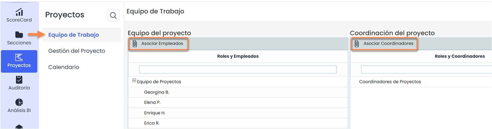

## 2. Gestión del Proyecto

En esta pantalla se podrá crear un proyecto y gestionarlo. Cuando se acceda por primera vez, se deberá definir el proyecto especificando: nombre y fechas previstas de inicio y fin. Asimismo, se tendrá la posibilidad de escoger entre crear un proyecto vacío para ir ajustándolo a las necesidades del proyecto o seleccionar un modelo preconfigurado (ver punto **“**[**3. Ajustes: Proyectos”**](como-crear-y-gestionar-proyectos-en-globalsuite-r.md#3.-Ajustes:-Proyectos)de esta guía). Para comenzar, se debe dirigir a **Proyectos>** [**Gestión de Proyectos**](https://help.globalsuitesolutions.com/es/globalsuite/v1/gestion-del-proyecto) se seleccionará un modelo y/o se pulsará directamente en **Crear Proyecto**.

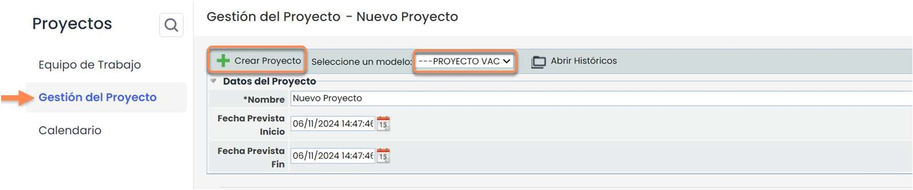 

Al crear un proyecto, esta sección mostrará a partir de ese momento el modelo con las tareas a completar o un espacio de trabajo vacío si no se ha seleccionado ningún modelo. Se podrá crear nuevas fases o tareas, seleccionando en primer lugar aquella de la que estas vayan a depender; **eliminar** las **existentes** o marcarlas como **completadas** (siempre que se complete una tarea, automáticamente se completarán todas sus subtareas).

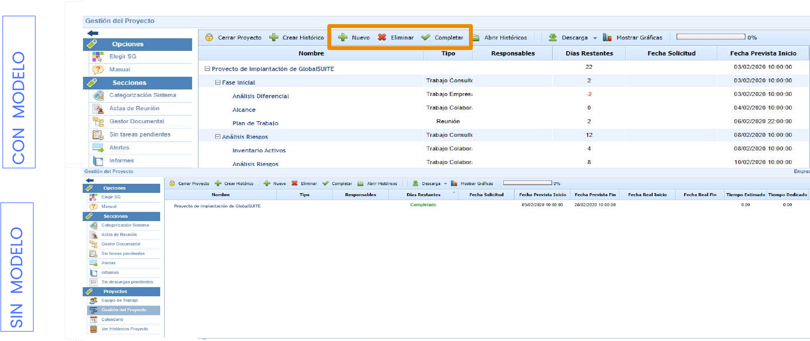 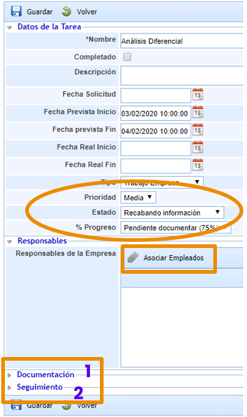

Para editar una tarea, se deberá acceder a su ficha pulsando en el nombre.

Se podrá rellenar todos los campos visibles en la sección “**Datos de la Tarea**”, si bien el único obligatorio viene marcado con un asterisco (\*).

Los campos de Prioridad, Estado y % Progreso se pueden activar/desactivar, debiéndose editar las opciones disponibles desde **Ajustes** (ver punto “**3.** [**Ajustes: Proyectos**](como-crear-y-gestionar-proyectos-en-globalsuite-r.md#3.-Ajustes:-Proyectos)” de esta guía).

También se podrá asociar a la tarea a los empleados que estén registrados en **Gestión >** [**Empleados**](https://help.globalsuitesolutions.com/es/globalsuite/v1/empleados)**.**

En el apartado de **Documentación** se podrá especificar los documentos de los que se disponga para llevar a cabo la tarea. Existe la posibilidad de diferenciar los documentos aportados por la propia empresa de aquellos que aporte la empresa consultora, si la hubiera.

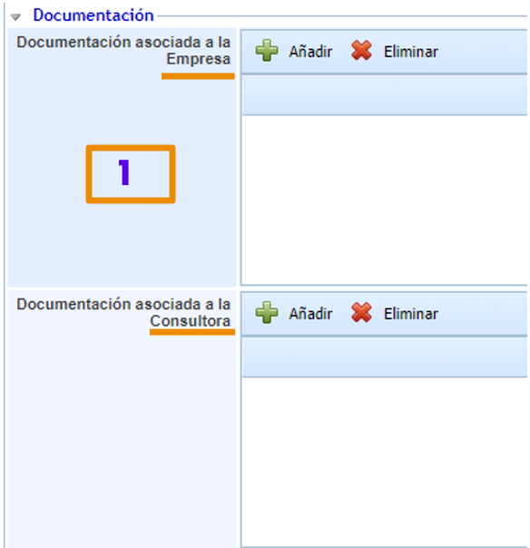

Los campos de la sección de **Seguimiento** son opcionales, se pueden editar u ocultar desde Ajustes (ver punto **“**[**3. Ajustes: Proyectos”**](como-crear-y-gestionar-proyectos-en-globalsuite-r.md#3.-Ajustes:-Proyectos) de esta guía).

Existe la opción de informar de los tiempos y los gastos en los que se ha incurrido al realizar una tarea.

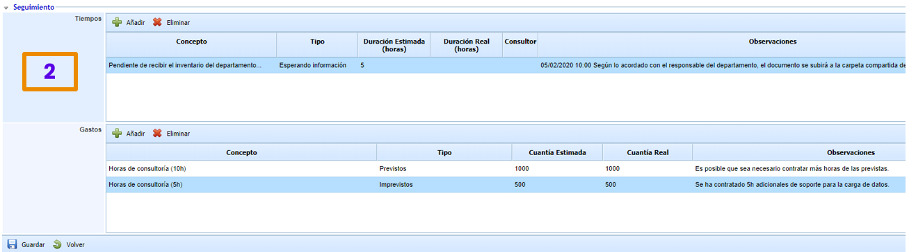

Volviendo al listado de **Gestión del Proyecto** se verá los cambios realizados en el formulario.

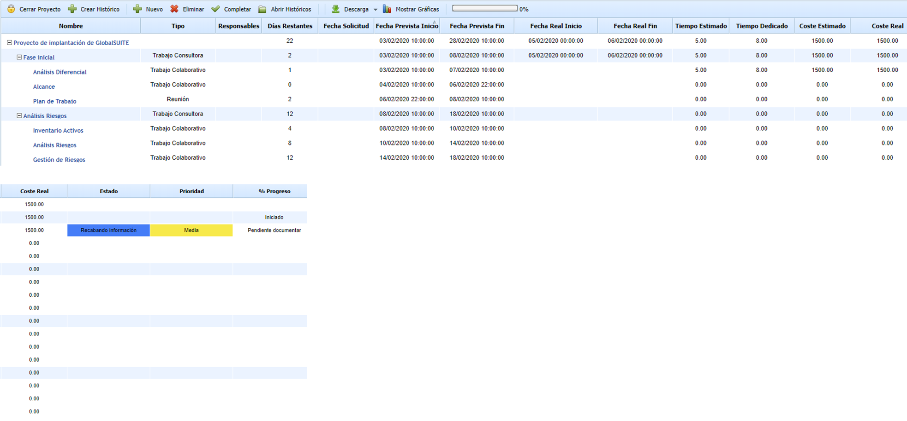

En las opciones disponibles también se incluyen **Mostrar gráficas** y **Descarga**, que permiten visualizar el estado del proyecto y exportar la información en distintos formatos.

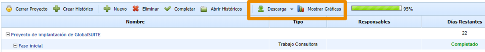

Haciendo click en **Mostrar Gráficas** se verá el estado de las tareas.

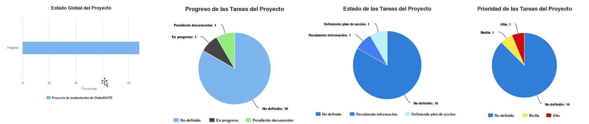

El botón **Descarga** permitiré generar un archivo Excel o PDF con los datos del proyecto que aparecen en esta pantalla.

## 3. Ajustes: Proyectos

En el apartado de **Ajustes** se tiene la opción de configurar algunos de los campos de la ficha de tareas de un proyecto e igualmente de establecer modelos de proyectos.

### Configuración

Siempre que una casilla esté marcada, la opción estará disponible en la ficha de las tareas de un proyecto.

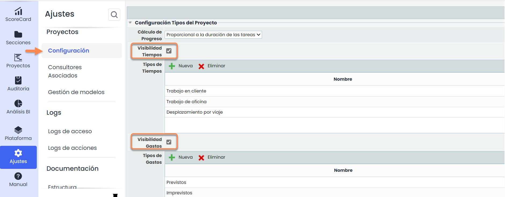

En el caso de las opciones activas, se deberá definir los niveles o tipos que se pueda seleccionar en el momento de rellenar la ficha. Se podrá crear **nuevos** niveles y/o tipos o **eliminar** los existentes, y/o asignarles un color o **cambiar sus niveles de prioridad** cuando estas opciones estén disponibles.

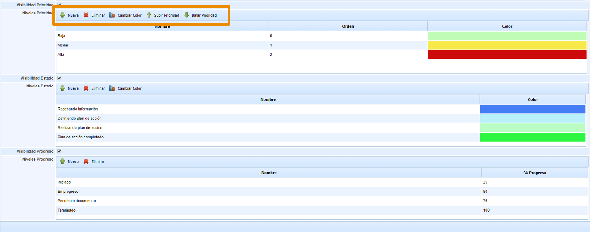

### Gestión de Modelos

En el listado de modelos se podrá **añadir** algunos de los que vienen definidos por defecto (en función del tipo de usuario) o configurar uno desde cero pinchando en **Nuevo**.

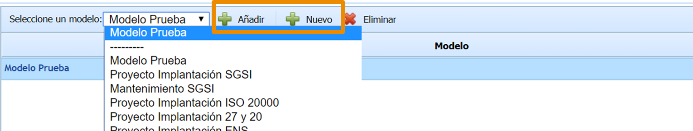

Los modelos servirán como guía preconfigurada y, además de ahorrar tiempo, permitirán la creación de proyectos con estructuras similares.

Para acceder al modelo se deberá pinchar en el **nombre**.

Una vez dentro, se verá la plantilla de tareas y subtareas, el tipo de y la duración expresada en %. Se podrá **añadir, subir o bajar** tareas dentro del árbol al igual que cambiar el **tipo** y el porcentaje de **duración** haciendo doble click sobre dichos campos. Téngase en cuenta que los porcentajes de las subtareas deben sumar entre todos un 100% y, a su vez, los porcentajes de las tareas deben sumar también un 100% con respecto al proyecto.

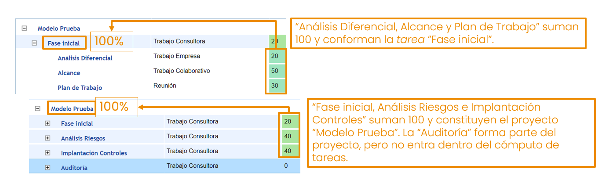

Pinchando en el nombre de una tarea/subtarea, se accederá a su ficha y se tendrá la posibilidad de realizar una preconfiguración del tipo de tarea, **roles y documentación** asociados. Igualmente se podrá editar el **nombre** y añadir una descripción de la tarea.

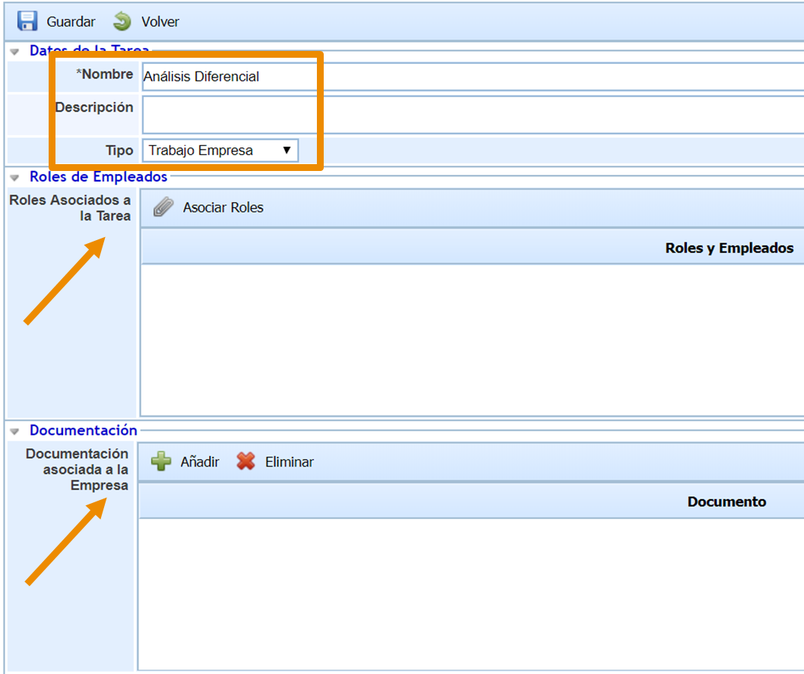

## 4. Calendario

En la sección de [**Calendario**](https://help.globalsuitesolutions.com/es/globalsuite/v1/calendario) se verá la programación de todas las tareas y se podrá filtrar para que aparezcan el inicio y el fin de cada una, sólo el inicio o sólo el fin. Asimismo, se podrá decidir si se quiere ver todas las tareas del proyecto o sólo las que le corresponden al usuario.

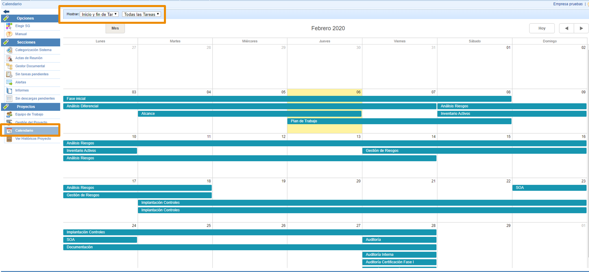

Al hacer doble click en una tarea aparecerá un pop-up con los datos esenciales de la misma.

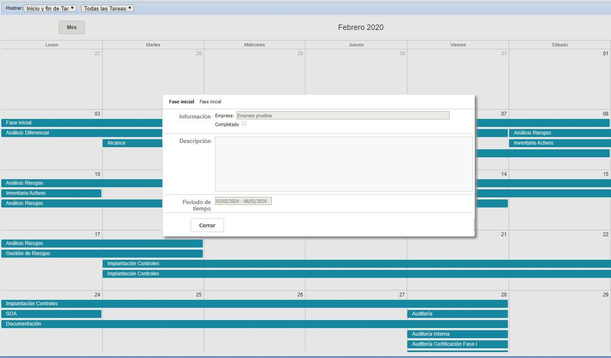

## 5. Históricos

Existe la **posibilidad** de realizar una copia del estado en que se encuentra un proyecto en un momento determinado por medio del botón [**Crear Histórico**](https://help.globalsuitesolutions.com/es/globalsuite/v1/ver-historicos-proyecto). De esta manera se podrá hacer un seguimiento del progreso de las tareas del proyecto. Se puede crear tantos históricos como se necesite y consultarlos a través del botón **Abrir Históricos** dentro de la opción de Gestión de Proyectos.

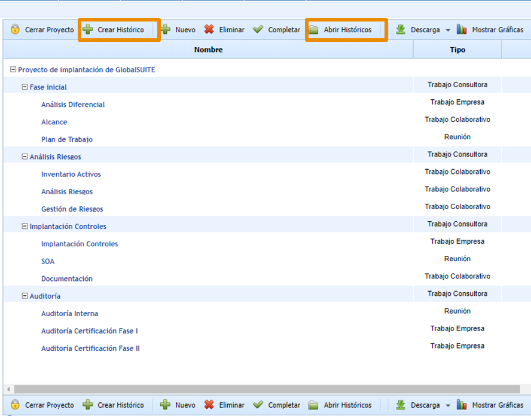

## 6. Históricos del Proyecto

En ambos casos aparecerá un pop-up. Se deberá seleccionar del desplegable el histórico que se quiera consultar. Pinchando en las diferentes tareas se accederá a sus fichas. También se podrá **eliminar** los históricos seleccionados.

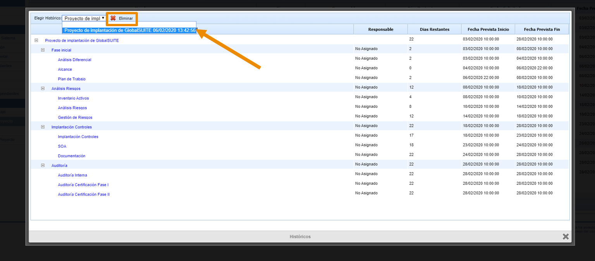

## 7. Finalización del Proyecto

Una vez se haya completado todas las tareas del proyecto, se deberá pinchar en **Cerrar Proyecto**. Este se eliminará de la pantalla de [**Gestión de Proyectos**](https://help.globalsuitesolutions.com/es/globalsuite/v1/gestion-del-proyecto) y pasará **al histórico.**

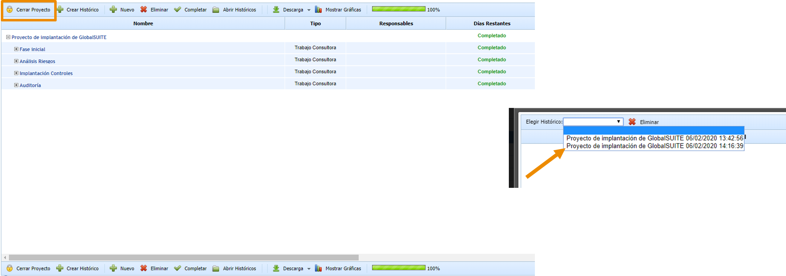
