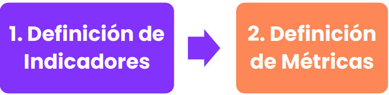
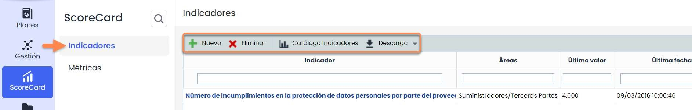
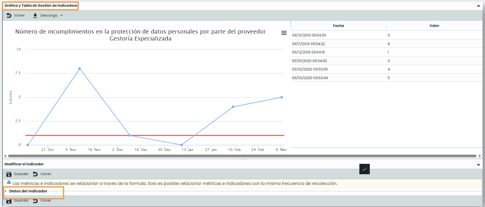
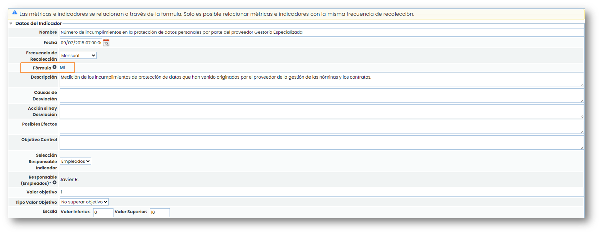
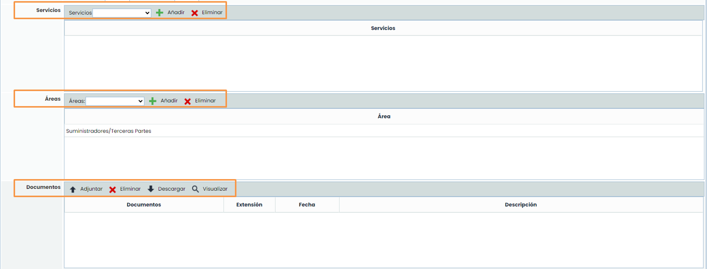
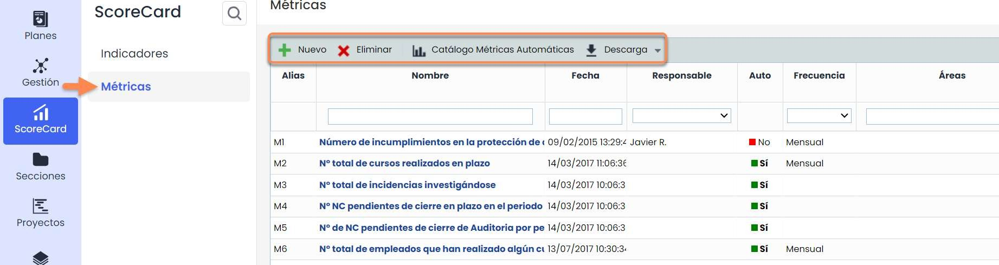
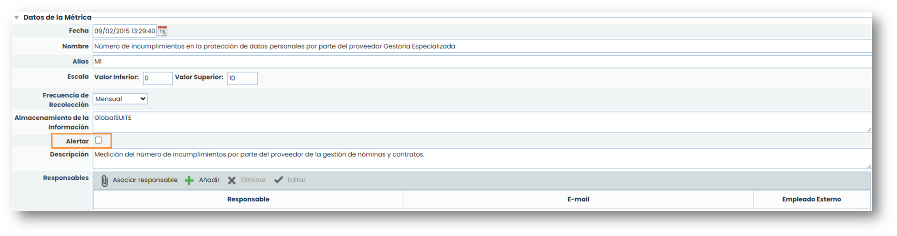
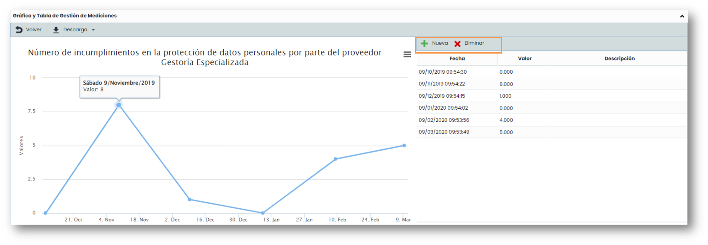
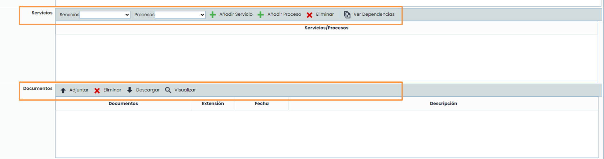

# ¿Cómo crear y gestionar indicadores y métricas en el ScoreCard de GlobalSuite®?


La opción ScoreCard o Cuadro de Mando que proporciona GlobalSuite® permite el cálculo, control y representación de indicadores que ayuden a la definición y el seguimiento de objetivos, así como a evaluar el desempeño de los sistemas de gestión implantados.


## Definición de ScoreCard (Cuadro de Mando)

Dentro de la pestaña “ScoreCard” de GlobalSuite®, tenemos las opciones de “Indicadores” y “Métricas”, para el seguimiento y la evaluación de los objetivos propuestos. A través de ellos GlobalSuite® permite asociar medidas y controles con el fin de verificar si las acciones tomadas acercan a la organización a sus objetivos.

## Indicadores

La primera opción del Cuadro de Mando permite definir “[**Indicadores**](https://help.globalsuitesolutions.com/es/globalsuite/v1/indicadores)” para valorar el progreso y grado de cumplimiento de los KPIs, así como el estado y la tendencia de los Indicadores definidos.

Las opciones que permite la herramienta GlobalSuite® con respecto a los Indicadores, son:

* **Nuevo**: Permite generar nuevos indicadores.
* **Eliminar**: Permite la eliminación de indicadores seleccionados.
* **Catálogo Indicadores**: Listado de indicadores comunes distribuidos por categorías.
* **Descarga**: Permite descargar el listado de indicadores en diferentes formatos.

Existen 2 tipos de indicadores:

* **Manuales**. Consiste en la creación de 0 de un indicador, donde, según la frecuencia elegida, habrá que ir añadiendo valores manualmente a las gráficas de las métricas que correspondan con la fórmula del indicador.
* **Del catálogo.** Son indicadores que vienen por defecto. En el botón “Catálogo Indicadores” se encuentran los que están disponibles. La ventaja es que, al elegir un indicador del catálogo, se crean métricas asociadas a dicho indicador, por lo que no hay que crearlas manualmente.


Nota: Para poder tener datos en un indicador es necesario tener una métrica asociada a este y, para ello, es obligatorio que la métrica y el indicador tengan la misma frecuencia.


Al pulsar en alguno de los indicadores ya creados o al crear uno “**Nuevo**”, se accede a la pantalla de GlobalSuite® que permite caracterizar, representar y evaluar el indicador.

Aparecen dos partes claramente diferenciadas:

* **Gráfica y Tabla de Gestión de Mediciones**: permite visualizar los valores de los indicadores a lo largo del tiempo. Estos valores no se pueden modificar desde los indicadores, ya que son valores que vienen dados por las métricas asociadas.

* **Modificar el indicador:**
  * Datos del indicador: Consiste en un formulario donde se describen los datos principales del indicador. Estos datos incluyen la opción de editar la fórmula para el cálculo del indicador a través de métricas, una descripción, un responsable, un valor objetivo (valor que se quiere conseguir), tipo de valor objetivo (lo que se quiere conseguir con respecto al valor objetivo), entre otras opciones.

Se puede asociar a cada indicador uno o varios servicios, una o varias áreas y cargar uno o varios documentos que sirvan como evidencia de la información registrada.

Para la carga de estos documentos hay que pulsar sobre el botón “**Adjuntar**” y se abrirá una ventana emergente para seleccionar los documentos que se quieren adjuntar que estén en el local (en el ordenador). Adicionalmente se puede poner una descripción a cada documento.

## Métricas

En la opción de “[**Métricas**](https://help.globalsuitesolutions.com/es/globalsuite/v1/metricas)” se definen las medidas y valores usados para definir los indicadores. Al pulsar sobre los enlaces de los nombres de las métricas se accede a opciones para la definición y de las métricas.

Las opciones que permite la herramienta GlobalSuite® son:

* **Nuevo**: Permite generar nuevas Métricas.
* **Eliminar**: Permite eliminar Métricas.
* **Catálogo Métricas Automáticas**: Listado de métricas, distribuidas por categorías, que se pueden obtener de forma automática a partir de información registrada en GlobalSuite®.
* **Descarga:** Permite descargar el listado de Métricas en diferentes formatos.

Existen 2 tipos de métricas:

* **Manuales**: Consiste en la creación de 0 de una métrica, donde, según la frecuencia elegida, habrá que ir añadiendo valores manualmente.
* **Automáticas:** Son métricas que vienen por defecto. En el botón “**Catálogo Métricas Automáticas**” se encuentran los que están disponibles. La ventaja de estas métricas es que recogen los datos directamente de GlobalSuite®, por lo que no hay que introducirlos manualmente.

Al pulsar en alguno de las métricas creadas o al crear una “**Nueva**”, se accede a la pantalla de GlobalSuite® que permite caracterizar, representar la métrica.

Aparecen dos partes claramente diferenciadas:

* **Gráfica y Tabla de Gestión de Mediciones**: permite visualizar los valores de las métricas a lo largo del tiempo.
* **Modificar la métrica:**
  * Datos de la métrica: Consiste en un formulario donde aparece la fecha, nombre, la frecuencia, entre otros campos disponibles. El check de alertar permite que se avise a los responsables de una métrica que deben registrar un valor. Estos responsables se registran en la tabla más abajo.

Para poder asociar una métrica a un indicador la frecuencia de recolección de ambos debe ser la misma.

Las métricas se irán registrando y representando en la **Gráfica y Tabla de Gestión de Mediciones**. Para asignar un nuevo valor a una métrica se debe pulsar la opción “**Nueva**”. Para borrar el dato de una métrica se pulsará la opción “**Eliminar**”.

La fecha se puede modificar pulsando sobre la misma, al igual que para modificar un valor habrá que pulsar sobre el valor que se quiera modificar.

Se puede asociar a cada métrica uno o varios servicios, uno o varios procesos que vayan asociados a dichos servicios, una o varias áreas y cargar uno o varios documentos que sirvan como evidencia de la información registrada.

Para poder asociar un proceso primero hay que **añadir el servicio** del que depende ese proceso. Una vez añadido ya se podrá añadir los procesos que dependan del mismo.

Para la carga de estos documentos hay que pulsar sobre el botón “**Adjuntar**” y se abrirá una ventana emergente para seleccionar los documentos que se quieren adjuntar que estén en el local (en el ordenador). Adicionalmente se puede poner una descripción a cada documento.

