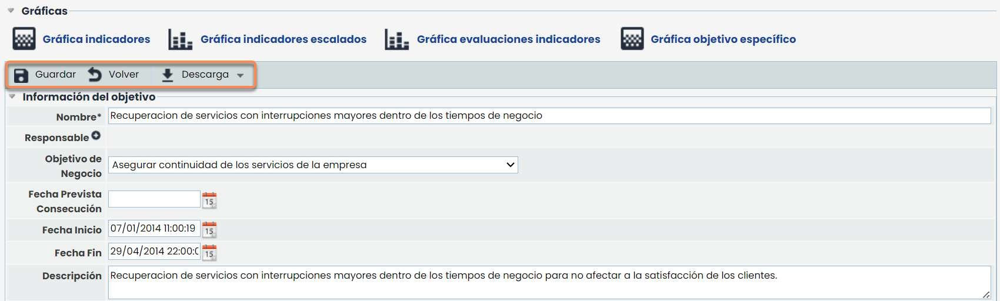
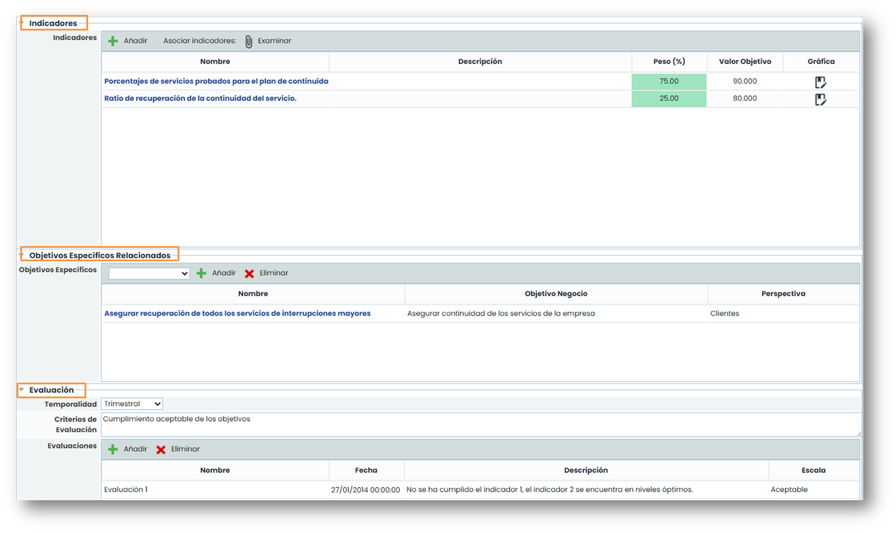
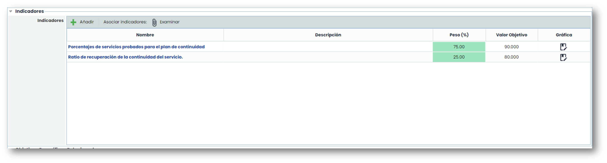
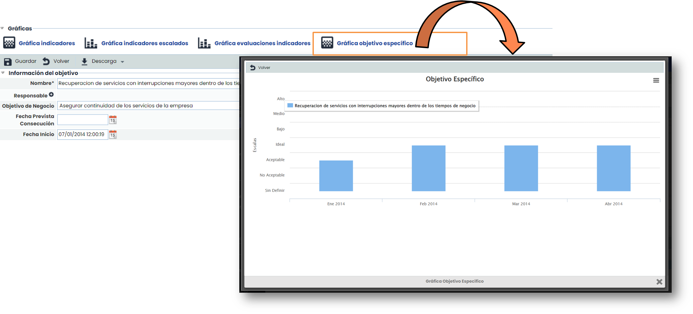

# ¿Cómo definir y calcular los objetivos específicos en el ScoreCard (BSC) de GlobalSuite®?


En este artículo tratamos cómo crear, asociar y evaluar los objetivos específicos dentro del cuadro de mando de GlobalSuite®, vinculándolos con indicadores ponderados y analizando su valor mediante gráficas de rendimiento y rangos configurados en la herramienta.


## Definición de los Objetivos Específicos

En la opción de “Objetivos Específicos” se crean metas concretas cuya consecución garantiza el éxito de la entidad.

Pulsando en el nombre del objetivo, accedemos al formulario que permite detallar, representar gráficamente y actualizar su seguimiento mediante indicadores y evaluaciones periódicas.

Las opciones de GlobalSuite® permiten ejecutar las siguientes acciones:

* **Nuevo**: Permite generar nuevos Objetivos Específicos.
* **Eliminar**: Permite eliminar Objetivos Específicos creados anteriormente.
* **Mostrar**: Permite visualizar solo los objetivos activados o la totalidad de los mismos.
* **Descarga**: Permite descargar el listado de Objetivos Específicos en diferentes formatos.

Pulsando en los objetivos, se accede a la pantalla de GlobalSuite® que permite el registro pormenorizado de los objetivos específicos. El registro consta de cinco apartados:

* **Gráficas**: Representación del desempeño de los Objetivos Específicos mediante la asociación de Indicadores.
* Información del objetivo: Descripción general del objetivo, servicios y áreas asociados, Objetivos de Negocio asociados, etc.
* **Indicadores**: Para cuantificar la evolución en el cumplimiento de los objetivos, se pueden crear y asociar estos parámetros a los Objetivos Específicos de la entidad.
* **Objetivos específicos relacionados**: Otros objetivos específicos asociados.
* **Evaluación**: Donde se describen valoraciones periódicas de los Objetivos Específicos.

## Cálculo del valor de los objetivos específicos

El valor que se calcula es el valor de la gráfica, ya que es donde se puede consultar:

Para empezar, el objetivo específico debe tener indicadores asociados. Dichos indicadores deben tener definido un peso cuya suma sea 100. El valor objetivo que aparece en la tabla es el valor que tiene definido el propio indicador.

Estos indicadores solo podrán ser usados una vez, es decir, una vez que se asocie un indicador a un objetivo específico, ese indicador no aparecerá disponible para usarlo en otro objetivo específico.

1. Teniendo en cuenta los pesos de los indicadores y sus valoraciones, se calcula el objetivo específico. Para poder acceder a la gráfica resultante, hay que pulsar sobre el botón “Gráfica Objetivo Específico” que se encuentra en la parte superior del formulario.
2. Una vez se accede, aparecerá la gráfica con los resultados.

5. Los cálculos que se han realizado son los siguientes:

Se dividen los rangos que se tengan configurados en Ajustes entre 100, para sacar el tamaño del rango. Después, para cada rango se cogería el punto medio. Ejemplo, para un caso de 4 rangos, tendríamos:

* IDEAL: 70-100 (85)
* ACEPTABLE: 40-70 (55)
* NO ACEPTABLE: 10-40 (25)
* SIN DEFINIR: 0-10 (5)

Para calcular el valor del objetivo, se tienen en cuenta tanto los valores de los indicadores como los pesos asignados. Por ejemplo:

Tenemos un Objetivo Específico con 3 Indicadores:

* Indicador A **(Peso 50%): IDEAL (85)**
* Indicador B **(Peso 25%): ACEPTABLE (55)**
* Indicador C **(Peso 25%): IDEAL (85)**

Para el cálculo del Objetivo Específico, se haría la siguiente operación: **85x0,5 + 55x0,25 + 85x0,25 = 77,5**

Por tanto, el 77,5 cae en el rango IDEAL (70-100).
