# ¿Cómo definir y evaluar objetivos en el ScoreCard (BSC) de GlobalSuite®?


En este artículo tratamos cómo configurar el cuadro de mando integral de GlobalSuite®, definiendo objetivos de negocio y específicos, indicadores y métricas, y cómo evaluar su cumplimiento mediante gráficas, evaluaciones periódicas y el mapa estratégico para analizar el rendimiento organizacional.


* 1 [Definición de ScoreCard](como-definir-y-evaluar-objetivos-en-el-scorecard-bsc-de-globalsuite-r.md#id-¿CómodefiniryevaluarobjetivosenelScoreCard\(BSC\)deGlobalSuite®?-DefinicióndeScoreCard)
  * 1.1 [Definición de los Objetivos de Negocio](como-definir-y-evaluar-objetivos-en-el-scorecard-bsc-de-globalsuite-r.md#id-¿CómodefiniryevaluarobjetivosenelScoreCard\(BSC\)deGlobalSuite®?-DefinicióndelosObjetivosdeNegocio)
  * 1.2 [Definición de los Objetivos Específicos](como-definir-y-evaluar-objetivos-en-el-scorecard-bsc-de-globalsuite-r.md#id-¿CómodefiniryevaluarobjetivosenelScoreCard\(BSC\)deGlobalSuite®?-DefinicióndelosObjetivosEspecíficos)
  * 1.3 [Configuración ScoreCard](como-definir-y-evaluar-objetivos-en-el-scorecard-bsc-de-globalsuite-r.md#id-¿CómodefiniryevaluarobjetivosenelScoreCard\(BSC\)deGlobalSuite®?-ConfiguraciónScoreCard)
  * 1.4 [Definición de los Indicadores](como-definir-y-evaluar-objetivos-en-el-scorecard-bsc-de-globalsuite-r.md#id-¿CómodefiniryevaluarobjetivosenelScoreCard\(BSC\)deGlobalSuite®?-DefinicióndelosIndicadores)
  * 1.5 [Definición de las Métricas](como-definir-y-evaluar-objetivos-en-el-scorecard-bsc-de-globalsuite-r.md#id-¿CómodefiniryevaluarobjetivosenelScoreCard\(BSC\)deGlobalSuite®?-DefinicióndelasMétricas)
* 2 [Evaluación del Cuadro de Mando (ScoreCard)](como-definir-y-evaluar-objetivos-en-el-scorecard-bsc-de-globalsuite-r.md#id-¿CómodefiniryevaluarobjetivosenelScoreCard\(BSC\)deGlobalSuite®?-EvaluacióndelCuadrodeMando\(ScoreCard\))
  * 2.1 [Evaluación de Métricas](como-definir-y-evaluar-objetivos-en-el-scorecard-bsc-de-globalsuite-r.md#id-¿CómodefiniryevaluarobjetivosenelScoreCard\(BSC\)deGlobalSuite®?-EvaluacióndeMétricas)
  * 2.2 [Evaluación de los Indicadores](como-definir-y-evaluar-objetivos-en-el-scorecard-bsc-de-globalsuite-r.md#id-¿CómodefiniryevaluarobjetivosenelScoreCard\(BSC\)deGlobalSuite®?-EvaluacióndelosIndicadores)
  * 2.3 [Evaluación de los Objetivos Específicos](como-definir-y-evaluar-objetivos-en-el-scorecard-bsc-de-globalsuite-r.md#id-¿CómodefiniryevaluarobjetivosenelScoreCard\(BSC\)deGlobalSuite®?-EvaluacióndelosObjetivosEspecíficos)
  * 2.4 [Evaluación de los Objetivos de Negocio](como-definir-y-evaluar-objetivos-en-el-scorecard-bsc-de-globalsuite-r.md#id-¿CómodefiniryevaluarobjetivosenelScoreCard\(BSC\)deGlobalSuite®?-EvaluacióndelosObjetivosdeNegocio)
  * 2.5 [Todos los Indicadores](como-definir-y-evaluar-objetivos-en-el-scorecard-bsc-de-globalsuite-r.md#id-¿CómodefiniryevaluarobjetivosenelScoreCard\(BSC\)deGlobalSuite®?-TodoslosIndicadores)
  * 2.6 [Mapa Estratégico](como-definir-y-evaluar-objetivos-en-el-scorecard-bsc-de-globalsuite-r.md#id-¿CómodefiniryevaluarobjetivosenelScoreCard\(BSC\)deGlobalSuite®?-MapaEstratégico)

## Definición de ScoreCard

La opción [**ScoreCard**](https://help.globalsuitesolutions.com/es/globalsuite/v1/scorecard) o **Cuadro de Mando** que proporciona GlobalSuite®, permite el cálculo, control y representación de indicadores que ayuden a la definición y el seguimiento de objetivos, así como a evaluar el desempeño de los sistemas de gestión implantados.

Dentro de la pestaña “**ScoreCard**” de GlobalSuite®, tenemos las opciones de **“**[**Objetivos de Negocio**](https://help.globalsuitesolutions.com/es/globalsuite/v1/objetivos-de-negocio)**”** y **“**[**Objetivos Específicos**](https://help.globalsuitesolutions.com/es/globalsuite/v1/objetivos-especificos)**”**, para la definición, la consulta y el seguimiento de las metas propuestas por la entidad a varios niveles de la organización.

Para el seguimiento y la evaluación de los objetivos propuestos, GlobalSuite® permite mediante las pestañas **“Indicadores” y “Métricas”**, asociar medidas y controles con el fin de verificar si las acciones tomadas acercan a la organización a sus objetivos.

Para la completa evaluación de los objetivos, GlobalSuite® permite en la opción **“Todos los indicadores”** una representación gráfica de los indicadores definidos con anterioridad, proporcionando así un análisis rápido e intuitivo del progreso de la organización con respecto a las metas planeadas.

Finalmente, la opción **“Mapa Estratégico”** permite identificar las diferentes correlaciones entre los Objetivos Específicos definidos, así como visualizar el estado de cada uno de los objetivos.

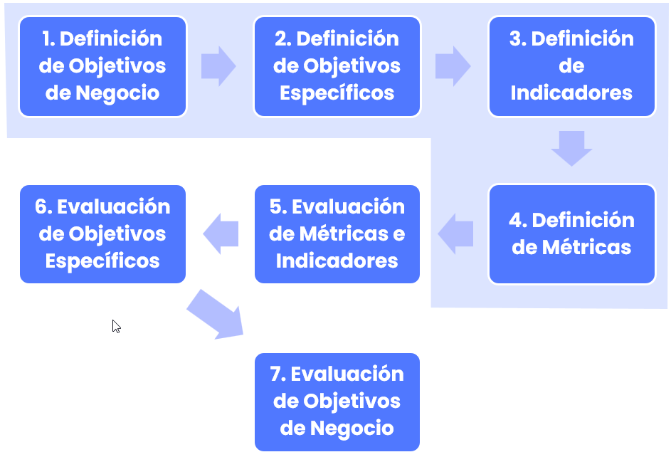

### Definición de los Objetivos de Negocio

Para comenzar a definir los objetivos se debe seleccionar la opción “[**Objetivos de Negocio**](https://help.globalsuitesolutions.com/es/globalsuite/v1/objetivos-de-negocio)” dentro de la sección “[**ScoreCard**](https://help.globalsuitesolutions.com/es/globalsuite/v1/scorecard)”. Al acceder a la opción “[**Objetivos de Negocio**](https://help.globalsuitesolutions.com/es/globalsuite/v1/objetivos-de-negocio)” aparecen los objetivos generales de la entidad.

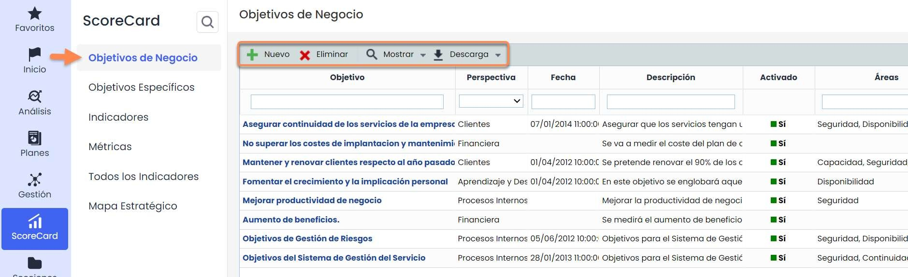

Como parte de la pantalla principal, GlobalSuite® permite ejecutar las siguientes acciones:

* **Nuevo**: Permite generar nuevos Objetivos de Negocio.
* **Eliminar**: Permite Objetivos de Negocio ya existentes.
* **Mostrar**: Permite visualizar solo los objetivos activados o la totalidad de los mismos.
* **Descarga**: Permite descargar el listado de Objetivos de Negocio en diferentes formatos

Una vez se ha creado un nuevo objetivo de negocio mediante el botón “**Nuevo**”, pulsando sobre el enlace asociado al nombre del objetivo se accede a un formulario donde se puede registrar la información relativa al objetivo. La pantalla de objetivos se divide en tres partes:

* **Gráficas**: Representación del desempeño de los Objetivos de Negocio mediante la asociación de Objetivos Específicos.
* **Información del objetivo**: Descripción general del objetivo, servicios y áreas asociados, Objetivos Específicos relacionados, etc.
* **Evaluación**: donde se describen valoraciones periódicas de los Objetivos de Negocio.

Una vez que se haya registrado la información, es necesario pulsar sobre el botón “**Guardar**” para almacenar los cambios. Para regresar al listado se debe pulsar el botón “**Volver**”.

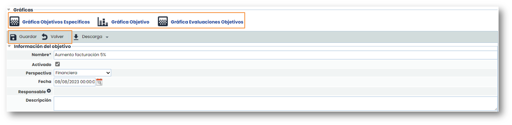

### Definición de los Objetivos Específicos

En la opción de “[**Objetivos Específicos**](https://help.globalsuitesolutions.com/es/globalsuite/v1/objetivos-especificos)” se crean metas concretas cuya consecución garantiza el éxito del objetivo de negocio relacionado. Pulsando en el nombre del objetivo, accedemos al formulario que permite detallar, representar gráficamente y actualizar su seguimiento mediante indicadores y evaluaciones periódicas.

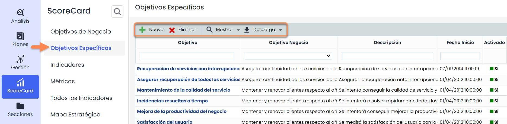

Las opciones de GlobalSuite® permiten ejecutar las siguientes acciones:

* **Nuevo**: Permite generar nuevos Objetivos Específicos.
* **Eliminar**: Permite eliminar Objetivos Específicos creados anteriormente.
* **Mostrar**: Permite visualizar solo los objetivos activados o la totalidad de los mismos.
* **Descarga**: Permite descargar el listado de Objetivos Específicos en diferentes formatos

Pulsando en los objetivos, se accede a la pantalla de GlobalSuite® que permite el registro pormenorizado de los objetivos específicos. El registro consta de cinco apartados:

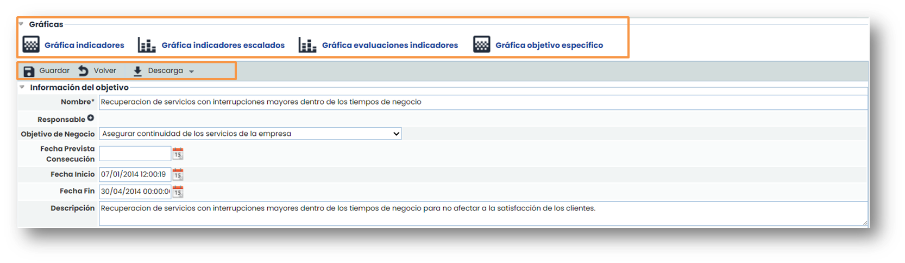

* **Gráficas**: Representación del desempeño de los Objetivos Específicos mediante la asociación de Indicadores.
* **Información del objetivo**: Descripción general del objetivo, servicios y áreas asociados, Objetivos de Negocio asociados, etc.
* **Indicadores**: Para cuantificar la evolución en el cumplimiento de los objetivos, se pueden crear y asociar estos parámetros a los Objetivos Específicos de la entidad.
* **Objetivos específicos relacionados**: Otros objetivos específicos asociados.
* **Evaluación**: Donde se describen valoraciones periódicas de los Objetivos Específicos.

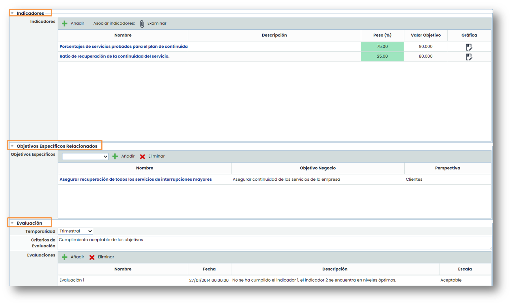

### Configuración ScoreCard

Esta opción de ScoreCard se encuentra en **Ajustes >** [**Configuración ScoreCard.**](https://help.globalsuitesolutions.com/es/globalsuite/v1/configuracion-scorecard)

Aquí se podrá configurar las diferentes opciones de perspectivas que aparece en los objetivos de negocio.

Además de ello, también se pueden configurar las escalas para la evaluación de los diferentes objetivos.

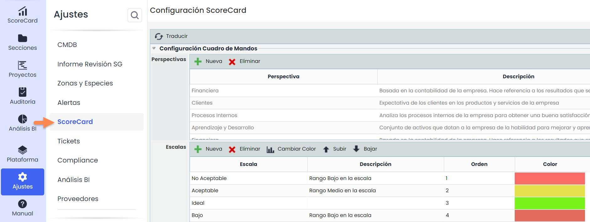

### Definición de los Indicadores

La tercera opción del Cuadro de Mando permite definir “[**Indicadores**](https://help.globalsuitesolutions.com/es/globalsuite/v1/indicadores)**”** para valorar el progreso y grado de cumplimiento de los Objetivos Específicos relacionados, así como el estado y la tendencia de los Indicadores. definidos

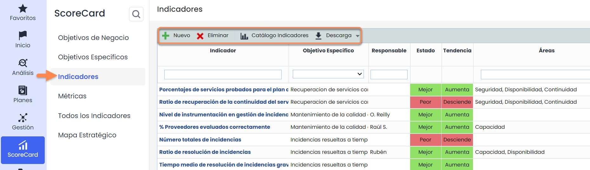

Las opciones que permite la herramienta GlobalSuite® con respecto a los Indicadores, son:

* **Nuevo**: Permite generar nuevos indicadores.
* **Eliminar**: Permite la eliminación de indicadores.
* **Catálogo Indicadores:** Listado de indicadores comunes distribuidos por categorías.
* **Descarga**: Permite descargar un listado de indicadores en diferentes formatos.

Existen 2 tipos de indicadores:

* **Manuales**. Consiste en la creación de 0 de un indicador, donde, según la frecuencia elegida, habrá que ir añadiendo valores manualmente a las gráficas de las métricas que correspondan con la fórmula del indicador.
* **Del catálogo.** Son indicadores que vienen por defecto. En el botón “**Catálogo Indicadores**” se encuentran los que están disponibles. La ventaja es que, al elegir un indicador del catálogo, se crean métricas asociadas a dicho indicador, por lo que no hay que crearlas manualmente.


Nota: Para poder tener datos en un indicador es \*\*necesario\*\* tener una métrica asociada a este y, para ello, es obligatorio que la métrica y el indicador tengan la misma frecuencia.


Al pulsar en alguno de los indicadores, se accede a la pantalla de GlobalSuite® que permite caracterizar, representar y evaluar el indicador.

Aparecen dos partes claramente diferenciadas:

* **Gráfica y Tabla de Gestión de Mediciones**: permite visualizar los valores de los indicadores a lo largo del tiempo. Los valores son automáticos en función de las métricas que formen parte del indicador.
* **Modificar el indicador**:
  * Datos del indicador: Consiste en un formulario donde se describen los datos principales del indicador. Estos datos incluyen la opción de editar la fórmula para el cálculo del indicador a través de métricas, el “peso” del indicador dentro de su Objetivo Específico o el valor objetivo a alcanzar, entre otras opciones.
  * Evaluación: Gestiona el cálculo de valoraciones automáticas del indicador.

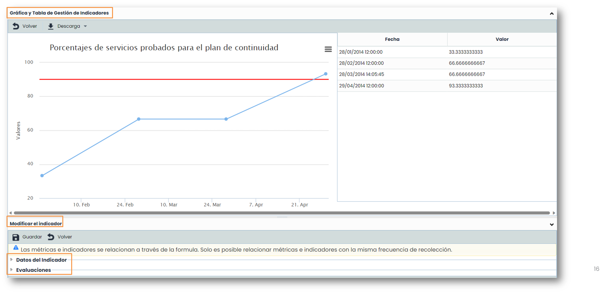 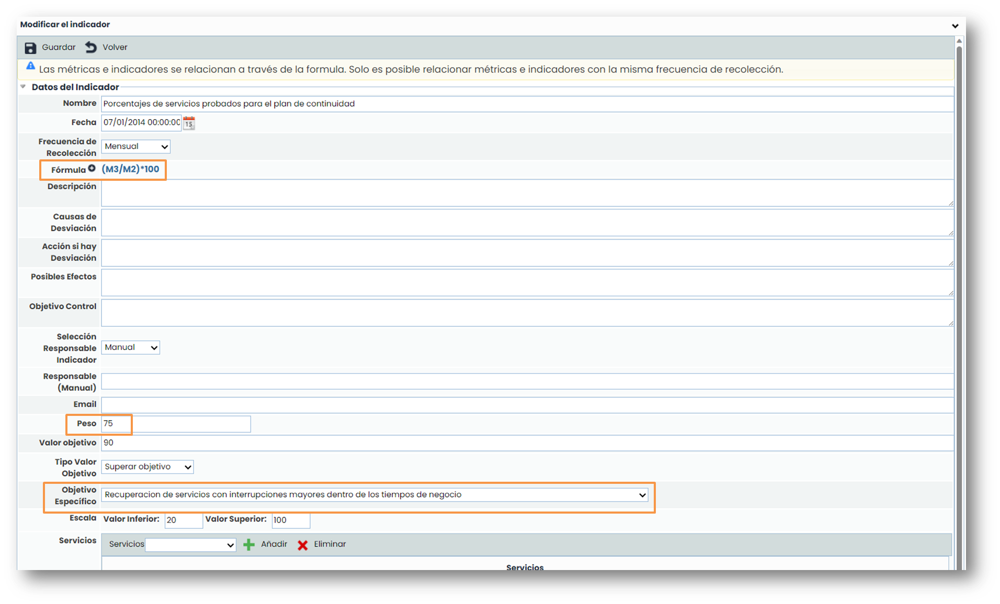

Se puede asociar a cada indicador uno o varios **servicios**, una o varias **áreas** y cargar uno o varios **documentos** que sirvan como evidencia de la información registrada.

Para la carga de estos documentos hay que pulsar sobre el botón “**Adjuntar**” y se abrirá una ventana emergente para seleccionar los documentos que se quieren adjuntar que estén en el local (en el ordenador). Adicionalmente se puede poner una descripción a cada documento.

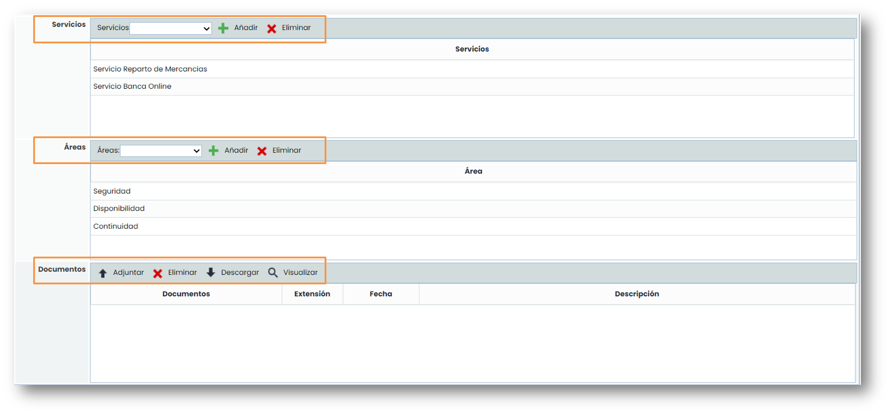

### Definición de las Métricas

En la opción de “[**Métricas**](https://help.globalsuitesolutions.com/es/globalsuite/v1/metricas)” se definen las medidas y valores usados para definir los indicadores. Al pulsar sobre los enlaces de los nombres de las métricas se accede a opciones para la definición y de las métricas.

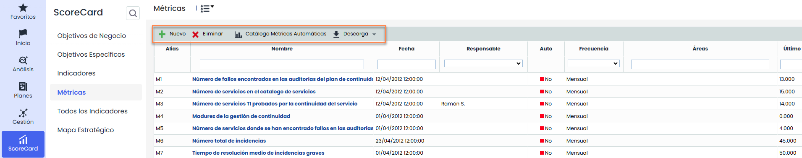

Las opciones que permite la herramienta GlobalSuite® son:

* **Nuevo**: Permite generar nuevas Métricas.
* **Eliminar**: Permite eliminar Métricas.
* **Catálogo Métricas Automáticas:** listado de métricas, distribuidas por categorías, que se pueden obtener de forma automática a partir de información registrada en GlobalSuite®.
* **Descarga:** Permite descargar el listado de Métricas en diferentes formatos.

Existen 2 tipos de métricas:

* **Manuales**. Consiste en la creación de 0 de una métrica, donde, según la frecuencia elegida, habrá que ir añadiendo valores manualmente.
* **Automáticas**. Son métricas que vienen por defecto. En el botón “**Catálogo Métricas Automáticas**” se encuentran los que están disponibles. La ventaja de estas métricas es que recogen los datos directamente de GlobalSuite®, por lo que no hay que introducirlos manualmente.

Al pulsar en alguno de las métricas creadas o al crear una “**Nueva**”, se accede a la pantalla de GlobalSuite® que permite caracterizar, representar la métrica. Aparecen dos partes claramente diferenciadas:

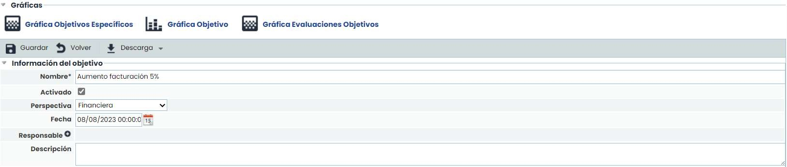

* **Gráfica y Tabla de Gestión de Mediciones:** permite visualizar los valores de las métricas a lo largo del tiempo.
* **Modificar la métrica:**
  * **Datos de la métrica**: Consiste en un formulario donde aparece la fecha, nombre, la frecuencia, entre otros campos disponibles. El check de alertar permite que se avise a los responsables de una métrica que deben registrar un valor.

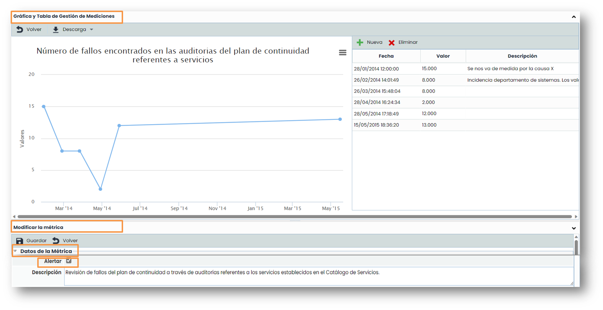

Una vez se ha accedido dentro de una métrica, se pueden asignar valores de forma periódica. Las métricas se irán registrando y **representando en la Gráfica y Tabla de Gestión de Mediciones**. Para asignar un nuevo valor a una métrica se debe pulsar la opción “**Nueva**”. Para borrar el dato de una métrica se pulsará la opción “**Eliminar**”.

Para poder asociar una métrica a un indicador, la frecuencia de ambos debe ser la misma.

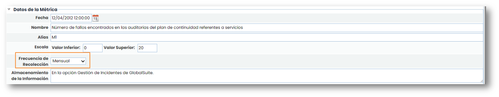

Se puede asociar a cada métrica uno o varios servicios, uno o varios procesos que vayan asociados a dichos servicios, una o varias áreas y cargar uno o varios documentos que sirvan como evidencia de la información registrada.

Para poder asociar un proceso primero hay que añadir el servicio del que depende ese proceso. Una vez añadido ya se podrá añadir los procesos que dependan del mismo.

Para la carga de estos documentos hay que pulsar sobre el botón “Adjuntar” y se abrirá una ventana emergente para seleccionar los documentos que se quieren adjuntar que estén en el local (en el ordenador). Adicionalmente se puede poner una descripción a cada documento.

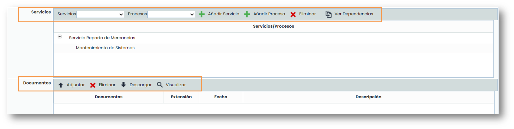

## Evaluación del Cuadro de Mando (ScoreCard)

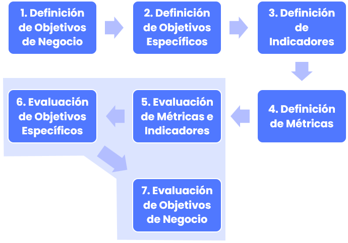

### Evaluación de Métricas

En la fase de evaluación el proceso que se sigue es el inverso a la definición. La evaluación se realizará desde los elementos más específicos (“**Métricas**”) a los más generales (“**Objetivos de Negocio**”).

La valoración de métricas se realiza accediendo a la opción de Métricas e introducción las valoraciones de dichas métricas en la tabla de valores en la fecha correspondiente.

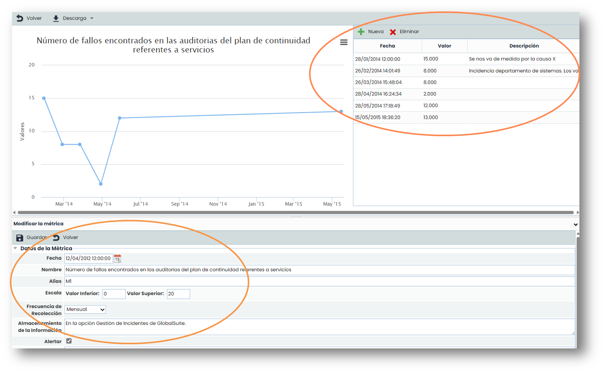

### Evaluación de los Indicadores

Para la evaluación de Indicadores y Objetivos se procede de forma inversa a la definición de los mismos, interactuando con la herramienta ascendiendo en el cuadro de mando por las opciones de “**Indicadores**”, “**Objetivos Específicos**” y “**Objetivos de Negocio**”.

Cuando se accede a un indicador concreto de la opción “**Indicadores**”, se pueden calcular los valores de dicho indicador a través de fórmulas matemáticas, cuyas variables serán las métricas definidas anteriormente. A continuación, se evalúa el indicador en el apartado **Evaluaciones**, lo que permite la representación automática del indicador pulsando en **Recalcular**. Se representarán tantos datos del indicador como medidas tengan las Métricas asociadas en la fórmula.


Nota: La periodicidad entre métricas e indicadores relacionados debe ser la misma.


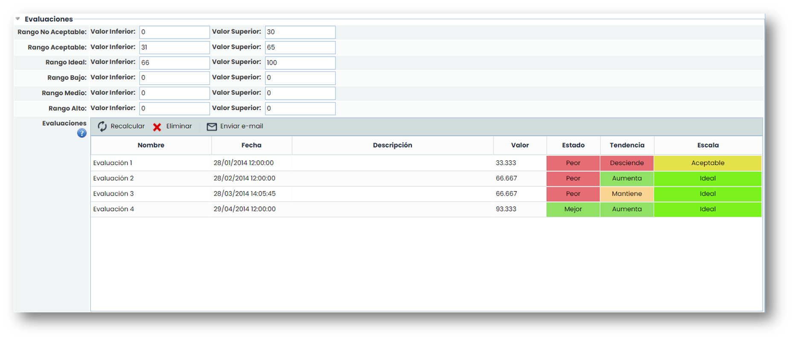 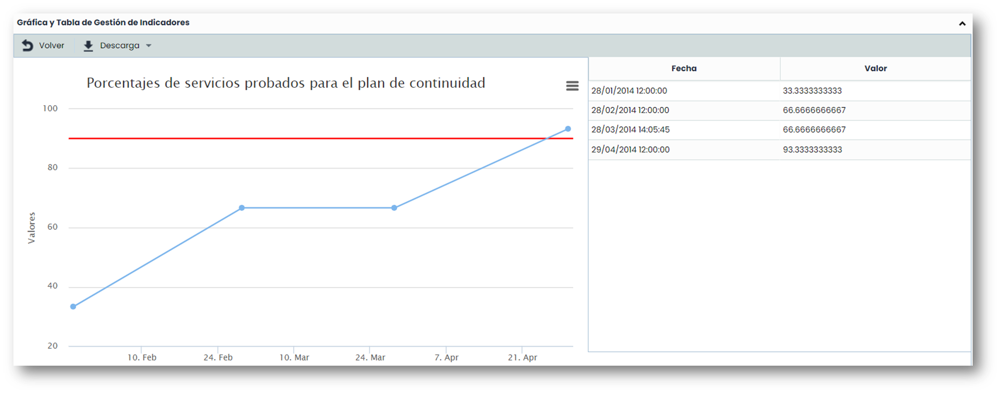

### Evaluación de los Objetivos Específicos

Una vez calculados los indicadores, al acceder a un Objetivo Específico, se podrán visualizar las gráficas de los indicadores y Objetivos Específicos

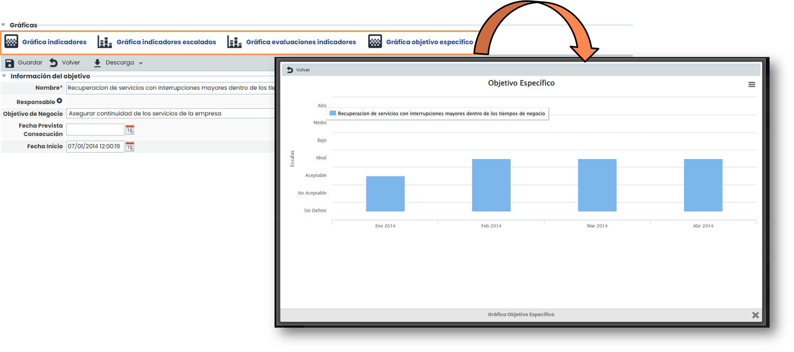

Las evaluaciones de los Objetivos Específicos permiten dejar registro de las evaluaciones de cumplimiento realizadas sobre el objetivo específico definido así como su periodicidad. Se tiene la opción de:

* **Añadir**: Permite generar un nuevo registro de evaluación.
* **Eliminar**: Permite eliminar un registro de evaluación generado de forma previa.

Una vez vistas las gráficas resultantes del objetivo se tendrá que rellenar la tabla de Evaluaciones con los datos obtenidos.


Nota: La temporalidad de los Objetivos Específicos e Indicadores relacionados debe ser la misma.


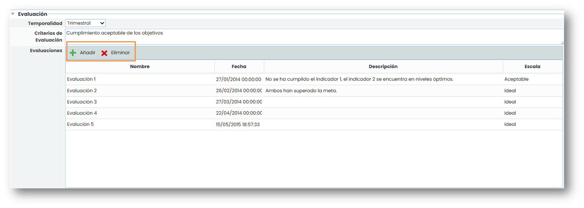

### Evaluación de los Objetivos de Negocio

Una vez que se haya rellenado la tabla de evaluaciones de **Objetivos Específicos** ya se podrían ver las gráficas con los resultados de los **Objetivos de Negocio**.

Finalmente, al igual que con los Objetivos Específicos, GlobalSuite® permite evaluar los Objetivos de Negocio definidos, concretando en el apartado frecuencia la periodicidad de las valoraciones. Las evaluaciones se crean y se eliminan mediante las opciones **Añadir** y **Eliminar**.


Nota: La frecuencia de los objetivos de negocio y los objetivos específicos relacionados debe ser la misma.


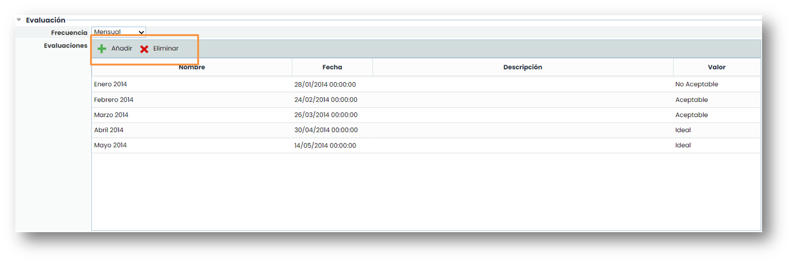

### Todos los Indicadores

En la opción “[**Todos los Indicadores**](https://help.globalsuitesolutions.com/es/globalsuite/v1/todos-los-indicadores)” se representan todos los indicadores que han sido definidos mediante las métricas correspondientes. Se permite filtrar por un objetivo específico concreto para consultar sus indicadores.

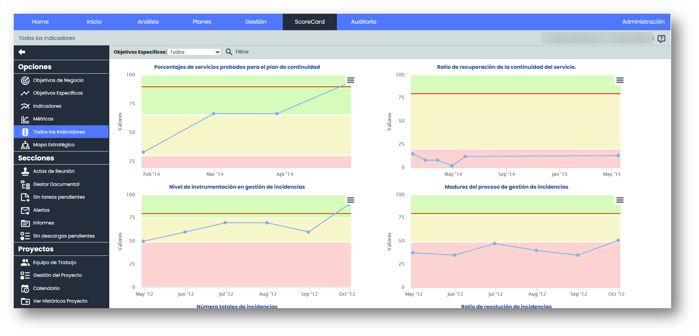


Nota: En la representación gráfica aparecen los colores que corresponden con los estados definidos para los valores obtenidos.


### Mapa Estratégico

Esta última opción de la pestaña ScoreCard> [**Mapa Estratégico**](https://help.globalsuitesolutions.com/es/globalsuite/v1/mapa-estrategico) nos permite visualizar las relaciones entre los Objetivos Específicos en función de las distintas perspectivas de los Objetivos de Negocio. El color representa el estado de la última evaluación realizada en el Objetivo Específico.

Pulsando el click derecho sobre uno de los objetivos, nos permite visualizar las gráficas asociadas.

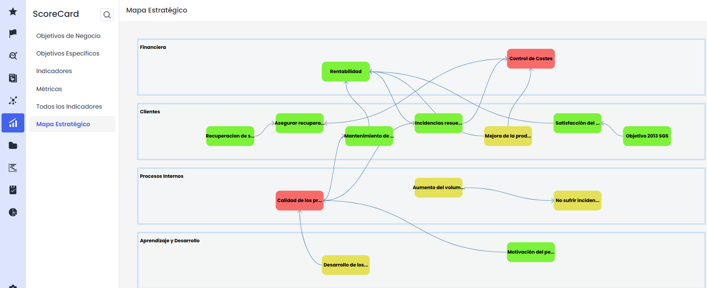
