# ¿Cómo propagar y consolidar el ScoreCard en GlobalSuite®?


En este artículo tratamos cómo utilizar las funciones de \*\*Propagación\*\* y \*\*Consolidación\*\* del ScoreCard en GlobalSuite®, para enviar objetivos, indicadores y métricas a entidades subordinadas, mantener su trazabilidad y consolidar resultados entre la empresa matriz y sus subentidades de forma centralizada.


## Propagación

La funcionalidad de propagación aparece en aquellos entornos que dispongan de licenciamiento con entidades.

Propagar es la acción de enviar objetivos, indicadores y/o métricas a las entidades que se encuentran por debajo de nuestra empresa.

En esta guía se explica la propagación de:

* [Objetivos de Negocio.](https://help.globalsuitesolutions.com/es/globalsuite/v1/objetivos-de-negocio)
* [Objetivos Específicos.](https://help.globalsuitesolutions.com/es/globalsuite/v1/objetivos-especificos)
* [Indicadores](https://help.globalsuitesolutions.com/es/globalsuite/v1/indicadores).
* [Métricas](https://help.globalsuitesolutions.com/es/globalsuite/v1/metricas).

### Propagación - Objetivos de Negocio

Actualmente, el botón de propagación sólo está en los [**Objetivos**](https://help.globalsuitesolutions.com/es/globalsuite/v1/objetivos) que se encuentran en la opción de Inicio. Los pasos para crear y propagar un objetivo, con sus objetivos asociados, son:

1. Crear el objetivo en Inicio -> Objetivos, y rellenar su información.
2. En el formulario del Objetivo, pulsar el botón “**Incluir BSC**”, para que aparezca en las dos opciones.
3. Propagar el Objetivo a las entidades deseadas.

A partir de ese momento, en las entidades hijas, esos objetivos no se pueden modificar, sino que tendrán la misma información que sus padres, excepto los campos específicos de las entidades hijas: Activado, Perspectiva, Objetivos Específicos, Documentos, Frecuencia y Evaluaciones.


Nota: Si se eliminan en el padre, en los hijos también se eliminan.


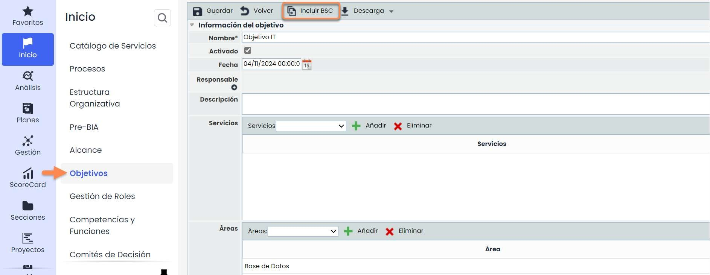

Una vez incluido en BSC, aparecerá también en [**Objetivos de Negocio**](https://help.globalsuitesolutions.com/es/globalsuite/v1/objetivos-de-negocio). Donde habrá que rellenar el resto de información faltante, como la perspectiva.

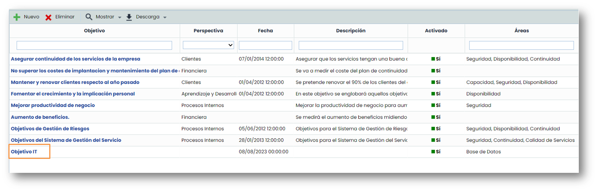

Una vez creado e incluido en BSC, se vuelve a Inicio > Objetivos, y se propaga.

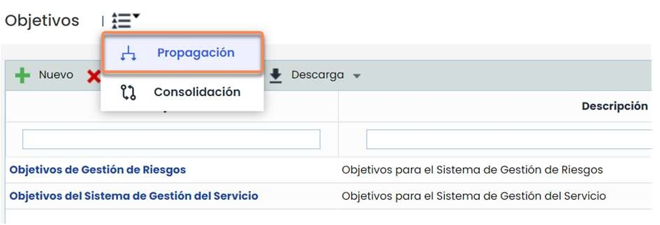

Para ello hay que seleccionar la opción de Propagación, y marcar los objetivos que se quieren y las entidades donde se quiere propagar.

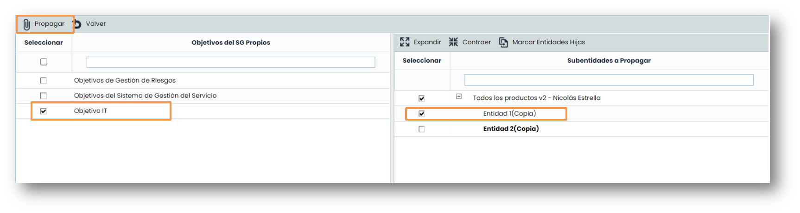

### Propagación - Objetivos Específicos

Los [Objetivos Específicos.](https://help.globalsuitesolutions.com/es/globalsuite/v1/objetivos-especificos) se propagan la 1ª vez (si se propaga su Objetivo de Negocio), pero luego son autónomos en las entidades hijas, es decir, realmente se hacen **COPIAS**.

Por tanto, al funcionar de forma autónoma en los hijos, se pueden editar todos los campos en las entidades hijas (nombre, fechas, descripción, etc).


Nota: Si se eliminan en el padre, en los hijos no afecta para nada.


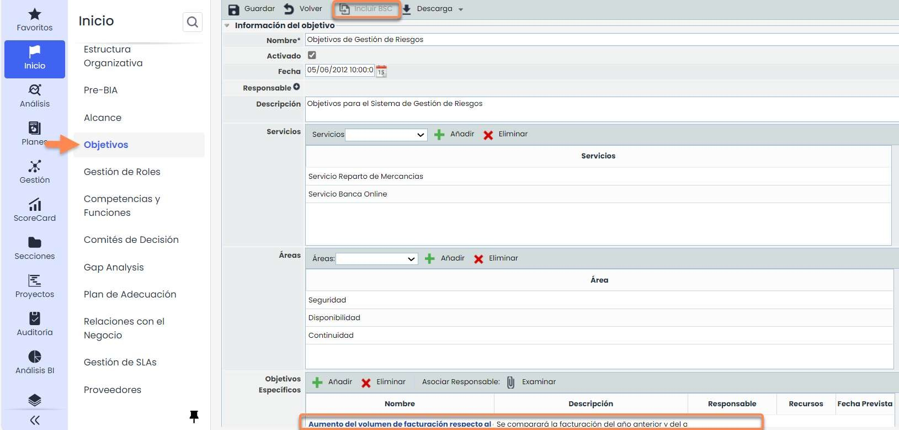 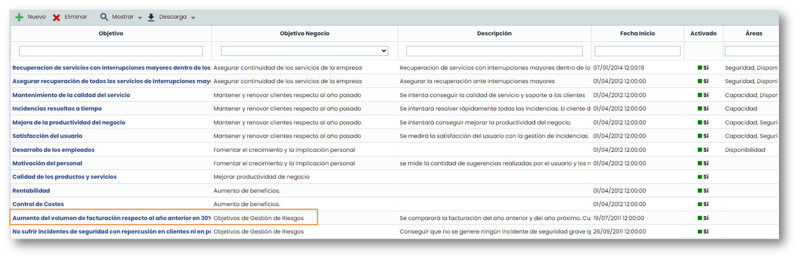

Como el Objetivo que se ha creado tiene Objetivos Específicos y Objetivo de Negocio, la forma para Propagarlo es la misma que si solo tuviese Objetivo de Negocio.

Para ello hay que seleccionar la opción de Propagación, y marcar los objetivos que se quieren y las entidades donde se quiere propagar, y pulsar sobre el botón **Propagar**.

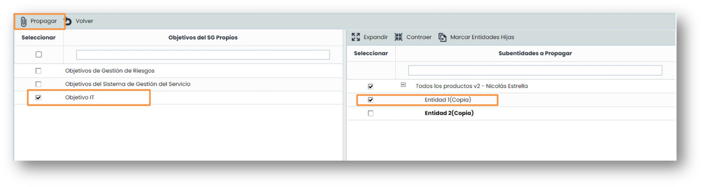

### Propagación - Indicadores

Una vez propagados, en las entidades hijas **se pueden modificar**, y las modificaciones que se hagan en la empresa padre no afectan a las hijas (es decir, son independientes). Sin embargo, siguen manteniendo una relación interna que permite visualizar correctamente la CONSOLIDACIÓN.


Nota: Si en la empresa padre, se eliminan desde el LISTADO, en las hijas se quedan de forma autónoma (independiente). Si se elimina desde el formulario de PROPAGACIÓN (tabla inferior derecha), se elimina en esa entidad y en sus hijas.


Para propagar un indicador hay que seguir los siguientes pasos:

1. Entrar en la opción de [**Indicadores**](https://help.globalsuitesolutions.com/es/globalsuite/v1/indicadores).
2. Entrar en la opción de **Propagación**.

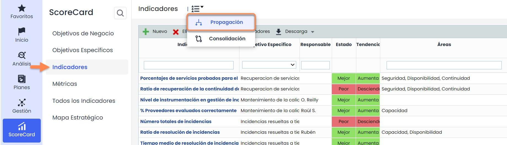

Una vez dentro hay que seleccionar los indicadores que se quieran propagar y la entidad en la que se quiere que se propaguen.

Cuando se haya seleccionado, hay que pulsar sobre el botón **propagar**.

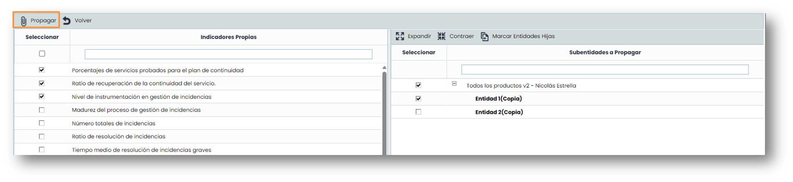

### Propagación - Métricas

Una vez propagadas, en las entidades hijas las métricas no se pueden modificar, sino que tendrán la misma información que sus padres, excepto los campos Selección Responsable Métrica, Responsable (Empleados) y Alertar.


Nota: Si en la empresa padre, se eliminan desde el LISTADO, en los hijos también se eliminan. Si se elimina desde el formulario de PROPAGACIÓN (tabla inferior derecha), se elimina en esa entidad y en sus hijas.


Para propagar una métrica hay que seguir los siguientes pasos:

1. Entrar en la opción de [**Métricas**](https://help.globalsuitesolutions.com/es/globalsuite/v1/metricas).
2. Entrar en la opción de **Propagación**.

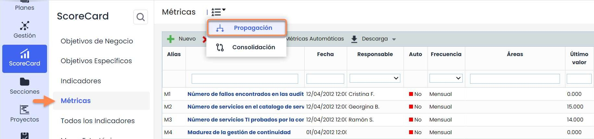

Una vez dentro hay que seleccionar las métricas que se quieran propagar y la entidad en la que se quiere que se propaguen.

Cuando se haya seleccionado, hay que pulsar sobre el botón propagar.

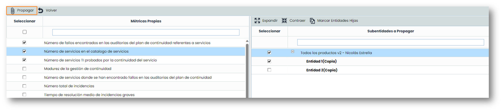

## Consolidación

La funcionalidad de consolidación aparece en aquellos entornos que dispongan de licenciamiento con entidades.

En esta guía se explica la consolidación de:

* [Objetivos](https://help.globalsuitesolutions.com/es/globalsuite/v1/objetivos) .
* [Indicadores](https://help.globalsuitesolutions.com/es/globalsuite/v1/indicadores)
* [Métricas](https://help.globalsuitesolutions.com/es/globalsuite/v1/metricas).

### Consolidación- Objetivos

La presente opción permite visualizar de manera resumida los diferentes objetivos asociados a la entidad y subentidades. Para consolidar un objetivo hay que seguir los siguientes pasos:

1. Entrar en la opción de Inicio > [**Objetivos**](https://help.globalsuitesolutions.com/es/globalsuite/v1/objetivos)
2. Entrar en la opción de **Consolidación**.

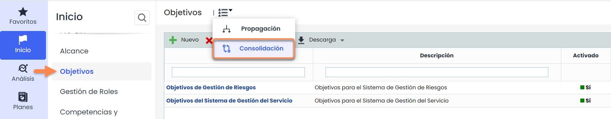

* **Tabla Servicios:** Permite al usuario filtrar los alcances asociados a los Servicios seleccionados.
* **Tabla Subentidades:** Ofrece la posibilidad de filtrar los alcances definidos en las subentidades seleccionadas.
* **Tabla Etiqueta/Valor:** Permite visualizar los alcances que tengan asociados una etiqueta determinada.
* **Filtros específicos:** Ofrece la posibilidad de seleccionar si el objetivo está activo, inactivo o ambos, incluso realizar un filtrado específico por rango de fechas de evaluación.

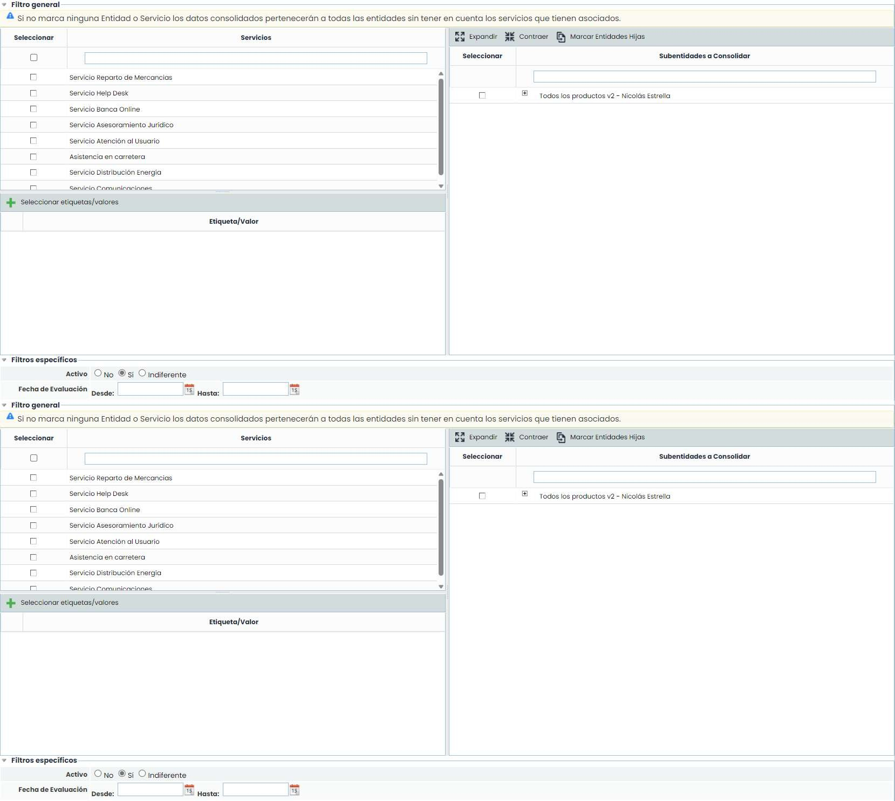

Una vez se han establecido los filtros necesarios, hay que generar la consulta, para ello existen las siguientes opciones:

* **Consolidar**: Una vez se pulsa el botón y en función de los filtros establecidos, permite visualizar de manera resumida los objetivos en la tabla inferior.
* **Volver**: Ofrece la posibilidad de regresar al listado inicial de objetivos.

Los resultados de la consolidación se muestran en la tabla inferior '**Resultados de consolidación**’.

* **Nombre**: Informe sobre el nombre del objetivo.
* **Descripción**: Permite visualizar la descripción más especifica que se ha establecido por cada uno de los objetivos.
* **Última evaluación**: Muestra la información de la última evaluación del objetivo.
* **Fecha última evaluación**: Permite visualizar la fecha de la última evaluación del objetivo.
* **Estado**: Informa al usuario del estado de la evaluación.
* **Unidad de gestión**: permite visualizar la entidad o subentidad a la que está asociado.
* **Propagado**: Informa al usuario si el objetivo ha sido propagado a subentidades.

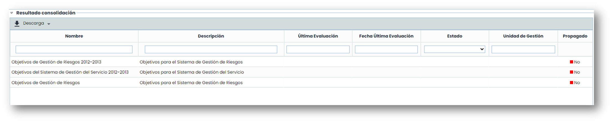

### Consolidación- Indicadores

Esta opción permite consolidar los indicadores definidos en la empresa matriz con los indicadores de las subentidades que dependen de esta. Para consolidar un indicador hay que seguir los siguientes pasos:

1. Entrar en la opción de [Indicadores](https://help.globalsuitesolutions.com/es/globalsuite/v1/indicadores).
2. Entrar en la opción de **Consolidación**.

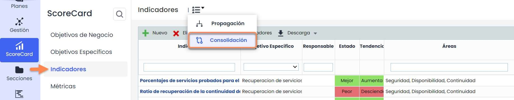

Al ingresar vemos dos secciones:\
**Gráfica**. Muestra las diferentes valoraciones efectuadas en los indicadores de la empresa matriz y las subentidades.

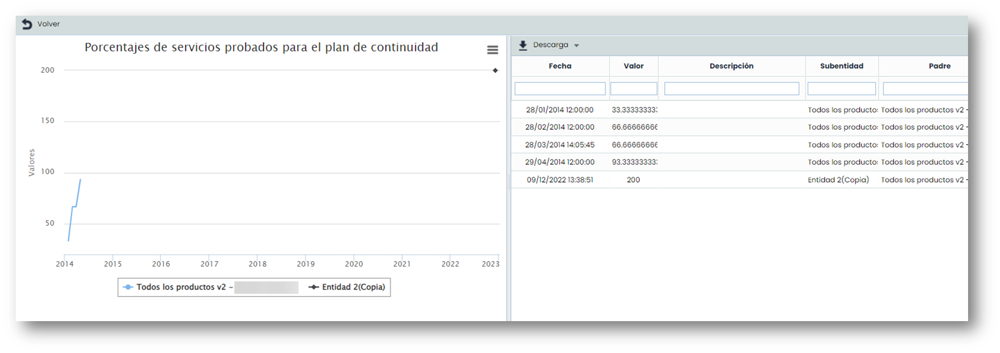

**Tabla indicadores propios**. Permite visualizar el listado de indicadores de la empresa matriz que se han asociado a una o varias subentidades.

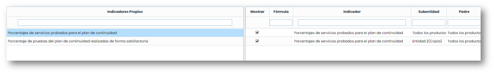

**Tabla indicadores propagados**. Permite visualizar las subentidades a las que se ha asociado el indicador seleccionado. La información que aporta la tabla es la siguiente:

* **Mostrar**. Ofrece la posibilidad de visualizar los resultados del indicador en la gráfica superior.
* **Fórmula**. Indica la fórmula de cálculo del indicador.
* **Indicador**. Informa sobre el nombre del indicador asociado a la subentidad.
* **Subentidad**. Muestra la subentidad a la que se ha asociado el indicador.
* **Padre**. Indica la empresa matriz desde la que se ha propagado el indicador.

### Consolidación - Métricas

La presente opción permite la consolidar las métricas definidas en la empresa matriz con las métricas de las subentidades que dependen de esta. Para consolidar una métrica hay que seguir los siguientes pasos:

1. Entrar en la opción de [**Métricas**](https://help.globalsuitesolutions.com/es/globalsuite/v1/metricas).
2. Entrar en la opción de **Consolidación**.

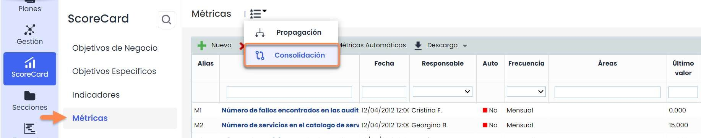

**Gráfica**. Muestra las diferentes valoraciones efectuadas en las métricas de la empresa matriz y las subentidades.

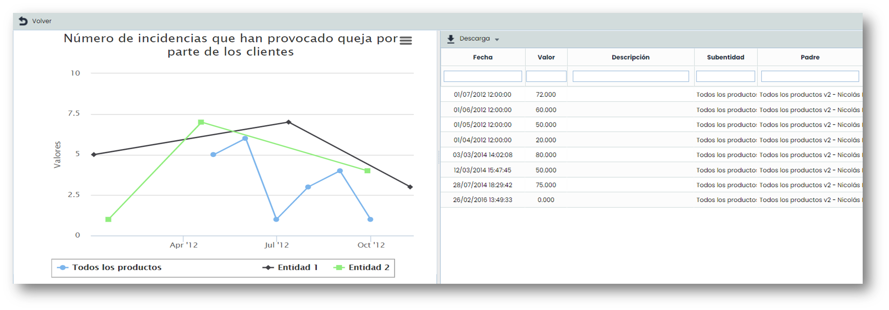

**Tabla métricas propias.** Permite visualizar el listado de métricas de la empresa matriz que se han asociado a una o varias subentidades.

**Tabla métricas propagadas.** Permite visualizar las subentidades a las que se ha asociado la métrica seleccionada. La información que aporta la tabla es la siguiente:

* **Mostrar**. Ofrece la posibilidad de visualizar los resultados de la métrica en la gráfica superior.
* **Alias**. Indica el alias asignado a la métrica en la subentidad.
* **Métrica**. Informa sobre el nombre de la métrica asociada a la subentidad
* **Subentidad**. Muestra la subentidad a la que se ha asociado la métrica
* **Padre**. Indica la empresa matriz desde la que se ha propagado la métrica.
