# ¿Cómo conectar y sincronizar Active Directory?

## Conexión y sincronización con Active Directory


Este tutorial explica cómo configurar la conexión de GlobalSuite® con Active Directory (AD) o LDAP, sincronizar usuarios y empleados, y mapear atributos entre AD y la herramienta. Incluye detalles sobre los campos requeridos, configuración de grupos, sincronización de usuarios y empleados, diferencias con LDAP y consideraciones importantes para asegurar que la integración funcione correctamente.


### 1. Conexión a Active Directory

Para llegar a la pantalla de conexión a Active Directory, es necesario situarse en el apartado de Ajustes > [Conexiones](https://help.globalsuitesolutions.com/es/globalsuite/v1/conexiones) (como se muestra en la imagen). A esta opción tienen acceso los usuarios de tipo Platinum, Gold, Consulting, Administrador Consulting, Administrador Plataforma, Administrador Enterprise y Administrador Configuración.

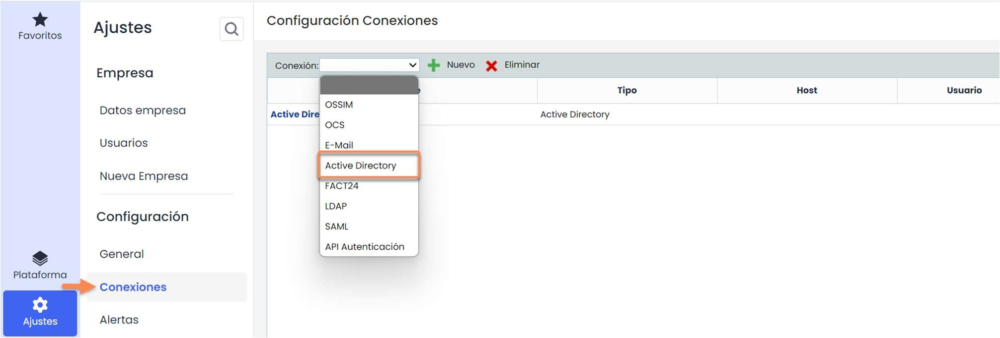

Esta pantalla tiene varias columnas que se describen a continuación:

* **Nombre**: Contiene el nombre de la conexión, que sirve para identificarla.
* **Tipo**: Contiene el tipo de conexión, en este caso será Active Directory o LDAP.
* **Host**: Contiene el nombre del servidor (Server Name) al que se conecta la conexión determinada.
* **Usuario**: Es el nombre del usuario que se utilizará para conectarse al servidor de Active Directory. Será necesario que esta cuenta de servicio en Active Directory pueda leer la estructura del mismo para poder recorrer los usuarios a sincronizar así cómo los atributos de Active Directory que se deseen recuperar. Se recomienda además que esta cuenta de servicio tenga una contraseña que no caduque o en su defecto que se tenga en cuenta para evitar que el proceso de sincronización este siempre operativo.
* **Habilitado**: Indica si una conexión está habilitada o no.

El formulario de conexión a Active Directory consta de diferentes campos, los cuales se describen a continuación.

En primer lugar, se encuentra la sección de “Datos Generales”:

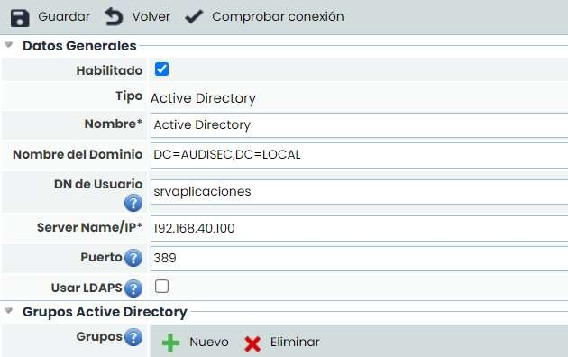

* **Habilitado**: Indica que esa conexión de Active Directory es la que está habilitada para sincronizar. No se pueden tener activadas dos conexiones de AD a la vez.
* **Tipo**: Indica el tipo de la conexión (en este caso, Active Directory).
* **Nombre\***: Es un campo obligatorio, e indica el nombre de esa conexión para ser utilizada en otras opciones de la herramienta.
* **Nombre de Dominio**: Indica el dominio al que se conecta el AD (como puede visualizarse en la imagen). La forma de expresarlo es igual que en el ejemplo: “DC=desarrollo, DC=local”. Además, puede incluirse una Unidad Organizativa concreta añadiendo, por ejemplo, “OU=prueba” al dominio, lo que hará que únicamente se sincronicen los usuarios de esa unidad.

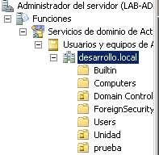

* **DN de Usuario**: Indica el usuario que va a conectarse con el Active Directory. Cualquier usuario que forme parte del AD podrá conectarse, aunque sólo tendrá los privilegios que tenga adjudicados en AD. Es decir, para GlobalSuite es transparente, realiza la petición a AD y recibe los datos que éste considere que puede proporcionar en función de los privilegios del usuario.
* **Server Name / IP:** Indica la dirección IP en la que está alojado el servidor de Active Directory. Esta IP debe ser válida, por lo que un administrador de la herramienta debe añadirla al sistema.
* **Puerto:** Indica el número del puerto al que accede la sincronización. Por defecto, se usan los siguientes puertos:

  * AD normal: 389.
  * AD con LDAPS: 636.
  * Árboles de directorios: 3268.
  * Árboles de directorios con LDAPS: 3269.
* **Usar LDAPS**: Este campo se usa para utilizar la conexión a un Active Directory sobre un protocolo de cifrado SSL. Cundo se activa este campo, por defecto se cambia el puerto al 636.

Por último, existe el botón “Comprobar conexión”, que permite verificar si los parámetros introducidos son válidos, y si conectan con un AD válido. Para comprobar la conexión se solicitará la password del usuario indicado en el campo DN de Usuario, esta password no se conserva en GlobalSuite y habrá que introducirla cada vez que se requiera realizar la prueba.

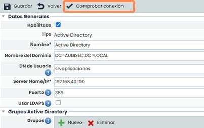

En segundo lugar, se encuentra la sección “Grupos Active Directory”. Estos grupos sirven para sincronizar con un conjunto de usuarios concreto de AD. Estos grupos contienen un campo “Nombre” para identificar al grupo y un campo “Descripción” por si se quiere añadir más información acerca del grupo. Para sincronizar, en el campo “Cadena de Conexión”, además del nombre del dominio (que se copia por defecto al crear uno nuevo), se puede añadir el grupo de AD que queremos sincronizar. Por ejemplo: “DC=desarrollo, DC=local, CN=desarrollo”, siendo desarrollo un grupo creado en AD y al que pertenecen una serie de usuarios. Hay que tener en cuenta que, en el caso de usar un grupo para sincronizar, se utilizará la cadena de conexión para conectar con el AD, sin tener en cuenta el nombre de dominio (explicado anteriormente) de la conexión. Es decir, la “Cadena de Conexión” del grupo sustituiría al conectar con AD al Nombre de Dominio que tenga configurada la conexión.

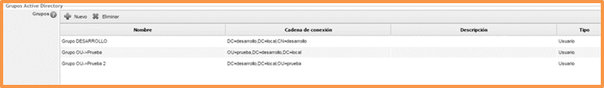

Ejemplo: En la imagen anterior se puede ver que el Nombre de Dominio es

“DC=desarrollo,DC=local”. Sin embargo, uno de los grupos es

“DC=desarrollo,DC=local,CN=desarrollo”, por lo que esta será la cadena que se use para conectar, sustituyendo a la de dominio.

Además, existe el campo “Tipo” en cada grupo, que puede ser “Usuario” o “Empleado”, y que indica en cuál de estas dos opciones de la herramienta podrá utilizarse este grupo para sincronizar.


\*\*Nota\*\*
En GlobalSuite, se considera “\*\*Usuario\*\*” a las personas que pueden acceder (con contraseña) a la herramienta, y navegar por las distintas opciones a las que tengan acceso en su SG (Sistema de Gestión). Por otra parte, dentro de GlobalSuite, existe una opción llamada “\*\*Empleados\*\*”, en el que se contiene información acerca de los empleados de la empresa o SG, pero que no tienen por qué tener conocimiento de la existencia de la herramienta. Ejemplo: Un guardia de seguridad podrá aparecer como “Empleado” en la herramienta, ya que forma parte de la empresa, pero no tendrá acceso a GlobalSuite, por lo que no tendrá usuario. Así mismo, es posible que el Responsable de Continuidad de Negocio sea un empleado de la empresa, y a la vez tenga un usuario en la herramienta para acceder a las distintas opciones.


La siguiente sección, denominada “Logs Conexión”, muestra el historial de conexiones con Active Directory. En caso de que la conexión falle, se puede ver el error que ha devuelto el servidor de Active Directory en el momento de realizar la conexión.

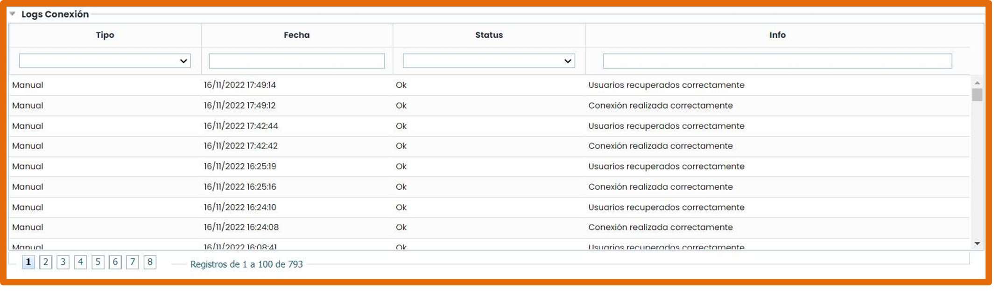

En la sección “Conectado con…” se indica en cuales de las dos opciones citadas de la herramienta (pueden seleccionarse ambas) se permitirá la sincronización con los usuarios de AD.

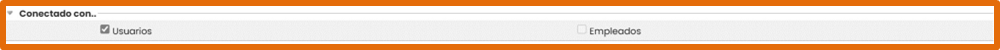

Por último, se encuentran la sección “Configuración de la sincronización”. En esta sección se puede configurar la relación entre los atributos del Active Directory y los campos de los formularios de GlobalSuite. En concreto se permite configurar la relación con los campos de usuarios y de empleados.

La configuración se realiza por medio de la tabla que se muestra a continuación.

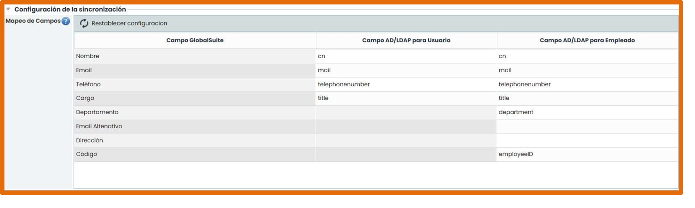

Por defecto, se establecen los campos lógicos del Active Directory que por definición están relacionados para cada uno de los campos de GlobalSuite. Si se desea recuperar dicha configuración, después de haber realizado modificaciones, puede utilizarse el botón “Restablecer configuración”

También existe un campo seleccionable llamado “Crear y asociar empleados al sincronizar usuarios”. Si este campo está marcado, cada vez que se sincronicen usuarios en la herramienta, se creará un empleado asociado, y existirá una correspondencia entre sus campos que permitirá conservar la relación entre ambas entidades.

Nota: Es importante indicar que al marcar “Crear y asociar empleados al sincronizar usuarios” los datos para crear el empleado son los mismos que los datos para crear el usuario, por lo tanto, campos como “departamento”, “Email alternativo”, etc… se crearán en blanco. Para rellenar dichos campos es posible realizar la sincronización desde la parte de empleados, actualizando los empleados y completando así el formulario, esta vez con el mapeo para empleados.

Nota 2: En ocasiones es necesario modificar el mapeo de campos para poder recuperar la información que se requiere. A continuación, en la imagen se muestran (en rojo) el nombre de los campos donde suele estar alojada la información más relevante referente a usuarios dentro del AD de los clientes.

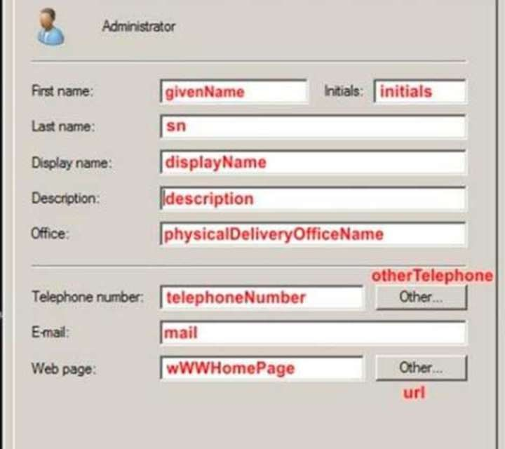

### 2. Sincronización con Active Directory

Para llegar a la pantalla de sincronización, es necesario situarse en la sección de Ajustes > [Usuarios](https://help.globalsuitesolutions.com/es/globalsuite/v1/usuarios) (como se muestra en la imagen). A esta opción tienen acceso los usuarios que no sean “Enterprise” o “Entidad” (es decir, los usuarios Platinum, Gold, Consulting y los distintos tipos de administradores).

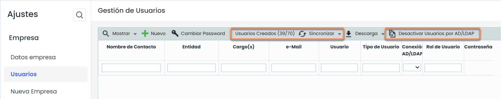

Esta pantalla tiene varias columnas que se describen a continuación:

* Nombre de Contacto: Nombre del Usuario, que no tiene nada que ver con el usuario que se usa para acceder a GlobalSuite. Ejemplo: Tomás Ramírez Rodríguez.
* Entidad: Indica la entidad o sistema de gestión a la que pertenece el usuario (las entidades se explican más adelante en la sección de entidades.
* Cargo(s): cargo que ocupa ese usuario en la empresa.
* e-Mail: correo electrónico del usuario.
* Usuario: nombre que se usa para acceder a la herramienta por parte del usuario. Ejemplo: tomas.ramirez
* Tipo de Usuario: Indica el tipo de usuario en la herramienta, si es de tipo Entidad, Enterprise, o algún tipo de administrador.
* Conexión AD/LDAP: Indica si un usuario está sincronizado con un usuario de AD, por lo que utiliza estas credenciales para acceder a la herramienta. En caso negativo, sería un usuario normal de GlobalSuite.
* Contraseña: Contiene un botón “Restaurar” para enviar una nueva contraseña a un usuario de GlobalSuite. Esto aplica únicamente para los usuarios locales a la herramienta. En el caso de los que están

sincronizados con AD, no es posible realizar la acción y el botón no aparece.

* Usuario Relacionado: Muestra, si lo hubiese, el usuario de AD a través del cual se puede ingresar a la herramienta para tener acceso a los mismos datos que el usuario dependiente.
* Rol de Usuario: Rol de empresa definido para este usuario, estos roles pueden crearse en Clientes/Roles Empresa.
* Estado: Indica si el usuario está activo, es decir, se puede acceder a la herramienta utilizando dicho usuario.

Algunas de las columnas detalladas anteriormente aparecen por defecto ocultas, para mostrar dichas columnas hay que pulsar con el botón derecho del ratón en la cabecera de la tabla y marcar aquellas columnas que se desean ver.

Por otra parte, arriba existen dos botones: “Sincronizar”, que permite seleccionar la conexión general o uno de los grupos de AD que se han configurado en la opción de Conexiones. Una vez elegida una de ellas, e introduciendo la contraseña, se podrá acceder a la pantalla de sincronización de AD, que se explica en la siguiente sección.

Además, existe el botón “Desactivar usuarios por AD/LDAP”. Este botón cambia la configuración de los usuarios que tienen la columna “Conexión AD/LDAP” a Sí, para que pasen a ser usuarios normales de GlobalSuite. En este caso, se les enviará a estos usuarios una nueva contraseña y quedarán desincronizados de AD.

#### 2.1. Sincronización de Usuarios

Una vez abierta la pantalla de sincronización de usuarios, aparecen 3 secciones que se describen a continuación:

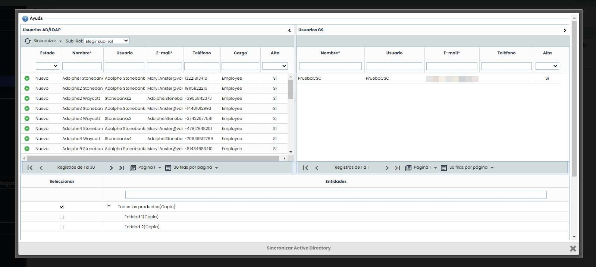

##### 2.1.1. Sección de usuarios de Active Directory

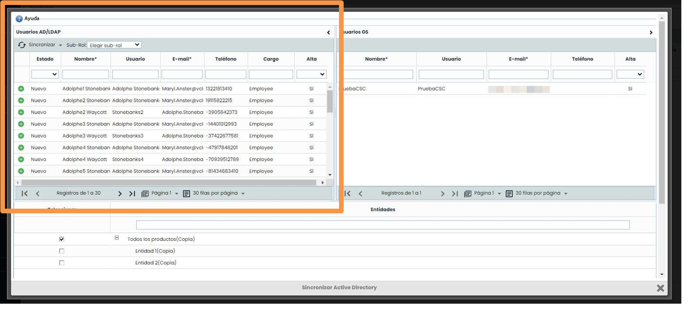

La sección de la izquierda se corresponde con los usuarios que pertenecen a la conexión de Active Directory establecida. Estos usuarios pueden estar en 4 estados, que se describen a continuación:

|  |  |
| --- | --- |
|  | Indica que el usuario ya está sincronizado con la herramienta, por lo tanto existe un usuario en  GlobalSuite con los mismos datos (nombre, teléfono y correo electrónico). |
|  | Indica que el usuario existe en Active Directory, pero no en GlobalSuite. |
|  | Indica que el usuario existe tanto en Active Directory como en GlobalSuite y están sincronizados, pero algún dato ha cambiado en alguna de las dos herramientas. También puede aparecer como modificado, si se tiene marcado el check en configuración de conexiones de |
|  | “Crear y asociar empleados al sincronizar usuarios”, en alguno de estos casos:  Si un usuario tiene un empleado asociado pero de BAJA.  Si un usuario tenía algún empleado asociado, pero este ya no lo tiene. |
|  | El usuario no dispone de algunos datos en el AD que son obligatorios, o esos datos no tienen el formato correcto. En el caso concreto del ejemplo, estos campos son “Nombre” y “E-mail”, por ello están marcados con un asterisco \*. |


\*\*Importante\*\*
Si existen usuarios en el Active Directory que tienen la directiva “El usuario debe cambiar la contraseña en el siguiente inicio de sesión” y aún no lo han hecho, no podrán acceder a GlobalSuite. Una vez que estos usuarios hayan modificado su contraseña, accediendo a su dominio, tendrán acceso a GlobalSuite sin ningún problema y sin necesidad de volver a sincronizar.


##### 2.1.2. Menú de Sincronización

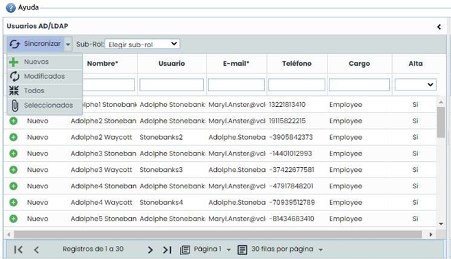

En la parte superior izquierda, existe el botón “Sincronizar”, que permite llevar a cabo las acciones de sincronización de usuarios. Es importante destacar que la sincronización solo existe en un sentido, desde el Active Directory a GlobalSuite, es decir, GlobalSuite **nunca modifica** nada en Active Directory. Cada botón funciona de la siguiente forma:

* **Nuevos**: Añade a los usuarios de la empresa los usuarios del Active Directory que no estén sincronizados, a menos que se supere el límite de usuarios. (Además, si se tiene marcado el check de “Crear y asociar empleados al sincronizar usuarios”, se creará un empleado asociado a ese nuevo usuario).
* **Modificados**: Se actualizan los cambios de los usuarios con los datos del usuario de Active Directory. (Si se tiene marcado el check de “Crear y asociar empleados al sincronizar usuarios”, se pone de “Alta” el empleado asociado a ese usuario).
* **Todos:** Se añaden los nuevos usuarios y se actualizan los modificados.
* **Seleccionados**: Se añaden o modifican (depende de cada caso) los usuarios seleccionados en la tabla.

Por otra parte, existe el botón “**Sub-Rol**”, ya que un usuario Enterprise o Entidad de GlobalSuite puede tener a su vez un Sub-Rol que permite configurar las opciones a las que tiene acceso. Por esta razón, si se selecciona uno de estos sub-roles, los usuarios sincronizados tendrán asociado este sub-rol en la herramienta.

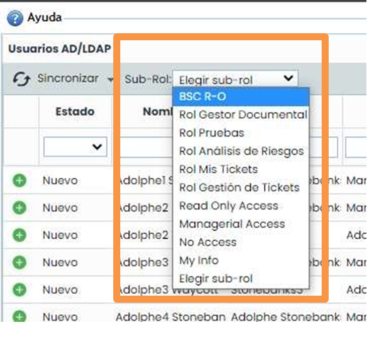

#### 2.1.3 Sección de usuarios

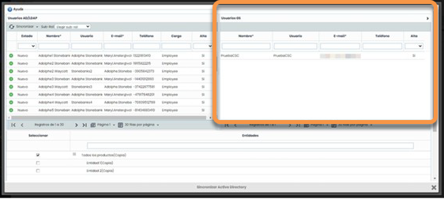

La sección de la derecha se corresponde con los usuarios que pertenecen a GlobalSuite, tanto los que están sincronizados con AD como los que no.

#### 2.1.4 Sección de entidades

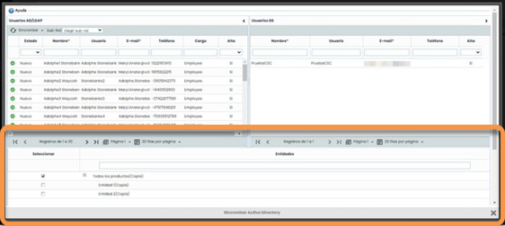

La sección situada en la parte inferior muestra las entidades o sistemas de gestión que están disponibles en la empresa. En GlobalSuite, una empresa puede tener por debajo una o varias entidades (también llamadas Sistemas de Gestión). Aunque los usuarios se gestionen por empresa, es posible indicar que algunos usuarios tengan acceso únicamente a una entidad concreta. Por lo tanto, mediante esta sección, es posible indicar a que entidad van a pertenecer los usuarios que se están sincronizando.

#### 2.2 Sincronización de Empleados

La sincronización de empleados se hace de forma similar a la de los usuarios (punto 1), aunque sin tener en cuenta las consideraciones del check “Crear y asociar empleados al sincronizar usuarios” de la configuración de la conexión.

### 3. Diferencias con LDAP

A la hora de sincronizar con LDAP, existen algunas diferencias que se explican a continuación. En la pantalla de conexión, el campo DN de Usuario debe llevar antes las siglas “CN=”. Así, mientras que en Active Directory el valor podía ser “Administrador”, en el caso de LDAP debe ser “CN=Administrador”.

Por otra parte, también es posible acceder a diferentes grupos o unidades organizativas. En las imágenes siguientes se muestran una serie de grupos y los usuarios que serían susceptibles de sincronizar:

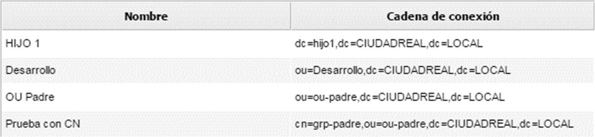

1- Grupos creados en LDAP

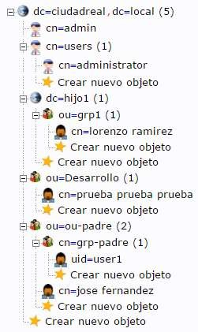

2- Ejemplo de árbol de usuarios en LDAP

En cada grupo, se podrían visualizar los siguientes usuarios:

* **HIJO 1**: lorenzo ramirez
* **Desarrollo**: prueba prueba prueba
* **OU Padre:** user1, jose fernandez
* **Prueba con CN**: user1

Si se sincroniza sin grupo, se podrían seleccionar los 4 usuarios: user1, prueba prueba prueba, jose fernandez y lorenzo ramirez.

El resto de las consideraciones de configuración son iguales que en el caso de Active Directory.

### 04. Campos requeridos para sincronización con AD

Para que la sincronización de usuarios sea exitosa la librería de conexión de AD de GlobalSuite requiere que el Active Directory tenga al menos los siguientes atributos:

* Atributos con valor predefinido

  * objectClass=user
  * samaccounttype=805306368 (NORMAL\_USER\_ACCOUNT)
  * objectCategory=person


Es obligatorio que existan estos atributos y tengan este valor.


* Atributos con valor asignado por el administrador de AD
* **cn**
* sn
* department
* **samaccountname ó employeeID (al menos 1)**
* mail
* memberof
* title
* displayname
* telephonenumber
* primarygroupid


Los atributos resaltados en negrita son obligatorios y deben tener un valor asignado. El resto es necesario que existan y recomendable que tengan un valor ya que se pueden utilizar en otras partes de GlobalSuite.

