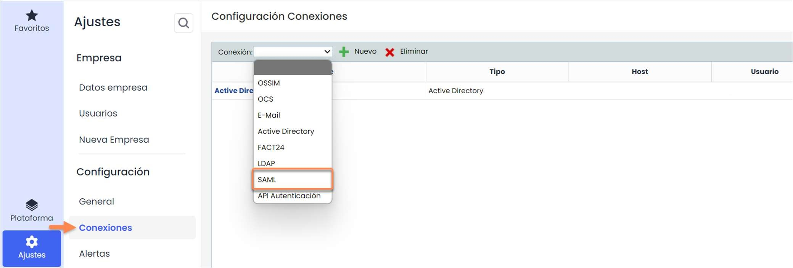
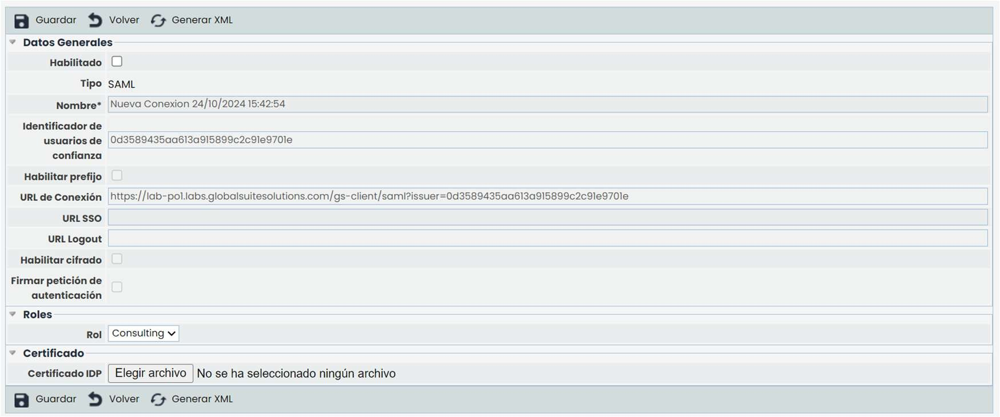
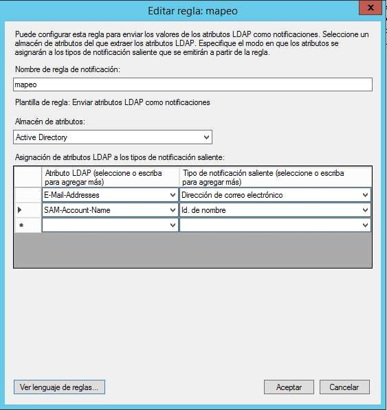
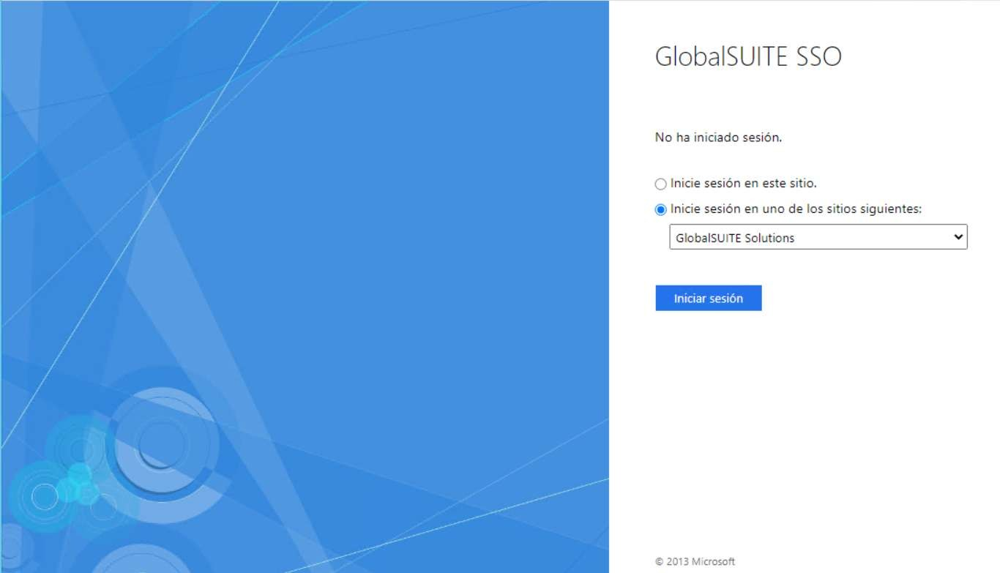

# ¿Cómo configurar una conexión SAML?

## Conexión con SAML 2.0


Esta guía explica cómo configurar y gestionar una conexión SAML en GlobalSuite®, desde el acceso al apartado de \*\*Ajustes >\*\* [\*\*Conexiones\*\*](https://help.globalsuitesolutions.com/es/globalsuite/v1/conexiones), hasta la definición de parámetros generales, roles por defecto y certificado IDP. También detalla la configuración necesaria en el servidor ADFS y los métodos de autenticación disponibles (IDP initiated SSO y SP initiated SSO), incluyendo consideraciones clave para la correcta sincronización de usuarios y roles.


### Configuración conexión de SAML 2.0

Para llegar a la pantalla de conexión a SAML, es necesario situarse en el apartado de Ajustes de GlobalSuite, concretamente en la opción “Conexiones” (como se muestra en la imagen). A esta opción tienen acceso los usuarios de tipo Platinum, Gold, Consulting, Administrador Consulting, Administrador Plataforma, Administrador Enterprise y Administrador Configuración.

Esta pantalla tiene varias columnas que se describen a continuación:

* **Nombre:** Contiene el nombre de la conexión, que sirve para identificarla.
* **Tipo**: Contiene el tipo de conexión, en este caso será SAML.
* **Host**: En este caso estará vacío.
* **Usuario**: No es necesario por lo tanto aparece vacío.
* **Habilitado**: Indica si una conexión está habilitada o no.

El formulario de conexión a SAML consta de diferentes campos, los cuales se describen a continuación.

En primer lugar, se encuentra la sección de “Datos Generales”:

* **Habilitado**: Indica que esa conexión de SAML está habilitada. No se pueden tener dos conexiones de SAML a la vez.
* **Tipo**: Indica el tipo de la conexión (en este caso, SAML).
* **Nombre\***: Es un campo obligatorio, e indica el nombre de esa conexión para ser utilizada en otras opciones de la herramienta.
* **Identificador de confianz**a: Se genera de forma automática. Indica la cadena de confianza que se establece entre el servidor y GlobalSuite, esta debe ser única.
* **URL SSO**: Cuando se desea configurar una conexión usando el método **SP initiated SSO**, se debe introducir la url del servicio del idp donde se realiza la autenticación vía SAML.
* **URL Logout**: Dirección a la que se redirige cuando un usuario con autenticación SAML cierra la su sesión.
* **Habilitar cifrado**: Configuración de la conexión SAML que permite que los parámetros que se reciben desde el idp vayan cifrados.
* **Firmar petición de autenticación**: Indica que, usando la configuración **SP initiated SSO**, la petición de autenticación que se realiza al idp será firmada.

En segundo lugar, se encuentra la sección de roles. En este apartado se pueden configurar los roles por defecto con los que se crearán los nuevos usuarios de SAML.

En principio los roles pueden ser obtenidos directamente del servidor, en caso de no recibir datos sobre el rol o que los datos que se reciban sean erróneos se utilizarán los roles configurados en esta sección.

Por último, se encuentra la sección “Certificado IDP”. En esta sección se debe subir un archivo, con extensión crt o cer, que contiene el certificado. Este debe ser el mismo que se utiliza para firmar las llamadas desde el servidor para la relación de confianza configurada.

### Configuración Servidor (SAML 2.0)

La url de servicio de conexión SAML 2.0 que se debe introducir en la configuración del servidor es: https://Nombre\_Dominio/Core/Adfs/trust.php

Donde Nombre\_Dominio es la url de acceso a GlobalSuite.

En la configuración del servidor ADFS se debe indicar que los datos a pasar en la petición son como mínimo:

* Id. Nombre (nameidentifier)
* Dirección de correo electrónico (emailaddress)

Si se desea enviar la configuración del rol para crear los nuevos usuarios de ADFS deberá utilizarse el claim:

http://schemas.microsoft.com/ws/2008/06/identity/claims/role


\*\*Importante\*\*
El nombre del rol que se envía desde el servidor de ADFS debe coincidir con alguno de los roles configurados en GlobalSuite.


Para obtener más información sobre la configuración del servidor ADFS puede acceder a:

https://docs.microsoft.com/es-es/windows-server/identity/adfs/operations/create-a-relying-party-trust

### Autenticación SAML 2.0

Existen dos tipos de autenticación con ADFS:

* **IDP initiated SSO**, el proceso de autenticación es iniciado por el idp, el usuario dispone de una lista de “aplicaciones corporativas”, selecciona la que corresponde de GlobalSuite e inicia la autenticación. A continuación, se muestra una imagen tipo de este formulario de aplicaciones.

* **SP initiated SSO**, el proceso de autenticación es iniciado por GlobalSuite, para usar este método se debe acceder con una url específica. Esta url se forma concatenando la url de GlobalSuite con el texto: ?issuer=identificador de confianza, donde el identificador de confianza es el código generado en la conexión y que puede encontrase en el campo con el mismo nombre, ver apartado 1 de este documento. Un ejemplo de url es:

https://sg.GlobalSuite.es/Core/index.php?issuer=a443c212c23af8ea8a107a f75345b0f8

La autenticación con SAML tiene las siguientes particularidades:

* Si el usuario está accediendo por primera vez a la herramienta, a través de SAML, se creará un usuario automáticamente con el nombre de usuario que se provee en la petición SAML.

Si el nombre de usuario ya existe en GlobalSuite y no es el mismo que se ha creado en la primera conexión se lanzaría un mensaje de error
