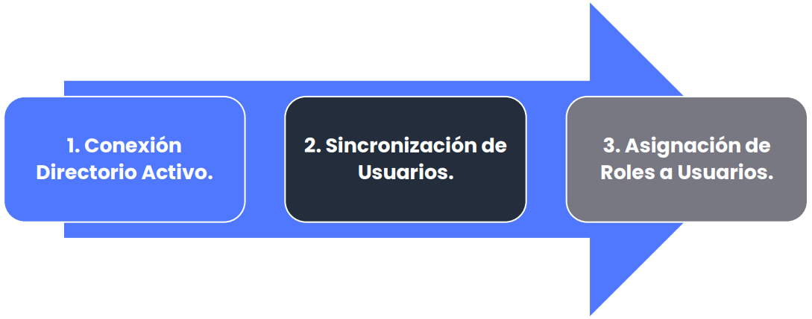
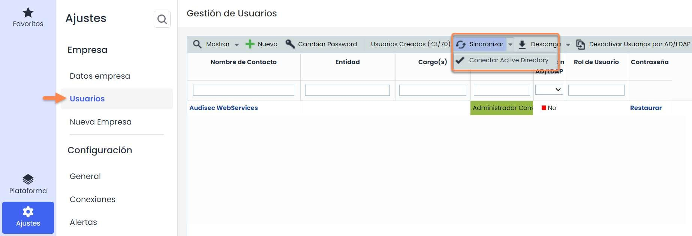
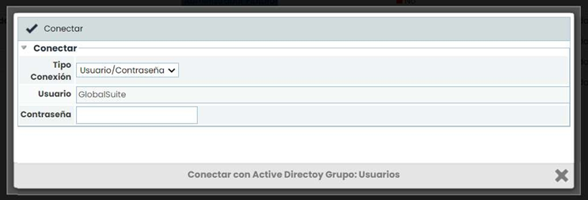
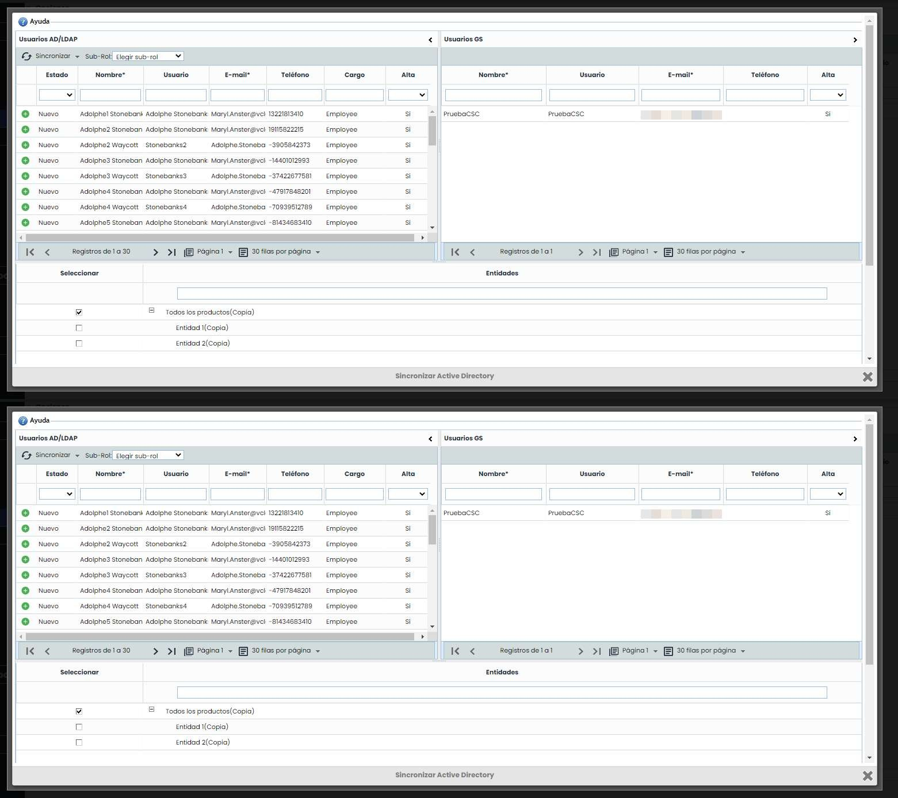
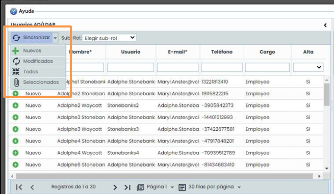
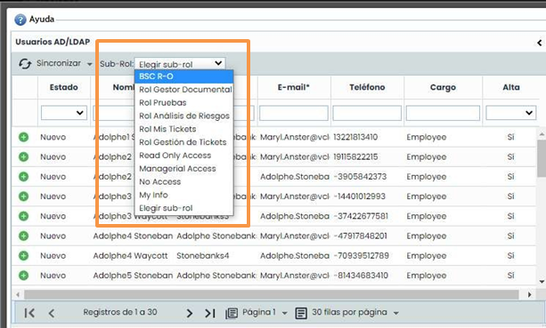
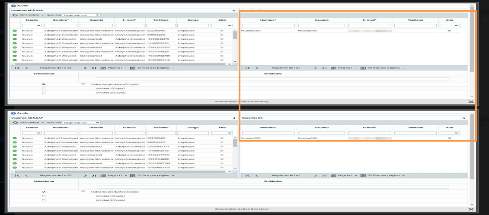
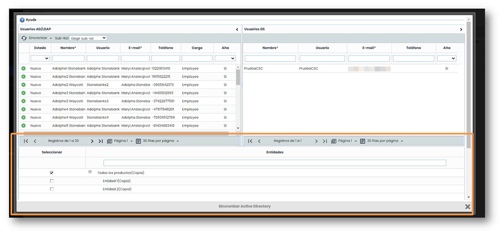

# ¿Cómo realizar la sincronización con el Directorio Activo?

## Pasos para la Sincronización con el Directorio Activo


La sincronización de GlobalSuite® con el Directorio Activo se puede realizar una vez se haya configurado la conexión pertinente. En esta guía se describen los pasos para la sincronización con el Directorio Activo, suponiendo que la conexión ha sido configurada previamente.


### Conexión Directorio Activo

#### Paso 1

A través del apartado “Ajustes” se accede a todas las opciones de configuración de la Plataforma. En la opción [Usuarios](https://help.globalsuitesolutions.com/es/globalsuite/v1/usuarios) se permite realizar la conexión con el Directorio Activo a través del botón “Sincronizar”.

Al pulsar sobre el botón “Sincronizar” aparecen todas las conexiones configuradas con el Directorio Activo.

#### Paso 2

Tras seleccionar una conexión, aparece una ventana para ingresar la contraseña de acceso. Una vez introducida la contraseña hay que pulsar sobre el botón “Conectar”.

Si la contraseña es válida, aparece la pantalla de sincronización de usuarios.

#### Paso 3

La pantalla de sincronización de usuarios se encuentra dividida en 3 secciones. Esta pantalla permite crear, actualizar y eliminar usuarios de GlobalSuite® procedentes del Directorio Activo, además de permitir el establecimiento de un sub-rol a cada uno de los usuarios durante el proceso de sincronización.

En las siguientes páginas se detalla cada una de las secciones.

#### Paso 4

La sección superior izquierda corresponde a la sección de usuarios que se encuentran en el Directorio Activo. En la tabla se muestran los usuarios que pertenecen al Directorio Activo y se pueden sincronizar con GlobalSuite®. Los usuarios pueden tener 3 estados:

Indica que el usuario ya está sincronizado con GlobalSuite®.

Indica que el usuario existe en el Directorio Activo, pero no se encuentra sincronizado en GlobalSuite®.

Indica que el usuario existe tanto en el Directorio Activo como en GlobalSuite®, pero algún dato ha cambiado en alguna de las dos herramientas.


\*\*Nota\*\*
Si la configuración del Directorio Activo tiene habilitado el check “Crear y asociar empleados al sincronizar usuarios”, entonces también aparece el usuario con esta imagen en alguno de los siguientes casos:
Si el usuario tiene un empleado asociado de baja.
Si el usuario ya no tiene un empleado asociado.


#### Paso 5

En la parte superior izquierda se encuentra el botón “**Sincronizar**”. Este botón permite realizar las diferentes acciones para realizar la sincronización.

La descripción de cada botón es la siguiente:

* Nuevos: Se añaden los usuarios del Directorio Activo que no se encontraban sincronizados (a menos que se supere el límite de usuarios establecido). Además, si la configuración de la conexión tiene habilitado el check “Crear y asociar empleados al sincronizar usuarios”, se crea un empleado asociado a cada uno de los usuarios.
* Modificados: Se actualizan los usuarios con los cambios detectados en el Directorio Activo. • Todos: Se añaden los usuarios del Directorio Activo que no se encontraban sincronizados, y se actualizan los usuarios modificados.
* Seleccionados: Se añaden o modifican (depende de cada caso) los usuarios seleccionados en la tabla.

### Asignación de Roles a Usuarios

#### Paso 6

Todos los usuarios que son sincronizados se registran con el tipo de usuario “Enterprise” por defecto. Si se requiere modificar el tipo de usuario se debe realizar posteriormente tras la sincronización, accediendo a los usuarios que se desean cambiar y estableciendo el tipo de usuario correspondiente.

Los usuarios “**Enterprise**” pueden tener asociado un sub-rol que delimita los privilegios de acceso a las diferentes opciones (los subroles se registran en la opción “**Roles Empresa**”). La ventana de sincronización permite establecer un sub-rol a los usuarios sincronizados. Para ello, hay que realizar lo siguiente:

* Seleccionar el sub-rol que se quiere utilizar.
* Seleccionar los usuarios que se quieren sincronizar y asociar al sub-rol
* Pulsar sobre la opción “Seleccionados” del botón “Sincronizar”.


\*\*Nota\*\*
A través de las acciones “Nuevos” y “Todos” puede aplicar un sub-rol a todos los usuarios sincronizados. Para ello, debe seleccionar previamente el sub-rol y seleccionar la acción deseada.


#### Paso 7

La sección superior derecha corresponde a la sección de usuarios ya registrados en GlobalSuite®. En la tabla se muestran tanto los usuarios sincronizados con el Directorio Activo como los usuarios locales registrados directamente en la herramienta.

#### Paso 8

La sección inferior muestra las entidades que se encuentran asociados a la empresa. Esto permite seleccionar sobre qué empresas o entidades va a tener acceso los usuarios sincronizados.

