# ¿Cómo sincronizar GlobalSuite® con FACT24?


Este tutorial explica cómo configurar y gestionar la \*\*sincronización entre GlobalSuite® y FACT24\*\*, la plataforma de gestión de emergencias y comunicación de crisis.
El objetivo es permitir la \*\*integración automática de información\*\* entre ambas herramientas: desde la conexión inicial y el mapeo de entidades, hasta la sincronización de comités, roles, empleados y alarmas. De esta manera, los usuarios podrán activar planes, actualizar datos de contacto y coordinar alertas críticas en tiempo real desde GlobalSuite®


## Configuración de conexión a FACT24

La configuración de la conexión a FACT24 desde GlobalSuite® permite comenzar a trabajar rápidamente.

Lo único que es necesario definir son los parámetros de configuración y la cuenta utilizada para sincronizar.

También se podrá relacionar los dispositivos de alerta que utiliza FACT24 con los campos de información de contacto de GlobalSuite®. Esto permitirá la actualización de información automáticamente.

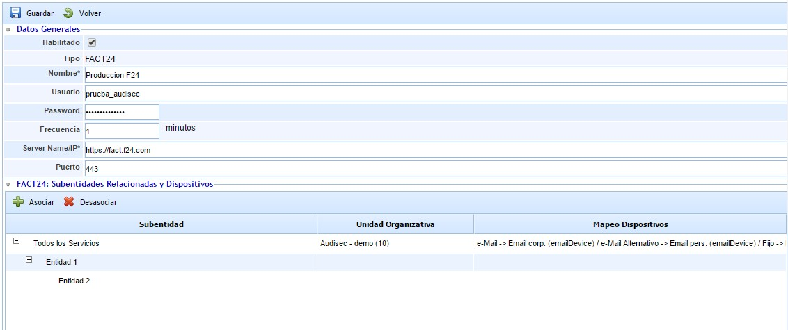

Tanto en GlobalSuite como en FACT24, se pueden disponer de una estructura jerárquica de Entidades o Unidades Organizativas que disponen de entornos independientes. Por ello, es posible establecer una correspondencia entre estas entidades en las dos plataformas.

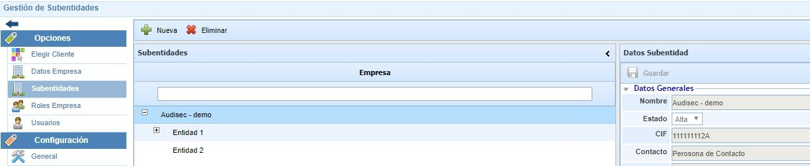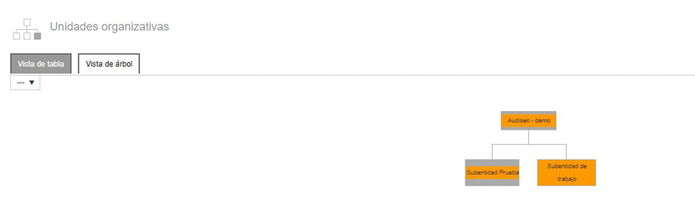

Además, para cada una, se puede establecer la correspondencia de dispositivos o campos para sincronizar la información de contacto de cada persona. Estos dispositivos en FACT24 pueden ser de distinto tipo:

* Teléfono (emailDevice)
* Correo (emailDevice)
* SMS (smsDevice)

En GlobalSuite, existen campos de correo electrónico (principal y alternativo) y distintos tipos de teléfono que se pueden configurar.

Según esta correspondencia, los datos de contacto de los empleados de GlobalSuite se actualizarán en los dispositivos correspondientes de las personas de FACT24.

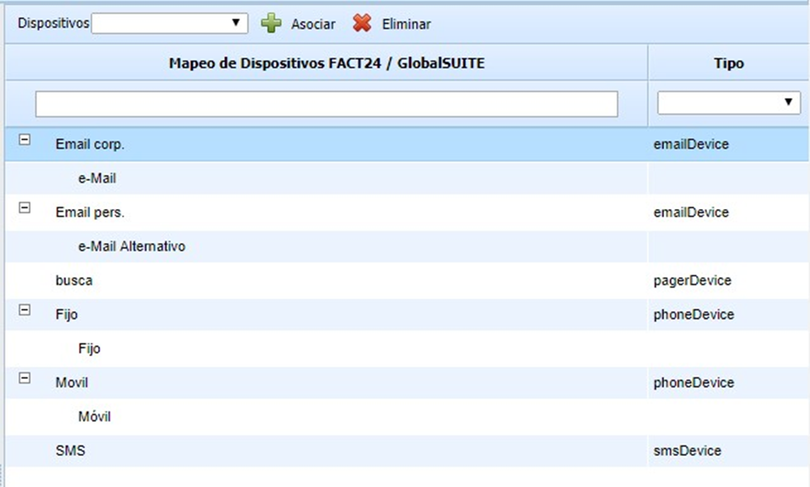

## Sincronización de Comités y Equipos de Personal Crítico

GlobalSuite® permite actualizar automáticamente los distintos comités y equipos definidos para configurarlos como Grupos en FACT24. Estos grupos serán los que se alerten en distintas situaciones de emergencia.

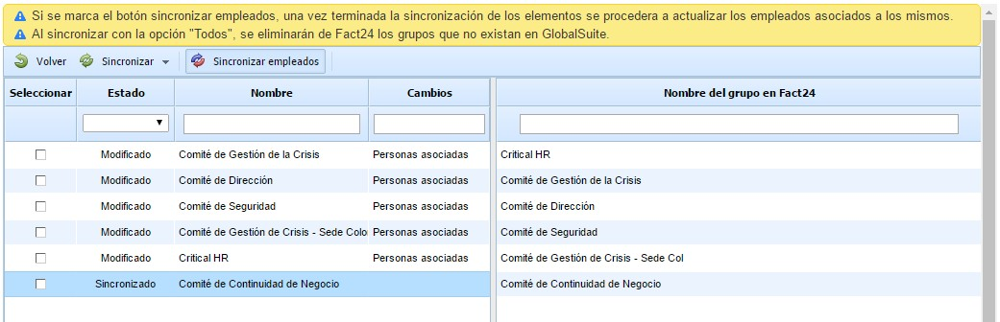

Podemos simplemente sincronizar los comités y equipos de personal crítico, con lo cual se incorporarán en FACT24 los comités que se hayan creado nuevos en GlobalSuite®, se actualizarán los modificados y se eliminarán los que ya no estén, así como modificar los miembros de cada uno.


\*\*Nota\*\*
Si marcamos “Sincronizar empleados” se actualizará también la información de contacto de esos miembros en un mismo paso, aunque se podrá hacer de manera independiente.


Los miembros del comité, tanto titulares como alternativos o sustitutos se incorporarán al Grupo de FACT24, con la precedencia indicada.

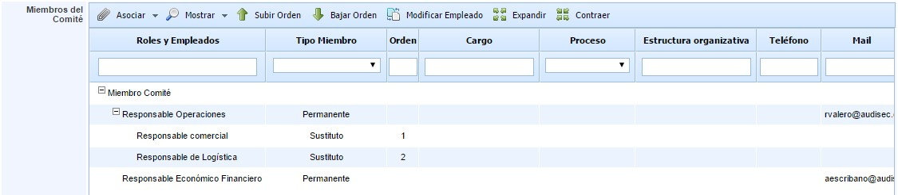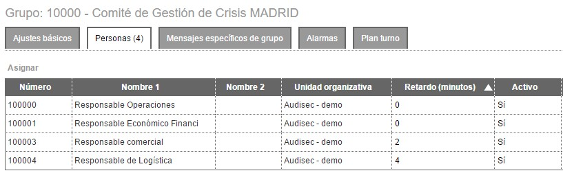

Los miembros principales del comité de GlobalSuite® se incluirán en el grupo de FACT24 para ser avisados en primera instancia, mientras que los sustitutos se incluirán con un retardo de 2 minutos para que en caso de que los titulares no respondan a la alerta, FACT24 comunicará con los alternativos.

Además, para cada persona se actualizará su información de contacto de manera automática según la configuración que hayamos realizado.

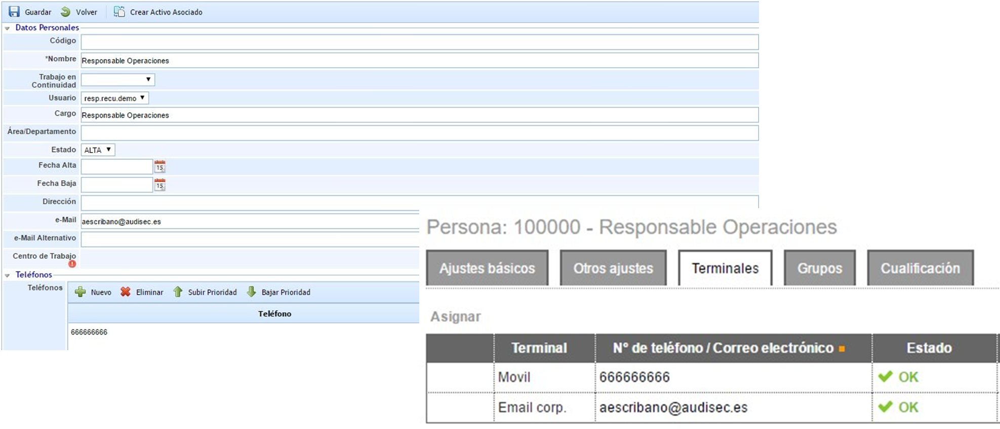

## Activaciones de Planes y Alarmas

Además de la actualización de la información de personal involucrado, comités y equipos definidos, GlobalSuite permite relacionar la activación de Alarmas en FACT24 con activación de Planes de Gestión de Crisis y Planes de Recuperación.

Esta activación se puede realizar desde el propio GlobalSuite, y FACT24 se encargará de la comunicación a todas las personas implicadas. También, permite que las activaciones que se hagan desde FACT24 se registren en GlobalSuite para su gestión y seguimiento desde la propia herramienta.

## Relación de Planes de Gestión de Crisis y Planes de Recuperación con Alarmas

Para cada uno de los Planes de Gestión de Crisis (PGC) y de los Planes de Recuperación (PRD) se pueden enlazar con una o varias alarmas configuradas en FACT24.

Se puede decidir qué planes se quiere utilizar alertas de F24 y en cuales utilizar alertas desde GlobalSuite (que se envían por correo electrónico), o ambos. En caso de utilizar alertas de FACT24, podremos seleccionar cuáles activar cuando se active el propio plan.

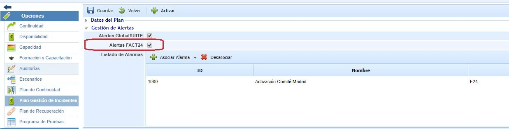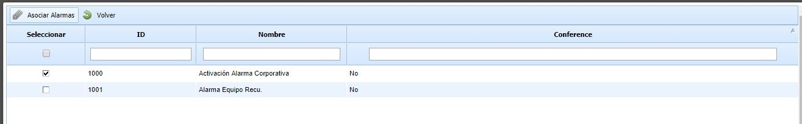

## Sincronización y actualización de información

GlobalSuite® permite conectar y actualizar la información de distintas partes desde el **Directorio Activo** de la organización.

Esto permite trasvasar la información de un sistema a otro automáticamente, evitando duplicidades e inconsistencias.

A continuación mostramos los elementos que se pueden conectar:

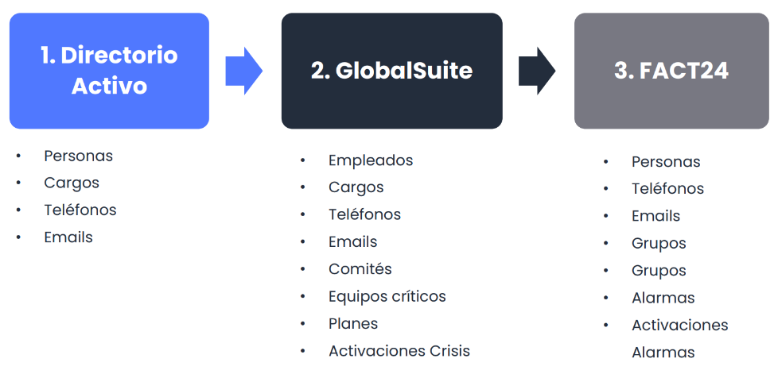
