# ¿Cómo configurar los tickets en GlobalSuite®?


En este artículo trataremos la configuración integral de Tickets: tipologías, secciones, campos y permisos, además de tabla principal, pantalla común, gráficas y mapeo de email.


## Tipologías de ticketing

GlobalSuite® dispone de diferentes tipologías de ticketing, que permite configurar de forma independiente cada una de estas opciones a través de la opción Ajustes concreta de “Tickets”.

Las opciones específicas de ticketing, por defecto, son las siguientes:

* **Tickets**: opción genérica para todas las tipologías.
* **Peticiones del Servicio**: registro de solicitudes de los usuarios en función de los servicios de un área.
* **Incidencias y Problemas**: relativo a cualquier tipo de SG, incidencias detectadas en los mismos.
* **Cambios y Entregas:** vinculados con las incidencias, son acciones de cambio o entregas tanto a nivel de activos físicos como a nivel procedimental.
* **No Conformidades**: ticket relativos a no conformidades detectados a nivel de compliance o auditoría.
* **Correctivas y Preventivas:** vinculados con las NC, son acciones correctivas tras la detección de una NC o bien preventivas ante la detección de una posible mejora.
* **Reclamaciones:** relativo a comunicaciones internas o externas referentes a reclamaciones sobre un servicio que un usuario recibe (cliente o empleado).
* **Derechos:** En este apartado podrá gestionar todos los tipos de derecho, dejando evidencia de su tratamiento y pudiendo establecer la comunicación y resolución de la solicitud directamente con el solicitante del ejercicio.


Todas estas opciones son flexibles y variarán en función de los módulos contratados en GlobalSuite®


## Configuración Tickets

### Configuración general

Las fases a llevar a cabo en la configuración de tickets son las siguientes:

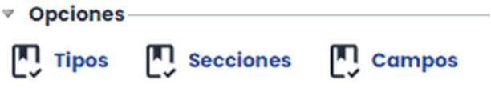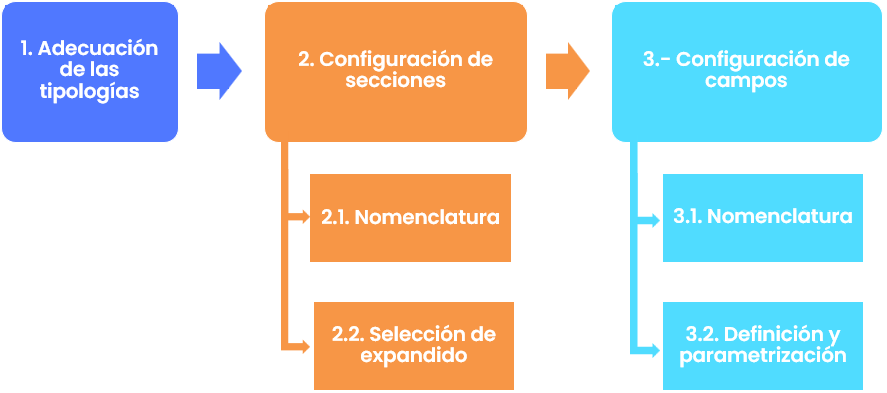

### Configuración de tipos.

El primer paso a realizar en la configuración de un ticket es definir la nomenclatura de cada uno de ellos, ya que GlobalSuite® permite renombrar y/o traducir cada una de las opciones de la herramienta de cara a todos los posibles usos que pueda tener cada funcionalidad.

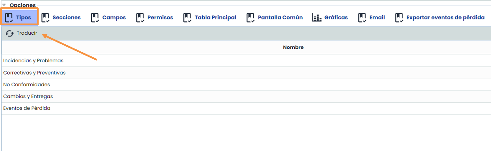

Realizando doble click sobre el nombre la herramienta permite editar el mismo.

En cada uno de los pasos de la configuración existe el botón “**Traducir**” en la parte de arriba (derecha o izquierda), que permite traducir toda la configuración que se haya realizado a cualquiera de los idiomas en los que se haya contratado la plataforma.

### Configuración de secciones

GlobalSuite® permite configurar las secciones de cada tipo de tickets de manera individual y personalizada:

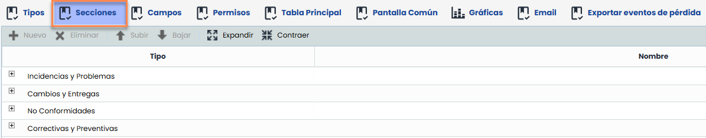

Seleccionando cada tipología, la herramienta permite añadir nuevas secciones mediante el botón “Nuevo”, definiendo su nombre tanto en español como en otros idiomas:

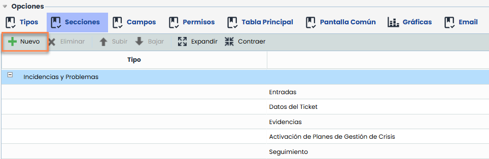

También es posible borrar o reubicar secciones mediante la botonera superior una vez seleccionada la sección concreta la cual se quiere editar o borrar:

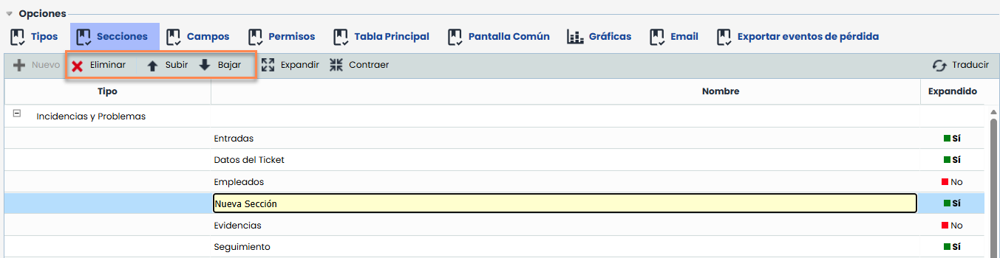

También permite al usuario definir si se desea mostrar la sección expandida o contraída por defecto

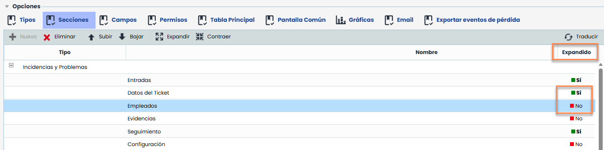

### Configuración de campos

Desde la opción de configuración de campos, GlobalSuite® permitirá configurar los campos que formarán parte de cada una de las secciones. Seleccionando una sección, la herramienta mostrará en la sección derecha los campos que la conforman.

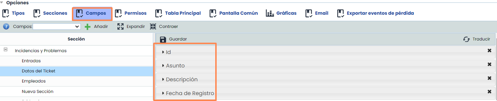

Se podrá arrastrar cada uno de los campos a la ubicación deseada, o bien borrar alguno de ellos mediante el aspa derecha marcada en cada campo.


\*\*Nota\*\*: Si se elimina un campo de un tipo de ticket, todos los datos contenidos en ese campo también se eliminarán.


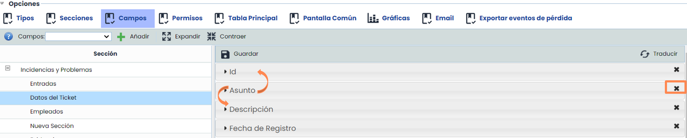

Para la adición de campos, debemos seleccionar en primer lugar la sección dónde queremos insertar el mismo, y utilizar el desplegable izquierdo, seleccionando el tipo de campo deseado y tras ello pulsar el botón “Añadir”.

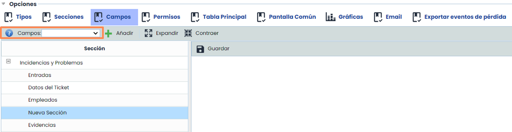

Tras la adición del campo, éste se mostrará en el área derecha para su configuración:

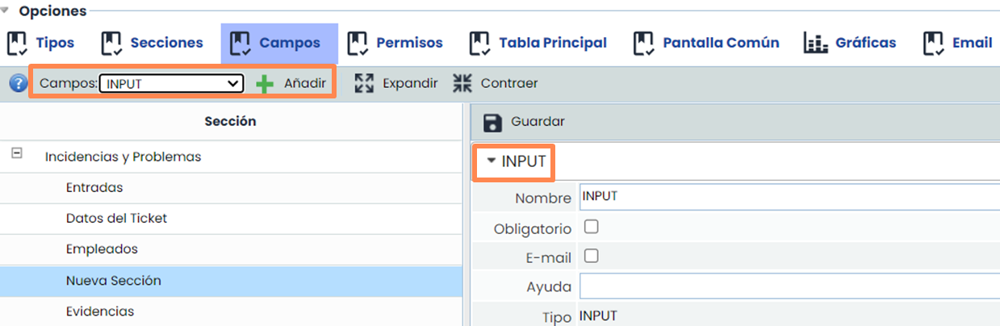

### Permisos

La sección de “Permisos” permite gestionar los privilegios de los usuarios con acceso a Mi Información, evitando posibles errores o cambios no deseados en los distintos tipos de tickets. En concreto, permite definir quiénes pueden crear o eliminar tickets en función del tipo. Los permisos de creación y eliminación son independientes entre sí y, además, también tienen efecto en la creación de los tickets en las tablas de entrada y salida.

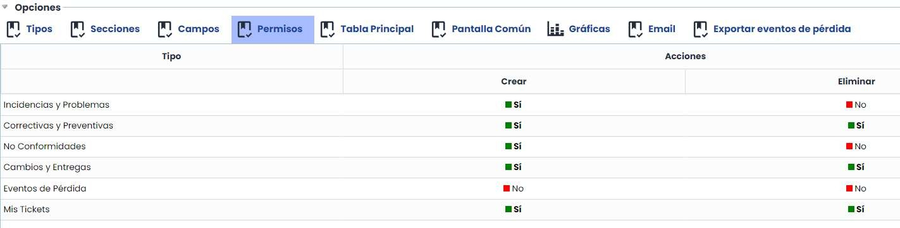

### Gestión de tabla principal

Es posible personalizar las columnas que se muestran en la tabla principal, añadiendo o eliminando los campos configurados en los apartados previos, para adaptar la visualización a las necesidades de cada organización.

No obstante, existen determinados campos que no pueden mostrarse en la tabla principal y, por tanto, no estarán disponibles para su selección:

* DELIVERABLES
* EVIDENCES
* INCIDENT MANAGEMENT PLANS
* MANAGERS
* QUANTIFICATIONS
* REFERENCES
* SIMULATION RISK
* THREATS
* TYPES
* FOLLOWS UP

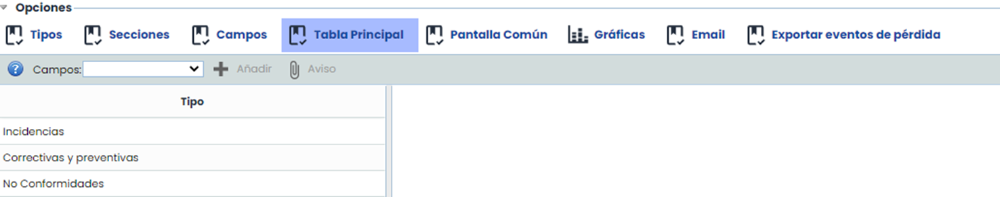

La herramienta permite editar su orden de cara a mostrar cada campo en formato columna en la posición deseada (arrastrar y soltar los campos):

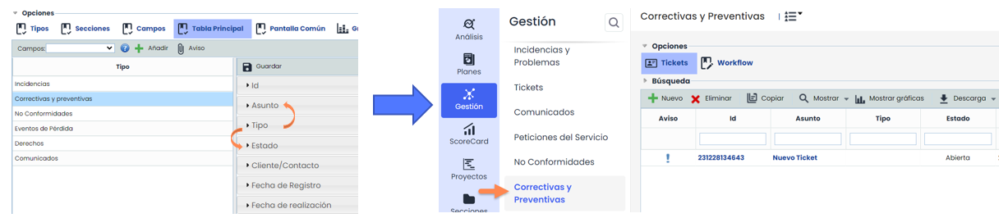

En el detalle de los campos que se muestra en el área derecha, GlobalSuite® permite definir diferentes parámetros:

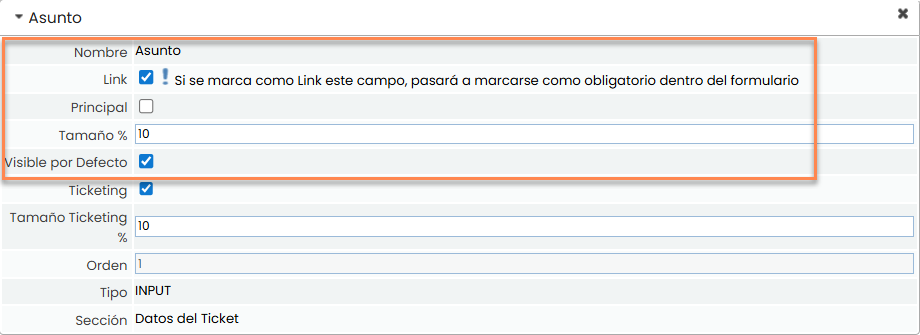

* Link: Permite establecer el campo como link para redireccionar al formulario del ticket desde esta columna.
* Principal: Permite definir el campo como Principal, solo se permite uno por tipo de ticket, y con esto podremos establecer que campo es el que nos va a aparecer para seleccionar el ticket dentro de otras opciones.
* Tamaño: Permite definir el tamaño de cada columna en función del campo.
* Visible por Defecto: Permite definir el campo Visible inicialmente, o si bien estará disponible en la tabla principal pero por defecto no será mostrado.

### Configuración de pantalla común

Esta opción permite definir qué campos y en qué orden se quiere que aparezcan en la Tabla de Pantalla Común (tabla para asociar los tickets en multitud de opciones de la herramienta):

Similar a los puntos anteriores, se permite añadir campos nuevos, editar la posición de los mismos o incluso eliminarlos.

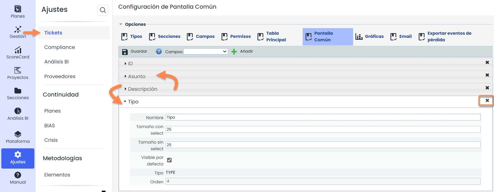

Una opción característica de la pantalla común es que divergen todos los tipos de ticket, por lo que es necesario realizar un “mapeo” de los campos de cada ticket sobre la columna que se mostrará en la tabla de esta pantalla.

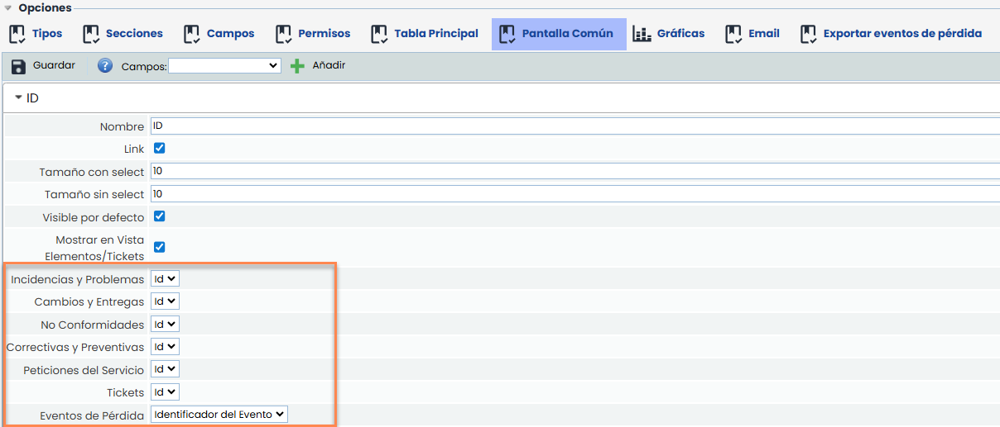

Las opciones en detalle de Link, tamaño y visible por defecto tendrán el mismo efecto que en lo comentado en apartados anteriores.

### Configuración de gráficas

Se permite configurar una serie de gráficas, con el fin de poder ver un resumen del estado en que se encuentran los diferentes tipos de tickets respecto a algunos de sus campos.

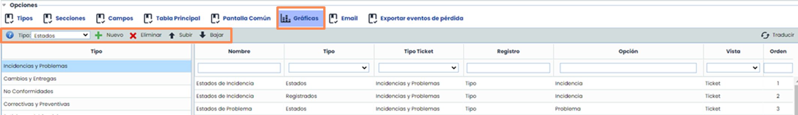

Existen diferentes opciones o tipos de gráficas disponibles generales en ticket para añadir:

* **Estados**: gráfica a partir de los registros del campo "Status" o "Select". (Por defecto, el campo "Status")
* **Registrados**: a partir de los registros de "Status" o "Select", organizado mensualmente.
* Registrados por Año: a partir de los registros “Status" o "Select" organizado Anualmente.

Un tipo especial son las gráficas con consolidación.

* **Agrupación por Select**: Crea una gráfica a partir de los registros del campo "Status" o del campo "Select".
* **Salidas**: a partir de "Status" o “Select", relacionado Tickets de Salida especificados en "Tickets-outputs".

Salidas por Plazo: gráfica a partir de los registros del campo "Status" o del campo "Select", relacionado con los Tickets de Salida de "Ticketsoutputs""Date“. Nota: debe tener configurado 4 campos “Date” con cada uno de estos con uno de los tipos disponibles "Inicial", "Final", "Inicio Previsto", "Final Previsto")

La herramienta también permite configurar el detalle de cada una de las gráficas disponibles:

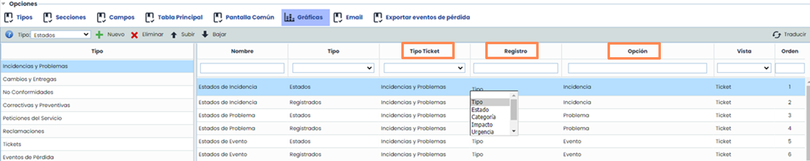

Esta definición en detalle se basa en tres parámetros:

* **Tipo Ticket**: Nos permite definir en las gráficas consolidadas, con que tipo de ticket de salida se comparan los registros.
* **Registro:** Nos permite indicar sobre que campo queremos las gráficas, ya sea el campo de tipo "Status" o todos los de tipo "Select" que tenga configurado el Ticket.
* **Opción**: Nos permite filtrar la gráfica con algún tipo de valor concreto de los campos "Status" o "Select" del Ticket.

### Configuración de email

Esta opción permite sincronizar cuentas de correo externas con los tickets de la herramienta. Para ello, se debe configurar en el apartado de Ajustes unas conexiones de tipo Email con las cuentas de correo, y en esta pestaña de tickets, definir con qué campos se realizará el *mapeo* del correo.

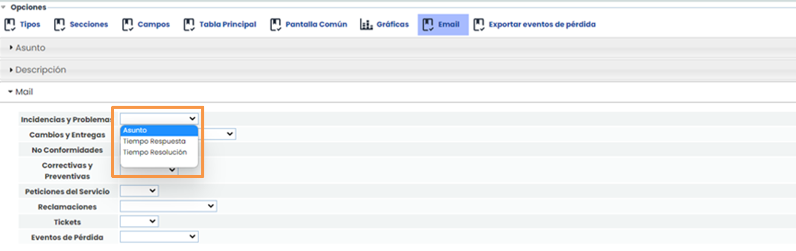

* **Asunto**: permite definir en qué campo de cada ticket se va a guardar el título/asunto del correo cuando se produzca la sincronización.
* **Descripción**: permite definir en qu´r campo de cada ticket se va a guardar el cuerpo del correo cuando se produzca la sincronización.
* **Mail**: permite definir en qué campo de cada ticket se va a guardar el remitente del correo cuando se produzca la sincronización.
