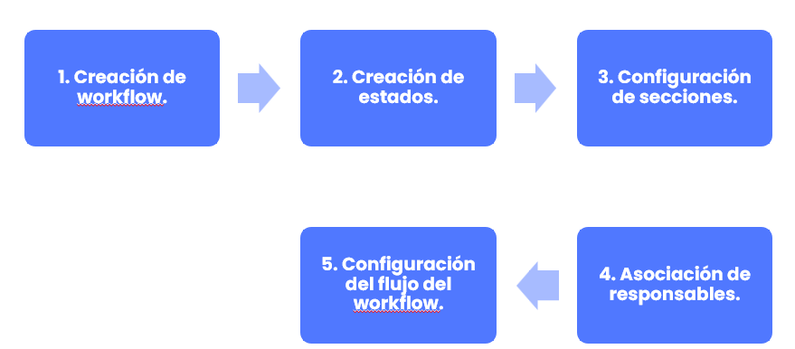
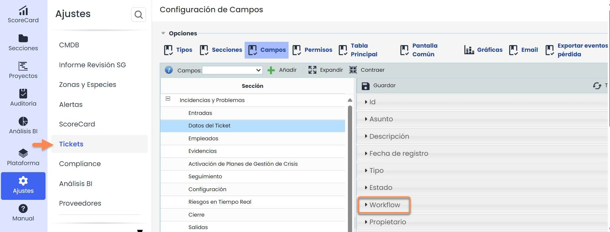
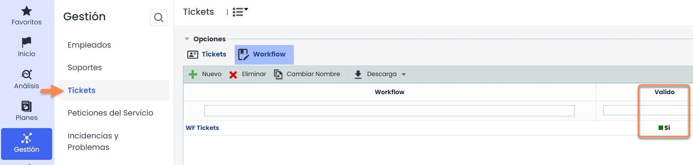
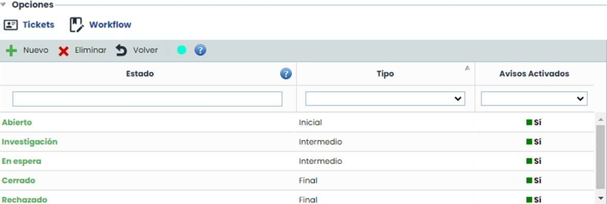
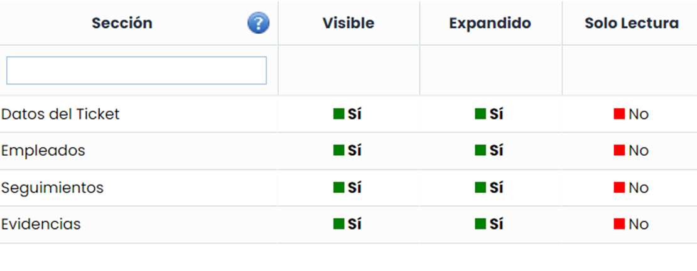
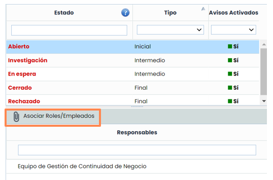
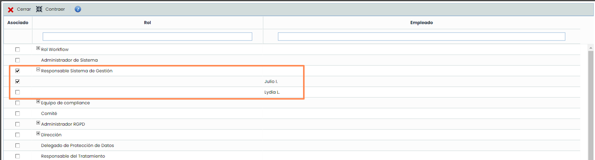
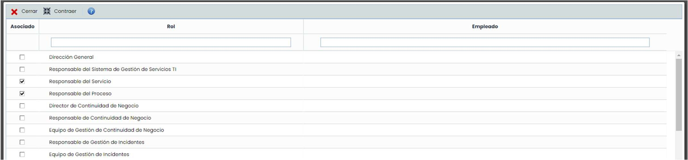
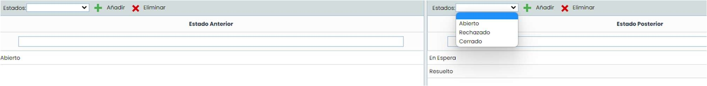
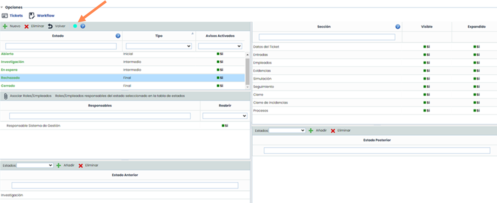

# ¿Cómo configurar un workflow de tickets en GlobalSuite®?


En este artículo trataremos cómo activar la funcionalidad de workflow para tickets, crear estados y secciones, asociar responsables y definir el flujo entre estados hasta validar un workflow completo listo para su uso en las opciones de Ticketing.


### Opciones de Ticketing con workflow

GlobalSuite® permite la generación de workflow en sus opciones de Ticketing, de forma que cada una de estas opciones pueden gestionarse a través de un workflow que el usuario previamente ha configurado.

Las opciones específicas de Ticketing que permiten la creación y gestión mediante workflow son las siguientes:

* Peticiones del Servicio.
* Incidencias y Problemas.
* Cambios y Entregas.
* Reclamaciones.
* No Conformidades.

En las siguientes páginas se mostrarán las posibilidades de configuración que ofrece la funcionalidad de workflow de Ticketing.

* Correctivas y Preventivas.
* Requerimientos (Audit Management).
* Brechas de Seguridad (Data Protection).
* Derechos (Data Protection).
* Comunicados (Data Protection).

### Fases para la Configuración de workflow de Tickets

### Paso 1. Creación de workflow

El primer paso para poder usar esta opción es la de activar la funcionalidad de Workflow de Tickets en una empresa.

Para ello hay que añadir el campo de Workflow en el tipo de Ticket en el que se quiere utilizar. Todo ello se realiza en **Ajustes**, en la [**Configuración de tickets**](https://help.globalsuitesolutions.com/es/globalsuite/v1/configuracion-tickets)**.**

En la sección de campos se despliegan las secciones del ticket que se quiere utilizar, y en alguna de ellas se añade el campo Workflow, y se guarda.

Al acceder a la funcionalidad de **workflow** aparece un listado con los workflow existentes para esa opción. En la tabla se puede observar si el workflow es válido o no; un workflow es válido cuando todos los estados que lo forman tienen asignados responsables y un flujo de estados válido que permite llegar a los estados finales.

A través de los botones “**Nuevo**” y “**Eliminar**” se pueden crear y eliminar workflow de la tabla, y el botón “Cambiar Nombre” permite asignar un nombre el workflow. El nombre asignado aparece en el formulario de gestión de tickets para su identificación.

### Paso 2. Creación de estados

Al acceder a un workflow, se muestra un formulario de configuración compuesto por varias tablas.

Al generar un nuevo workflow, éste se crea con un conjunto de **estados por defecto** que propone la herramienta. Los estados por defecto se crean sin configurar por lo que ninguno es válido. Cuando un estado no es válido se marca en color rojo. Las condiciones que se deben cumplir para que se considere un estado válido se encuentran definidas en el icono de ayuda de la tabla de estados.

Se pueden crear nuevos estados o eliminar a través de los botones **“Nuevo” y “Eliminar”**. El nombre de un estado se puede cambiar haciendo doble-click sobre uno de ellos. Además, los estados deben tener un tipo definido, existiendo tres posibilidades:

* **Inicial**. Primer estado asignado a un ticket.
* **Intermedio**. Estados por los que pasa un ticket. Pueden existir varios.
* **Final**. Estado final de un ticket. Pueden existir varios.

También se tiene la opción de que a los empleados asociados al estado se les avise por defecto o no, para ello hay una tercera columna llamada “Avisos Activados”, donde habrá que seleccionar “Sí” o “No” en función de si se quiere o no avisar a dichos empleados.

### Paso 3. Configuración de secciones

La tabla superior derecha sirve para la configuración de las secciones del formulario del ticket. Se permite una configuración específica de secciones para cada estado del workflow, por lo que es necesario seleccionar previamente un estado.

Al seleccionar un estado, en la tabla de la derecha aparecen todas las secciones del formulario del ticket. Por defecto, todas las secciones son visibles, editables y se presentan expandidas **para el estado seleccionado.**

* Para **ocultar** una sección, se debe pulsar sobre el valor “Sí” para que cambie a “No” en la columna “**Visible**”.
* Para que una sección no se muestre **expandida**, se debe pulsar sobre el valor “Sí” para que cambie a “No” en la columna “**Expandido**”.
* Para configurar una sección como no **editable**, se debe pulsar sobre el valor “No” para que cambie a “Sí” en la columna “**Solo Lectura**”.

  

### Paso 4. Asociación de responsables

Cada uno de los estados del workflow deben tener, como mínimo, un responsable asignado. Los **responsables asociados** a un estado podrán utilizarse para su asignación al ticket cuando éste se encuentre en dicho estado.

* Para asignar responsables a un estado primero hay que seleccionar el estado deseado. Tras esto, en la tabla de responsables aparecen los roles/empleados asignados al estado.

  
* A través del botón “**Asociar Roles/Empleados**” se permite la asignación de responsables al estado.  
  Al pulsar el botón “Asociar Roles/Empleados” aparece una ventana emergente que permite la asignación de responsables al estado. La asignación se realiza a través de la lista de roles y empleados de la organización, por lo que es necesario que los responsables estén asignados como mínimo a un rol de la organización.

Se permite la asignación tanto de un empleado como un rol completo. En este segundo caso, todos los empleados del rol podrán asignarse al estado del ticket. **Los empleados que aparecen son los que tienen asociado un usuario en la herramienta**.

Aquellas empresas que disponen de entidades pueden configurar un aspecto más en los workflow, concerniente a la asociación de responsables de las empresas superiores. Esto permite asociar un ticket a un rol que pertenece a una entidad superior de la entidad que tiene el ticket registrado.

En este tipo de empresas aparece una tabla nueva en la ventana de configuración de workflow. Esta tabla permite seleccionar los roles de la entidad superior que son responsables de un determinado estado. El funcionamiento descrito en los pasos anteriores es el mismo para esta tabla, excepto que en la ventana de asignación de roles sólo se pueden seleccionar roles no permitiéndose empleados concretos.

### Paso 5 . Configuración del flujo del workflow

El último paso para configurar un workflow de tickets es la creación de su flujo. Para ello existen dos tablas en la parte inferior que permiten indicar, para cada estado del workflow, los estados anteriores y posteriores. Es necesario seleccionar un estado del workflow en la tabla situada en la parte superior izquierda.

* **Estado Anterior**: Dado un estado seleccionado en la tabla de estados, permite seleccionar aquellos estados del ticket que son anteriores al estado seleccionado.
* En la imagen: sólo se puede llegar al estado que se está configurando desde el estado “Abierto”.
* **Estado Posterior**: Dado un estado seleccionado en la tabla de estados, permite seleccionar aquellos estados del ticket que son posteriores al estado seleccionado.
* En la imagen: el estado que se está configurando sólo podrá pasar al estado “En espera” y “Resuelto”.

## Resultado final

Tras realizar los pasos anteriores para cada uno de los estados de un workflow, se consigue un workflow válido de GlobalSuite® que permite su utilización en la opción de Ticketing dónde haya sido configurado.

La ventana de configuración del workflow mostrará un **punto verde** en la parte superior, indicando que todos los estados están correctamente configurados. Siempre que un estado sea incorrecto, el punto será de color rojo y el workflow no se considerará válido

