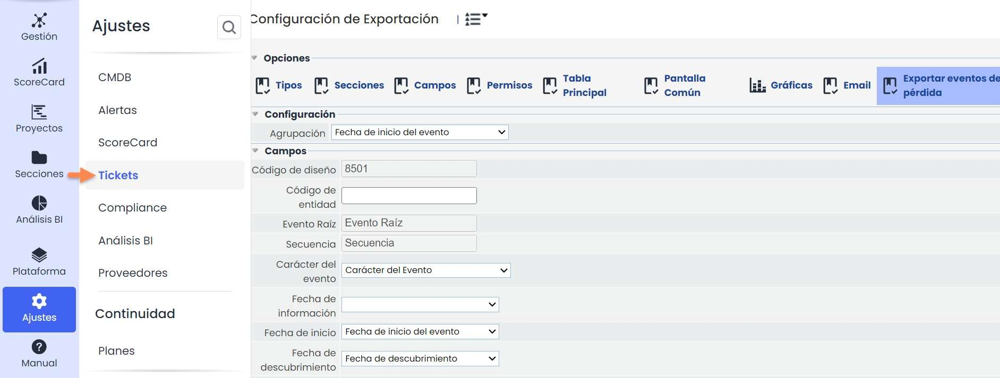
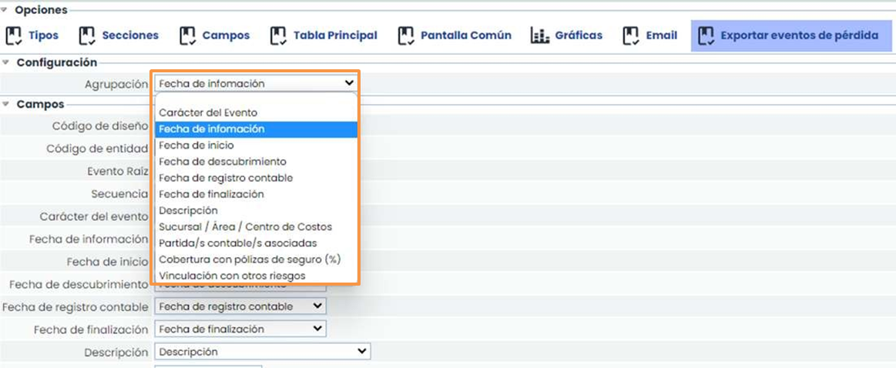
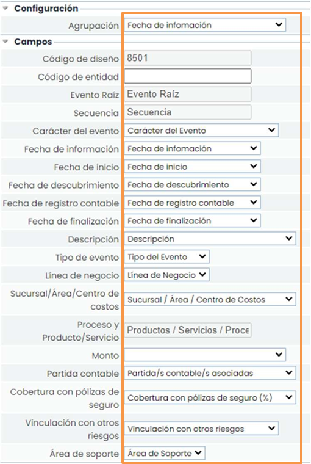
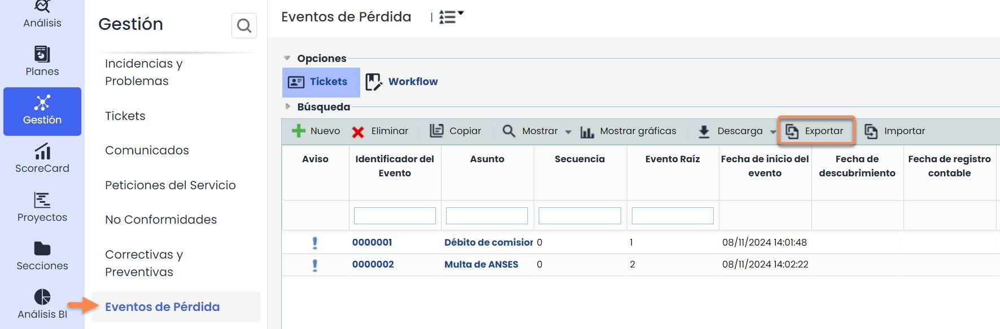
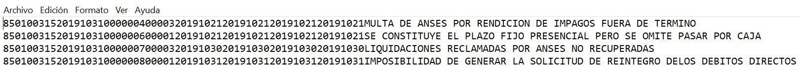
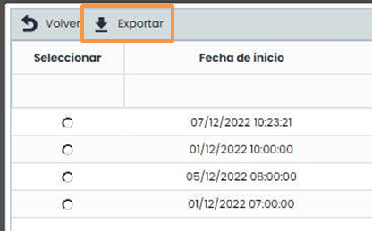
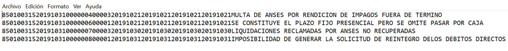

# ¿Cómo configurar y realizar la exportación de Eventos de Pérdida?


En este artículo explicaremos cómo exportar eventos de pérdida desde GlobalSuite® para cumplir con los requisitos normativos establecidos por las entidades reguladoras competentes.


La funcionalidad específica que permite exportar Eventos de pérdida desde GlobalSuite®, nace de la necesidad de las entidades que radican en la República Argentina de adaptarse a las normativas vigentes que exigen el envío de esta información al Banco Central de la República Argentina (BCRA), cumpliendo una serie de especificaciones. Estos requerimientos están contemplados en el documento oficial Presentación de informaciones al Banco Central; Sección 42. Base de datos sobre eventos de Riesgo Operacional.

En GlobaSUITE®, se desarrolló ésta funcionalidad cumpliendo estrictamente con todas las exigencias contempladas en el mencionado documento, siendo además una funcionalidad altamente parametrizable, por lo que su uso, puede extenderse a otros ámbitos de aplicabilidad según necesidades específicas de cada compañía.

Esta funcionalidad está disponible en el módulo Risk Management de GlobalSuite®.

## Configuración.

La configuración de esta funcionalidad se encuentra disponible en el apartado de Ajustes de GlobalSuite®, concretamente en la sección **Configuración > Tickets>** [**Exportar Eventos de Pérdida**](https://help.globalsuitesolutions.com/es/globalsuite/v1/exportar-eventos-de-perdida).

En la parte superior derecha de la pantalla se encuentra la opción específica, tal y como se muestra en la siguiente imagen.

En el primer campo, Agrupación, se deberá indicar el criterio por el que se agruparán los eventos de pérdida que se requiere exportar en un mismo fichero txt.

En la imagen, por ejemplo, se ha seleccionado como criterio el campo “Fecha de Información”.

### Mapeo de Campos

Seguidamente, se deberá mapear los campos que aparecen en la plantilla (resaltados en la imagen en color naranja) con los campos disponibles en el formulario del ticket eventos de pérdida (resaltados en la imagen en color verde). Esta asociación permitirá decidir qué información presente en el ticket se exportará en el archivo resultante.

## Funcionalidad.

La función de **Exportar** eventos de pérdida se encuentra dentro del menú Gestión, en la opción [**Eventos de Pérdida.**](https://help.globalsuitesolutions.com/es/globalsuite/v1/eventos-de-perdida)

Se deberá pulsar el botón **Exportar** para proceder a la selección de los eventos que se requiere extraer.

Tras ello, aparecerá una ventana emergente como la que se muestra en la siguiente imagen:

En esta ventana aparecerán, para su selección, las opciones disponibles según el criterio de agrupación que previamente se seleccionó en la opción de configuración. Véase [**Configuración. Mapeo de Campos**](como-configurar-y-realizar-la-exportacion-de-eventos-de-perdida.md#Mapeo-de-Campos) de esta guía.

En el ejemplo de la imagen, se seleccionó previamente como agrupación el campo “**Fecha de Información**”.

Se seleccionará la opción deseada y se pulsará sobre el botón Exportar obteniendo así el fichero txt resultante:

