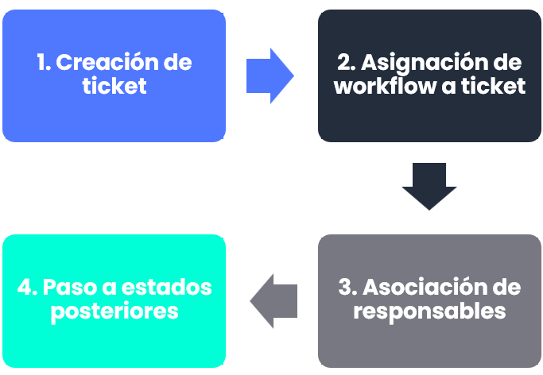
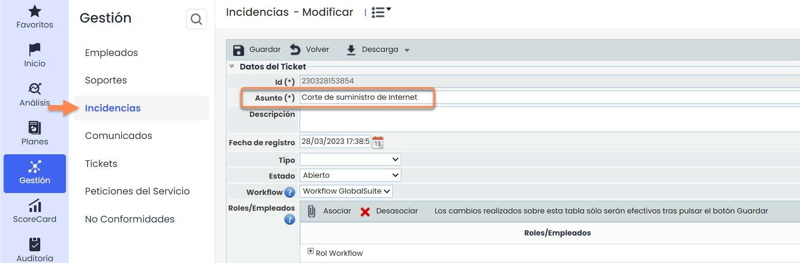
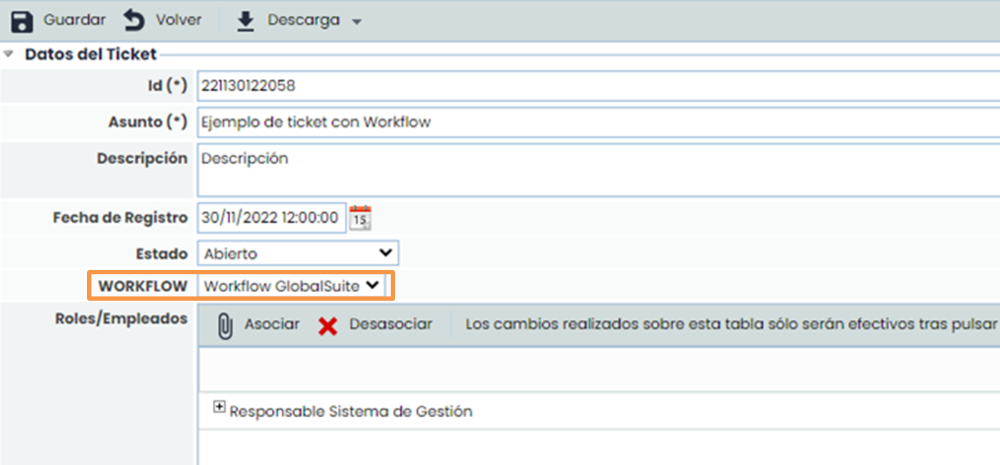
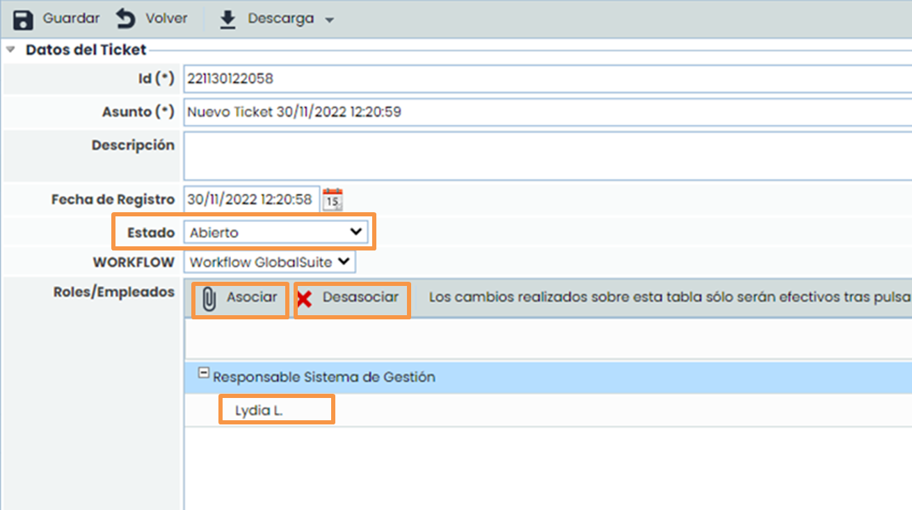
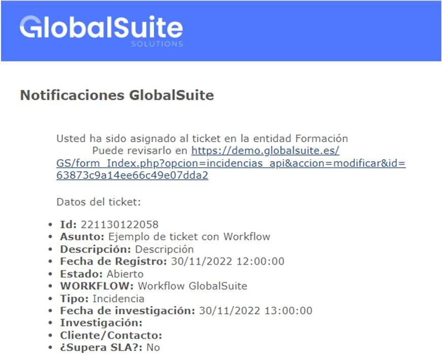
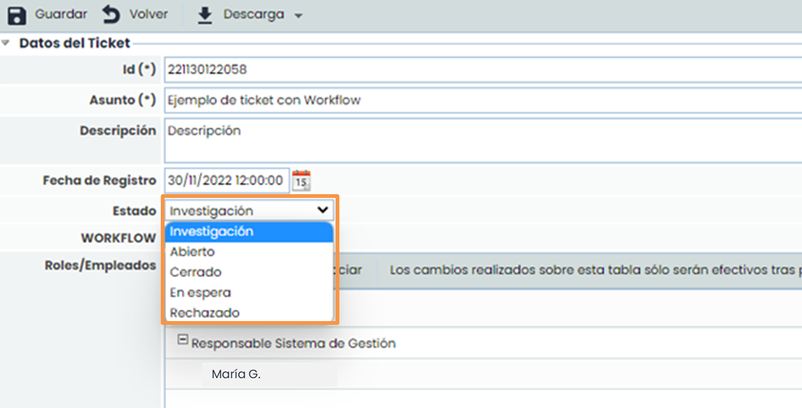
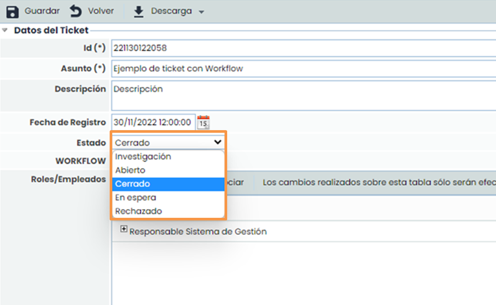
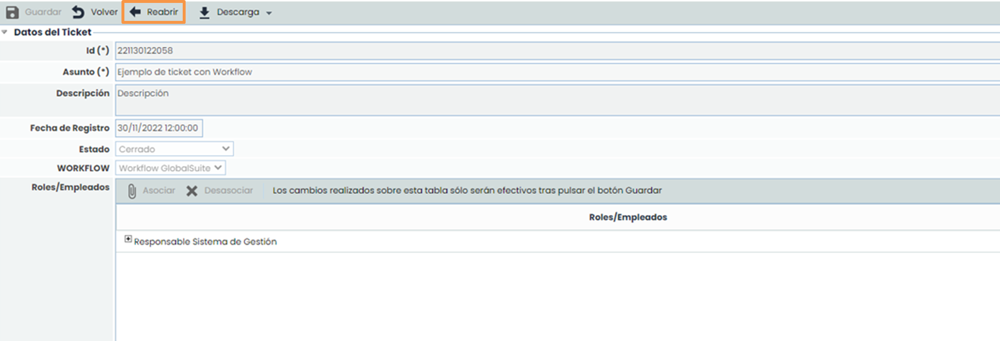

# ¿Cómo gestionar tickets con workflow en GlobalSuite®?


En este artículo tratamos cómo crear un ticket, asignarle un workflow, asociar responsables por estado y avanzar, cerrar o reabrir según la definición del flujo; aplicable a Peticiones de Servicio, Incidencias y Problemas, Cambios y Entregas, Reclamaciones y No Conformidades.


## Gestión Tickets con Workflow

### Asignación de workflow a ticket.

#### Opciones de Ticketing con workflow

GlobalSuite® dispone de una funcionalidad de Ticketing que está compuesta por un conjunto de opciones ubicadas en el menú “**Gestión**”. Estas opciones permiten gestionar diferentes tipos de tickets en función de su tipología, pero todas ellas tienen un punto en común: permiten su gestión a través de workflow.

Las opciones específicas de Ticketing que permiten la creación y gestión mediante workflow son las siguientes:

* Peticiones del Servicio.
* Incidencias y Problemas.
* Cambios y Entregas.
* Reclamaciones.
* No Conformidades.
* Correctivas y Preventivas.
* Requerimientos (Audit Management).
* Brechas de Seguridad (Data Protection).
* Derechos (Data Protection).
* Comunicados (Data Protection).

#### Fases para la Gestión de los Tickets a través de workflow

### Paso 1 - Creación de ticket

En cualquiera de las opciones de Ticketing donde haya un workflow válido**,** se permite crear un ticket asignando uno de los workflow diseñados. Para ello habrá que pulsar el botón nuevo y entrar en el formulario.


\*\*Ver Guía:\*\* Configuración Workflow Tickets


Al crear un ticket, en primer lugar, hay que indicar un asunto y una descripción. Para este ejemplo, se ha creado un ticket como el que se muestra en la imagen inferior.

### Paso 2 - Asignación de workflow a ticket

El siguiente paso corresponde a la asignación de un workflow al ticket. En el campo “**Workflow**” aparecen todos los workflow válidos disponibles. Al seleccionar uno de ellos, en la tabla “Roles/Empleados” aparecen los responsables asignados al primer estado del workflow.

### Paso 3 - Asociación de responsables

En la tabla “Roles/Empleados” aparecen los responsables del estado del workflow seleccionado, en este caso “**Abierto**”. En caso de que se quiera asociar a más responsables de los que por defecto vienen con el estado configurado, se puede utilizar el botón “**Asociar**”. Si por el contrario se quiere quitar alguno de los responsables se puede utilizar el botón “**Desasociar**”.

Al guardar el ticket con la información anterior, los responsables asignados reciben un aviso automático mediante correo electrónico. Si se desea que algún responsable no reciba el aviso automático, se debe indicar en la tabla “**Roles/Empleados**” pulsando sobre el campo “**No**” de la columna “**Avisar**”.

Para este ejemplo, el aviso recibido es el siguiente:

### Paso 4 - Cambio de estado del ticket

Un ticket puede avanzar por los estados de un workflow utilizando el campo “**Estado**”. Al pulsar sobre la lista desplegable, aparecen aquellos estados que pueden asignarse al ticket, en función del estado actual del ticket.

Al cambiar el estado de un ticket, los roles/empleados asignados se actualizan con los responsables concretos del nuevo estado. Se puede utilizar el botón “**Asociar**” para asociar más responsables. Si por el contrario se quiere quitar alguno de los responsables se puede utilizar el botón “**Desasociar**”. Al guardar el ticket con los cambios introducidos, los nuevos responsables son avisados mediante correo electrónico de la asignación del ticket.

Cuando un ticket llega a uno de los estados finales definidos en el workflow, el ticket se cierra automáticamente.

Para este ejemplo, se ha definido un estado denominado “**Cerrado**” que es del tipo “Final” en el workflow. Esto provoca que el ticket, al alcanzar este estado, se cierre automáticamente, se deshabiliten todos sus campos y ya no pueda modificarse.

No obstante, un ticket cerrado se puede reabrir pulsando en el botón “Reabrir” que se encuentra en la parte superior del ticket.

