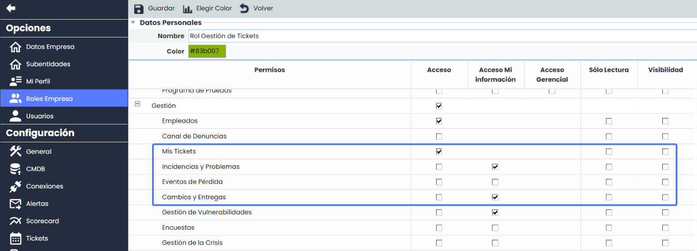
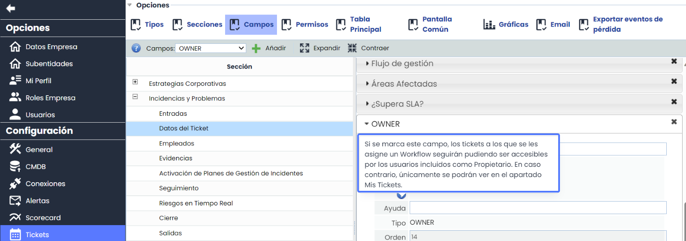
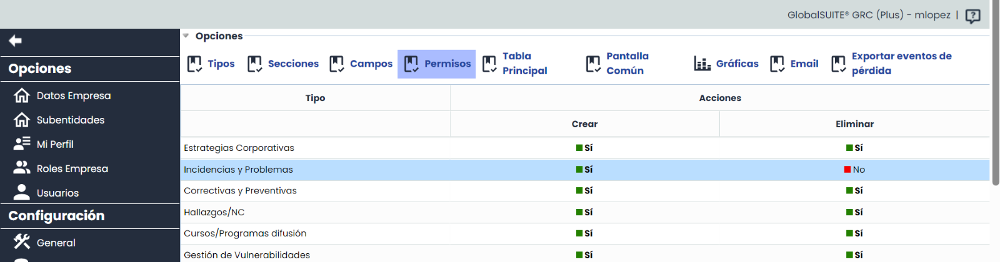
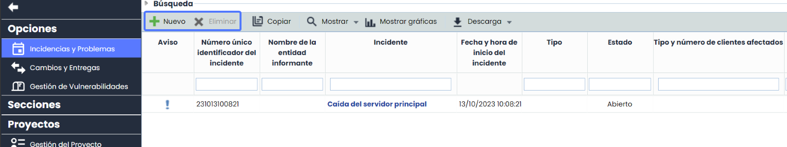
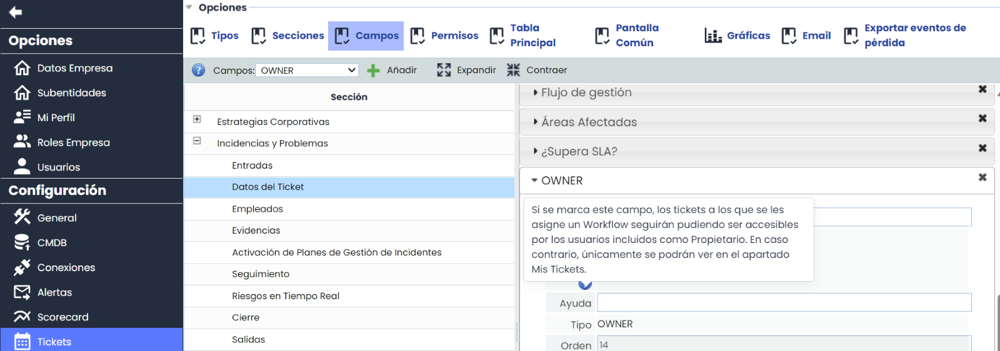
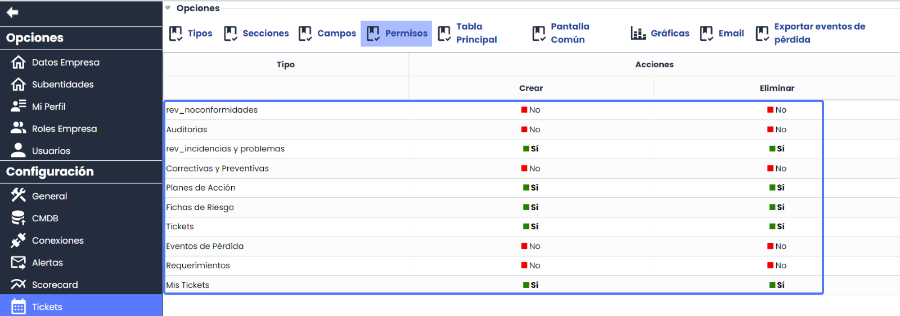
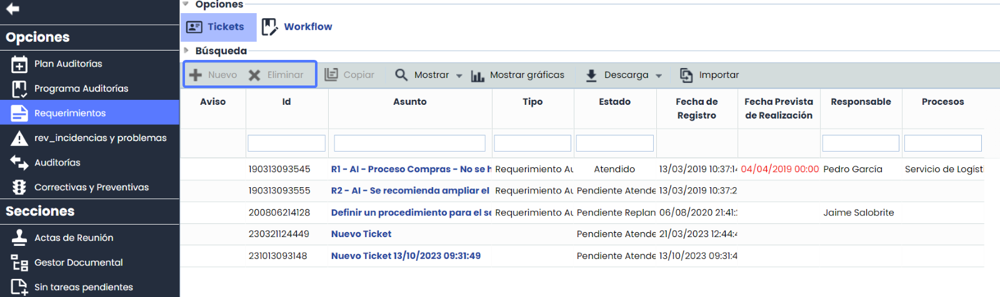
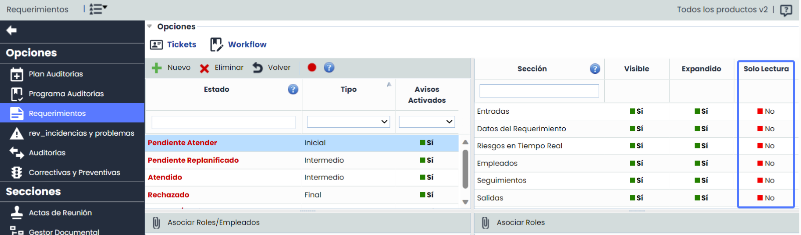

# ¿Cómo puedo configurar los permisos de los usuarios con acceso a las opciones de ticketing?


En este artículo veremos todas las posibilidades de configuración de los permisos de los usuarios para acceder y modificar a las opciones de ticketing.


Cuando en GlobalSuite se habla de Ticketing, se refiere a todas las opciones que permiten a la empresa gestionar peticiones internas, incidencias, planes de acción, hallazgos de auditoría, etc. En definitiva, cualquier proceso de la compañía en el que en la resolución intervengan varias áreas y sea necesario llevar la gestión automatizada a través de flujos de aprobación.

Cuando los flujos de aprobación son complicados es muy importante tener una definición correcta de permisos entre todos los usuarios de GlobalSuite.

Este artículo afectará a todas las licencias de GlobalSuite ya que esta parte de ticketing es una opción Core del sistema.

## ¿Cómo configurar los permisos generales para estas opciones?

Antes de ir al detalle específico por opción, se detallará la forma de configurar los perfiles de acceso, para ello, habría que hacerlo en Ajustes> Roles Empresa. Se accederá a un perfil de acceso que representarán grupos de usuarios con los mismos permisos.

Se podrá configurar según las columnas de la tabla:

* Acceso: Acceso total a la opción. Podrá ver y modificar los tickets de la opción siempre y cuando estos tickets no tengan Workflow. En este caso solo lo podrá modificar si está como responsable de un estado del WF.
* Acceso Mi Información: Podrá ver y modificar solo los tickets en los que tiene algún tipo de responsabilidad. Hay que distinguir dos opciones:

* Si el ticket no tiene WF, el usuario verá los tickets de los que es propietario.
* Si el ticket tiene WF, se podrá configurar la visibilidad del propietario del ticket cuando se añade la opción. Esto da la posibilidad de que el propietario haga seguimiento del ticket en cualquier fase del WF.

## ¿Cómo puedo configurar los permisos de creación y eliminación sin Workflow de aprobación?

Estos permisos solo afectan a usuarios que tengan acceso a Mi Información dentro de cualquier tipo de ticket. El objetivo es poder asociar a cualquier usuario un plan de acción, una incidencia, un evento de pérdida, una observación de auditoría, etc. Y que no la pueda eliminar.

Si tenemos una asociación sin WF o solo hay un estado se podrá configurar de la siguiente forma:

En este ejemplo, todos los usuarios configurados con Acceso Mi Información, podrán crear Incidencias, pero no podrán eliminar. La vista de la opción para un usuario de este tipo será:

Cuando creamos un ticket, automáticamente el sistema asignará como propietario al usuario que lo ha creado. A partir de aquí la gestión y seguimiento del tipo de ticket es de la misma forma que si tuviera acceso total. Como no hay WF de aprobación el cambio de estado será manual.

Este ejemplo concreto, es idóneo para equipos de riesgos o auditorías que delegan en los responsables de áreas o procesos la creación de cualquier incidencia o plan de acción, pero que quieren controlan los permisos de eliminación

## ¿Es posible configurar los permisos de creación y eliminación teniendo un Workflow de aprobación?

Si el equipo de auditoría o riesgos cuenta con un sistema automatizado de varios estados donde en cada estado hay responsables y se quiere llevar un control completo de las acciones de los usuarios, se podrá establecer una configuración de estos permisos.

Si tenemos un WF también se podrá configurar los permisos de la misma forma que el ejemplo anterior, donde los usuarios podrán crear sus tickets y asociar un WF correspondiente. Se tienen varias opciones con esta configuración:

* Si el usuario que crea el ticket está de responsable del primer estado. Este usuario seguirá viendo el ticket.
* Si el usuario no está de responsable, al ser propietario se podrá configurar la visibilidad con la opción identificada en el primer punto de este documento

En este ejemplo, se configurará las opciones para que solo los equipos de auditoría, riesgos, seguridad, etc. puedan tener una gestión centralizada por el equipo y crear ellos los tickets y asociarlos a través del WF de aprobación.

Configuración de la opción para que no se pueda crear ni eliminar:

De esta forma los equipos involucrados en la resolución serán notificados cuando creen un ticket donde tengan algún tipo de responsabilidad y el equipo encargado de la gestión podrá estar seguro de que no habrá ningún tipo de acción no deseada por parte de los responsables de resolución.

Esta funcionalidad ha sido muy demandad por los equipos de auditoría donde los auditores podrán crear cualquier observación o hallazgo desde las opciones de auditoría y asociarlo al equipo correspondiente.

Adicionalmente a la creación de permisos podremos detallar campo por campo si es posible modificarlo o no o si solo es de Solo Lectura. Para ello, habrá que detallarlo dentro de la configuración del WF. Se pulsará en el estado del WF y en la parte derecha, configurar los campos a través de las secciones.

Esta combinación de funcionalidades aportará a la opción una gran seguridad y detalle de los permisos definidos.
