# ¿Cómo sincronizar una cuenta de correo con el ticketing de GlobalSuite®?


El propósito de esta guía es ver que elementos hay que configurar o parametrizar en GlobalSuite, para sincronizar una cuenta de correo con cualquiera de las opciones de Ticketing. Es muy útil para el envío de información de los usuarios y que se registren directamente como tickets en la herramienta. Los tickets que se pueden sincronizar son todos los que se dispongan en la herramienta y dependerán de que módulos se tengan disponibles.


Para registrar automáticamente en GlobalSuite® los correos entrantes como tickets, primero debes activar las conexiones externas, configurar la cuenta IMAP y definir el mapeo de campos. Esta sincronización puede aplicarse a distintos módulos de ticketing, según las licencias disponibles en tu empresa.

**Serán los siguientes:**

* Tickets
* Peticiones de Servicio
* Incidencias y problemas
* Eventos de Pérdida
* Derechos
* Cambios y entregas
* Comunicados
* Reclamaciones
* No Conformidades
* Correctivas y Preventivas

Para sincronizar un correo electrónico, se vincula cualquiera de las opciones de ticketing a una cuenta de correo, y todos los correos que se reciban a esa cuenta van a aparecer como un nuevo registro al sincronizar. Para configurar esta opción en una empresa, se debe ir a Ajustes y dentro de la opción “Datos Empresa”, comprobar que se tiene activado el módulo External Connections. Si no lo tiene, debe contactar con CSC (Centro de Soporte a Clientes).

## Configurar la conexión de correo **(Paso 1 de 3)**

Esta licencia permite que cuando se accede a **Ajustes >** [**Conexiones**](https://help.globalsuitesolutions.com/es/globalsuite/v1/conexiones), se pueda configurar una conexión de correo. En todas las conexiones que salen disponibles, se ha de seleccionar E-mail.

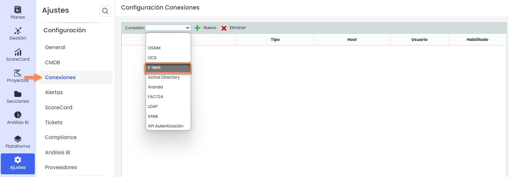

En este caso de Cuenta de correo, se ha de configurar la Nueva Conexión pinchando el link azul para acceder a los detalles de la misma.

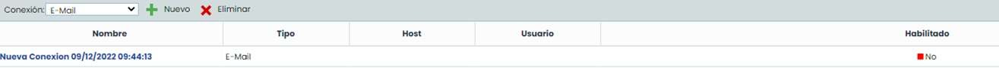

Lo primero una vez se accede a los detalles para poder configurar es activar el check Habilitado. Una vez que se tiene activado el check de habilitado para modificar la Conexión, se van a poder incorporar al mismo los valores que sean necesarios la sincronización.

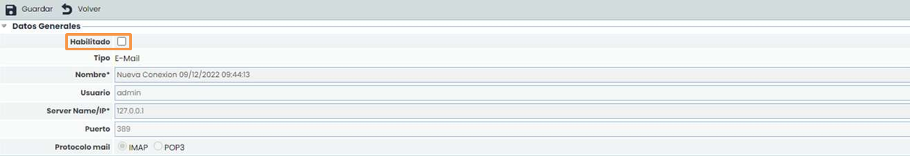

Estos valores que se han de configurar son los siguientes:

* **Nombre**: Nombre de la conexión
* **Usuario**: email o correo electrónico con el que se va a estar sincronizado, en caso de que sea por ejemplo de Protección de Datos podría ser por ejemplo [DPO@empresa.com](mailto:DPO@empresa.com) o lo que sea necesario.
* **Server Name / IP\*:** En el caso del Servidor en este caso será [imap.gmail.com](http://imap.gmail.com)
* **Puerto**: 993
* **Protocolo mail:** IMAP

Por último, en el apartado “Conectado con…” se debe decidir qué opciones de Ticketing se quiere que tenga ésta sincronización de correo.

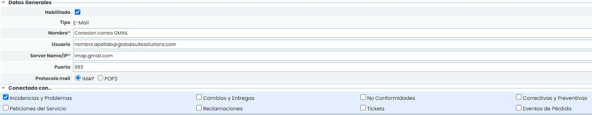

## Habilitar IMAP en la cuenta de correo **(Paso 2 de 3)**

Para el **IMAP o POP3** en el caso de correos Gmail se debe usar IMAP, y para hacerlo se ha de ir a la cuenta de correo, dentro de la parte de Configuración se tiene una pestaña que se llama “Reenvío y correo IPOP/IMAP” a la que hay que acceder. Tras ello se debe pulsar “**Habilitar IMAP**” y tras ello se pulsa el botón **Guardar** de la parte inferior. Después de guardar aparecerá en verde.

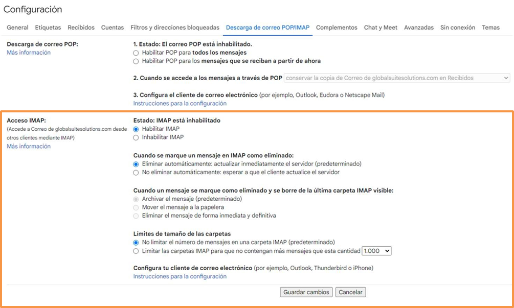

Se pueden configurar algunas otras opciones como estos elementos de configuración si así se desea. Lo importante es que esté habilitado el IMAP para poder recibir esos correos o notificaciones.

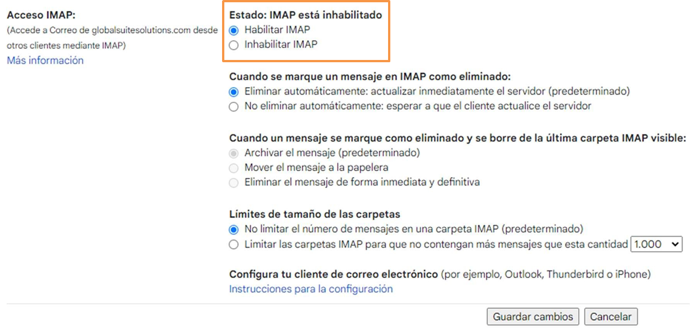


En resumen, se debe haber configurado:
\* Ajustes > [\*\*Conexiones\*\*](https://help.globalsuitesolutions.com/es/globalsuite/v1/conexiones)en GlobalSuite, se ha vinculado el correo que se desee a la conexión.
\* En el correo, se ha habilitado el IMAP para poder recibir esas notificaciones.


## Mapear campos y ejecutar la sincronización **(Paso 3 de 3)**

Quedaría por hacer un tercer paso, que sería decir en la configuración de los tickets que se hayan marcado en la Conexión, los campos que se pueden sincronizar a qué campos corresponden dentro del formulario de los tickets.

Se hace en la configuración dentro de Ajustes > [**Tickets**](https://help.globalsuitesolutions.com/es/globalsuite/v1/configuracion-tickets), donde en el menú interno de la opción hay una que se llama Email que sirve para configurar los campos de sincronización con el email.

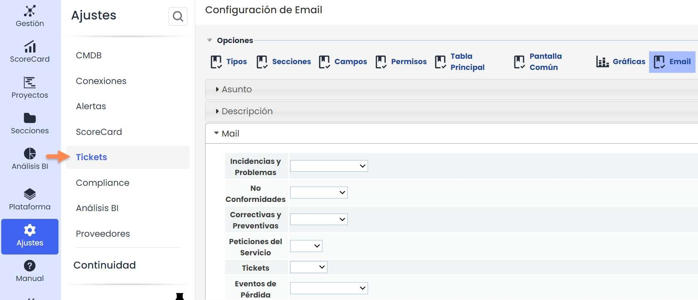

En la opción **Email** se tienen los siguientes campos que se pueden configurar para que se quede correcto y funcione la sincronización.

En cada uno de los tickets que se quiera se pueden parametrizar estos 3 campos **Asunto, Descripción y Mail** haciendo el emparejamiento en cada uno de ellos con los campos que tengan ya creados cada ticket.

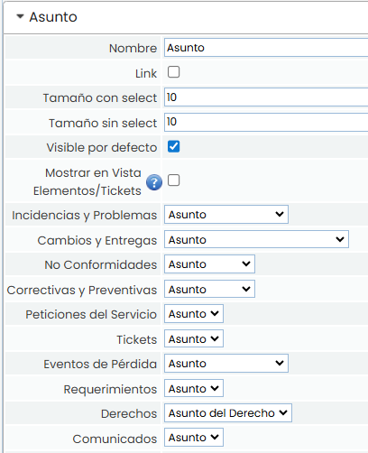

**Asunto**, sería el asunto del correo. En la captura, para todos los casos, por ejemplo, se le ha llamado Nombre Derecho. Aunque se puede seleccionar si así se quiere cualquier tipo de campo de tipo INPUT que haya en el ticket creado.

El segundo campo dentro de las 3 opciones que se pueden mapear es el campo Descripción que habrá que emparejar o mapear con su correspondiente campo TXT de tipo Texto.

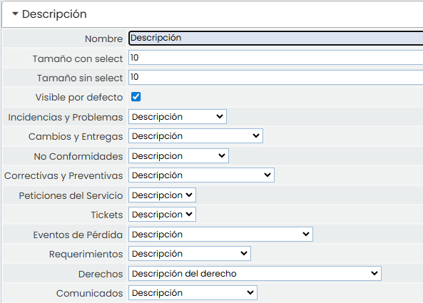

**Descripción**, que sería el contenido propio del correo en la captura, para el caso de *Derechos***,** por ejemplo, se le ha llamado *Descripción del derecho*. Aunque se podría seleccionar cualquier tipo de campo de tipo TEXT que se tenga dentro del ticket.

El tercer campo dentro de las 3 opciones que se pueden mapear es el campo Email que habrá que emparejar o mapear con su correspondiente campo **Input de tipo Email.**

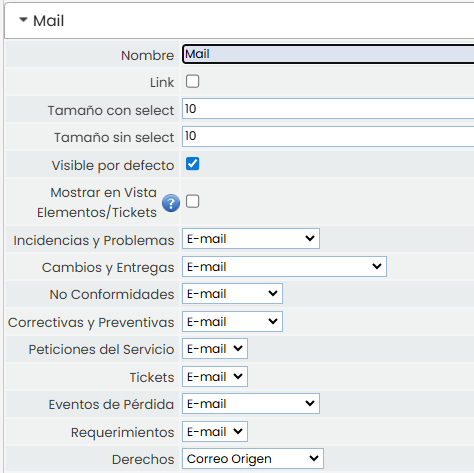

**Mail**, que significa el correo del origen, es decir que persona está enviando el correo. Se ha de decir para qué ticket o tickets que se quieren sincronizar con que campos están vinculados. Por ejemplo si se quiere sincronizar en Derechos, se mapea el Mail con el campo “Correo Origen” que tiene el ticket.

### Sincronización

El botón Sincronizar solo estará visible en las opciones que se hayan habilitado en la opción de **Ajustes >** [**Conexiones**](https://help.globalsuitesolutions.com/es/globalsuite/v1/conexiones) (Primer paso).

Para ello, solo desde el ticket que se haya habilitado aparecerá la opción Sincronizar siguiente:

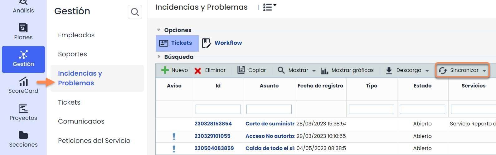

La herramienta lo que va a hacer es leer los emails, de tal forma que como se ha configurado tomará el correo origen, el asunto del correo y el texto o descripción del mismo y a través del botón sincronizar los incluirá en la herramienta de forma automática.

Para ello desde la opción de Gestión/ Ticket, se ha de ir al ticket en concreto configurado, se ha de ir a sincronizar y pulsar la conexión que se quiera de las que estén configuradas. En este caso se llamar Conexión CORREO GMAIL.

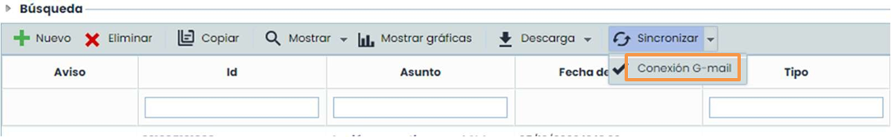

Una vez se acceda a la conexión, habrá que introducir la contraseña del Correo y pulsar el botón Sincronizar para poder acceder a la información del mismo. Una vez se haga, se quedara cargando la información del email de tal forma que se habrán incluido como tickets esos emails.

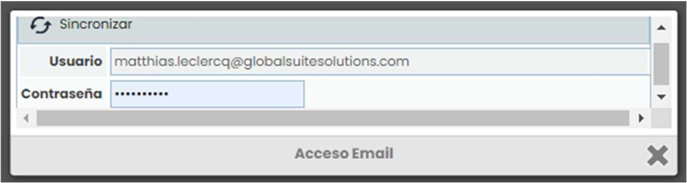

Tras este paso se habrán sincronizado los correos No Leídos que hubiera en el correo. Y se habrá cargado los campos configurados de Nombre, Asunto y Mail .

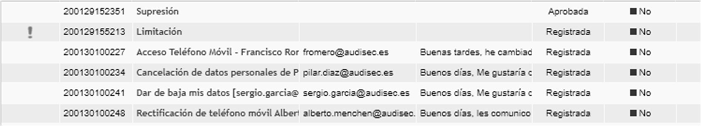

En algunos casos para que este último proceso de sincronización suceda, es necesario hacer un paso adicional. Esto es necesario para el caso de Gmail. Se trata de acceder a través de este link para activar el acceso de aplicaciones poco seguras, dado que Google en algunos casos no deja recuperar los datos del email: https://support.google.com/accounts/answer/6010255?p=lsa\_blocked&hl=es&visit\_id=637159142840464317-172962183&rd=1

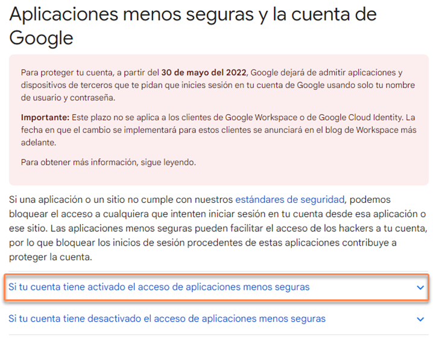

Dentro de la opción, hay que pulsar el link de “Acceso de aplicaciones poco seguras”.

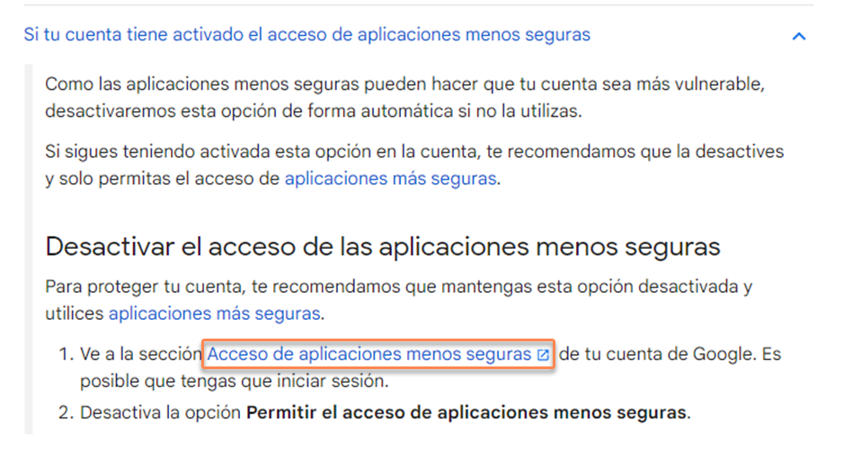

Y una vez dentro se debe Permitir el acceso de aplicaciones poco seguras: SI. Tras esta activación debería ya poder sincronizar el correo en los tickets.

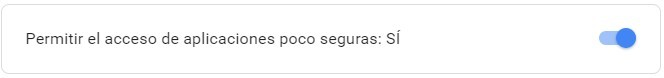
