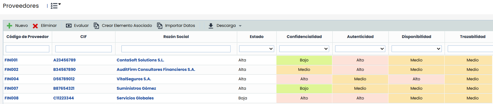
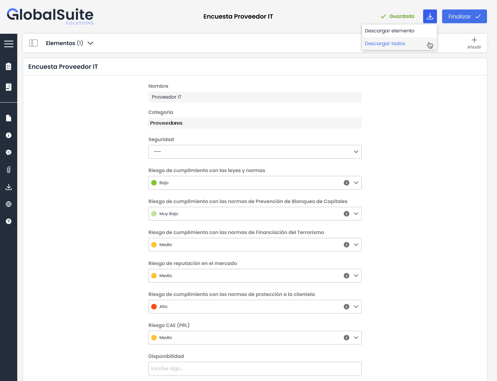
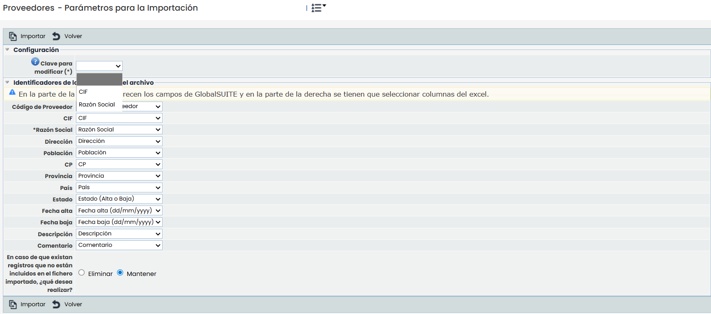
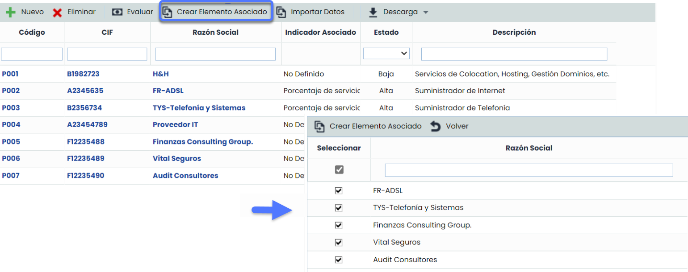
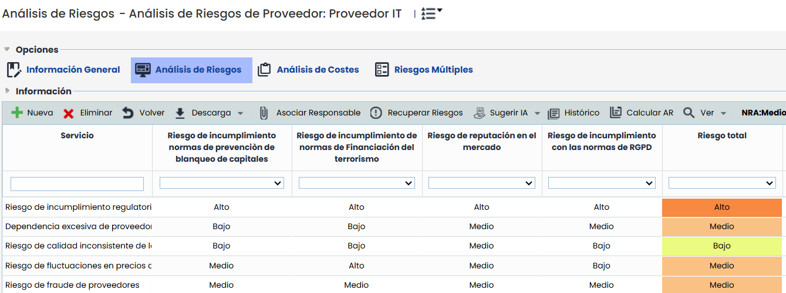
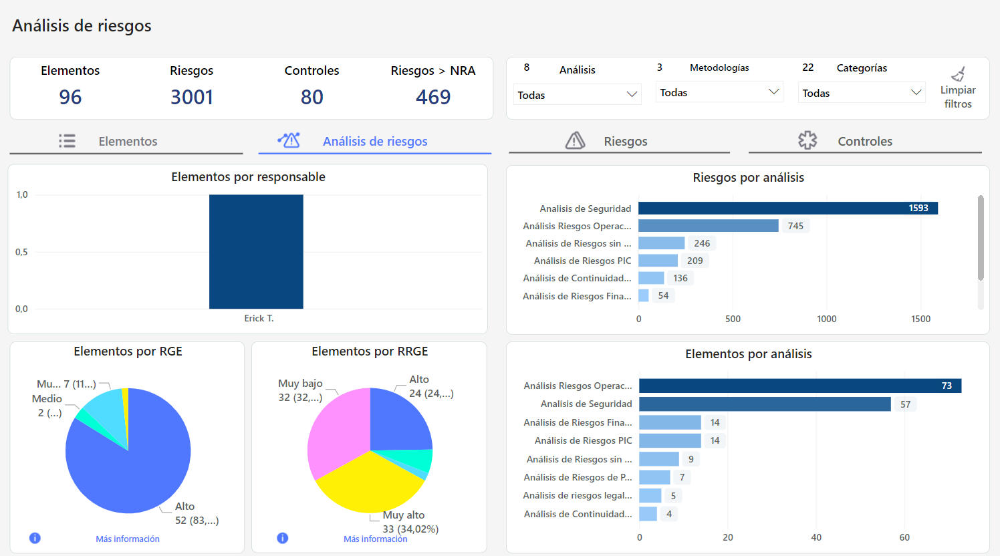
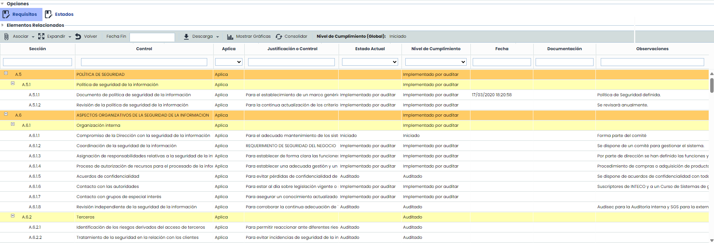
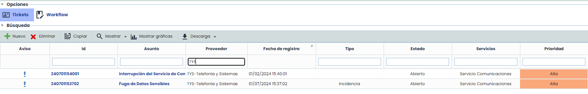
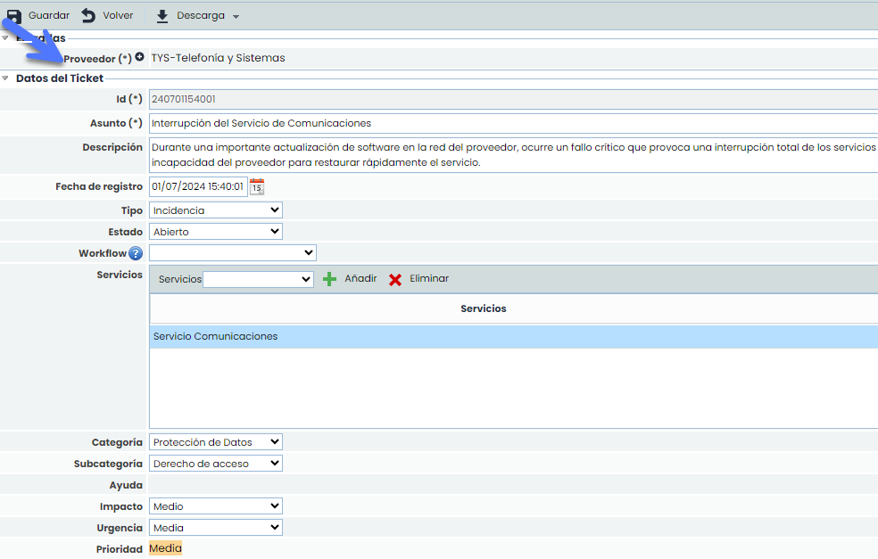

# GlobalSuite® TPRM


\*\*Controlar la colaboración con terceros, clave para el éxito\*\*
La gestión de TPRM con un software puede transformar radicalmente a las organizaciones. Confía en nosotros para controlar la relación con tus proveedores.


## Entendiendo los Riesgos de Terceros

### ¿Qué es un tercero (Third – Party)?

En el ámbito empresarial, un tercero es cualquier entidad externa con la que una organización mantiene una relación comercial, incluyendo proveedores, fabricantes, proveedores de servicios, socios comerciales, distribuidores, revendedores, agentes y vendedores. Estas relaciones son vitales para el funcionamiento y éxito de las empresas, por lo que la Gestión de Riesgos de Terceros (TPRM) se ha convertido en un componente esencial de los programas de ciberseguridad.

### ¿Qué es la gestión de riesgos de terceros (TPRM)?

La Gestión de Riesgos de Terceros (TPRM) es un proceso crucial enfocado en identificar y mitigar los riesgos asociados con la externalización de servicios a entidades externas. Este proceso es crítico por varias razones:

* **Control y visibilidad reducida:** Las organizaciones a menudo no tienen control directo ni visibilidad completa sobre las prácticas de seguridad de sus terceros.
* **Aumento de los vectores de ataque:** Cada proveedor puede actuar como un canal para brechas de seguridad o un ataque cibernético, incrementando la superficie de ataque, y por ende el riesgo.
* **Regulaciones de protección de datos:** Normativas como el GDPR, DORA, ESG y otras exigen controles estrictos de TPRM, con consecuencias financieras significativas si no gestionan adecuadamente los riesgos asociados con terceros.

## Cómo GlobalSuite® mejora la Gestión de TPRM

Con GlobalSuite® Third-Party Risk Management podrás optimizar la gestión de riesgos de terceros, mejorando la seguridad, cumplimiento normativo y la resiliencia operativa. Un sistema TPRM proporciona un marco para gestionar sistemáticamente estos riesgos, lo cual es esencial para:

* **Proteger los activos críticos:**  Asegura que la información sensible y los activos corporativos estén protegidos adecuadamente.
* **Mantener la conformidad regulatoria:** Ayuda a cumplir con las regulaciones aplicables, evitando multas y sanciones.
* **Preservar la reputación corporativa:** Evita los daños reputacionales que pueden surgir de las acciones o el incumplimiento de los terceros.
* **Fomentar la resiliencia operativa:** Permite a tu organización anticipar y responder efectivamente a los problemas que puedan surgir con terceros, minimizando las interrupciones.

## Características principales

### Inventario unificado de terceros

* **Homologación y categorización de terceros:** Clasifica a los proveedores según las operaciones que realizan en la organización, analizando su nivel de riesgo inicial y la criticidad de los elementos e información que manejan.

  * **Configuración personalizada**: Personaliza la metodología que utilizas para evaluar a tus proveedores y qué información se visualiza en cada apartado de la solución.

* **Recopilación automática de información**: Automatiza la obtención de datos de primera mano e importa masivamente desde diversas fuentes a través de los distintos tipos de encuestas automatizadas.

* **Sincronización con otras aplicaciones:** Conecta a tus proveedores de cualquier otra aplicación para ahorrar tiempo y reducir errores.

  * **Automatización de conexiones mediante API**: Actualiza de forma automática la valoración de Proveedores, actualiza las operaciones que gestiona cada proveedor, y enlaza con herramientas de otros departamentos (Compras, IT, etc.) para tener la información disponible y actualizada en todo momento.

    
  * La **Importación de Proveedores** Permite cargar y actualizar proveedores de forma semiautomática mediante Excel. Además, puedes realizar altas masivas o actualizaciones, y también decidir qué hacer con la información de los proveedores existentes.

* **Creación de elementos relacionados de forma masiva:**  Crea elementos asociados a múltiples proveedores de forma masiva, asegurado que los elementos asociados a los proveedores seleccionados, estén disponibles en el Inventario. Esto simplifica y agiliza el proceso de creación de elementos relacionados, mejorando la eficiencia y la gestión de proveedores.

### Identificación y Mitigación de Riesgos:

* **Evaluaciones periódicas**: Realiza evaluaciones continuas de riesgos asociados a cada tercero y aplica controles para mitigarlos.
* **Revisión de Evidencias**: Revisa los cuestionarios específicos para pedir las evidencias necesarias para comprobar los requisitos mínimos que debe cumplir el proveedor.
* **Metodología de cálculo flexible**: Adapta la metodología de cálculo de riesgos de acuerdo a tus necesidades específicas.
* **Planes de acción**: Implementa planes de acción personalizados para la mitigación y gestión de riesgos, integrando flujos de trabajo eficientes.

### Compliance

GlobalSuite® cuenta con un módulo especializado para evaluar las normativas que se exigen a cada proveedor, una parte fundamental del proceso de cumplimiento. Este módulo ofrece una solución integral para gestionar y asegurar el cumplimiento normativo, facilitando la evaluación, seguimiento y mejora continua de los proveedores.

### Gestión de Incidentes.

En GlobalSuite®, la gestión de incidentes con terceros se optimiza al vincular cada incidente con el proveedor correspondiente, facilitando una respuesta rápida y eficaz.

La plataforma permite gestionar las incidencias y sus riesgos mediante flujos de trabajo personalizables, adaptados a las necesidades específicas de cada organización. Además, los incidentes son completamente configurables con distintos tipos de campos, lo que permite una gestión detallada y precisa de cada situación. De esta manera, GlobalSuite® garantiza un seguimiento y resolución óptimos de las incidencias, mejorando la colaboración y minimizando los riesgos asociados a los terceros.

### Dashboard específico de TPRM

Visualiza en un único panel el estado de los riesgos, encuestas y tickets relacionados con terceros. Este dashboard facilita el análisis y la toma de decisiones estratégicas. Puedes consultarlo en: [Dashboard TPRM – GlobalSuite®](https://help.globalsuitesolutions.com/es/globalsuite/v1/dashboard-tprm)

### Beneficios del Uso de GlobalSuite TPRM

El uso de GlobalSuite® TPRM ofrece numerosos beneficios para la gestión de riesgos de terceros, entre los cuales destacan:

* **Automatización de procesos críticos**: Reduce significativamente el tiempo y los recursos dedicados a la evaluación y monitoreo de terceros, permitiendo una gestión más eficaz y menos propensa a errores humanos.
* **Mejora de la coordinación interna**: Al unificar y centralizar la información y los procesos, facilita la colaboración entre diferentes departamentos y equipos dentro de la organización.
* **Análisis exhaustivo de riesgos**: Proporciona herramientas avanzadas para la identificación y mitigación de riesgos, ofreciendo una visión clara y detallada de la postura de riesgo de cada tercero.
* **Evidencias centralizadas**: Dispondrás de un repositorio común para evidenciar el  
  cumplimiento de tus terceros en las materias que apliquen
* **Cumplimiento normativo**: Ayuda a las organizaciones a cumplir con las regulaciones y normativas vigentes, evitando sanciones y protegiendo la reputación corporativa.
* **Ahorro de costes**: La automatización y la optimización de los procesos de TPRM se traducen en un retorno de inversión significativo y en una reducción de los costos operativos a largo plazo.
* **Visión estratégica a través del dashboard de TPRM:** Gracias al dashboard específico del módulo, podrás visualizar de forma consolidada los riesgos, encuestas y tickets relacionados con terceros. Esto permite tomar decisiones más informadas y proactivas.


Puedes solicitar información adicional sobre el módulo TPRM GlobalSuite® escribiendo a [comercial@globalsuitesolutions.com](mailto:comercial@globalsuitesolutions.com)

