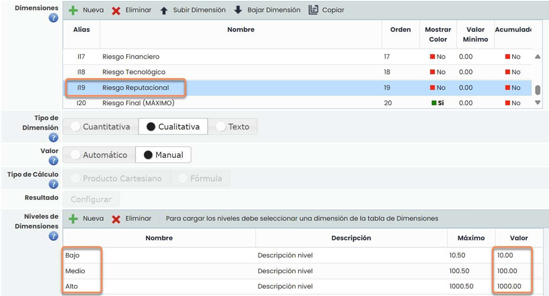
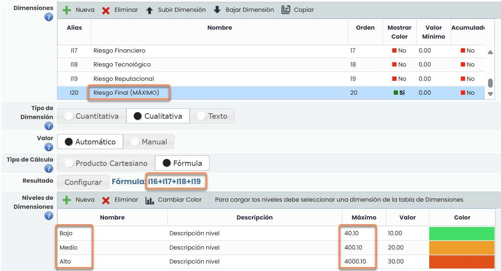
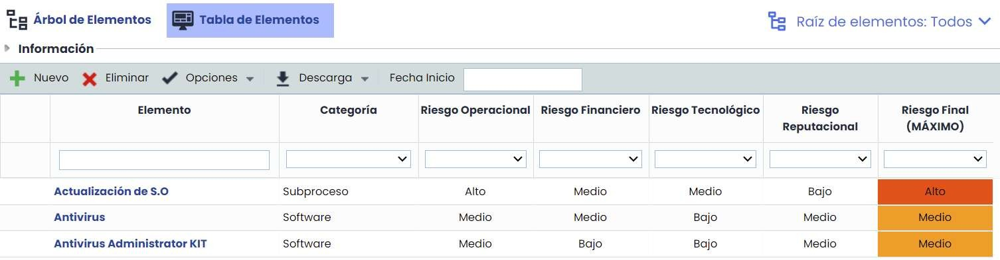
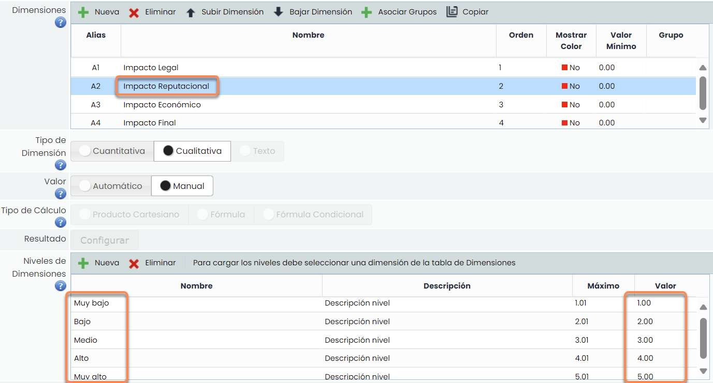
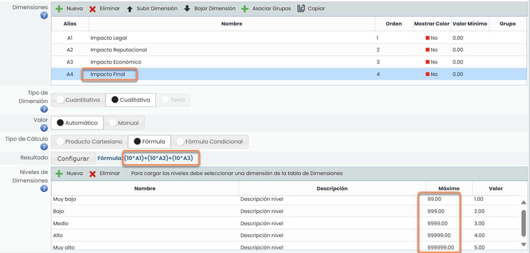

# ¿Cómo configurar una dimensión MÁXIMO en metodologías de GlobalSuite?


Este tutorial explica cómo configurar una \*\*dimensión automática tipo MÁXIMO\*\* dentro de las metodologías de GlobalSuite® (elementos, riesgos, controles).
El objetivo es permitir que una dimensión calcule automáticamente el \*\*valor máximo\*\* entre varias dimensiones cuantitativas o cualitativas, facilitando el análisis de riesgos o impactos globales sin requerir cálculos manuales.


## Introducción

GlobalSuite permite la configuración de dimensiones CUANTITATIVAS, CUALITATIVAS o TEXTO dentro de las metodologías para:

* INVENTARIO
* METODOLOGÍAS DE RIESGOS
* METODOLOGÍAS DE CONTROLES

Adicionalmente, estas dimensiones pueden configurarse como MANUALES (donde el usuario indica el valor directamente), o AUTOMÁTICAS, que se calculan en base a otras dimensiones.

El cálculo AUTOMÁTICO puede configurarse mediante FÓRMULA, y mediante este documento, se explica cómo configurar una dimensión para que sea el máximo de otras dimensiones (se podrían utilizar hasta 9).

## Configuración de MÁXIMO en metodologías de GlobalSuite

Para el ejemplo, se va a calcular el máximo RIESGO entre varias dimensiones:

* Riesgo Operacional
* Riesgo Financiero
* Riesgo Tecnológico
* Riesgo Reputacional
* Riesgo Final (Máximo)

Lo primero que habrá que hacer, es definir los niveles para cada una de las dimensiones. Para ello, se modela cada uno de los niveles como “potencias” de 10, es decir: “1”, “10”, “100”, “1000”…

Seguidamente, habrá que configurar la dimensión automática donde se quiere obtener el máximo, utilizando los mismos rangos, multiplicados por el número de dimensiones que estamos tratando. Es decir, para el ejemplo, al ser 4 dimensiones, modelaremos “4”, “40”, “400”, “4000”… añadiendo además “0.1” para se adecúe justo a lo que se quiere conseguir.

Además, habría que configurar la fórmula como la suma de las demás dimensiones.

El Riesgo Final (Máximo) estaría configurado de la siguiente manera, haciendo hincapié en la columna “Máximo”:

Además, el campo “Valor” podría cambiar en función del valor de riesgo que se quiera dar, y permitiría utilizar esta dimensión (I20) en dimensiones futuras, como por ejemplo un Riesgo Residual.

De este modo, al evaluar el elemento, riesgo o control, el valor del riesgo final podrá obtenerse como máximo de las demás dimensiones:

## Configuración de MÁXIMO en metodologías de GlobalSuite (opción 2)

Esta opción se corresponde con otra forma de calcular el máximo. Es más recomendable que la anterior ya que los niveles van a tener valores de 1 a 5.

El ejemplo se realizará con los valores del impacto:

* Impacto Legal
* Impacto Reputacional
* Impacto Económico

El resultado será el Impacto Final y será el máximo de los tres.

Lo primero que habrá que hacer, es definir los niveles para cada una de las dimensiones. Para ello, se modela cada uno con valores consecutivos empezando desde el 1. Ejemplo: 1,2,3,4,5

Seguidamente, habrá que configurar la dimensión automática donde se quiere obtener el máximo. En este caso se pondrá el máximo del rango empezando por el 99 y añadiendo un 9 según el nivel. En el caso de las cinco dimensiones: 99, 999, 9999, 99999, 999999.

Una vez configurados los máximos, se tendrá que configurar elevando 10 el nivel elegido. El cálculo del riesgo será: 10^A1+10^A2+10^A3

Ejemplo:

* Impacto Legal: Alto
* Impacto Reputacional: Medio
* Impacto Económico: Muy Bajo.

El cálculo del riesgo sería: 10^4+10^3+10^1 = 10.000+1000+10 =11010.

El valor está en el rango Alto que va de [9999 a 99999).

