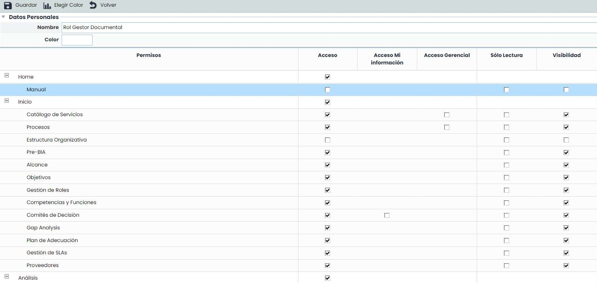
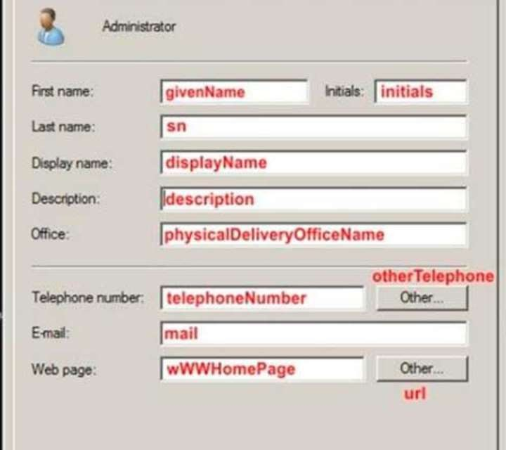

# ¿Cuáles son los tipos de usuarios disponibles?

## Tipos de Usuarios


Esta guía explica los diferentes tipos de usuarios que existen en GlobalSuite®, organizados en dos grandes categorías: \*\*Administradores\*\* (con privilegios de configuración y gestión) y \*\*Usuarios Empresa\*\* (con acceso a la información del sistema de gestión). Además, detalla los perfiles disponibles en cada categoría, la configuración de sub-roles para personalizar accesos y las principales funciones y limitaciones asociadas a cada perfil.


### Categorías de usuarios

GlobalSuite® dispone de varios perfiles de acceso predefinidos, los cuales se dividen en dos categorías principales: Administrador y Usuario Empresa. La principal diferencia entre las dos categorías radica en que los usuarios administradores tienen privilegios para configurar el entorno, mientras que los usuarios de empresa sólo tienen acceso a la información del sistema de gestión.

Para la **categoría** **Administrador**, los 5 tipos de usuario existentes son los siguientes:

* Administrador Plataforma: Se trata del perfil con máximos privilegios. El usuario puede acceder al entorno asignado, gestionar todas las opciones del apartado de Ajustes y gestionar al resto de usuarios Administrador.
* Administrador Enterprise: El usuario puede acceder al entorno asignado y gestionar todas las opciones del apartado de Ajustes. Este usuario tiene privilegios similares al Administrador Plataforma, pero con la salvedad de que no puede crear más usuarios Administrador Enterprise, Administrador Plataforma, Administrador Accesos y Administrador Configuración; por tanto, sólo puede crear y visualizar usuarios con rol Administrador Entidad y con rol de categoría Empresa.
* Administrador Accesos: El usuario únicamente podrá acceder al apartado de Ajustes, limitado a las opciones de "Roles Empresa", "Usuarios", "Logs de Acceso" y "Logs de Acciones". No tiene acceso a la información del sistema de gestión.
* Administrador Configuración: El usuario puede gestionar las opciones del apartado de Ajustes del entorno asignado, a excepción de "Roles Empresa", "Usuarios", "Logs de Acceso" y "Logs de Acciones". No tiene acceso a la información del sistema de gestión.
* Administrador Entidad: El usuario puede acceder a la información del entorno asignado y administrar las opciones de entidades, perfil y usuarios. Este tipo de usuario sólo tiene sentido en empresas con entidades.

Respecto a los usuarios de **categoría Empresa**, existe los siguientes tipos de usuario que permite el acceso a la información de las entidades:

* Enterprise: El usuario puede acceder a toda la información de la entidad asignada (en el desplegable “Empresa/SG” se selecciona la entidad) y no dispone de permisos de administración sobre la misma.
* Entidad: El usuario puede acceder a toda la información de la entidad asignada (en el desplegable “Empresa/SG” se selecciona la entidad) y consolidar información de las entidades que dependan de la entidad (en caso de existir). El usuario no dispone de permisos al apartado de Ajustes. Este tipo de usuario sirve para asignarlo a las personas de la licencia Corporate que tengan privilegios para ver la información de todas las entidades, pero no tengan privilegios para parametrizar metodologías.

### Configuración de Sub-Roles

La configuración se haría a través de la siguiente ruta: Ajustes > [Roles Empresa](https://help.globalsuitesolutions.com/es/globalsuite/v1/roles-de-empresa)

Para ambos tipos de Usuario Empresa (Enterprise y Entidad) se puede asignar un sub-rol para configurar los accesos particulares a cada opción (por defecto, si no tiene sub-rol asignado, el usuario tiene acceso a todas las opciones del sistema de gestión). Para cada opción del menú izquierdo de GlobalSuite® se podrá configurar la visibilidad y los permisos dentro de la opción:

Se puede especificar si se permite o no realizar cambios en la opción Sólo Lectura o si permite utilizar información de la opción marcada, aun cuando no se tenga acceso de gestión a la misma marcando la opción Visibilidad). Ejemplo: desde la opción "Inventario" se pude asignar un "Empleado" como responsable de un Elemento, pero no se quiere que ese usuario tenga acceso a la opción de "Empleados". En ese caso, la opción de "Empleados" tendrá marcado el check de "Acceso", pero no el de "Visibilidad".

Además, para algunas opciones de GlobalSuite® se permite configurar un acceso especial a los datos de los que el usuario es responsable (Acceso a Mi Información).

Por último, existe la opción de parametrizar al usuario para que solo vea los datos que pertenecen al Servicio (opción Inicio – Servicios) donde el usuario que tiene asignado este rol es responsable (Acceso Gerencial). Esta opción de configuración se encuentra disponible para algunas opciones de GlobalSuite®.

### Funciones principales de los usuarios Administrador

Las funciones principales que dispone un usuario Administrador Plataforma de GlobalSuite® son las siguientes:

1. Gestión de usuarios de acceso.
2. Generación de perfiles de acceso.
3. Consulta de logs de accesos y acciones.
4. Modificación de metodología de Riesgos.
5. Modificación de metodología de Controles.
6. Modificación de catálogos de riesgos-controles.
7. Modificación de catálogos de compliance. 8. Modificación de la configuración de CMDB.
8. Modificación de metodología de Continuidad de Negocio.
9. Modificación de Configuración de diferentes aspectos de tickets y eventos de pérdida.
10. Modificación de configuración de ScoreCard.
11. Modificación de modelos de encuestas (BIA, Activos, Riesgos, Controles, Compliance).
12. Asignación de metodologías, catálogos de riesgos, catálogos de cumplimiento y modelos de encuestas a las entidades.
13. Acceso a la información de cualquiera de las entidades.

Las funciones anteriores pueden ser delegadas en un usuario Administrador Enterprise. Las únicas acciones que puede realizar un Administrador Plataforma, que no puede realizar un usuario Administrador Enterprise, son las siguientes:

Creación de usuarios Administrador Enterprise

Configuración del gestor documental (activación/desactivación del workflow)

Configuración de aspectos técnicos de la plataforma (configuración del SMTP para el envío del correo, establecimiento del logo y activación/desactivación del log de acciones)

Por otro lado, existen otros perfiles de tipo Administrador que pueden hacer algunas de las funciones descritas anteriormente. A continuación, se indica las funciones que puede realizar cada uno de los perfiles:

Administrador Accesos: Puede realizar las funciones 1 - 3.

Administrador Configuración: Puede realizar las funciones 4 – 13.

Administrador Entidad: Puede realizar la función 1 (únicamente creación de usuarios con acceso a una entidad en particular), la función 13 y la función 14.

Por último, comentar que los usuarios de tipo Usuario Empresa, con los 2 tipos Enterprise y Entidad (no administradores) no podrán hacer ninguna de las funciones anteriores, excepto la función 13 que sí pueden realizarla ya que corresponde al acceso a la información de su propia entidad.

