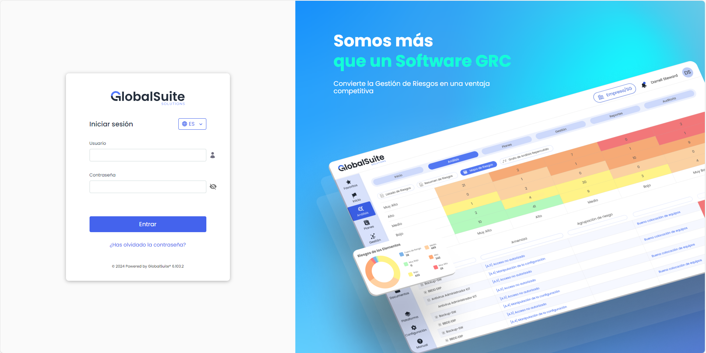
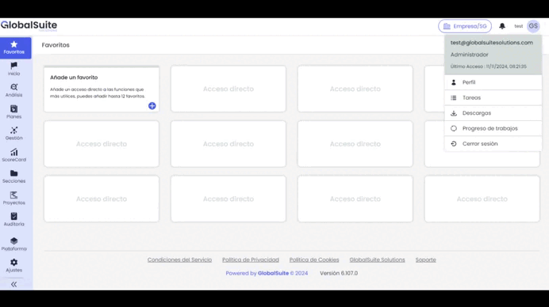

# Descubre los principales cambios de la Nueva Interfaz GlobalSuite

## Nueva interfaz de la solución GlobalSuite® GRC: Modernización, Usabilidad y Futuro Innovador

Desde GlobalSuite Solutions hemos estado a la vanguardia en la gestión del GRC durante muchos años, y ahora nos enorgullece anunciar el próximo lanzamiento de la nueva versión de nuestra solución. Esta versión trae consigo una interfaz renovada, diseñada para mejorar significativamente la experiencia del usuario y, al mismo tiempo, sentar las bases para el futuro de la plataforma.


\*\*¡Descubre las novedades en el próximo webinar!\*\*
Te esperamos el 21 de noviembre para conocer en detalle el nuevo GlobalSuite®.
[Regístrate gratis aquí](https://events.teams.microsoft.com/event/ddfdd2b1-3b57-4d2e-8ff2-7ec44d19a2b2@db6d54ae-b406-4e61-93c7-8585360c3549)


### Objetivo del cambio

Dentro de la estrategia que tenemos marcada como compañía, el principal objetivo de este proyecto es doble: **modernizar nuestra solución** y mejorar la **experiencia de uso** de nuestros clientes.

Además, esta versión es el primer paso de un roadmap que irá ampliando este proyecto estratégico al resto de apartados de GlobalSuite, y contempla la incorporación de mejoras y nuevas funcionalidades innovadoras aprovechando las herramientas que este cambio tecnológico proporciona.

### Beneficios clave de la nueva interfaz

1. **Mejora de la Usabilidad:** La nueva interfaz ha sido diseñada con un enfoque centrado en el usuario. Hemos planteado simplificar la navegación, optimizado la visualización y mejorado el acceso a las opciones más críticas. El resultado es una experiencia más intuitiva y fluida, que permite a los usuarios enfocarse en lo importante: gestionar sus riesgos y adaptar su cumplimiento.
2. **Mayor Eficiencia y Seguridad:** El cambio transversal ha permitido incluir una arquitectura serverless donde se elimina la parte del servidor del cliente web haciéndolo mucho más ligero de tamaño y fácil de desplegar y cargar, reduciendo el tiempo de respuesta. También se ha potenciado el registro de logs que mejoran la trazabilidad y seguridad de la información.
3. **Adaptabilidad y Escalabilidad:** Esta versión no solo se ve mejor y funciona de manera más eficiente, sino que está construida sobre la base de una arquitectura tecnológica más moderna y escalable. Esta arquitectura Clean permite separar las distintas capas del software para dotar al producto de más resiliencia al cambio.
4. **Preparación para el Futuro:** Al renovar la base tecnológica de nuestra solución, hemos trabajado en plantear una base de componentes y sistemas reutilizables que permitan alinear el comportamiento de la solución, y en reducir los tiempos de desarrollo de nuevas mejoras para ponerlas a disposición de nuestros usuarios.

### Principales características

Esta primera actualización, que como indicábamos es un primer paso en la modernización del producto, tiene el siguiente alcance visual:

* **Nueva página de login**: Hemos modernizado el proceso de autenticación en GlobalSuite, simplificándolo y adaptándolo con la imagen corporativa, además de servir como punto de entrada para incorporar avisos. También, hemos mejorado la rapidez de respuesta, independientemente del mecanismo de autenticación que se utilice (usuarios locales, Active Directory, LDAP, ADFS, Azure AD, SAML, etc.), y cubriendo el Doble Factor de Autenticación en el mismo paso de logueo.

  
* **Nueva estructura de menú centralizada en la parte izquierda:** Como parte de la simplificación del interfaz, hemos querido unificar la estructura de apartados, bloques y opciones que componen los distintos módulos de GlobalSuite, disponiendo esta estructura jerárquica de forma completa en un lateral, eliminando la agrupación por pestañas que teníamos antes.  
  Incluso el apartado de Administración, que ahora pasa a llamarse Ajustes, lo hemos incorporado en este menú.

  
* **Nuevo apartado de Usuario:** Otro cambio que permite agilizar la estructura con las opciones específicas del usuario. Apartados como Mi Perfil, Fecha de última conexión, Descargas Pendientes, Tareas… estarán accesibles en el área superior.

  
* **Mejoras de navegación, aprovechamiento de pantalla y reducción de espacio:** El menú lateral en dos niveles de Apartados y Opciones, puede estar compacto, expandido o completamente fijado para tenerlo siempre visible. Además, ahora puedes localizar y moverte a cualquier opción del menú a través del buscador incorporado en el mismo.

* **Nueva opción de Favoritos:** Para poder entrar de forma rápida a las principales opciones de trabajo, hemos incorporado una vista de Favoritos. Aquí cada usuario podrá añadir las funcionalidades que quiera tener a mano, a modo de accesos directos, independientemente de la estructura del menú o que se encuentren en distintos apartados.  
  Además, para los usuarios organizativos y consultores, que trabajan con distintos clientes, estos Favoritos podrán ser diferentes para cada entorno al que acceda.

* **Nueva pantalla centralizada para Elegir Empresa y Sistema de Gestión**: Hemos fusionado los menús clásicos de “*Elegir SG*” y “*Elegir Cliente*” que existían para acceder a distintas empresas, áreas de partner, o incluso distintas Entidades dentro de una misma licencia. Y estará disponible en todo momento en la cabecera de la interfaz, permitiendo cambiar de forma rápida, y aprovechando los nuevos mecanismos de filtrado que hemos incorporado.

### Próximos pasos

Esta primera versión es sólo el comienzo de una transformación más amplia que va a abarcar las diferentes opciones y módulos funcionales de GlobalSuite GRC.

El objetivo es continuar aplicando esta nueva interfaz renovada a los distintos apartados, ofreciendo una apariencia común y una experiencia de usuario mejorada en toda la aplicación.

Paralelamente, continuaremos introduciendo mejoras de rendimiento y nuevas funcionalidades que van a potenciar aún más el uso de nuestra solución, permitiendo que nuestros clientes puedan gestionar su GRC con mayor agilidad y eficacia.

### Para terminar

Esperamos que esta nueva versión de GlobalSuite GRC permita mejorar la interacción de los usuarios y la adopción de nuestros clientes, y cumpla con las expectativas que tienen con una solución cuyo objetivo es facilitar el Gobierno, los Riesgos y el cumplimiento de sus organizaciones.

Estaremos muy atentos al feedback que recibamos, y que aprovecharemos para seguir mejorando el producto, y continuando con nuestro compromiso constante con las necesidades de nuestros clientes y que nos permite continuar siendo un referente tecnológico en el ámbito del GRC.

## Vídeos


Ajustes_menu.mp4



Favoritos_GS.mp4



Nueva Interfaz GlobalSuite.mp4



buscador-menu.mp4

